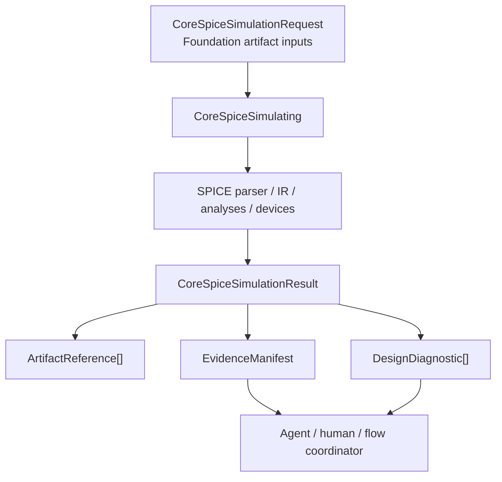
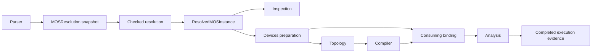

# CoreSpice Design Contract

## Purpose and Scope

This directory is both the package and system root for CoreSpice. The parent is
the [LSI system design](../DESIGN.md). Device implementation contracts are owned
by the [CoreSpiceDevices module](Sources/CoreSpiceDevices/DESIGN.md).

## Responsibilities and Boundaries

CoreSpice is the independently usable simulation domain package. It owns
SPICE parsing and lowering, circuit IR, device models, numerical analyses,
optoelectronic co-simulation, photonic GPU execution, waveform conversion, and
SPICE-compatible I/O.

The package uses the exact Swift 6.4.0 release toolchain and macOS 27 or later.
Native preparation transfers noncopyable device owners through the standard
library's `UniqueArray`; this availability requirement propagates to direct
and transitive host consumers. Pure MOS targets are independently verified
with the matching ordinary and Embedded WebAssembly SDKs.

It does not own project state, flow ordering, tool trust, human approval, or
physical signoff semantics.

## CircuiteFoundation integration

The package depends on `CircuiteFoundation` and uses its types directly from
the `CoreSpice` target. Clients import `CircuiteFoundation` explicitly when
they use the shared boundary, which is intentionally small:

- `CoreSpiceSimulationRequest` carries digest-bearing input
  `ArtifactReference` values and optional configuration, revision, and random
  seed digests.
- `CoreSpiceSimulationResult` carries output artifacts, typed diagnostics, and
  an `EvidenceManifest` built from caller-supplied `ExecutionProvenance`.
- `CoreSpiceSimulating` refines `CircuiteFoundation.Engine` for an
  asynchronous simulation entry point.

The existing analysis types and synchronous setup APIs remain domain-owned.
They are composed through the injected executor, but their numerical
algorithms must not move into Foundation and must not silently invent artifact
digests or provenance.

## Ownership boundary

| Concern | Owner |
|---|---|
| Artifact, provenance, evidence, and diagnostic vocabulary | CircuiteFoundation |
| SPICE syntax, netlist lowering, circuit IR | CoreSpice |
| Device physics and numerical solvers | CoreSpice |
| Waveform serialization and SPICE-compatible formats | CoreSpice |
| Process timeout and external tool cleanup | SignoffToolSupport |
| Tool qualification and trust gates | ToolQualification / DesignFlowKernel |
| Project/run persistence and human approval | Xcircuite / DesignFlowKernel |
| DRC, LVS, PEX, STA, EM/IR, and physical signoff rules | Domain signoff engines |

## Related Designs

| Design | Relationship | Contract Used | Summary | Cautions |
|---|---|---|---|---|
| [LSI](../DESIGN.md) | parent | Simulation domain ownership | Platform composition | Numerical evidence is not signoff approval |
| [CoreSpiceParsedIR](Sources/CoreSpiceParsedIR/DESIGN.md) | child | Ordered parsed numeric vectors | SPICE source identity | Scalar consumers reject vectors |
| [CoreSpiceIO](Sources/CoreSpiceIO/DESIGN.md) | child | Explicit transient caller policy | Typed and CLI intent | Missing limits fail before execution |
| [CoreSpice module](Sources/CoreSpice/DESIGN.md) | child | Artifact backend and native prepared execution | Domain dispatch composition | Prepared native execution has bounded CPU/runtime evidence; physical qualification remains separate |
| [CoreSpiceIR](Sources/CoreSpiceIR/DESIGN.md) | child | Canonical model and node ownership | Lossless circuit values | Revalidate direct consumers |
| [CoreSpiceParserSPICE](Sources/CoreSpiceParserSPICE/DESIGN.md) | child | Exact SPICE syntax and quoted-value role preservation | Parser-owned syntax contract | Revalidate direct consumers and serialization |
| [CoreSpiceParser](Sources/CoreSpiceParser/DESIGN.md) | child | Source-document and resolver contracts | Atomic selected path/content identity | Revalidate include/library and memory adapters |
| [CoreSpiceCLICore](Sources/CoreSpiceCLI/DESIGN.md) | child | Completed phase evidence and explicit case output | Direct developer execution | Baseline binding does not prove sweep or Monte Carlo execution |
| [CoreSpiceMOSContracts](Sources/CoreSpiceMOSContracts/DESIGN.md) | child | Explicit MOS input profiles, exact release/schema and staged values | Portable semantic dependency floor | Selection is distinct from preparation and physical qualification |
| [CoreSpiceMOSResolution](Sources/CoreSpiceMOSResolution/DESIGN.md) | child | Immutable declaration snapshot and checked one-evaluation resolution | Independent scoped MOS interpretation | No numerical device/kernel dependency |
| [CoreSpiceLowering](Sources/CoreSpiceLowering/DESIGN.md) | child | Parsed declaration/program projection and circuit lowering | Source-preserving adapter to MOS resolution | Device preparation belongs to execution composition |
| [CoreSpiceCompile](Sources/CoreSpiceCompile/DESIGN.md) | child | Auxiliary sparse topology | CPU solver structure | Revalidate direct consumers |
| [CoreSpiceWaveform](Sources/CoreSpiceWaveform/DESIGN.md) | child | Opaque result-storage retention and waveform views | Export value lifetime | Numerical conversion and IO projection retain the admitted owner |
| [CoreSpiceAnalysis](Sources/CoreSpiceAnalysis/DESIGN.md) | child | Fallible stamps and session lifetime | Numerical execution | Revalidate direct consumers |
| [CoreSpiceDevices](Sources/CoreSpiceDevices/DESIGN.md) | child | Bound-device stamping | Native electrical models | Revalidate affected analyses when device derivatives change |
| [CoreSpiceCompactModels](Sources/CoreSpiceCompactModels/DESIGN.md) | child | Safe compact-model evaluation | Independent native BSIM3 kernel | Production selection is separately verified by Devices BSIM3 |
| [CoreSpiceBSIM3](Sources/CoreSpiceBSIM3/DESIGN.md) | child | Private physics ABI | Official Berkeley model equations | The safe evaluator owns exclusive lifetime |

## Architecture

The request-to-domain-to-evidence diagram above describes package composition.
Native devices depend on IR and event types; analyses consume their stamps.

## Contracts and Invariants

PDK declaration intake, semantic model/geometry admission, numerical execution
and physical qualification are distinct boundaries. The target PDK contracts are
owned by [IO](Sources/CoreSpiceIO/DESIGN.md),
[Lowering](Sources/CoreSpiceLowering/DESIGN.md),
[native resistors](Sources/CoreSpiceDevices/Devices/DESIGN.md#resistor-execution-contract)
and [exact BSIM4 release admission](Sources/CoreSpiceCompactModels/BSIM4/DESIGN.md#exact-release-admission).
These contracts record current gaps; they do not assert completed Sky130 support.
The [CLI](Sources/CoreSpiceCLI/DESIGN.md) owns receipts generated from actual
selected/bound models. Trust and application criteria remain with
[ToolQualification](../ToolQualification/DESIGN.md) and their domain/application
authorities. Loaded declarations cannot supply executed-model coverage.

Native L3 MOS DC, AC, and transient analyses use the same device current and its
linearization. A non-finite numerical result is a failure, never completed
simulation evidence. L3 binding rejects unsupported parameter domains.

## MOS Boundary Migration

The approved migration fixes one semantic authority: source declarations become an
immutable snapshot; checked resolution determines an exact declaration, release,
schema and normalized supplied values. Devices prepares that result once for
explicit execution conditions. Preparation supplies auxiliary topology before the
existing compiler, and the prepared owner is consumed by binding. Resolution is
reusable; an executable owner belongs to one run. The solver algorithm is unchanged.

The [MOS requirement/evidence index](docs/mos-boundary-requirements.md) links
R01–R35 to their owners, tests and scoped cumulative verification. Workspace
PROGRESS.md, B8.6.5.18, owns task completion, including the final commit.
The semantic contracts and their local counterexamples are owned by MOSContracts
and MOSResolution. Parser owns source retention, Lowering owns the
adapter, Devices owns preparation and executable lifetime, and the native/CLI
composition owns complete run ordering. Each owner design records its local
requirement mapping. BSIM4.5 inspection must succeed independently of executable
support; numerical preparation must reject that exact unsupported release.
No loaded or selected declaration is counted as executed model coverage.

## Verification and Change Impact

Device numerical changes require local current/Jacobian tests and actual affected
analysis execution. See the device module for its owned behavioral evidence.
The Metal backend qualification below applies only to GPU execution changes.

## Deliberate non-goals

- `CoreSpice` does not become a project or run ledger.
- `CoreSpice` does not qualify an external simulator, PDK, or foundry deck.
- Foundation does not contain SPICE-specific requests, waveform types, or
  device models.
- A simulation result is evidence for review; it is not a signoff approval.

## Concrete engine boundary

`CoreSpiceSimulator` is the concrete domain engine and directly conforms to
`CoreSpiceSimulating`. It delegates numerical execution to an injected
`CoreSpiceSimulationBackend`
implementation, checks cooperative cancellation, records the request inputs
and execution-supplied invocation/environment fields in `ExecutionProvenance`, and exposes verified
artifact references and structured diagnostics from the execution.

The injected backend remains responsible for parsing, analysis selection,
artifact materialization, artifact verification, and typed domain errors.
CLI and I/O surfaces expose only the current contract; obsolete compatibility
paths are removed during development.

## CLI artifact boundary

JSON-mode CLI operations expose domain records rather than a generic result
envelope. `CoreSpiceCLIBatchRunRecord` contains the materialized deck under
`inputArtifacts` and every emitted waveform or coverage report under
`outputArtifacts`. `CoreSpiceCLIMeasurementRunRecord` references the exact CSV
that was measured. All references use `CircuiteFoundation.ArtifactReference`;
output references identify CoreSpiceCLI as their producer, and every reference
is created only after the file exists so its digest and byte count describe the
materialized bytes. Both records include `ExecutionInvocation`, preserving the
executable, arguments, and working directory needed to replay the operation.

## Metal execution verification

[MetalBackendExecutionTests](Tests/CoreSpiceBackendTests/MetalBackendExecutionTests.swift)
requires an actual Metal device, compiles the production photonic library, dispatches
the production even-layer kernel and checks its swapped complex amplitudes plus
untouched state. Device absence fails qualification rather than skipping it. Run
this owner through `xcodebuild test-without-building` after `build-for-testing`,
with the exact `CoreSpiceBackendTests/MetalBackendExecutionTests/dispatchesProductionEvenLayer()`
selector and a bounded process. CPU-only, compile and kernel-load checks do not
prove GPU execution. Test-owned shared buffers remain alive until the awaited
dispatch completes and are returned to the backend pool on all exit paths.

## BSIM4 Kernel Composition

[BSIM4 standalone kernel](Sources/CoreSpiceBSIM4/DESIGN.md) owns exact Berkeley 4.8.3 host CPU evaluation. This lower
contract is composed by [BSIM4 Devices](Sources/CoreSpiceDevices/BSIM4/DESIGN.md)
under explicit caller preparation policy and noise-dependent topology intent. [CLI](Sources/CoreSpiceCLI/DESIGN.md) owns execution provenance.

### Exact caller-owned SPICE source intake

[IO](Sources/CoreSpiceIO/DESIGN.md#caller-owned-exact-source-intake) composes
full `ArtifactReference` bindings and immutable checked bytes with the ordinary
SPICE grammar. [ParsedIR](Sources/CoreSpiceParsedIR/DESIGN.md#exact-source-dependency-values)
owns portable dependency/work evidence; [ParserSPICE](Sources/CoreSpiceParserSPICE/DESIGN.md#exact-profile-dependency-and-work-contract)
owns active grammar events and cooperative parsing; [Parser](Sources/CoreSpiceParser/DESIGN.md#cooperative-library-projection)
owns location-preserving projection. No target depends on PDKKit. Native exact
intake and ordinary parser/IO behavioral tests establish only source admission,
not numerical support, foundry qualification or cross-platform execution.

### Designed bounded profile source boundary

Status: designed, not implemented. Existing exact loader proves post-resolution
expected-graph comparison and finite work counts; it does not prove pre-await
contextual authorization or retained/temporary byte capacity. The next lower
contract composes [ParsedIR owned storage/occurrences](Sources/CoreSpiceParsedIR/DESIGN.md#bounded-source-storage-and-occurrence-values),
[Parser contextual source/environment](Sources/CoreSpiceParser/DESIGN.md#bounded-contextual-source-contract),
[ParserSPICE bounded grammar](Sources/CoreSpiceParserSPICE/DESIGN.md#bounded-profile-grammar)
and [IO Span intake/proof sprints](Sources/CoreSpiceIO/DESIGN.md#bounded-profile-source-intake).
It supports exact-approved and candidate-discovery providers using the same actual
grammar, without requiring a whole expected graph. The optional PDK adapter owns
PDK approval/availability; CoreSpice owns actual parser context and storage.
This adds no PDK dependency, numerical qualification, new allocator or implicit
filesystem fallback. Source design/proof does not change model physics or Engine.

### MOS input-admission finding closure

The [frontend contract](Sources/CoreSpiceLowering/Frontend/DESIGN.md#mos-source-admission-repairs)
and [declaration intake](Sources/CoreSpiceMOSResolution/Declarations/DESIGN.md#non-scalar-model-input-admission)
own non-scalar coefficient refusal and global width-selection transport. Public
source callers use those shared contracts; Devices and solver algorithms do not
interpret source options or repair omitted invalid coefficients.

### MOS boundary regression and performance closure

The parser rejects malformed model fields before declaration publication; native
preparation separates its IR/MOS reservation from exact-topology compile admission.
Their owning contracts are [parser](Sources/CoreSpiceParserSPICE/DESIGN.md#mos-declaration-intake)
and [native execution](Sources/CoreSpice/NativeExecution/DESIGN.md#incremental-result-capacity-ownership).
The reproducible [MOS boundary benchmark](Benchmarks/MOSBoundary/DESIGN.md) owns
calibrated allocation/copy API measurements and their scope; it creates no new
physical-model or portable numerical qualification.
