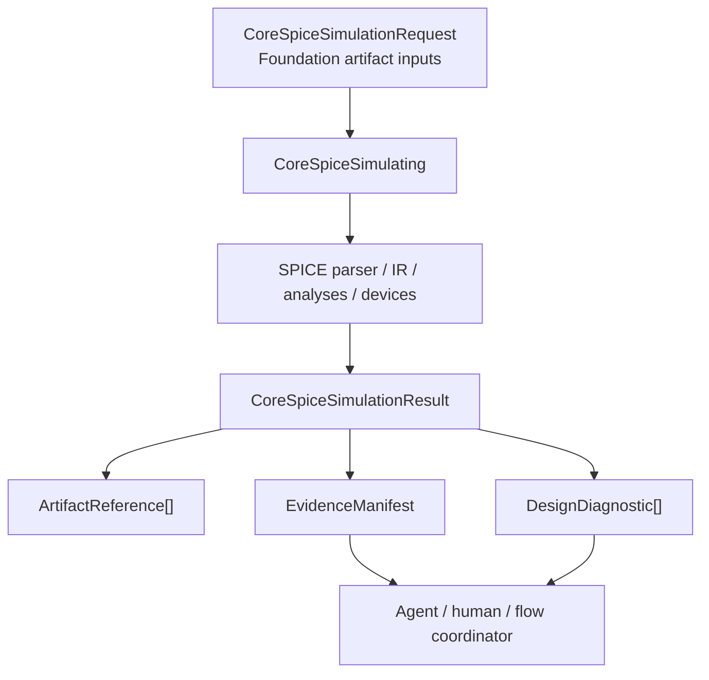
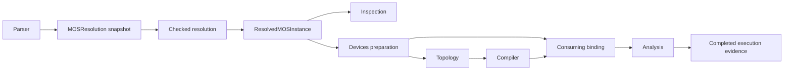
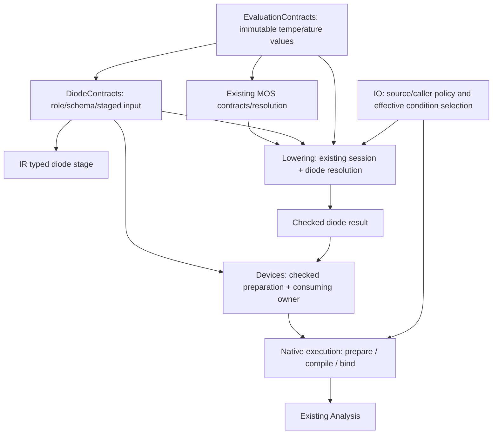

# CoreSpice Design Contract

## Purpose and Scope

This directory is both the package and system root for CoreSpice. The parent is
the [LSI system design](../DESIGN.md). Device implementation contracts are owned
by the [CoreSpiceDevices module](Sources/CoreSpiceDevices/DESIGN.md).

## Responsibilities and Boundaries

CoreSpice is the independently usable simulation domain package. It owns
SPICE parsing and lowering, circuit IR, device models, numerical analyses,
optoelectronic co-simulation, photonic GPU execution, waveform conversion, and
SPICE-compatible I/O.

The package uses the exact Swift 6.4.0 release toolchain and macOS 27 or later.
Native preparation transfers noncopyable device owners through the standard
library's `UniqueArray`; this availability requirement propagates to direct
and transitive host consumers. Pure MOS targets are independently verified
with the matching ordinary and Embedded WebAssembly SDKs.

It does not own project state, flow ordering, tool trust, human approval, or
physical signoff semantics.



## Finite prerequisite source publication

This candidate conveys the tracked source tree of
`39443965441b175f57198a1d98706895f5453280` with sole public parent
`cfcadac5aeff5d95681d2d91c0bf3e75bd35f169`. Production source, tests, resources,
package products and build-control files retain their selected identities.
Only these owning publication notes and the fresh resolved-lock origin hash are
candidate-specific changes. Private intermediate ancestry, local availability
mirrors, untracked documents and verification outputs are not published source.

| Boundary | Qualification and remaining obligation |
|---|---|
| Public source prerequisite | Exact tracked-tree/mode comparison, a clean six-dependency public graph, focused Native fixtures, and a separately linked public consumer |
| Conditional Flow | The [Native Flow owner](Sources/CoreSpice/NativeExecution/PrescribedVoltageFlow/DESIGN.md) defines checked initial/window/Picard scope, almost-everywhere rates, retained source/model bindings, limits and cleanup |
| Physical composition | A downstream actual producer must establish candidate, PEX, model, power/ground, numeric rail and common source-family correspondence; a caller label or copied receipt does not supply it |
| Complete release | Common-family nonemptiness, unrestricted all-phase/all-history composition and remaining production gates are not established by this source publication |

Existing evidence remains limited to its exact source, backend, inputs and
conditions. No unchanged whole-package or external-model qualification is
implicitly rerun or enlarged here. The thirteen selected products and explicit
OSDI compact-model boundary remain intact; no retired model product is restored.
Distribution is [source-only](docs/distribution-licensing.md), retaining original
MIT and incorporated GPL/BSD notices and the exact dependency inventory. It does
not bundle executables, model/compiler images, precision workers or GMP/MPFR.

## CircuiteFoundation integration

The package depends on `CircuiteFoundation` and uses its types directly from
the `CoreSpice` target. Clients import `CircuiteFoundation` explicitly when
they use the shared boundary, which is intentionally small:

- `CoreSpiceSimulationRequest` carries digest-bearing input
  `ArtifactReference` values and optional configuration, revision, and random
  seed digests.
- `CoreSpiceSimulationResult` carries output artifacts, typed diagnostics, and
  an `EvidenceManifest` built from caller-supplied `ExecutionProvenance`.
- `CoreSpiceSimulating` refines `CircuiteFoundation.Engine` for an
  asynchronous simulation entry point.

The existing analysis types and synchronous setup APIs remain domain-owned.
They are composed through the injected executor, but their numerical
algorithms must not move into Foundation and must not silently invent artifact
digests or provenance.

## Ownership boundary

| Concern | Owner |
|---|---|
| Artifact, provenance, evidence, and diagnostic vocabulary | CircuiteFoundation |
| SPICE syntax, netlist lowering, circuit IR | CoreSpice |
| Circuit equations, elementary device laws and numerical solvers | CoreSpice |
| Compact-model physics and model-local derivatives | Official model / external compiler through swift-osdi |
| Waveform serialization and SPICE-compatible formats | CoreSpice |
| Process timeout and external tool cleanup | SignoffToolSupport |
| Tool qualification and trust gates | ToolQualification / DesignFlowKernel |
| Project/run persistence and human approval | Xcircuite / DesignFlowKernel |
| DRC, LVS, PEX, STA, EM/IR, and physical signoff rules | Domain signoff engines |

## Sole Compact-Model Boundary and Retired Physics

The adopted model boundary is [swift-osdi](../swift-osdi/DESIGN.md), consumed by
[CoreSpiceOSDI](Sources/CoreSpiceOSDI/DESIGN.md). Official Verilog-A models and
external OpenVAF-generated evaluation code own compact-model physics. Those
external implementations need not be Swift. CoreSpice owns circuit assembly,
sparse solution, Newton iteration, integration, analyses and artifacts in Swift;
model equations are not duplicated in Swift or in an embedded C kernel.

```text
Official model -> external compiler -> OSDI artifact -> swift-osdi
    -> CoreSpice model projection -> Swift circuit equations/solvers/analyses
    -> exact API/CLI artifacts
```

The obsolete native BSIM3, BSIM4.5, BSIM4.8.3 kernels, custom Swift compact-model
wrappers, source-specific enclosure, registration, schemas and execution records
are removed together. Classic MOS L1/L2/L3 and other built-in elementary devices
are separate responsibilities. A former BSIM level/version without an explicit
OSDI binding fails with its original source location. It is never reinterpreted
as a classic MOS device or another model release.

Historical verification receipts and Git history remain historical evidence;
they do not make a removed backend available or qualify a new model. The same
rule applies to the old Sky130 native capture and its PVT/enclosure exports.
Required Sky130 execution must obtain an exact independently admitted OSDI model
binding for the original PDK equations; modern BSIM-BULK cards are not a substitute.
The [RangeExecution contract](Sources/CoreSpiceOSDI/RangeExecution/DESIGN.md)
owns the remaining causal-model obligations.

The Pure Swift numerical boundary is a requirement, not a completion claim:
existing Newton vDSP operations and the pole/zero LAPACK pencil path must be
replaced and behaviorally qualified before this package meets that boundary.
External model workers and optional Metal/photonic execution remain explicitly
separate capabilities.

The electrical `CoreSpice`, `CoreSpiceAnalysis` and CLI targets do not depend on
or reexport the photonic backend. `CoreSpiceBackend` is an explicit optional
product, and `PluginsPhotonic` keeps its existing dependency on that backend and
its Metal ABI types. Clients using GPU types select that product and import its
module explicitly. Removing an unused electrical dependency does not remove or
qualify the optional GPU implementation.

```text
CoreSpice / CLI -> Swift Analysis -> Swift sparse Compile
               -> swift-osdi -> external official-model image
PluginsPhotonic -> optional CoreSpiceBackend -> Metal / SharedTypes
```

Standard-library/runtime memory operations and scalar math facilities are distinct
from delegation of the owned circuit, sparse-solver and QZ algorithms. No external
circuit solver becomes the native default through this separation.


## Related Designs

| Design | Relationship | Contract Used | Summary | Cautions |
|---|---|---|---|---|
| [LSI](../DESIGN.md) | parent | Simulation domain ownership | Platform composition | Numerical evidence is not signoff approval |
| [CoreSpiceParsedIR](Sources/CoreSpiceParsedIR/DESIGN.md) | child | Ordered parsed numeric vectors | SPICE source identity | Scalar consumers reject vectors |
| [CoreSpiceIO](Sources/CoreSpiceIO/DESIGN.md) | child | Explicit transient caller policy | Typed and CLI intent | Missing limits fail before execution |
| [CoreSpice module](Sources/CoreSpice/DESIGN.md) | child | Artifact backend and native prepared execution | Domain dispatch composition | Prepared native execution has bounded CPU/runtime evidence; physical qualification remains separate |
| [CoreSpiceIR](Sources/CoreSpiceIR/DESIGN.md) | child | Canonical model and node ownership | Lossless circuit values | Revalidate direct consumers |
| [CoreSpiceParserSPICE](Sources/CoreSpiceParserSPICE/DESIGN.md) | child | Exact SPICE syntax and quoted-value role preservation | Parser-owned syntax contract | Revalidate direct consumers and serialization |
| [CoreSpiceParser](Sources/CoreSpiceParser/DESIGN.md) | child | Source-document and resolver contracts | Atomic selected path/content identity | Revalidate include/library and memory adapters |
| [CoreSpiceCLICore](Sources/CoreSpiceCLI/DESIGN.md) | child | Completed phase evidence and explicit case output | Direct developer execution | Baseline binding does not prove sweep or Monte Carlo execution |
| [CoreSpiceMOSContracts](Sources/CoreSpiceMOSContracts/DESIGN.md) | child | Explicit MOS input profiles, exact release/schema and staged values | Portable semantic dependency floor | Selection is distinct from preparation and physical qualification |
| [CoreSpiceMOSResolution](Sources/CoreSpiceMOSResolution/DESIGN.md) | child | Immutable declaration snapshot and checked one-evaluation resolution | Independent scoped MOS interpretation | No numerical device/kernel dependency |
| [CoreSpiceLowering](Sources/CoreSpiceLowering/DESIGN.md) | child | Parsed declaration/program projection and circuit lowering | Source-preserving adapter to MOS resolution | Device preparation belongs to execution composition |
| [CoreSpiceCompile](Sources/CoreSpiceCompile/DESIGN.md) | child | Auxiliary sparse topology | CPU solver structure | Revalidate direct consumers |
| [CoreSpiceWaveform](Sources/CoreSpiceWaveform/DESIGN.md) | child | Opaque result-storage retention and waveform views | Export value lifetime | Numerical conversion and IO projection retain the admitted owner |
| [CoreSpiceAnalysis](Sources/CoreSpiceAnalysis/DESIGN.md) | child | Fallible stamps and session lifetime | Numerical execution | Revalidate direct consumers |
| [CoreSpiceDevices](Sources/CoreSpiceDevices/DESIGN.md) | child | Bound-device stamping | Native electrical models | Revalidate affected analyses when device derivatives change |

| [EvaluationContracts](Sources/CoreSpiceEvaluationContracts/DESIGN.md) | child | Frozen temperature values | Shared evaluation dependency floor | No evaluator or Devices dependency |
| [DiodeContracts](Sources/CoreSpiceDiodeContracts/DESIGN.md) | child | Typed diode roles and preparation stages | Independent input schema | No Level3 numerical claim |

## Architecture

The request-to-domain-to-evidence diagram above describes package composition.
Native devices depend on IR and event types; analyses consume their stamps.

## Contracts and Invariants

PDK declaration intake, semantic model/geometry admission, numerical execution
and physical qualification are distinct boundaries. The target PDK contracts are
owned by [IO](Sources/CoreSpiceIO/DESIGN.md),
[Lowering](Sources/CoreSpiceLowering/DESIGN.md),
[native resistors](Sources/CoreSpiceDevices/Devices/DESIGN.md#resistor-execution-contract)
and [exact OSDI preparation](Sources/CoreSpiceOSDI/Preparation/DESIGN.md).
These contracts record current gaps; they do not assert completed Sky130 support.
The [CLI](Sources/CoreSpiceCLI/DESIGN.md) owns receipts generated from actual
selected/bound models. Trust and application criteria remain with
[ToolQualification](../ToolQualification/DESIGN.md) and their domain/application
authorities. Loaded declarations cannot supply executed-model coverage.

Native L3 MOS DC, AC, and transient analyses use the same device current and its
linearization. A non-finite numerical result is a failure, never completed
simulation evidence. L3 binding rejects unsupported parameter domains.

## MOS Boundary Migration

The approved migration fixes one semantic authority: source declarations become an
immutable snapshot; checked resolution determines an exact declaration, release,
schema and normalized supplied values. Devices prepares that result once for
explicit execution conditions. Preparation supplies auxiliary topology before the
existing compiler, and the prepared owner is consumed by binding. Resolution is
reusable; an executable owner belongs to one run. The solver algorithm is unchanged.



The semantic contracts and their local counterexamples are owned by MOSContracts
and MOSResolution. Parser owns source retention, Lowering owns the
adapter, Devices owns preparation and executable lifetime, and the native/CLI
composition owns complete run ordering. Each owner design records its local
requirement mapping. Native MOS intake is restricted to classic L1/L2/L3; compact
models use the separate exact OSDI binding and preparation contract.
No loaded or selected declaration is counted as executed model coverage.

## Verification and Change Impact

Device numerical changes require local current/Jacobian tests and actual affected
analysis execution. See the device module for its owned behavioral evidence.
The Metal backend qualification below applies only to GPU execution changes.

## Deliberate non-goals

- `CoreSpice` does not become a project or run ledger.
- `CoreSpice` does not qualify an external simulator, PDK, or foundry deck.
- Foundation does not contain SPICE-specific requests, waveform types, or
  device models.
- A simulation result is evidence for review; it is not a signoff approval.

## Concrete engine boundary

`CoreSpiceSimulator` is the concrete domain engine and directly conforms to
`CoreSpiceSimulating`. It delegates numerical execution to an injected
`CoreSpiceSimulationBackend`
implementation, checks cooperative cancellation, records the request inputs
and execution-supplied invocation/environment fields in `ExecutionProvenance`, and exposes verified
artifact references and structured diagnostics from the execution.

The injected backend remains responsible for parsing, analysis selection,
artifact materialization, artifact verification, and typed domain errors.
CLI and I/O surfaces expose only the current contract; obsolete compatibility
paths are removed during development.

## CLI artifact boundary

JSON-mode CLI operations expose domain records rather than a generic result
envelope. `CoreSpiceCLIBatchRunRecord` contains the materialized deck under
`inputArtifacts` and every emitted waveform or coverage report under
`outputArtifacts`. `CoreSpiceCLIMeasurementRunRecord` references the exact CSV
that was measured. All references use `CircuiteFoundation.ArtifactReference`;
output references identify CoreSpiceCLI as their producer, and every reference
is created only after the file exists so its digest and byte count describe the
materialized bytes. Both records include `ExecutionInvocation`, preserving the
executable, arguments, and working directory needed to replay the operation.

## Metal execution verification

[MetalBackendExecutionTests](Tests/CoreSpiceBackendTests/MetalBackendExecutionTests.swift)
requires an actual Metal device, compiles the production photonic library, dispatches
the production even-layer kernel and checks its swapped complex amplitudes plus
untouched state. Device absence fails qualification rather than skipping it. Run
this owner through `xcodebuild test-without-building` after `build-for-testing`,
with the exact `CoreSpiceBackendTests/MetalBackendExecutionTests/dispatchesProductionEvenLayer()`
selector and a bounded process. CPU-only, compile and kernel-load checks do not
prove GPU execution. Test-owned shared buffers remain alive until the awaited
dispatch completes and are returned to the backend pool on all exit paths.

## Exact Source Intake

### Exact caller-owned SPICE source intake

[IO](Sources/CoreSpiceIO/DESIGN.md#caller-owned-exact-source-intake) composes
full `ArtifactReference` bindings and immutable checked bytes with the ordinary
SPICE grammar. [ParsedIR](Sources/CoreSpiceParsedIR/DESIGN.md#exact-source-dependency-values)
owns portable dependency/work evidence; [ParserSPICE](Sources/CoreSpiceParserSPICE/DESIGN.md#exact-profile-dependency-and-work-contract)
owns active grammar events and cooperative parsing; [Parser](Sources/CoreSpiceParser/DESIGN.md#cooperative-library-projection)
owns location-preserving projection. No target depends on PDKKit. Native exact
intake and ordinary parser/IO behavioral tests establish only source admission,
not numerical support, foundry qualification or cross-platform execution.


### Designed bounded profile source boundary

Status: designed, not implemented. Existing exact loader proves post-resolution
expected-graph comparison and finite work counts; it does not prove pre-await
contextual authorization or retained/temporary byte capacity. The next lower
contract composes [ParsedIR owned storage/occurrences](Sources/CoreSpiceParsedIR/DESIGN.md#bounded-source-storage-and-occurrence-values),
[Parser contextual source/environment](Sources/CoreSpiceParser/DESIGN.md#bounded-contextual-source-contract),
[ParserSPICE bounded grammar](Sources/CoreSpiceParserSPICE/DESIGN.md#bounded-profile-grammar)
and [IO Span intake/proof sprints](Sources/CoreSpiceIO/DESIGN.md#bounded-profile-source-intake).
It supports exact-approved and candidate-discovery providers using the same actual
grammar, without requiring a whole expected graph. The optional PDK adapter owns
PDK approval/availability; CoreSpice owns actual parser context and storage.
This adds no PDK dependency, numerical qualification, new allocator or implicit
filesystem fallback. Source design/proof does not change model physics or Engine.

### MOS input-admission finding closure

The [frontend contract](Sources/CoreSpiceLowering/Frontend/DESIGN.md#mos-source-admission-repairs)
and [declaration intake](Sources/CoreSpiceMOSResolution/Declarations/DESIGN.md#non-scalar-model-input-admission)
own non-scalar coefficient refusal and global width-selection transport. Public
source callers use those shared contracts; Devices and solver algorithms do not
interpret source options or repair omitted invalid coefficients.

### MOS boundary regression and performance closure

The parser rejects malformed model fields before declaration publication; native
preparation separates its IR/MOS reservation from exact-topology compile admission.
Their owning contracts are [parser](Sources/CoreSpiceParserSPICE/DESIGN.md#mos-declaration-intake)
and [native execution](Sources/CoreSpice/NativeExecution/DESIGN.md#incremental-result-capacity-ownership).

## Fixed Native Dependency Lock

The repository tracks its root `Package.resolved`. Direct exact requirements
and transitive versions are resolved from published Git objects; normal and
qualification builds use `--force-resolved-versions`. Local edits/overrides are
not final execution evidence. Updating this lock requires actual target build
and public-path regression, with no implicit release/tag or dependency downgrade.

The earlier Native compatibility adoption pinned CircuiteFoundation `c952ac5` and
ToolQualification `4a2f804` in its manifest and root lock. The current graph is
owned by [released OSDI adoption](#migration-scope-and-dependency-authority).
That earlier Foundation change was limited to Linux secure filesystem handling; Native APIs, persisted
schemas and numerical/Metal sources are unchanged. The fixed Swift 6.4.0 build
consumes clean normal checkouts without automatic resolution. The existing diode
operating-point CLI exports a CSV with reloaded input/output content identities
and Kirchhoff current consistency; unsupported series resistance remains an
explicit preparation failure. [Compatibility evidence](../.verification/runs/s3-stageIII-20261013-2e1f3af7/s3m-core-native/proof.json)
records this Native CPU scope and reuses the unchanged `spice07C` proofs without
extending Metal, portable numerical or physical qualification.

## Diode Boundary Design and Implementation Units

Status: D1-D4 implemented; D5 CoreSpice API/CLI admission is implemented by 07C,
with downstream package adoption owned by workspace integration. Designed on 2026-10-12
against f2bd586. This is the
composition authority for the new diode boundary. Existing MOS release/owner and
numerical solver contracts remain in force. Child documents distinguish confirmed
current behavior, new contracts and unavailable physical features.

| Current evidence | Source / actual behavior | Required change owner |
|---|---|---|
| Flattened coefficient/instance maps | NetlistLoweringSession.resolveNonMOS and DiodeDescriptor.bind; model m=0.4 plus instance m=2 fails grading validation | Diode resolution / input schema |
| Ignored geometry and Level3 | Release CLI area=1/2 and js=1e-14/1e-10 return the same current | Input admission / native feature admission |
| Accepted but unused series resistance | BoundDiode.operatingPoint does not use rs; release CLI rs=0/1000 returns -2.48560822992006e-06 A at 0.5 V | Diode numerical capability admission |
| Environment arrives after scalar roots | beginEvaluation resolves root bindings before SPICEAnalysisOptions; scalar temper probe fails while runtime-resistor control succeeds | Existing evaluation engine / IO composition |

D1 registers and implements the two pure SwiftPM targets: [EvaluationContracts](Sources/CoreSpiceEvaluationContracts/DESIGN.md) and
[DiodeContracts](Sources/CoreSpiceDiodeContracts/DESIGN.md). Their dependency direction
is enforced by the manifest and independent verification. D2 adopts the existing evaluator, shared environment and circuit-wide native guard;
D3 source resolution and D4 exact/generic numerical preparation are implemented.
D5 CoreSpice consumers are described below; downstream package adoption remains
a separate integration responsibility. No second evaluator is introduced. Lowering
remains independent of Devices and numerical kernels.

The following diagram is the full D1-D5 target design; D1 adopts EC-to-DC and D2 adopts the evaluation/IR/native temperature edges.
The historical evidence table describes the pre-D1/D2 behavior. D3 replaces
source diode lowering with checked staged input; D4/07N supply numerical owners
and 07C closes CoreSpice public admission and original evidence publication.



| Unit | Responsibility / dependencies | Independent completion evidence |
|---|---|---|
| D1 Contracts/schema | EvaluationContracts and DiodeContracts; no lower implementation dependency | Role/unit/default/domain tables; known vs unknown fields; finite/underflow/identity checks; Native/WASM/Embedded pure runtime |
| D2 Evaluation environment | Existing MOSResolution evaluator + Frontend/IO condition planning and common IR/native condition guard; depends D1 | One memo/RNG across bootstrap/freeze; scalar temper success, indirect cycle refusal, source/caller precedence, no model/local T contamination; MOS/resistor regressions |
| D3 Diode resolution | Lowering/DiodeResolution and parser occurrence admission; depends D1/D2 | Raw-source and direct-ParsedIR counterexamples, exact scope/duplicates, m separation, normalization once, model sharing and independent GPU-free resolver tests |
| D4 Native preparation | Devices/Diode typed owner and minimal correct admitted junction law; depends D1, independently construct checked fixtures without D2/D3 | Identity/temperature/A/M, consuming bind, finite analytic I/G, limits/cancel/cleanup; core rejects breakdown/nonzero Cjo/Tt; generic supports its declared dynamic/breakdown law; both reject unsupported Rs/Pj |
| D5 Public adoption/integration | IR stage/clone transport, NativeExecution batch accounting, IO/API/CLI/downstream consumers; depends D2/D3/D4 | Actual parse->freeze->resolve->prepare->compile->bind->DC/AC/transient/shot-noise under the selected law; no raw descriptor bypass, one setup per diode, failure atomicity and exact diagnostics |

D2 and D4 may be developed independently after D1; they do not share production
files or mutable state. D3 follows the frozen-session contract. D5 owns composition
rather than repeating the lower proofs. Each unit updates its owning design before
implementation, runs timeout-bounded focused tests, receives one complete review
and finding-limited recheck, then a coherent local commit. Adoption updates affected
public consumers/instance clones and exact dependency pins in the same migration,
without a compatibility merge or fallback path.

First native admission deliberately provides no sidewall/Level3, series resistance,
breakdown or charge-physics claim. Recognition/reporting of these features is distinct
from preparation support. Additional physics units must define their exact laws and
independent I/Q/derivative/noise/temperature proofs before capability admission changes.
Original Sky130 Level3 cards remain unchanged and fail precisely; they are never
translated into coreJunctionV1 or counted as successful PDK coverage. The physical-area,
scalm and density rules for that future law require their own original-source study.

### Completion and verification ownership

| Invariant | Owner / falsifying evidence |
|---|---|
| No lost source input or model/instance role collision | ParserSPICE / DiodeResolution: unknown trailing token, duplicate m roles and selected non-scalar field |
| No silent coefficient/feature loss | Diode schema / Devices: unknown zero coefficient, Level3 js, nonzero rs/pj/cjo/tt and requested unsupported analysis |
| Exactly one evaluation/normalization and consistent temperature | Existing evaluator / Environment: draw counts across freeze, scale once, changed-environment mismatch |
| No late model search, raw bind or repeated setup | Diode owner / NativeExecution: typed-stage tests, setup counter and public bypass attempts |
| No partial publication or leaked resources | NativeExecution: budget edge, prepare/compile/bind cancellation and batch failure, reservation transfer/release |
| Physical evaluation matches admitted capability | Devices / Analysis: independent I/G and KCL, AC/transient/noise actual execution; future Q/dQ/dV/BE/trapezoidal proofs before charge support |
| Evidence has the correct scope | IO/API/CLI: resolution, preparation and completed execution results separately recorded; process qualification remains separate |

D5 also records release total input-to-binding/representative-analysis time, peak
retained/temporary capacity, allocations/copies, expression visits and cold setups,
separating cold parsing from snapshot reuse. Structural completion requires zero
late diode model-name searches, repeated same-binding evaluation and repeated
same-execution cold setups, plus no intermediate coefficient-range copies.
Timing improvements require measurements; this design makes no speedup claim.

Current investigation reuses the previous eight source-bound CLI probes and adds
two bounded series-resistance probes. Binary SHA-256:
144816b5cdb49bec82d1953b3a34a8de0aefdb4551e62ec33ed940719a462935.
Both rs cases exited zero with identical current. Existing diode tests exercise flat
binds and capacitance stamps, not this new boundary or full charge conservation;
they must be migrated and strengthened, not treated as completion evidence.
The original boundary-design evidence does not qualify a numerical implementation.
Existing six-row Sky130 MOS evidence remains local to those rows. D1 completion
is recorded separately below.

D1 completion evidence is owned by the
[contract verification runner](validation/diode-contracts/README.md): two isolated
Native suites, public success/refusal probes on Native/normal WASM/Embedded WASM,
registered-target builds and compiler refusal of forged schema, mixed role IDs and
normalized-to-raw geometry. This evidence does not qualify diode numerical physics
or fix the legacy public parse/preparation path; those remain D2-D5.

D2 integrates the existing evaluator's temperature bootstrap/freeze without a new
evaluator target. [Evaluation](Sources/CoreSpiceMOSResolution/Evaluation/DESIGN.md)
owns session continuity; [Frontend](Sources/CoreSpiceLowering/Frontend/DESIGN.md)
owns source/caller root selection; [IR](Sources/CoreSpiceIR/DESIGN.md) transports
the stamp and [native execution](Sources/CoreSpice/NativeExecution/DESIGN.md)
rejects another environment before numerical preparation. D3 consumes that frozen
environment; D4/D5 numerical adoption remains separate.

D2 downstream impact: Xcircuite already consumes the selected session conditions.
Studio currently pins the prior CoreSpice and changes process temperature after
beginEvaluation. D5 must move that override into NetlistTemperaturePolicy before
adopting D2 or the exact environment guard correctly refuses the conflicting edit.
D2 does not update those pinned downstream dependency graphs.

## D3 Change Impact

The [D3 resolution owner](Sources/CoreSpiceLowering/DiodeResolution/DESIGN.md) defines occurrence admission, frozen
evaluation and immutable result transport. D4 preparation and CoreSpice D5
API/CLI adoption are implemented by their owning contracts below; downstream
package graph adoption remains workspace-owned. D3 evidence remains scoped to
source resolution.

## D4 Exact and Generic Diode Preparation

[Preparation values](Sources/CoreSpiceDiodeContracts/Preparation/DESIGN.md),
[Devices Diode](Sources/CoreSpiceDevices/Diode/DESIGN.md), IR, compiler and native
composition provide checked once-resolved preparation. coreDiodeV1 remains the
restricted memoryless profile. genericDiodeV1 preserves the existing generic
breakdown/Cjo/Tt input profile through the same typed owner; the
[07N numerical law](Sources/CoreSpiceDevices/Diode/DESIGN.md#07n-generic-numerical-law)
is verified on the native CPU path. Raw descriptor binding does not authorize either profile.
This preparation sprint does not graduate numerical generic physics, complete CLI
model receipt encoding or process qualification. The [optional process backend](Sources/CoreSpiceProcessBackend/DESIGN.md)
adopts typed SignoffToolSupport failure and cleanup ownership independently of
native numerical execution.

07N qualifies the generic diode numerical law through the
[owning diode contract](Sources/CoreSpiceDevices/Diode/DESIGN.md#07n-generic-numerical-law).
It preserves the distinct restricted core law. Full CoreSpice CLI/admission/receipt integration is owned by the
[07C CLI contract](Sources/CoreSpiceCLI/DESIGN.md#07c-diode-and-original-evidence-admission).
Native CPU evidence does not imply portable numerical backend qualification.


## S3 OSDI DC Integration Contract

Status: implemented and behaviorally verified for the Native operating-point profile
through the existing typed API and both CLI command paths. This is numerical
execution evidence, not model/foundry certification or release qualification.
Parent system policy is
[the OSDI model boundary](../DESIGN.md#device-model-connection-authority).
Model-family source acquisition and qualification are owned by
[OSDI model qualification](tools/OSDIModelQualification/DESIGN.md).
The user-selected criterion is the latest obtainable official stable source.
SOI4.7.0 (2025-05-19) is qualified from its unchanged official Verilog-A archive;
the separate 100.x download currently containing 100.1.0 is never relabelled 100.1.1.
Exact source/artifact and family-version authority remain in the qualification design.

Physical output metadata is owned by [Waveform](Sources/CoreSpiceWaveform/DESIGN.md)
and [CSV exchange](Sources/CoreSpiceExporterCSV/DESIGN.md);
[OSDI test support](Tests/CoreSpiceOSDITestSupport/DESIGN.md) owns only shared
manifest values for the separate adapter/API/CLI witnesses.

Children: [portable OSDI integration values](Sources/CoreSpiceOSDIContracts/DESIGN.md)
and [native OSDI adapter](Sources/CoreSpiceOSDI/DESIGN.md). S2 native model evaluation
is owned and independently verified by [swift-osdi](../swift-osdi/DESIGN.md).

```text
explicit OSDI N instance + model catalog / typed CircuitIR
 -> exact artifact acquisition and one isolated library per prepared instance
 -> generated setup/collapse -> canonical local-to-circuit unknown mapping
 -> existing StandardCompiler CSR -> consuming bind of fixed index tables
 -> existing DCAnalysis / NewtonRaphsonSolver / SparseLUSolver
 -> independently checked physical DC result -> existing API / CLI outputs
```

CoreSpiceOSDI owns only OSDI topology projection and native equation contribution.
It neither copies model equations nor launches a compiler. Raw descriptor offsets
remain inside swift-osdi. The initial source profile admits explicit `N` instances
and `.model <name> osdi` with a separately supplied typed catalog. The catalog
retains model/instance assignment kinds and scopes and explicit previous state;
source coefficient expressions are refused in this profile, not flattened or
silently ignored. Existing X subcircuit and MOS/diode selection remain distinct.

The existing solver solves a full new solution. For raw-to-global incidence P,
the contribution is A += P^T G P and rhs += P^T (G P x - F). Collapsed row/column
contributions add; ground contributes no global unknown. Internal potential and
flow coordinates remain instance-private. V/A, A/V and K/W equations retain their
units; unsupported natures fail preparation. A collapse requiring distinct external
nets to become the same unknown is rejected explicitly by the initial adapter
profile rather than choosing a net or creating an unused matrix row.

Preparation precedes sparse compilation and binds checked CSR indices once.
Each OSDI session has an exclusive native owner. A copyable BoundDevice may expose
only an execution reference: taking/returning its noncopyable session is serialized
under Mutex, while all foreign evaluation and caller stamping run outside that
lock. Concurrent/reentrant use fails explicitly. Previous state is fixed throughout
Newton and residual restamps; evaluation does not commit candidate state.

The existing DC solver remains the numerical owner. Unit-aware convergence uses
explicit variable/equation tolerances; thermal unknowns are temperature rises,
not electrical voltages or ambient temperature. Electrical gmin is not applied to
thermal/flow equations in the OSDI profile. A result must satisfy the final physical
residual with the original source conditions before completed output is published.
DC-only capability refuses AC, transient and noise before a run. The legacy device
profiles retain their existing choices; OSDI failure never selects a legacy model.

Native host preparation acquires OSDI artifacts asynchronously before the existing
synchronous numerical preparation boundary. Original sync callers remain usable
without OSDI inputs; an OSDI circuit missing explicit runtime inputs fails. Original
API/CLI preparation and execution own exact catalog/model/environment identities,
caller limits, cancellation and failure-atomic cleanup. Native .op is the S3
profile; no source sweep, AC/transient/noise or all-history qualification is implied.

### S3 local immutable dependency exception

The user explicitly authorized this exception for S3: the independent, unpublished
swift-osdi repository may be consumed through a local Git URL at one exact committed
revision. This is not a path dependency, editable override, implicit HEAD/latest,
publication or release-qualified lock. The common Foundation revision is the
existing CoreSpice exact `c952ac5ebe3c21bf0cbd6d6ac239130efd732b3a`; swift-osdi
must retain its S1/S2 behavior after alignment. The final S3 evidence records both
source commits and dependency checkout identities. Existing unpushed exact
Foundation/ToolQualification/SignoffToolSupport commits use project-local Git
mirror availability without editable overrides or changed revision requirements.
The published dependency rule
above remains the release contract; this exception does not authorize publishing,
tags, pushing unrelated commits or incorporating unrelated working-tree changes.

### S3 verification ownership

| Owner | Required falsifying evidence |
|---|---|
| OSDI values / IR / source | scoped parameters, explicit device/catalog admission, clone transport and invalid-input refusal |
| OSDI adapter | nonlinear F/G stamp, collapse/ground sums, private internal and flow variables, state/lifetime/bounds failures |
| Analysis | per-unit update and residual checks, electrical-only gmin, singular/nonconvergent/cancelled cases |
| [Independent direct-ABI oracle](tools/OSDIDCVerification/DESIGN.md) | same-artifact circuit solve and physical residual at returned CoreSpice x, including thermal balance |
| Native API / CLI | real BSIM-BULK107.2.1, CMG112.1.0, IMG103.1.0 and SOI4.7.0; unknown drain/load solution, current/KCL, exact bindings, save/reload and explicit failure |
| Whole S3 task | committed integration, focused unaffected-device regressions, sanitizers and measured steady allocation/copy boundaries |

[PROGRESS.md](PROGRESS.md) is the sole S3 task ledger. Existing unrelated BSIM45
enclosure, README and evidence edits remain outside this task and are preserved.


## S4 Dynamic OSDI Composition Contract

Status: implementation contract; S3 DC evidence alone does not establish dynamic
behavior. Parent model authority remains the system's
[OSDI boundary](../DESIGN.md#device-model-connection-authority). The user extended
the S3 immutable local Git exact-revision exception to S4 explicitly. Uncommitted
state, editable overrides, implicit latest, publication and release eligibility
are not final dependency evidence.

The user-authorized S4D precision extension preserves this completion scope and
its equation tolerances. [NumericalState](Sources/CoreSpiceDevices/NumericalState/DESIGN.md)
owns represented high/low coordinates; [CompensatedTransient](Sources/CoreSpiceAnalysis/CompensatedTransient/DESIGN.md)
owns their Newton/integration/history propagation. The linked
[swift-osdi precision boundary](../swift-osdi/Sources/OSDIContracts/ModelEvaluation/DESIGN.md#s4d-precision-boundary--d1-proposal)
owns original nonlinear F and model-derived DeltaQ enclosures. A dedicated native
arithmetic worker is a model-runtime implementation detail, not a second circuit
solver. Rounded total-Q subtraction or an uncertified first-order correction
does not meet the new contract. Actual four-family API/CLI, strict residual,
complete saved/reloaded trajectory and independent replay evidence remains
required; the precision design alone is not completion evidence.

### Responsibilities and Related Designs

| Owner | Contract used by composition | Verification responsibility |
|---|---|---|
| [swift-osdi](../swift-osdi/DESIGN.md) | Typed evaluation mode, absolute time, explicit IC, fresh noise PSD and bound-step output | Actual ABI flags/data, bounded scoped views and unchanged model/storage lifetime |
| [Analysis](Sources/CoreSpiceAnalysis/DESIGN.md) | Existing Newton, complex LU, BE/TR integration, accepted-step decisions and finalization barrier | UIC, unit-aware rows, reject/retry and accepted-step numerical audit |
| [Devices](Sources/CoreSpiceDevices/DESIGN.md) | Existing stamp/session requirements plus narrow noise/trial-bound/physical residual interfaces | Canonical equation identities, source units and immutable accepted history |
| [OSDI adapter](Sources/CoreSpiceOSDI/DESIGN.md) | Project actual F/Q/G/C, native state and source PSD into the fixed compiled graph | No Q=Cx approximation, no name-based topology or noise identity |
| [NativeExecution](Sources/CoreSpice/NativeExecution/DESIGN.md) | Existing prepared API, resource owner and exact executed facts | Whole-operation lifetime, physical acceptance and fresh reruns |
| [CLI](Sources/CoreSpiceCLI/DESIGN.md) | Existing batch/prepared commands with versioned completed records | Actual executable, full numerical artifacts, projection and reload |
| [Waveform](Sources/CoreSpiceWaveform/DESIGN.md) / [CSV](Sources/CoreSpiceExporterCSV/DESIGN.md) | Complete real/complex layouts and physical units | Same row map and typed PSD across conversion/reload |
| [Independent reference](tools/OSDIDCVerification/DESIGN.md) | Direct ABI numerical reference and complete-candidate validation | Independent complex solve, charge integration and per-source noise transfer |

### Architecture and Frozen Boundaries

```text
exact source/catalog + immutable generated model
  -> setup/collapse -> same compiled graph
  -> actual OP, or explicit UIC initialization
  -> AC / noise / BE-TR transient on the existing numerical engine
  -> validate physical results; reject never advances accepted history
  -> end transient sessions -> caller finalization -> outer completed event
  -> exact phases + full numerical values -> JSON and CSV -> checked reload
```

The following contracts are implemented by their listed owners. Each owner defines
its detailed contract in its linked DESIGN.md; behavioral verification remains
tracked in PROGRESS.md. Generic APIs stay independent of OSDI physics and types.

- Analysis owns `AnalysisCompletionFinalizing.finalizeCompletion() throws`, invoked
  after successful numerical validation and session end, before outer completed.
  Nested OP validation is pure; only the full operation closes model resources.
- Transient analysis retains the actual nested OP when used and each accepted
  integration record (time, actual step, BE/TR method and previous-step context).
  UIC initial samples remain explicit; no OP is manufactured when UIC skips it.
- Devices owns an explicit transient initialization phase on its session boundary,
  a fresh candidate-step limit query, and direct transient physical residual
  contribution. Existing conformers retain compatible default behavior.
- Analysis owns a transient physical-validation hook before accepted commits.
  Trial-step bounds are checked before acceptance, not merely at the next step.
- Devices owns optional direct complex CSR stamping, residual-row noise metadata
  and scoped PSD borrowing, and a separate noise-matrix stamp requirement. Pure
  AC and noise matrix evaluation use distinct typed runtime contexts.
- Generic frequency analysis owns actual `operatingPoint` evidence on AC/noise
  results and input-referred noise quantity. Native output retains actual noise
  results rather than reconstructing them from a reduced display waveform.
- Native/IO owns AC/noise cases in the existing effective configuration and their
  exact identity encoding. Mixed R/L/C/V/I admission requires original physical
  equations for each included device; a matrix-derived acceptance substitute is
  not allowed.
- CLI preserves readable S3 records and gives dynamic evidence a new version.
  Full pre-projection values and actual OP/accepted-step/source-channel evidence
  remain independent of CSV display selection or column order. Production JSON
  decoding and CSV reading establish reload; no test-only RAW decoder is used as
  evidence of a production import capability.

### Numerical and State Invariants

Runtime state slots and integrator charge/current history are distinct. Trial
native next-state values are candidates; accepted native/Q/current history changes
only at accepted initialization/steps. No general Verilog-A hidden-state support
is inferred from the four models' zero native-state counts. Supported retained
state is tested separately from unsupported compiler paths.

AC uses the actual complex linearization. Noise uses actual frequency-dependent
PSD (including model signal factors once), stable source indices, canonical
residual endpoints and their A/V/W units. Collapse cancels coincident injections;
zero, ground, missing, invalid and unmeasured are distinct. Output noise is a
voltage differential in this profile; a thermal output is explicitly refused,
while thermal equations and their coupled effects remain in the solve. Input
voltage/current noise units are retained separately. Existing correlated legacy
noise follows its existing single accounting path.

Nonlinear transient uses native Q and C with BE/TR accepted charge-current history.
A source's state-dependent positive finite bound can reject the current trial;
no-limit is optional, not zero. Model/cancellation/resource errors are terminal
failures rather than convergence retries. Invalid PSD, dimensions, time, source
identity or units cannot publish successful output. Initial-condition mode is
explicit and never inferred from time zero.

UIC correction must remove the demonstrated algebraic initial-jump LTE failure
without raising tolerances or overwriting explicit initial samples. The chosen
bootstrap uses independent positive-time BE trials at h, h/2 and h/4 when those
absolute times are representable, with the same accepted history and the
corresponding second-order error estimate. After accepted history exists, an
adjacent-representable endpoint that cannot be subdivided uses an embedded full-time
BE/TR comparison, retaining the BE candidate and explicit failure on unavailable
history or failed error acceptance. It neither invents substep times nor discards
the endpoint. The [transient numerical owner](Sources/CoreSpiceAnalysis/DESIGN.md#s4-transient-numerical-and-lifecycle-contract)
defines this bounded branch. The inconsistent initial algebraic vector does not
seed later TR smooth-history LTE.
LTE selection is independent of physical equation validation. Generic transient
analysis accepts an optional explicit set of error-controlled variables; invalid
or ground identities fail before model execution. Native OSDI composition may
select an empty set only when the entire circuit has structurally zero reactive
residual: each OSDI raw node has the ABI absent-reactive-residual sentinel and all
other devices are R/V/I. The runtime exposes this immutable descriptor fact.
Any reactive residual offset, C/L device, or unclassified component retains
state error control with the branch eligibility defined below. Numeric zero Q/C and reactive Jacobian columns
do not prove absence of time- or native-state-dependent charge. Exclusion changes
only LTE; every Newton equation, physical residual and accepted-state check still
runs. This profile prevents ideal algebraic retained-state jumps from being
misclassified as integration error without claiming general DAE error control.
For a circuit with reactive storage, automatic Native solution LTE controls all
coordinates except structurally unreferenced independent voltage-source reaction
currents. The admitted RLCVI/OSDI profile cannot use those source-owned branches
as storage inputs; private model flow coordinates and inductor currents remain
controlled. A referenced or unclassified branch retains conservative control.
This is a state-error indicator, not a certified bound on every derived output.
In particular Q(time) under a clamped voltage can produce derivative error in
source current without voltage error. All original per-point equations still
pass their unchanged strict residual gates; complete-output time refinement and
analytic derivative fixtures separately verify temporal accuracy. A one-picoampere
physical residual is never presented as a one-picoampere temporal error bound.
For Native OSDI transient Newton solves, the complete original physical residual
is available independently of the absolute-solution matrix RHS. At small steps,
forming Jx minus the physical residual can discard a resolvable current residual.
Analysis therefore accepts an optional original-residual evaluator and solves
J times delta equals minus that residual, then applies the normal damping/update
and direct-residual convergence gates. The matching electrical GMIN contribution
is included in the Newton equation only; original final physical validation stays
independent. The existing nil-evaluator path is preserved. Transient supplies the
actual integration context and Native supplies every original device contribution;
no inferred matrix residual certifies this path. Callback indices, finite sums,
workspace and extra numerical work remain bounded, and any failure precedes commit.
Additional solves, scratch, accepted-step records, noise channels and serialization
are admitted under caller-owned count/byte/work/output limits before retention.

### Verification and Change Impact

The same exact four official model artifacts remain input authority. New dynamic
references retain twelve circuits: n-loaded, p-reverse and an internal/series/thermal
or correlated-noise case per family. AC and transient exercise nonzero complex
response and actual charge dynamics. A native artifact returning negative PSD
must fail explicitly for that unchanged input; it cannot be qualified by clipping,
absolute value or omitting the channel. Such profiles remain expected-failure
regressions, alongside separately named loaded forward-polarity noise controls
that establish nonzero valid spectra for each family and polarity. Independent
direct ABI references validate complete returned candidates, not only plotted ports.
Source API and CLI use the same source-representable frequency schedule, with an
immutable derivation linking its independent references to the original circuit
capture. A multipoint noise integral must come from one actual analysis run; it
cannot be reconstructed from unrelated single-point runs. A transient's actual
accepted schedule/method is replayed separately from h/h2/h4 time-accuracy tests. External resistor thermal noise participates consistently.

Analytic controls cover RC/RLC, non-ground UIC, nonlinear Q, mixed electrical/flow/
thermal rows, mode/time/IC, noise units/collapse and retained native state. Rejection,
retry, bound-step, invalid spectra, singularity, capacity, cancellation, reentry,
close failure and fresh rerun must preserve their stated lifecycle. API and actual
CLI save/reload retain full values and exact binding. Existing DC proofs remain
valid only while their premises are unchanged and receive affected regressions.
Swift 6.4.0 Debug plus an actual Release consumer compile/link/runtime, scoped
allocation/copy measurement and instrumented ownership checks are required. These
numerical traces do not establish interval/all-phase/all-history or foundry model
certification. [PROGRESS.md](PROGRESS.md) is the sole task control ledger.


## Verified OSDI Runtime Adoption

The cross-package task ledger is [swift-osdi/PROGRESS.md](../swift-osdi/PROGRESS.md).
The changed test contract is [OSDI adapter tests](Tests/CoreSpiceOSDITests/DESIGN.md).

The earlier S4 continuation adopted swift-osdi's exact committed latest-family
runtime qualification under its local immutable Git exception. That snapshot did
not publish dependencies or establish release eligibility. The current dependency
authority is [released OSDI adoption](#migration-scope-and-dependency-authority). Its
[package qualification](../swift-osdi/DESIGN.md#four-family-completion-and-performance-qualification)
owns the precise supported Native point envelope, signed fixed-bias noise
interpretation, precision semantics and arithmetic equivalence. CoreSpice owns
regression of the affected circuit/API/CLI composition. SOI101's six-terminal
artifact must be bound by exact library ID and digest; its descriptor name is
also used by old SOI releases and cannot select a version. Parent solved-circuit
qualification is separate from swift-osdi's raw-point qualification. Existing
original full-schedule evidence remains valid where source equations, programs,
settings and numerical outputs remain unchanged. The original causal/all-corner
completion requirement remains unclosed by these finite fixtures.


## Stable dependency successor preparation

This metadata-only successor starts from public
`23b5449db81705a026f921c37b49053e93b69060`. It selects canonical HTTPS exact
CircuiteFoundation `26.1021.1` at
`7b5ab9cfcd89eccd04e98fb8355bd8ed4d5596c3`, ToolQualification `26.1021.1` at
`a89d4bec8fffd12125773588091290c20673202c` and swift-osdi `1.2.2` at
`e5909f50a4394cffb37312c30e04302d9decbdc1`. SignoffToolSupport remains exact
`26.1018.0`; no new dependency edge is introduced. A fresh canonical HTTPS
resolution must record all six clean public source-control checkouts in the
tracked lock. The dependency-license inventory identifies these released sources.

All production, test, resource, product, license and file-mode contracts are
unchanged. Foundation's additive controlled digest construction and decoding
context leave the previously consumed APIs unchanged; ToolQualification and SDK
successors preserve their implementation source and complete their own release
gates. Qualification of this metadata step consists of exact source preservation,
canonical resolution and dependency-contract composition. No CoreSpice build or
runtime is claimed on this successor graph. The final Timing and Physical
consumers own compilation and execution of their new composed graphs.

The previous `26.1021.0` / SDK `1.2.1` graph qualification remains historical:
17 affected Native/OSDI/CLI tests in 5 suites with no skips, plus 8 API and 8 CLI
ordinary four-family OP/AC cases, actual capacity refusal/cancellation, fresh
save/reload and independent full-row physical oracles under their original
tolerances. Those receipts are reused only with unchanged source, fixtures and
assumptions, retaining their original graph identities. They do not establish
new precision-worker, model/history/range or all-corner coverage.
[Third-party notices](THIRD_PARTY_NOTICES.md) and the
[distribution manifest](docs/distribution-licensing.md) identify the released
SDK LICENSE/NOTICE and all six resolved pins. Retain the existing GPL combination,
Corresponding Source and separately supplied compiler/model/worker boundaries;
this dependency update grants no external artifact rights or release readiness.

## Released OSDI Adoption and Semiconductor Production Gates

This section retains the SDK 1.2.0 migration and package-level production admission
matrix. It superseded the historical S3/S4 local-dependency exception for that
migration; the successor preparation above owns the new candidate selectors.
Earlier receipts remain immutable historical evidence.
The previously qualified declared and resolved dependency was public `swift-osdi` exact `1.2.0` at commit
`e17d3bcca1224c8ab9ccfaddea7a47580b29b748`, published as a
[source-only release](https://github.com/1amageek/swift-osdi/releases/tag/1.2.0).
This adds explicit typed REAL simulation lookup, own-scope Given facts and
caller-controlled cold snapshot construction. The SDK's public exact-version
consumer verifies those controlled snapshot bytes, identities, bounded work,
shared storage lifetime and typed refusals with its analytic source fixture;
that does not qualify a CoreSpice circuit composition. The manifest/lockfile own
the selected dependency. A fresh immutable Core archive with the manifest and
lockfile overlaid resolved all six public HTTPS dependencies without mirrors or
edited overrides; only the SDK version/revision changed. The final manifest also
enables lexical lifetime checking for the native borrowed inspection surface;
ordinary public clients require neither experimental flags nor package/test
privileges. The final public-resolution receipt is
`/private/tmp/CoreSpice-public-sdk120-resolution-20261019-r2/receipt.json`.

The actual central production build is frozen against Core `184b7f4` plus the
explicitly reviewed migration, native inspection and controlled capture changes.
Four current families complete eight original DC/AC cases through both Native API
and independent production CLI, exact public cold persistence and unchanged
full-row numerical criteria. Each API case exercises capacity refusal, cancellation
and completion with exact refunds. Three existing Native and three CLI selected
compensated tests also pass with no skips, including both artifact-tamper arguments.
Their retained protocol-1 worker remains distinct from the operation-5 capture
worker. The capture owner passes 19 new tests and the complete 56-test adapter
registry with one existing optional binding-performance skip. The public lexical
inspection consumer is recompiled and executed against the final frozen objects.
The aggregate source/object/command binding is
`.verification/sdk-1.2.0-adoption-20261019/consumer-adoption-aggregate-r1.json`.
Local build availability mirrors are recorded separately from the fresh public-only
resolution proof. These finite Native tests do not establish circuit roots,
validated flow, all-phase/all-history/all-corner behavior or Core release readiness.

Historical CoreSpice qualification used exact `1.1.0` at
`2c9ee1f620406e7a479ac10a4fddfaa17bc23d6d` (tree
`d2d47ca4e13c0acdb5be160dba5add0d8e850f60`), after exact `1.0.1` at
`9e321b082d71528b64c7ca69d640389c0e144cbb`. Its fresh immutable-source archive
resolved all six public HTTPS dependencies without mirrors or edited overrides.
The central immutable Core snapshot498d6f8 qualified all four current official families
through eight DC/AC cases in both Native API and independent production CLI,
complete public cold persistence, original full-row oracles and resource refusal/
cancellation/refund. Three selected Native and three CLI existing compensated
point tests also pass with zero skips; their protocol-1 worker remains a separate
exact retained input. The source/object/binary and evidence join is retained in
`.verification/sdk-1.1.0-adoption-20261019/consumer-adoption-aggregate-r1.json`.
This finite consumer compatibility grants no circuit range/root/history authority.
Historical qualification receipts retain their original dependency and worker
identities. That graph used public Foundation
exact `26.1018.0` at `5f132c58209123433e0e479e1ea61096e46061ba`.
The existing qualified adapter consumes ordinary and compensated point APIs; published SDK
range/chart/cover/conditional-identity capabilities do not create a CoreSpice
consumer. Their adoption boundary is owned by
[RangeExecution](Sources/CoreSpiceOSDI/RangeExecution/DESIGN.md).
The approved additive public controlled-preparation boundary is owned by
[NativeExecution](Sources/CoreSpice/NativeExecution/DESIGN.md#additive-public-controlled-intake).
It reuses existing Native/SPICE child protocols, with finite separate-module
public preparation/refusal and conditional Flow evidence recorded by that owner.
SDK capability or this intake alone does not establish common-family nonemptiness,
a complete initial cover, Physical integration, all-phase/all-history or release
qualification.
The existing CoreSpice host floor remains macOS 27 arm64 and Swift 6.4.0.
The SDK's macOS 26 support does not lower the consuming simulator's own floor.

```text
public exact package versions + source/model/compiler/worker identities
  -> bounded SPICE resolution and immutable conditions
  -> prepared native model owners and fixed MNA topology
  -> original circuit equations, numerical solve and accepted history
  -> independent numerical validation and exact API/CLI artifacts
  -> saved/reloaded results, bounded failure and exactly-owned cleanup
```

### Related Designs

| Design | Relationship | Contract used | Change impact |
|---|---|---|---|
| [OSDI adapter](Sources/CoreSpiceOSDI/DESIGN.md) | child | Prepared model-to-circuit ownership and stamps | Revalidate affected analyses and failure cleanup |
| [Model qualification](tools/OSDIModelQualification/DESIGN.md) | child | Exact finite family/source/artifact/case authority | Profile changes require new bound capture |
| [OSDI test support](Tests/CoreSpiceOSDITestSupport/DESIGN.md) | child | Shared manifest and pre-execution admission | Revalidate adapter/API/CLI inputs |
| [Latest SOI precision qualification](tools/OSDIPrecisionSOIQualification/DESIGN.md) | child | Full finite same-candidate trajectory replay | New source/worker/conditions require new circuit evidence |
| [OSDI CLI tests](Tests/CoreSpiceOSDICLITests/DESIGN.md) | child | Actual Native/batch/prepared persistence and lifecycle | Keep process cleanup and numerical paths real |

### Migration Scope and Dependency Authority

CoreSpice owns its model-to-circuit adapter, solver, analysis, API/CLI and result
artifacts. The released SDK owns OSDI ABI/storage/model-local evaluation and its
explicit precision profiles. Its model-local enclosures do not establish a
continuous-time or whole-circuit guarantee.

The user authorized MIT licensing and stable publication of the required
ToolQualification metric-policy and SignoffToolSupport process-control APIs.
That previously qualified graph used public exact `26.1018.0`: ToolQualification at
`601ff5933396be4ba62c77b8bb0502e2f601f159` and SignoffToolSupport at
`e15ea6cd60ca1957297aafbba839e51a478d735e`. Their published source/test bytes
match the previously qualified compatibility candidates. License and documentation
changes do not certify new numerical behavior. Historical candidate receipts remain
provisional dependency evidence; their numerical results carry forward only when
the source, models, programs, conditions and settings remain identical.
Final verification must resolve the complete public graph with no local mirror,
editable dependency or sibling-path availability. Existing user configuration is
preserved; verification uses isolated configuration rather than deleting it.

### Profile Completeness and New Precision Execution

The qualification tools and test-support owner must distinguish the historical
SOI 4.7 profile from SOI 101.0.0. A descriptor string, minimum aggregate case count,
or appended SOI point cannot establish a four-family production profile. Admission
must bind each required family/version to actual libraries and required case IDs,
reject omissions/misbindings, and retain exact official source and compiler facts.
Latest SOI ordinary and compensated transient evidence are separate obligations.
Latest SOI AC/noise also requires separately selected exact-image Native/CLI
execution; the historical SOI dynamic manifest cannot establish it. Ordinary CLI
terminal metadata comes from preparing that actual admitted model, independently
of whichever DC family profile was selected for another suite.
A new worker is verified through actual evaluation; an old exact-worker receipt
cannot certify a different executable. Earlier references may be reused only when
their source, model, equations, parameters, conditions and tolerances are unchanged.

### Semiconductor Simulation Requirements Matrix

Each row is an admission obligation, not a declaration of completed support.
Detailed numerical and lifetime contracts remain with their linked owners.

| ID | Required capability and owner | Production evidence and known gap |
|---|---|---|
| PR01 | Exact source, include/lib hierarchy, scope, expressions, units and parameter resolution: Parser/Lowering/IO | Original PDK decks, boundary failures and retained source identities; parsed syntax alone is not numerical support |
| PR02 | Model preparation, internal/collapsed/flow/thermal nodes and temperature: OSDI/Devices | BULK107.2.1, CMG112.1.0, IMG103.1.0 and SOI101.0.0 by exact source/selector/polarity/topology; legacy models remain separately identified |
| PR03 | DC operating point and source/device sweeps: Analysis | Original physical KCL, operating regions, strict unit-specific residuals, singular/no-solution/multiple-solution diagnostics; recovery aids cannot alter the final problem |
| PR04 | Complex AC and frequency-dependent model contributions: Analysis | Independent complete complex matrix/gain/phase across admitted frequencies and internal topology |
| PR05 | Transient, initialization, events, accepted/rejected state and integration: Analysis/Devices | Full waveform/charge/current and step-refinement checks, startup/stiff/switching cases and exact rollback; local LTE is not a global error certificate |
| PR06 | Compensated coordinates and model-derived F/DeltaQ: Analysis/OSDI | Strict residual and independent replay for the actual worker/program, including latest SOI; G/C Newton aids cannot replace nonlinear charge difference |
| PR07 | Thermal/flicker/correlated noise and band integration: Analysis/OSDI | Exact source PSD, transfer, temperature and integrated noise; small-signal frequency noise does not establish periodic noise |
| PR08 | TF, poles/zeros and sensitivity: Analysis | Independent analytic/network cases, model applicability and exact typed port classification; source-backed TF/PZ/Fourier/DC/AC sensitivity use fresh resolved owners and require their Native/CLI qualification |
| PR09 | Parameter, temperature, process-corner, mismatch and Monte Carlo execution: IO/Analysis | Fresh resolved owners per changed condition, deterministic seeds, complete provenance and coverage; multi-temperature/source-seed schedules are implemented, with actual-model family qualification required |
| PR10 | Measurement and Fourier extraction: Analysis/IO/CLI | Explicit sampling/interpolation/window/crossing semantics, analytic harmonics and failure for unfulfilled measurement; source-backed sensitivity publication retains typed child identities and requires strict saved-record verification |
| PR11 | PDK/passive/device capability admission: Devices/IO | Every accepted parameter has a numerical owner; independent BJT, static/model-backed capacitor, conservative charge and differential-capacitance tests verify their separate laws, and unsupported values fail explicitly |
| PR12 | Sparse factorization and post-layout scale: Compile | Real/complex conditioning, pivots, residual/error checks and measured realistic PEX memory/time; true sparse CSC LU is qualified for the finite Native CPU envelope in the [measured report](docs/sparse-pex-qualification.md); actual fill, peak RSS, complete execution time and transient reference sensitivity are retained, while general sparse eigensolving and whole-platform qualification remain separate |
| PR13 | PEX and layout handoff: CoreSpice with PEX/Timing owners | Exact parasitic R/C/coupling, node mapping, units, model/PDK/corner binding and pre/post comparison; extraction and signoff remain external domain responsibilities |
| PR14 | API, CLI, persistence and replay: NativeExecution/CLI/Waveform | Same-candidate complete real/complex values, saved/reloaded/rerun equality, exact identities and structured failure |
| PR15 | Resource bounds, cancellation and lifecycle: every allocation/process owner | Cold start, overflow/admission refusal, mid-run cancellation, failed preparation/retry and owner release without partial success or orphan processes |
| PR16 | Concurrency and isolation: device/runtime owners | Immutable model inputs, exclusive instance state, synchronized shared state, reentrancy and close/cancel races; sequential execution is not a parallel safety proof |
| PR17 | Runtime performance: complete execution owner | Cold and reused parse/prepare/solve/save wall time, peak storage and allocation/copy counts with identical inputs/audit; local heap reduction is not end-to-end speedup |
| PR18 | Public distribution and numerical qualification: package/qualification owners | Stable public dependency closure, licenses, fixed toolchain, independent oracle and explicit tested envelope; finite cases do not establish foundry/process accuracy |
| PR19 | Adopted fixed-bias RF profile: Analysis/IO/Native/CLI | Existing AC/noise/TF/PZ plus multiport S/Y/Z, Touchstone and conditional pointwise two-port stability metrics are required for this release. The [Analysis child](Sources/CoreSpiceAnalysis/NetworkParameters/DESIGN.md) owns the mathematical profile and [IO codec](Sources/CoreSpiceIO/Touchstone/DESIGN.md) owns exchange; periodic PSS/HB/PAC/Pnoise and oscillator/envelope proposals have not been adopted by this profile. Pointwise criteria do not establish internal-pole or whole-frequency stability |
| PR20 | Requested continuous-time/all-phase/all-history/corner enclosure: CoreSpice with Timing/PEX | Explicit causal-response/source-model contract, validated integration/ranges and same-candidate complete-corner evidence; ordinary OSDI points and accepted traces do not close this original goal |

### Verification and Change Impact

Migration completion requires a fresh public dependency solve, the adapter's
success/failure/state/topology/precision tests, Native and actual batch/prepared
CLI DC/AC/noise/transient with exact saved/reloaded artifacts, the original full
precision schedules and latest-SOI compensated execution, and scoped numerical
and lifecycle regressions. Builds are bounded under one scratch owner. Distinct
test processes use immutable binaries and independent run owners; they do not
mutate shared SwiftPM state. Source/model/oracle evidence and final products are retained
when obsolete intermediates are removed. No Metal, Linux, WASM or Embedded
execution guarantee is added by the Native CPU migration.

The matrix records the full target without absorbing unrelated implementations
into this migration. A remaining row is reported as a gap and cannot be described
as production-ready. PDK/model qualification, simulator numerical qualification,
all-history enclosure and foundry signoff remain distinct evidence kinds.

## True Sparse PEX Qualification

Numerical and capacity contracts are owned by [Compile sparse factorization](Sources/CoreSpiceCompile/SparseFactorization/DESIGN.md)
and [Analysis sparse execution](Sources/CoreSpiceAnalysis/SparseExecution/DESIGN.md).
This task targets DC/Newton/transient and complex AC/noise normal solves, not sparse
generalized eigenvalue or GPU execution. Stable public dependencies stay unchanged.

The [qualification tooling child](tools/SparseQualification/DESIGN.md) owns
conversion, independent comparisons and measured execution protocols.
Qualification uses the retained public OpenSTA `examples/gcd_sky130hd.spef`,
SHA-256 `775b511037d1b3bd3ed7fc7b85561e7496bef80ff5ee0f65c46842ce7fa9135b`,
1,478 interconnect nodes, 1,190 resistors, 1,478 ground-cap records and 1,604 physical
coupling capacitors. Mirrored coupling records are checked and counted once.
Explicit source/sink terminations define a passive-interconnect test boundary;
they do not recreate original logic-cell behavior or establish foundry signoff.
Larger deterministic replicas and analytic chain/mesh cases are labeled as scaling
fixtures, separately from the original extracted network. The original public
corpus remains an external input; no model/fixture license is silently changed.

Use identical retained SPICE bytes and sampling/audit/output conditions for the
immutable d8157f1 baseline and new Native implementation. Independent ngspice and
closed-form/edge-list KCL references qualify DC/complex AC/transient values.
Report cold-process total time and peak RSS, warm reuse and factor/storage counts
separately. Baseline refusals/timeouts remain refusals, not estimated measurements.
API/CLI must save and reload the same complete result with exact source/configuration
and new solver identity. Source/model/oracle evidence and frozen executables are
retained while obsolete build caches may be removed. No whole-platform production
readiness follows from this sparse migration alone.


## Production Release Integration

This release task retains every PR01–PR20 gate above. The [distribution contract](docs/distribution-licensing.md) fixes source-only package publication with exact dependency identities; external model/compiler/worker artifacts are supplied separately under their own terms. The following direct child
owners define the corrected execution contracts; their presence is not a claim
that runtime qualification or the all-history proof is complete.

| Child | Contract used | Integration evidence required |
|---|---|---|
| [Backend](Sources/CoreSpiceBackend/DESIGN.md) | Checked Metal owner and completion | Actual Metal execution, bounds, races and release |
| [Photonic plugin](Sources/PluginsPhotonic/DESIGN.md) | Finite optical results and wavelength model | Independent complex reference and real GPU sweeps |
| [Exporter](Sources/CoreSpiceExporter/DESIGN.md) | Exclusive session and publication | Concurrent writes, cancellation and destination preservation |
| [CSV](Sources/CoreSpiceExporterCSV/DESIGN.md) | Delimited real/complex exchange | Escaped fields and complete reload |
| [RAW](Sources/CoreSpiceExporterRAW/DESIGN.md) | RAW encoding and session | Complete reload and bounded failures |
| [PSF](Sources/CoreSpiceExporterPSF/DESIGN.md) | PSF encoding and session | Complete reload and bounded failures |
| [CLI](Sources/CoreSpiceCLI/DESIGN.md) | Invocation resources and phase completions | All requested analyses execute and every completion decodes |

CLI batch record schema v6 owns ordered multiphase completion evidence. Each
entry retains its own analysis, waveform summary, original DC result and OSDI
receipt where applicable; no final phase substitutes for earlier evidence.
Single-phase schema v3/v4/v5 contracts are preserved. This version is distinct
from other domain record schemas with the same numeric version.

## Explicit OSDI simulation parameters

The Native runtime now carries an optional explicit simulation-parameter selection.
The [Native owner](Sources/CoreSpice/NativeExecution/DESIGN.md#canonical-osdi-simulation-parameters)
owns canonical selection; [adapter preparation](Sources/CoreSpiceOSDI/Preparation/DESIGN.md#canonical-simulation-inputs)
forwards it to the unchanged SDK 1.2.0 setup. This is host input/identity plumbing,
not compact-model physics or an implicit nominal-temperature default. Focused
API/CLI preparation, exact-identity, persistence, refusal, resource, cancellation
and lifetime tests qualify this transport boundary with its scoped review.
Actual model-family and whole-candidate guarantees are not enlarged.
