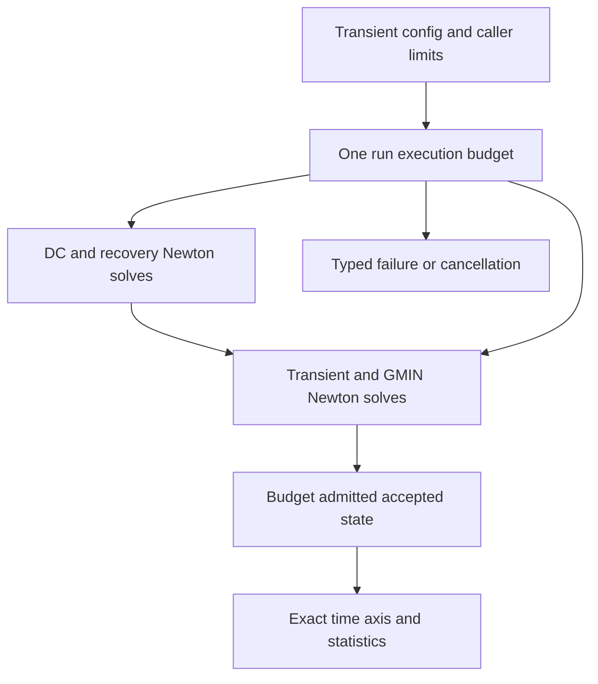

# CoreSpiceAnalysis

## Purpose and Scope

This SwiftPM module owns solver and analysis execution. Parent: [CoreSpice](../../DESIGN.md). This module has no newly introduced child components.

## Responsibilities and Boundaries

Analyses own Newton iteration, timestep acceptance, and the lifetime of explicit transient device sessions. Device implementations own their physics/history.

## Related Designs

| Design | Relationship | Contract Used | Summary | Cautions |
|---|---|---|---|---|
| [CoreSpice](../../DESIGN.md) | parent | Package composition | Owned module boundary | Revalidate direct consumers when contracts change |
| [Devices BSIM3](../CoreSpiceDevices/BSIM3/DESIGN.md) | uses | Throwing stamps and transient session | Native solver composition | All run exits must end acquired sessions |
## Architecture

## Contracts and Invariants

Bound-device stamps and accepted history commits may throw; all actual callers propagate errors. Newton residual re-stamps obey the same throwing contract. Numerical convergence retries handle AnalysisError only, preserving device failures. Noise admission is checked before execution for devices with an explicit unsupported noise contract.

## State, Ownership, and Lifecycle

A transient run begins sessions once after its initial solution; a scope defer ends every acquired session on success, throw, cancellation, or partial acquisition failure. One bound BSIM3 owner admits one transient run; rejected concurrent acquisition cannot reset accepted state. Trial stamps never commit history. Accepted steps re-evaluate the accepted bias and commit only its valid kernel token.

## Failure, Concurrency, and Constraints

PreparedCircuit validates physical and auxiliary identities. Sessions remain common Mutex-protected contracts across target compilation; native host CPU is the verified runtime scope. WASM/Embedded and Metal are not qualified by CPU evidence.

## Verification and Change Impact

Actual DC/AC/transient integration tests cover BSIM3 QS/NQS and series nodes, repeated run reset, rejected trial history, concurrent admission, cancellation and failure release. Existing L3 and affected analysis regressions cover the widened throwing boundary.

## Execution backend impact

| Production path | Actual implementation | Changed stamp contract | Evidence owner |
|---|---|---|---|
| CLI electrical analyses | Explicit SparseLUSolver; AC uses ComplexSparseLUSolver | Yes, fallible MNA stamping | BSIM3 integration and affected analysis suites |
| Optoelectrical DAG | OpticalNetworkEvaluator uses CPU emitter/receiver/propagate protocols | Electrical fallback stamps are throwing; optical requirements remain nonthrowing | Affected analysis/optical regressions |
| Metal photonic mesh | PhotonicExecutor.execute takes PhotonicMesh512 and PhotonicComputeBackend; dispatches MZI layers | No BoundDevice, MNA or Newton solver path | Existing Metal execution owner, unchanged by this sprint |

MetalBackend is a ComputeBackend/PhotonicComputeBackend, not a LinearSolver. The
package has no production selector that executes BSIM3 on Metal. CPU BSIM3 evidence
does not qualify GPU execution, and no GPU compact-model capability is advertised.

### Noise ownership and checked failure

NoiseAnalysis consumes fallible NoisyDevice current PSDs after the actual DC
operating point. It validates positive finite frequency and finite nonnegative
PSDs and known nodes before a transfer solve. Coincident source nodes inject
+1 and -1 additively and cancel. A source name/node identity list is fixed by
the first frequency; subsequent identity changes fail rather than misattribute
contributions. Four BSIM sources map through the full series/NQS complex matrix.

CoreSpice integrates sampled output PSD by its existing trapezoidal rule over
exactly [firstFrequency,lastFrequency]. A single frequency has zero bandwidth
and zero integrated RMS; it does not imply an unsampled 0..f band. A validated
NoiseResult is constructed before emitting completed. Device errors and invalid
spectra emit failed and propagate unchanged. The independent oracle supplies
sampled PSDs; its SPICE log-interpolated integral is not the CoreSpice integral.
No new retained state is introduced. Per-device output is bounded by existing
prepared circuit and sampled sweep, and kernel work remains fixed-size.

## Bounded Transient Run Ownership

A transient run owns one Mutex-protected execution budget from initial admission
through DC initialization, DC GMIN/source recovery, transient Newton/GMIN solves,
accepted state publication and terminal events. Solver attempts and Newton
iterations are admitted before their allocations/stamps. Output admission counts
the time scalar and all MNA scalars, including t=0, before reserve/save/publication.
Count/product overflow, budget exhaustion, invalid timestep constraints, nonfinite
LTE and nonprogressing time are typed failures, never nonconvergence retries or
completed partial trajectories. Cancellation remains a cancelled terminal event.
Callbacks and event I/O execute outside the counter lock.

Caller policy specifies accepted steps, solve attempts, Newton iterations, saved
scalars, matrix dimension, breakpoint count and weighted work units. A missing policy fails before execution; callers explicitly supply resource
ceilings. Machine integer capacity is not treated as a practical resource budget. Decoded limits are
validated by the same run admission as constructed values. Statistics include DC
and recovery work and retain the exact accepted time axis. Weighted work is an
operation-count surrogate: each Newton iteration charges n^3 + 2*nnz + 2*devices
+ 8*n; it is not measured FLOPS or a wall-time guarantee.

Matrix dimension bounds the existing SparseLU dense n*n factor storage and sparse
L/U fill (each at most n*n entries), in addition to O(n) work vectors and the
input sparse structure. Checked n*n, n^3 and byte-size products are required before
analysis allocation. This assumes the supplied LinearSolver and custom device
implementations honor their declared size contracts; the verified concrete solver
is the original SparseLUSolver. No new solver or Metal MNA execution is introduced.
Breakpoint scheduling never enlarges the proposed step and uses representable
relative lookahead rather than a fixed absolute time tolerance. If a breakpoint
is between one and two proposed steps away, the final approach is split into two
steps to avoid a rounding-sized history interval while retaining the exact point.

Synchronization review: Native/WASM/Embedded all use the same `Mutex<State>`
storage, read/statistics and mutation admission entry points; the budget owns no
shutdown resource. Runtime evidence is native host CPU only. WASM/Embedded are
unverified; native evidence does not qualify those targets or Metal.

| Target | Storage and isolation | Read / mutation entry points | Owner release | Runtime evidence |
|---|---|---|---|---|
| Native | `Mutex<State>` | `statistics` / admission methods | Run exit releases budget | CPU tested |
| WASM | Same shared source | Same shared source | Same run owner | Unverified |
| Embedded | Same shared source | Same shared source | Same run owner | Unverified |

## BSIM4 analysis composition

[BSIM4](../CoreSpiceDevices/BSIM4/DESIGN.md) participates through existing throwing
BoundDevice and transient-session protocols. The unchanged analysis run owns
begin/defer-end and accepted-step commits. Complex AC uses the device's original
frequency response and reserved-q constraint. Noise admission requires caller-owned
noise-capable preparation before OP; correlated composition follows the contract
below. Actual host CPU public DC/AC/transient and noise evidence bounds admission.

## Correlated Output-Referred Noise

[Output-referred device noise](../CoreSpiceDevices/OutputReferredNoise/DESIGN.md)
is accumulated separately from independent current sources. After actual OP and
original complex AC factorization at each frequency, the analysis solves one unit
injection per unique requested node and forms output-minus-reference transfer.
Ground gain is zero; requested private nodes must be compiled in the variable map.
Factorization and solve buffers are reused; no callback runs under a device lock.

Device-returned channels must remain finite, nonnegative and stable by name.
Validation precedes completed; failure/cancellation propagates and does not emit
a successful waveform. Cancellation is checked during added node solves and
before completion. Public integration remains trapezoidal on output V²/Hz,
with zero bandwidth for one frequency; independent oracle spectra are integrated
with that same documented method, not original ngspice Nintegrate.
