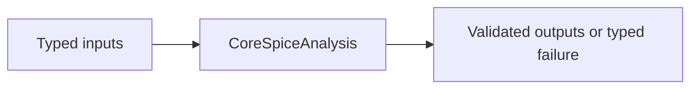

# CoreSpiceAnalysis

## Purpose and Scope

This SwiftPM module owns solver and analysis execution. Parent: [CoreSpice](../../DESIGN.md). This module has no newly introduced child components.

## Responsibilities and Boundaries

Analyses own Newton iteration, timestep acceptance, and the lifetime of explicit transient device sessions. Device implementations own their physics/history.

## Related Designs

| Design | Relationship | Contract Used | Summary | Cautions |
|---|---|---|---|---|
| [CoreSpice](../../DESIGN.md) | parent | Package composition | Owned module boundary | Revalidate direct consumers when contracts change |
| [Devices BSIM3](../CoreSpiceDevices/BSIM3/DESIGN.md) | uses | Throwing stamps and transient session | Native solver composition | All run exits must end acquired sessions |
## Architecture

## Contracts and Invariants

Bound-device stamps and accepted history commits may throw; all actual callers propagate errors. Newton residual re-stamps obey the same throwing contract. Numerical convergence retries handle AnalysisError only, preserving device failures. Noise admission is checked before execution for devices with an explicit unsupported noise contract.

## State, Ownership, and Lifecycle

A transient run begins sessions once after its initial solution; a scope defer ends every acquired session on success, throw, cancellation, or partial acquisition failure. One bound BSIM3 owner admits one transient run; rejected concurrent acquisition cannot reset accepted state. Trial stamps never commit history. Accepted steps re-evaluate the accepted bias and commit only its valid kernel token.

## Failure, Concurrency, and Constraints

PreparedCircuit validates physical and auxiliary identities. Sessions remain common Mutex-protected contracts across target compilation; native host CPU is the verified runtime scope. WASM/Embedded and Metal are not qualified by CPU evidence.

## Verification and Change Impact

Actual DC/AC/transient integration tests cover BSIM3 QS/NQS and series nodes, repeated run reset, rejected trial history, concurrent admission, cancellation and failure release. Existing L3 and affected analysis regressions cover the widened throwing boundary.

## Execution backend impact

| Production path | Actual implementation | Changed stamp contract | Evidence owner |
|---|---|---|---|
| CLI electrical analyses | Explicit SparseLUSolver; AC uses ComplexSparseLUSolver | Yes, fallible MNA stamping | BSIM3 integration and affected analysis suites |
| Optoelectrical DAG | OpticalNetworkEvaluator uses CPU emitter/receiver/propagate protocols | Electrical fallback stamps are throwing; optical requirements remain nonthrowing | Affected analysis/optical regressions |
| Metal photonic mesh | PhotonicExecutor.execute takes PhotonicMesh512 and PhotonicComputeBackend; dispatches MZI layers | No BoundDevice, MNA or Newton solver path | Existing Metal execution owner, unchanged by this sprint |

MetalBackend is a ComputeBackend/PhotonicComputeBackend, not a LinearSolver. The
package has no production selector that executes BSIM3 on Metal. CPU BSIM3 evidence
does not qualify GPU execution, and no GPU compact-model capability is advertised.

### Noise ownership and checked failure

NoiseAnalysis consumes fallible NoisyDevice current PSDs after the actual DC
operating point. It validates positive finite frequency and finite nonnegative
PSDs and known nodes before a transfer solve. Coincident source nodes inject
+1 and -1 additively and cancel. A source name/node identity list is fixed by
the first frequency; subsequent identity changes fail rather than misattribute
contributions. Four BSIM sources map through the full series/NQS complex matrix.

CoreSpice integrates sampled output PSD by its existing trapezoidal rule over
exactly [firstFrequency,lastFrequency]. A single frequency has zero bandwidth
and zero integrated RMS; it does not imply an unsampled 0..f band. A validated
NoiseResult is constructed before emitting completed. Device errors and invalid
spectra emit failed and propagate unchanged. The independent oracle supplies
sampled PSDs; its SPICE log-interpolated integral is not the CoreSpice integral.
No new retained state is introduced. Per-device output is bounded by existing
prepared circuit and sampled sweep, and kernel work remains fixed-size.
