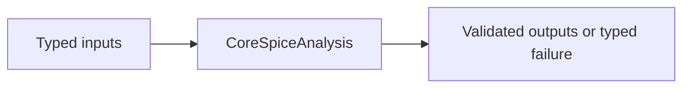
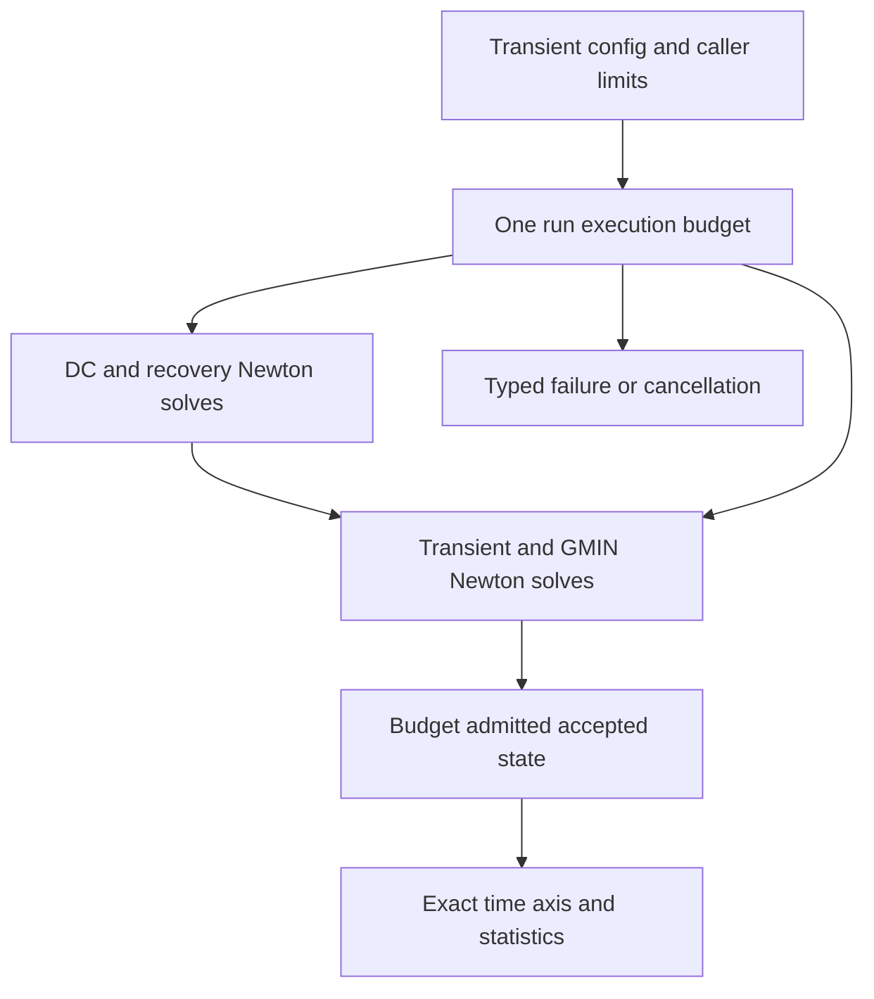

# CoreSpiceAnalysis

## Purpose and Scope

This SwiftPM module owns solver and analysis execution. Parent: [CoreSpice](../../DESIGN.md). The [EquationConvergence](EquationConvergence/DESIGN.md) child owns explicit unit-aware DC convergence policy and the final physical-validation boundary.

Children: [ValidatedParametricRoot](ValidatedParametricRoot/DESIGN.md), [ValidatedMatrixRegularity](ValidatedMatrixRegularity/DESIGN.md), [PrescribedVoltageReduction](PrescribedVoltageReduction/DESIGN.md), [ExactRowAlgebra](ExactRowAlgebra/DESIGN.md), [GeneralizedSchur](GeneralizedSchur/DESIGN.md), [ValidatedTransient](ValidatedTransient/DESIGN.md), [NewtonVoltageLimiting](NewtonVoltageLimiting/DESIGN.md), [CompensatedDC](CompensatedDC/DESIGN.md), [Completion](Completion/DESIGN.md), [TransientValidation](TransientValidation/DESIGN.md), and proposed S4D [CompensatedTransient](CompensatedTransient/DESIGN.md).

## Responsibilities and Boundaries

Analyses own Newton iteration, timestep acceptance, and the lifetime of explicit transient device sessions. Device implementations own their physics/history.

## Related Designs

| Design | Relationship | Contract Used | Summary | Cautions |
|---|---|---|---|---|
| [CoreSpice](../../DESIGN.md) | parent | Package composition | Owned module boundary | Revalidate direct consumers when contracts change |
| [NetworkParameters](NetworkParameters/DESIGN.md) | child | Fixed-bias voltage-boundary multiport S/Y/Z and conditional two-port metrics | Explicit port/frequency/reference/limit profile | Whole-history, periodic and internal-pole stability are distinct obligations |
| [ValidatedParametricRoot](ValidatedParametricRoot/DESIGN.md) | child | Conditional sparse parametric Krawczyk image and contraction check | Source/chart legitimacy remains with its caller; see child qualification scope |
| [ValidatedTransient](ValidatedTransient/DESIGN.md) | child | Conditional affine barrier and Picard slab numerical checks | Actual field/source-family and history premises remain with callers |
| [GeneralizedSchur](GeneralizedSchur/DESIGN.md) | child | Pure Swift generalized Schur and all homogeneous entries | Original affine PZ pencils | Dense storage and actual bounded work; no B inverse or rank oracle |
| [Transient device lifecycle](../CoreSpiceDevices/TransientLifecycle/DESIGN.md) | depends on | Throwing stamps and accepted/trial session boundary | Native solver composition | All run exits must end acquired sessions |
| [OSDI adapter](../CoreSpiceOSDI/DESIGN.md) | coordinates with | Official-model prepared owners and circuit stamps | Sole compact-model boundary | OSDI physics is external to the Swift analysis algorithms |
| [CompensatedTransient](CompensatedTransient/DESIGN.md) | child | Proposed compensated numerical state and bounded original equations | S4D design gate | Cross-owner D1 freeze precedes implementation |
## Architecture



## Contracts and Invariants

### Bound selected-origin identity

PreparedCircuit rejects a bound model whose declarationID differs from the plan's
selected model, even if model names/types match. This closes the concrete same-name
wrong-source substitution counterexample; permitted parameter perturbations still
retain their original model identity. Origin consistency proves binding composition,
not actual analysis execution or qualification.


Bound-device stamps and accepted history commits may throw; all actual callers propagate errors. Newton residual re-stamps obey the same throwing contract. Numerical convergence retries handle AnalysisError only, preserving device failures. Noise admission is checked before execution for devices with an explicit unsupported noise contract.

### MOS perturbation authority

IR dictionary perturbation cannot change an immutable MOS resolution or reuse its
prepared receipt. Without an injected SourceResolvingCircuitDeviceBinding,
sensitivity and Monte Carlo refuse any circuit containing a MOS stage with
AnalysisError.requiresFreshMOSResolution before solving or sampling. The source
binding owns a new evaluation session and fresh complete executable owners per
perturbation/sample. The solver and finite-difference algorithms are unchanged.
Focused tests retain refusal for ordinary whole-circuit rebinding even when the
requested perturbation names a non-MOS device.

## State, Ownership, and Lifecycle

A transient run begins sessions once after its initial solution; a scope defer ends every acquired session on success, throw, cancellation, or partial acquisition failure. Mutable device-session admission belongs to the concrete bound owner; rejected concurrent acquisition cannot reset accepted state. Trial stamps never commit history. Accepted steps re-evaluate and commit the accepted candidate through the device lifecycle contract.

## Failure, Concurrency, and Constraints

PreparedCircuit validates physical and auxiliary identities. Sessions remain common Mutex-protected contracts across target compilation; native host CPU is the verified runtime scope. WASM/Embedded and Metal are not qualified by CPU evidence.

## Verification and Change Impact

Analysis and transient lifecycle tests cover repeated run reset, rejected trial history, concurrent admission, cancellation and failure release. The OSDI Native/CLI suites separately exercise the actual four official-model families; classic L1/L2/L3 and affected analysis regressions retain their own numerical scope. Retired native-BSIM integration tests are not current evidence.

## Execution backend impact

| Production path | Actual implementation | Changed stamp contract | Evidence owner |
|---|---|---|---|
| CLI electrical analyses | Explicit SparseLUSolver; AC uses ComplexSparseLUSolver | Yes, fallible MNA stamping | OSDI Native/CLI and affected analysis suites |
| Optoelectrical DAG | OpticalNetworkEvaluator uses CPU emitter/receiver/propagate protocols | Electrical fallback stamps are throwing; optical requirements remain nonthrowing | Affected analysis/optical regressions |
| Metal photonic mesh | PhotonicExecutor.execute takes PhotonicMesh512 and PhotonicComputeBackend; dispatches MZI layers | No BoundDevice, MNA or Newton solver path | Existing Metal execution owner, unchanged by this sprint |

MetalBackend is a ComputeBackend/PhotonicComputeBackend, not a LinearSolver. The
electrical analysis path does not delegate MNA solving to the photonic backend.
CPU evidence does not qualify GPU execution; no GPU compact-model capability is advertised.


### Noise ownership and checked failure

NoiseAnalysis consumes fallible NoisyDevice current PSDs after the actual DC
operating point. It validates positive finite frequency and finite nonnegative
PSDs and known nodes before a transfer solve. Coincident source nodes inject
+1 and -1 additively and cancel. A source name/node identity list is fixed by
the first frequency; subsequent identity changes fail rather than misattribute
contributions. OSDI noise sources map through the exact prepared internal-node
topology; retired native-BSIM source catalogs are not used.

CoreSpice integrates sampled output PSD by its existing trapezoidal rule over
exactly [firstFrequency,lastFrequency]. A single frequency has zero bandwidth
and zero integrated RMS; it does not imply an unsampled 0..f band. A validated
NoiseResult is constructed before emitting completed. Device errors and invalid
spectra emit failed and propagate unchanged. The independent oracle supplies
sampled PSDs; its SPICE log-interpolated integral is not the CoreSpice integral.
No new retained state is introduced. Per-device output is bounded by existing
prepared circuit and sampled sweep, and kernel work remains fixed-size.

## Bounded Transient Run Ownership

A transient run owns one Mutex-protected execution budget from initial admission
through DC initialization, DC GMIN/source recovery, transient Newton/GMIN solves,
accepted state publication and terminal events. Solver attempts and Newton
iterations are admitted before their allocations/stamps. Output admission counts
the time scalar and all MNA scalars, including t=0, before reserve/save/publication.
Count/product overflow, budget exhaustion, invalid timestep constraints, nonfinite
LTE and nonprogressing time are typed failures, never nonconvergence retries or
completed partial trajectories. Cancellation remains a cancelled terminal event.
Callbacks and event I/O execute outside the counter lock.

Caller policy specifies accepted steps, solve attempts, Newton iterations, saved
scalars, matrix dimension, breakpoint count and weighted work units. A missing policy fails before execution; callers explicitly supply resource
ceilings. Machine integer capacity is not treated as a practical resource budget. Decoded limits are
validated by the same run admission as constructed values. Statistics include DC
and recovery work and retain the exact accepted time axis. Weighted work is an
operation-count surrogate; sparse stamping and actual controlled factorization/substitution
work are separate. It is not measured FLOPS or a wall-time guarantee.

Sparse numerical storage and work admission are owned by the linked sparse
execution component and actual factor capacities; no matrix-square or cubic
estimate substitutes for that path. Custom bounded solvers must accept its control.
No Metal MNA execution is introduced.
Breakpoint scheduling never enlarges the proposed step and uses representable
relative lookahead rather than a fixed absolute time tolerance. If a breakpoint
is between one and two proposed steps away, the final approach is split into two
steps to avoid a rounding-sized history interval while retaining the exact point.



Synchronization review: Native/WASM/Embedded all use the same `Mutex<State>`
storage, read/statistics and mutation admission entry points; the budget owns no
shutdown resource. Runtime evidence is native host CPU only. WASM/Embedded are
unverified; native evidence does not qualify those targets or Metal.

| Target | Storage and isolation | Read / mutation entry points | Owner release | Runtime evidence |
|---|---|---|---|---|
| Native | `Mutex<State>` | `statistics` / admission methods | Run exit releases budget | CPU tested |
| WASM | Same shared source | Same shared source | Same run owner | Unverified |
| Embedded | Same shared source | Same shared source | Same run owner | Unverified |

## Compact-Model Analysis Boundary

Official compact models participate through the prepared OSDI adapter and existing
throwing BoundDevice/session protocols. Model source equations and native storage
remain with swift-osdi; Analysis owns original circuit equations, accepted/rejected
history, integration, complex solves and noise transfer. Removed in-tree BSIM
kernels grant no execution or enclosure capability.

## Correlated Output-Referred Noise

[Output-referred device noise](../CoreSpiceDevices/OutputReferredNoise/DESIGN.md)
is accumulated separately from independent current sources. After actual OP and
original complex AC factorization at each frequency, the analysis solves one unit
injection per unique requested node and forms output-minus-reference transfer.
Ground gain is zero; requested private nodes must be compiled in the variable map.
Factorization and solve buffers are reused; no callback runs under a device lock.

Device-returned channels must remain finite, nonnegative and stable by name.
Validation precedes completed; failure/cancellation propagates and does not emit
a successful waveform. Cancellation is checked during added node solves and
before completion. Public integration remains trapezoidal on output V²/Hz,
with zero bandwidth for one frequency; independent oracle spectra are integrated
with that same documented method, not original ngspice Nintegrate.

### Prepared native DC budget composition

[NativeExecution](../CoreSpice/NativeExecution/DESIGN.md) uses the package-scoped
`TransientExecutionBudget` owner with DCAnalysis. This shares pre-operation
solve/Newton/work/saved-scalar admission across the complete `.op` or `.dc` schedule,
including convergence recovery. The underlying numerical algorithm and public
ordinary DC API are unchanged. The owner retains its common `Mutex<State>` storage;
package visibility does not expose direct mutable counter access.
Native physical residual gates use the package-scoped `chargeWork` admission on
that same budget before their extra source evaluations and vector passes; they
cannot create a second work allowance or mutate the shared limits/counters.

## Native Concrete Operation Budget Transport

Concrete native composition injects one package execution budget into AC, noise,
TF, PZ, sensitivity and AC sensitivity. Embedded DC, its recovery solves and every
sensitivity perturbation retain that same owner. Linear phases admit solve attempts
and stamping/vector work before numeric operations. Controlled sparse factorization
and substitutions charge their own actual work; dense eigen/pencil algorithms
retain separate explicit dense work admission. Saved real/complex
scalars and derivative outputs are admitted before append/reserve. These checks
preserve numerical algorithms and propagate exhaustion without convergence retry.
Raw lower analysis entry points retain their existing optional budget contract.

Fourier shares the injected owner with its transient analysis, then admits actual
completed-sample harmonic work and saved coefficients before column extraction and
integration. The transient result's statistics describe transient work; the native
run's statistics describe the complete operation. Harmonic arrays reserve their
checked component count once.

All concrete native result headers implement the package-only
`AnalysisResultStorageRetaining` contract. Each header privately retains an opaque
Sendable storage owner attached by native composition. Copying the complete result
retains that owner even after its native run/facts are released; the final result
copy releases the reservation. TF/sensitivity/Fourier typed nested results share
that owner, and DC sweep point results retain it before invoking callbacks.
Numerical fields remain immutable and Analysis does not depend on the source
accounting implementation. Extracting individual Array/Dictionary values, creating
new result headers with public initializers or materializing derived waveforms is
a caller-owned value boundary; those values do not inherit an invocation lease.
Common Mutex storage and admission entry points are identical across target source;
this change qualifies native CPU behavior only.

## Native Result Storage Admission Boundary

Package-only `AnalysisResultStorageAccounting` supplies pre-allocation capacity
admission and scoped postprocessing scratch. Native composition injects the
execution-owned implementation defined in [Native execution](../CoreSpice/NativeExecution/DESIGN.md#incremental-result-capacity-ownership).
Analysis owns buffer growth and reports required capacity before allocation; it
does not interpret native byte policy or source accounting. Transient native
storage starts at one point and grows geometrically before either accepted-step
branch mutates device state or publishes a point. Direct lower Analysis calls
retain their existing estimated-capacity behavior. Fourier transports the same
owner into transient execution, and requests scratch for the completed trace
before allocating final-period pairs. Numerical algorithms, scalar/work counters,
cancellation and terminal event behavior are unchanged.

The injected owner is retained by completed transient/nested result headers.
Capacity refusal propagates as failure, not a numerical retry or partial result.
Tests in CoreSpiceNativeExecutionTests verify admission ordering and lifetime; the
full CoreSpiceAnalysisTests target verifies unchanged numerical behavior.

Result-storage retention exposes its optional opaque owner within the package.
[Waveform conversion](../CoreSpiceWaveform/DESIGN.md) transports that lease without
retaining discarded numerical payload arrays or changing admission policy.

## D2 Source Evaluation Guard

StandardCircuitDeviceBinding checks plan.ir evaluationEnvironment against its
OperatingConditions before binding any instances. Monte Carlo/sensitivity retain
the plan and guard through this same binding entry. Source-free typed plans remain
bindable under explicitly supplied conditions.

## 07C Checked Diode Sensitivity Binding

CircuitParameterPerturbation enumerates supplied active diode coefficients and
instance assignments using the [typed diode owner](../CoreSpiceDevices/Diode/DESIGN.md#07c-checked-numeric-perturbations).
Role-qualified parameter names and checked resolved replacements preserve the
original source basis; flat overlays cannot alter a prepared receipt. Existing
StandardCircuitDeviceBinding receives explicit diode limits/capabilities/control,
validates basis and topology against the plan, prepares fresh checked owners and
consumes them. Native wrappers own extra scratch/work admission. Direct callers
must inject the same explicit policy; missing policy fails. Existing raw legacy
fixtures remain test-owned and do not become a production bypass. Current MOS
fresh-source and case sensitivity receipt limitations remain explicit.

## Checked Variable-Step LTE and Startup

Analysis owns local-error estimation, smooth accepted-sample history and step
acceptance. Devices retain their existing trial/accepted-history authority;
numerical tolerances, whole-run quotas and source RC models are unchanged.
The numerical basis is [NIST DLMF 3.5.1](https://dlmf.nist.gov/3.5.E1) and
[divided differences](https://dlmf.nist.gov/3.3#iii). Local estimates are not
rigorous global-error bounds or physical qualification.

```text
Accepted electrical/device/optical state
 -> insufficient smooth history: independent BE quarter, half and full trials
 -> otherwise preferred method candidate plus accepted samples
 -> checked normalized LTE / cumulative execution budget
 -> reject without accepted commit OR commit full candidate once
 -> rotate accepted vectors/actual intervals; breakpoint resets smooth history
```

Trapezoidal uses candidate plus three accepted vectors with their three actual
positive finite intervals. Its raw estimate is `abs(h*h*h*d3/2)`, where `d3` is
the third divided difference on those nonuniform time nodes. Backward Euler
retains `abs(h*h*d2)` from candidate plus two accepted vectors. Both normalize
voltage error by the existing `reltol*abs(current)+vntol`. Existing auxiliary
branch-current exclusion remains unchanged; `abstol` does not participate in
that voltage-only estimator. Missing history, mismatched dimensions and invalid
intervals/tolerances throw typed estimator errors rather than returning zero.
The corresponding next-step exponents remain 1/3 for TRAP and 1/2 for BE.

After a step passes LTE, its next adaptive proposal is clamped to
`[minTimeStep, maxTimeStep]`. The safety factor may suggest a smaller step even
when the accepted minimum step meets tolerance; this is not a failed trial.
Analysis owns this minimum and applies stop/max/device constraints before
breakpoint scheduling. The scheduler's only shortening that does not land on a
breakpoint is its optional half-distance approach when the breakpoint is farther
away than the proposal. If that approach falls below the minimum, Analysis keeps
the already constrained proposal: it cannot cross the farther breakpoint or
exceed a stop/max/device bound. A proposal already below the minimum gains no
such exception. Exact stop-time/breakpoint intervals may still be shorter.
A rejected trial at the minimum still fails with `timestepTooSmall`; clamping a
future proposal never accepts a failed trial.

Before taking a full proposal that would leave a positive terminal remainder
below `minTimeStep`, Analysis uses the same half-distance approach as breakpoint
scheduling. It does so only when both halves fit the already constrained proposal
and remain at least the minimum. This preserves the full interval and exact final
time without increasing a max/device bound or snapping the accepted clock. A
genuinely shorter terminal interval retains its existing solve/refusal contract.
The endpoint clock-grid regression uses 100 successive 100 ps proposals to detect
an avoidable rounding-sized terminal interval.

A Newton rejection above `minTimeStep` clamps its shrunken retry to that minimum,
so a shrink factor cannot skip the last admissible candidate. A failure at the
minimum, or at an admitted shorter exact endpoint, retains the existing failure,
rejection accounting and event path. Each failed attempt still consumes its
Newton/work quota and one rejection; a clamped retry is a fresh uncommitted
half/full trial from the same accepted state. Retry-count exhaustion and
cancellation remain independent limits. `newtonRejectionTriesMinimumBeforeFailing`
uses a test-only device convergence gate to isolate this retry contract from RC
physics, with minimum-success, minimum-failure and short-endpoint-failure cases.

The startup regressions `acceptedProposalRespectsMinimumTimeStep` and
`breakpointApproachRespectsMinimumTimeStep` check analytic RC steps, a short final
interval, and a nearby breakpoint with an unsafe half-distance approach. The
bounded regression `rejectedMinimumStepCannotLoopOrComplete` verifies the
unchanged rejection boundary.

The breaking public `preferredMethod` name replaces `initialMethod`; its default
is trapezoidal. Startup and post-breakpoint bootstrap always use checked BE until
three smooth accepted samples exist, then use the requested preferred method.
An explicit preferred BE stays BE after bootstrap. Each bootstrap computes BE at
h/4, h/2 and h independently from the same accepted electrical/device history and
accepted optical snapshot, using `(4/3)*abs(full-3*half+2*quarter)` as the leading BE
local error. Only the full candidate can be accepted/committed/saved. Quarter and half trials
are never committed and are not output samples. All trials' Newton/GMIN work,
retry work, estimator scans and cancellation use the same run budget/control.

During bootstrap the unavailable oldest accepted-vector slot is reusable half
trial scratch; trial stamps read only the current and previous accepted vectors.
The existing accepted-buffer rotation restores the older accepted sample before
smooth history becomes usable. One additional admitted dimension-sized quarter-trial vector is allocated once per run. Valid accepted intervals rotate only on acceptance. Explicit waveform
breakpoints reset smooth history and interval availability, preventing a divided
difference across a derivative discontinuity. Optical trial iteration begins
from the same accepted value snapshot for every half/full/retry; accepted optical
state changes only when the full candidate is accepted.

[Independent polynomial references](../../Tests/CoreSpiceAnalysisTests/LTEPolynomialReferenceTests.swift)
verify quadratic zero, cubic third-order scaling, nonuniform intervals and existing
normalization/exclusion. Estimator, bounded transient, configuration and accuracy
tests and [startup lifecycle regressions](../../Tests/CoreSpiceAnalysisTests/TransientStartupContractTests.swift) verify missing-history rejection, checked startup, breakpoint behavior,
trial versus commit counts, real accepted-bias commits, quotas and cancellation.
Existing integration-order tests remain numerical regressions, not LTE proofs.
Physical clock callers adopt the renamed method explicitly and revalidate actual
CTS separately; this correction alone does not prove its transient horizon or
resource-profile sufficiency.

Adaptive RC threshold regressions enforce their existing absolute waveform and
crossing-time accuracy bounds. Halving only a maximum step does not create nested
meshes because local error and breakpoint bootstrap select actual steps, so it
cannot guarantee pointwise monotonic crossing error. Controlled integration-order
ratios remain owned by `TransientAccuracyTests.convergenceOrder`, independently
of the polynomial estimator and adaptive threshold checks.

## Bounded Linear Refinement

Newton owns improvement of each raw linear solution against its original stamped
matrix/RHS before device limiting and damping. The existing LinearSolver contract
admits repeated RHS solves with one stored factorization. Corrections solve
`A*delta = b-A*x`; a candidate is retained only when the maximum normalized
accurate residual strictly improves. Tolerances remain
`(branch ? vntol : abstol) + reltol*abs(rhs)`. Stop at tolerance, unchanged bits,
no improvement, cancellation, a caller budget failure, or `config.maxIterations`
corrections. No additional public policy or concrete-solver dependency is added.
The existing nonlinear iteration and post-limiting physical gate remain in force.
The physical gate and terminal failure residual use the same
[accurate residual kernel](../CoreSpiceCompile/DESIGN.md#accurate-newton-residual-kernel).

```text
stamp -> factorize once -> raw solve -> accurate original-system residual
 -> bounded reused-factor correction -> retain only improved raw candidate
 -> existing limiting/damping/update/device checks -> accurate restamped gate
 -> accept OR original Newton failure/retry path
```

Refinement reuses the exclusively mutable `vdspTemp` for correction/candidate and
`residualProduct` for signed residual, before their ordinary iteration roles.
They are not retained by the helper. A candidate swap occurs only after checking
improvement; no new dimension-sized working vector is requested. This is an
ownership/allocation design, not a measured zero-copy or performance claim.

Each correction charges one additional solveAttempts and vector overhead before
dispatch. The controlled sparse solver charges traversal of its actual stored
factors separately. It does not charge a factorization or increment newtonIterations. Each accurate residual and
quality scan charges `40*nnz + 48*n` weighted work before calculation. These are
operation-count envelopes for the implemented loops, not measured FLOPs.
Checked arithmetic, original solve/work limits, cancellation between passes and
original failure propagation remain mandatory. Native results expose these actual
charges through their existing statistics; caller remaining allowances subtract
those statistics without a new policy or schema. Physical budgets stay unchanged.

Generic Newton precision rules affect OP, DC and transient preparation identity;
all effective configurations bind a new global numerical-rule marker. Source
identity, tolerances, public result fields, accepted device state and GMIN order
remain unchanged. Anonymous retained D455/D847 systems plus independent rounded
reference solutions define the strict-gate regression. They establish numerical
solve/gate behavior, not new TRAP assembly or full physical horizon success.

## Explicit DC Equation Convergence

[EquationConvergence](EquationConvergence/DESIGN.md) defines the optional per-global-row policy consumed by the existing Newton/SparseLU path. The same immutable policy reaches direct and recovery solves. The optional Sendable physical validator runs before accepted-state commits and completed publication, propagating its original failure. OSDI native composition requires the validator and owns direct residual assembly; Analysis has no OSDI dependency. A nil policy and validator preserve existing electrical profiles.

## S4 Transient Numerical and Lifecycle Contract

UIC preserves the explicit t=0 sample and starts smooth-history count at zero. Bootstrap solves independently from accepted history at h/4, h/2 and h. Its normalized defect is `(4/3)*abs(full-3*half+2*quarter)`: constants and linear terms cancel while the quadratic term matches the existing BE leading error. The extra fixed dimension scratch is admitted before allocation. Accepted history rotates only after LTE, fresh candidate bounds and direct physical validation pass. A bound below the candidate interval rejects it and consumes the existing rejection/retry budget. Accepted-state limits are reread before each step.

Explicit equation policy reaches initial DC, every ordinary Newton and every GMIN recovery solve. Variable-unit tolerances normalize LTE; thermal rows receive K/W tolerances and no electrical GMIN. Nil policy preserves legacy branch-current exclusion and voltage tolerance. Actual nested OP and accepted integration records are retained under existing caller scalar/byte/count ceilings. The initialization phase is passed through the device session requirement.

```text
OP or UIC -> explicit begin -> independent trial(s) -> LTE / candidate bound / physical validator
 -> reject without commit OR commit once -> retain actual integration record
 -> result validation -> end sessions -> completion finalizer -> completed
```

Failure, cancellation and partial session admission release all acquired sessions through the same defer. Finalizer failure emits failed, never completed. The completion barrier and acceptance types are defined by the linked child contracts.

## S4 Frequency and Residual Noise Execution

[FrequencyNoise](FrequencyNoise/DESIGN.md) owns the source transfer/input-quantity boundary.

AC and noise forward optional node guesses, explicit equation policy and pure OP physical validation into their actual nested DC solve. Results retain the actual OP. Explicit row policy restricts gmin to electrical potential rows; noise voltage outputs reject thermal rows while coupled thermal/flow equations remain in the matrix. Optional caller finalization runs after result validation and before outer completed; nested OP does not finalize the operation.

[ResidualNoise](../CoreSpiceDevices/ResidualNoise/DESIGN.md) supplies immutable canonical source metadata and a synchronously borrowed PSD span. Analysis validates source index uniqueness, endpoint units and exact density shape, and accumulates independent `|H|² S` using the existing complex LU. Ground and collapse use additive cancellation. A separate noise matrix hook selects actual noise context; pure AC remains pure. Legacy independent and correlated sources follow one accounting path each. Result storage admission precedes retained spectrum growth and uses the existing native accounting owner; saved-scalar/work admission remains independent.

NoiseResult retains input quantity (voltage or current), actual OP and stable per-source output PSD. Input voltage-source injection uses explicit owned branch identity, preserving the legacy inferred path only when ownership is absent. Voltage output is the supported measurement; thermal outputs fail explicitly under the supplied row policy. Existing trapezoidal integration and single-frequency zero bandwidth remain unchanged. Tests in CoreSpiceAnalysisTests own actual A/V/W transfer, mode, failure, finalization and input-unit behavior; Native/CLI own resource/lifetime and artifact projection.

### Representable full interval with unrepresentable bootstrap subdivisions

When a positive full interval advances absolute time but its quarter/half trial times cannot form distinct positive times before the full endpoint, Analysis uses an explicit embedded BE/TR pair at that same full endpoint only after at least one accepted step has committed valid integration history. An initial UIC interval without such history retains the typed subdivision-advance failure. TR is solved first into the existing quarter scratch; BE is solved last and remains the only accepted candidate. Both start from identical accepted electrical, optical and device history. The normalized `abs(BE-TR)` difference estimates the leading BE local error for valid accepted integration history. It cancels common algebraic jumps without constructing fictitious intermediate absolute times. This is an alternative estimator, not a global-error bound. Devices remain responsible for valid accepted charge/current history for TR; missing history and any stamp/solve/validation failure retain their original typed failure.

Full-time TR and BE work consume the existing cumulative Newton/work quotas. The full interval still passes ordinary advancement, endpoint, model-bound and physical gates. The exact endpoint and actual BE interval are retained. No sample is discarded and no tolerance is changed. Adjacent-Double endpoint RC tests include grounded and non-ground UIC initialization and retained integration records.

### Caller-owned transient error-control variable selection

`TransientAnalysis.errorControlVariables` is an optional set of canonical `MNAVariable` identities. Nil preserves the existing LTE selection. An explicit set selects only those coordinates for bootstrap, smooth-history and embedded BE/TR error estimates; an empty set selects none. Every selected identity must exist in the compiled variable map, so ground and unknown variables fail with a typed admission error before DC, session acquisition or stamping. The caller owns proof that its selection covers all required integration error dependencies. No sampled derivative or variable name is used to infer eligibility.

Selection affects only a heuristic indicator of local state integration error. It is not a certified temporal error bound for every reported coordinate, a global time-error bound, or an interval/all-history guarantee. All compiled rows and variables remain in Newton iteration, GMIN policy, device convergence, original physical validation, accepted state commits, result retention and numerical audit. Native composition owns proof of its selected state coordinates; the proof must retain inductor currents, private flow variables and thermal state and may exclude only structurally independent ideal-voltage-source multiplier currents. Explicit time/native-state charge dependence is not inferred absent from a zero bias derivative. Complete-output time accuracy is verified separately from state-LTE control and strict per-point physical equation residuals.

A focused algebraic step fixture verifies that an explicit empty selection permits a correctly solved and physically validated state jump, while default selection retains its LTE refusal. Unknown and ground selections fail before stamps, and original physical validation still rejects an invalid candidate regardless of selection.

### Derived current time accuracy counterexample

`TransientDerivedCurrentAccuracyTests` binds an actual ideal voltage source and an analytic time-dependent charge fixture `Q(t)=1e-6*t*t`, with zero charge Jacobian with respect to all circuit unknowns. The source clamps a known voltage ramp; its algebraic current is determined by the chosen numerical charge derivative. Every accepted point must pass the unchanged 1e-12 physical equation gate. State-only LTE does not imply that this derived current agrees with the continuous derivative `2e-6*t` to 1e-12.

Independent h, h/2 and h/4 runs compare every saved derived current with that analytic derivative for BE and preferred TR. The BE startup derivative history can leave a first-order alternating current error after transition to TR in this fixture; the test verifies measured convergence without asserting second-order derived-output accuracy. This explicitly separates strict discrete physical consistency from time-discretization error in algebraic outputs.

### Recovery when bootstrap subdivision cannot converge

After at least one accepted step has committed derivative history, a recoverable Newton convergence failure in the independent BE quarter or half trial selects the existing same-full-time TR/BE embedded estimator at the unchanged requested interval. This explicitly recovers an estimator subdivision, not a failed model evaluation: at a small interval, subtracting finite-precision charge values can make a quarter-step residual grid coarser than its strict equation tolerance while the full-time pair still has representable candidates.

The failed subdivision is recorded as a rejected attempt with an unchanged requested interval and an explicit estimator-recovery reason. All spent Newton/work attempts remain charged. TR runs first into the existing quarter scratch and BE runs last; neither changes accepted history until BE passes the unchanged embedded state-LTE, candidate-bound and original physical gates. No new vector or lifetime owner is allocated. The same original equations, units and tolerances apply to both methods. The indicator retains its heuristic local-state scope.

Without accepted derivative history, subdivision failure keeps the ordinary shrink/failure path. Device, original-residual, nonfinite, cancellation and capacity errors propagate. Failure of either full-time solve retains the existing bounded shrink policy; a failed pair never commits a candidate. Full BE failure alone does not trigger the alternative estimator. Focused recoverable-precision and terminal-error fixtures plus the actual CMG self-heating schedule own this path's verification.

## Complete-window Fourier integration

FourierAnalysis integrates the transient waveform's piecewise-linear interpolant
over exactly the final complete fundamental period. If the left boundary lies
between samples, interpolation supplies that boundary; the final sample supplies
the right boundary. DC is the exact linear-segment area divided by the period.
Each harmonic integrates that same interpolant times the absolute-time sine and
cosine basis analytically. A stable small-angle expression avoids cancellation
on short segments. Absolute-time phase is reduced modulo the harmonic period before
angular multiplication; a segment midpoint is formed from the reduced left phase
and half-angle, rather than from a potentially unrepresentable absolute midpoint.
This retains the existing absolute-time phase convention and
public result representation, and does not remove a fitted offset or special-case
constant signals. Insufficient transient duration remains an explicit run failure.

The run owns O(N) selected samples and O(H) coefficients; harmonic work remains
O(H*N) and uses the existing operation budget before integration. The run checks
cancellation after transient completion, during waveform extraction and harmonic
integration, and before publishing completed. A cancelled child completion observer
must produce a cancelled Fourier terminal event, never completed. No shared state,
new target capability, device physics, or transient acceptance rule is introduced.
FourierTests owns nonuniform constant, boundary interpolation, shifted affine
closed-form, large-time phase, short-segment, multitone, insufficient-period and
post-transient cancellation regressions. The
existing transient/Fourier integration and Native API/CLI consumers establish
composition after the scoped numerical changes settle.

## Compensated DC and simultaneous voltage limiting

DCPrecisionMode selects automatic, binary64 or compensated execution. Automatic
uses compensated coordinates only when every bound device supplies the device-owned
DC residual enclosure contract and no optical network or voltage limiter requires
a binary64-only model boundary. Explicit compensated mode refuses incompatible
circuits before solving. Binary64 preserves the ordinary device path. The mode
never promotes a rounded assembled matrix into an original physical residual.

Compensated DC reuses the paired Newton kernel and an electrical row policy built
from the caller's unchanged tolerances when no explicit policy exists. Every direct,
Gmin and source-recovery phase binds the same coordinate representation and source
scale as its stamp. Device contributions exclude artificial Gmin. A final zero-Gmin,
full-source solve and original-equation enclosure check precede accepted-state
commit and completed publication. DCResult retains normalized high/low coordinates;
ordinary scalar access remains a display projection, and checked compensated
access preserves small terminal differences. Native output/persistence must retain
the coordinate pair and its representation without reinterpreting transient-only
OSDI precision receipts. Requested unsupported precision fails explicitly.

Voltage limiting remains device-owned. For binary64 Newton, a common step along
the Newton direction is admitted only when independently applying each eligible
limiter to the same proposed vector leaves it unchanged. Sequential limiter writes
must not invalidate an earlier device's constraints. A bounded halving search
reuses existing Newton scratch/candidate buffers, accounts each probe's work and
checks cancellation. Exhaustion is a convergence failure, never acceptance of an
inadmissible candidate or suppression of device evaluation errors. First-iteration
limiter eligibility is unchanged. Compensated mode keeps its existing refusal of
binary64-only limiters. No shared mutable state or target-specific isolation is
introduced.

The DC component owns near-short original-law accuracy, source/Gmin recovery,
mode refusal and paired-result tests. Native/CLI tests own exact paired persistence
and reload. ConvergenceAidTests and limiting tests own coupled-junction admission,
nonfinite failure preservation, bounded work and cancellation. Original tolerances
and the original 1 microohm regression circuit remain unchanged.

Compensated DC consumers preserve the represented state when constructing their
linearization SolutionState. Sensitivity subtracts and divides complete paired
output voltages before publishing its existing binary64 derivative. A compensated
non-UIC transient retains an available paired DC operating point into session
initialization, initial saved state and accepted history. Ordinary transient
explicitly selects its existing binary64 operating-point profile. Tests own the
sub-ULP current sensitivity and nonzero-low OP-to-first-step counterexamples.

## True Sparse Run Composition

[Sparse execution](SparseExecution/DESIGN.md) is the child authority for controlled
factorization work/capacity, cancellation, failure propagation and bounded custom
solver admission. It supersedes the historical dense SparseLU envelopes in the
bounded-run sections above. The original equation/refinement contracts remain
with their existing owners; no tolerance or physical acceptance gate changes.

## Original-equation linear response and finite pencils

DC publication in both binary64 and compensated modes requires a final full-source,
zero-Gmin Newton solve whenever a recovery/direct stage used artificial Gmin.
The existing strict residual gate, work quotas, cancellation and failure propagation
remain authoritative. AC, noise and TF factor only the original device matrix;
regularization of the OP must never become a physical shunt in the reported response.

TF/PZ/noise source excitation resolves explicit instance-owned branch identity before
legacy ownership-free inference. Explicit ownership is never reconstructed from device
order or overridden by a display name. Monte Carlo normalizes instance lookup and
override keys consistently while retaining caller spelling in sampled provenance.

PZ's finite G+sC pencil requires explicit device-owned affine applicability. Unknown
custom devices and frequency-dependent delay stamps fail before OP or dense work.
This API does not solve the infinite spectrum of a delay equation. Generalized
eigenvalue computation belongs to the Pure Swift [GeneralizedSchur](GeneralizedSchur/DESIGN.md)
child. Its complete internal homogeneous triples classify beta equal to zero as
infinity, nonzero beta as a finite ratio, and alpha=beta=0 as an indeterminate
pencil that fails. A dimensional absolute beta threshold cannot classify infinity.
The existing finite public result is projected only after all entries are checked.
DC gain uses the original extracted G through the existing controlled CSR Swift LU
and an independent original-matrix residual check; no foreign dense solve is used.

Finite-pencil extraction supplies both coordinate and pre-resolved CSR accumulation
against the same compiled matrix structure. Device-owned CSR slots remain valid
through AC stamping and the subsequent dense G/C projection; an affine device is
not required to reconstruct coordinates or use a second stamping path for PZ.
The direct-slot capacitor regression verifies the resulting analytic RC pole.

TF results classify each port as `PortImpedance.finite` or `.openCircuit`.
Only an exactly zero solved input current establishes an open input; a nonzero
current must have a finite reciprocal or fail numerically. Negative finite values
remain legal for active ports. Result construction rejects nonfinite finite-case
payloads and negative infinity. Existing numeric impedance properties project an
open circuit to positive infinity; typed properties own the classification used
by persistence and finite waveform projection. Tiny-current, open-port and
overflow regressions verify these distinct outcomes.

```text
Original OP -> device matrix -> original AC/noise/TF response
Affine capability -> original OP -> G+sC -> homogeneous finite eigenvalues
Nonaffine/unknown capability -> typed applicability failure
```

ReleaseNumericalRegressionTests owns independent Tohm divider/noise and reordered
branch regressions, deterministic mixed-case sampling, scaled-pencil invariance and
delay/custom-device admission. Existing analysis suites own integration. These
changes introduce no shared state or target-specific synchronization branch.

## Resolver-backed parameter reexecution

`SourceResolvingCircuitDeviceBinding` is the opt-in contract for source-backed
sensitivity and Monte Carlo. Its source owner enumerates supported scalar
parameters with canonical device/parameter names and finite nominal values. Binding
consumes explicit parameter replacements, reevaluates the original captured source
under its retained conditions, prepares fresh device owners for the entire circuit,
and returns their newly compiled plan. Immutable MOS/OSDI receipts are never edited
or reused as a substitute for source evaluation. Ordinary bindings retain their
existing refusal of whole-circuit MOS perturbation.

```text
Source schema -> canonical scalar replacement -> fresh source evaluation/preparation
 -> returned plan + owners -> actual DC/AC/inner analysis -> derivative/sample
```

Each perturbed solve executes the returned plan. Sensitivity maps an original named
output node into the returned source topology; missing or ambiguous mappings fail
before solving. Ground retains its canonical identity. Source errors, cancellation,
and preparation failures propagate. The source binder owns evaluation temperature,
model-selection provenance, preparation limits and retained native owners; Analysis
owns the unchanged derivative/sampling algorithms and cumulative execution quotas.
Generic IR and source-backed parameter enumeration remain separate contracts.

PreparedCircuit optionally retains the source/native preparation owner for the
lifetime of the plan/device pair. Its split-argument analyses borrow those owners
only during execution; durable result provenance is retained by Native composition.
A rebound execution budget is an immutable layout view with actual compiled
dimension/nonzero/device work, sharing the original counter Mutex and unchanged
limits. Constructing a view validates the proposed graph before returning and
cannot replace or reset the existing owner's layout or cumulative counters.

SourceReexecutionAnalysisTests verifies DC/AC analytic derivatives and fixed-seed
sampling when a binder returns changed node IDs, extra coordinates and a new plan;
it also verifies cumulative quota sharing, larger-graph charges, failed-layout
admission and cancellation. The budget's CounterOwner retains one Mutex<State>
on Native, WASM and Embedded shared source; immutable layout views share its
read/mutation entry points and lifetime. No target-specific isolation is introduced.
Native source tests separately own actual MOS resolution and provenance.

## Explicit invocation numerical resources

AnalysisExecutionResources owns immutable invocation numerical ceilings and one
Mutex-protected cumulative solve-attempt/Newton/work/max-dimension usage. Each
explicit budget factory call starts one case-local counter owner; rebound views
share that same case owner and the invocation resource. NativeRun statistics
remain case-local. Resources.usage reports the separate invocation aggregate.
Accepted/rejected steps and saved-scalar ceilings remain case-local; globally
retained output bytes remain owned by the source/publication resource owner.

```text
Explicit invocation resources -> cumulative attempts / Newton / work / max dimension
    -> case A counters + output ceilings -> rebound topology views
    -> case B counters + output ceilings -> rebound topology views
```

Admission holds the case mutex, computes and validates the entire local proposal,
then admits its numerical delta under the invocation mutex. Only after global
admission succeeds does a nonthrowing local commit occur. Lock order is always
case then invocation, with no external callback or I/O under either lock. Failed
admission leaves both owners unchanged. No end-of-case allowance subtraction,
global singleton, or post-identity limit mutation participates in enforcement.
The common owner/isolation contract is identical across shared target source.

## Prepared analysis policy composition

TF and finite-pencil PZ accept an explicit equation policy and pure physical OP
validator, forwarding both into their actual embedded DC analysis. The completed
response is validated before a caller completion finalizer runs; cancellation or
finalizer failure cannot publish outer completed. OP does not finalize the outer
operation. Native owns model-specific policy construction and resource close.

Fourier admits one package-supplied prepared TransientAnalysis value. It reuses that
analysis's original physical/DC/transient/history/error-control contracts, injecting
the same Fourier budget and storage owner. Numerical integration remains unchanged.
The outer Fourier completion finalizer executes after harmonic/result validation;
Native configures the child without final resource close and closes only the full
operation. No solver or device physics is reproduced in this composition boundary.

CircuitDeviceBinding declares an asynchronous bind requirement with cancellation.
Its default invokes the existing synchronous binding contract with pre/post cancel
checks. Async source owners override that requirement; analyses await it through
the protocol existential. This preserves old synchronous binders while allowing
actual asynchronous model preparation and cleanup without extension-only dispatch.

With an explicit row policy, TF voltage outputs and all PZ voltage/current port
endpoints must select electrical-potential rows. Thermal rows remain coupled in
the original matrix and OP validator but cannot represent voltage measurement or
ampere injection. Policy-aware endpoint refusal is separate from affine matrix
applicability and preserves the original row-unit contract.

Fourier consumes a selected compensated transient's complete high/low trace.
Boundary interpolation, reference subtraction, DC area and harmonic accumulation
use CompensatedValue operations. A fixed represented reference is subtracted for
nonzero harmonics because its exact integral over a complete period is zero; the
reference is restored for physical DC. This is algebraically the original integral,
not fitted detrending. Analytic segment weights retain their existing binary64
trigonometric accuracy; this is not a certified global Fourier-error bound. Final
coefficient fields are binary64 projections and the complete paired trace remains
in the result. Paired extraction/integration scratch and work are admitted before
allocation. No selected precision silently falls back to a high-only trace.

## Completed sensitivity observations

Generated sensitivity results retain the exact baseline selected output and each
actual successful child's selected output, canonical returned output nodes,
represented replacement scalar and exact compensated replacement-minus-nominal
increment. That same effective increment is the derivative denominator; requested
step size is not substituted after scalar rounding. AC child frequencies must
exactly equal the retained result frequency axis before storing their selected
complex values. Complete child MNA arrays are not retained for this evidence.

Native joins these completed observations with its ordered preparation ledger by
parameter identity, actual replacement and returned topology. A preparation record
alone is never execution evidence, and child values cannot be reconstructed from
a rounded derivative. Legacy manually constructed result headers may omit these
optional observations but cannot claim the completed-child evidence contract.

Sensitivity baseline guesses use the caller's original canonical nodes. Every fresh
child maps all required guesses by source node name into its returned plan before
execution; a missing or ambiguous name fails. Unknown guesses are never dropped
or reused by numeric Node ID. Root parameter/temperature invocations own their own
new baseline guesses through source preparation.

SourceResolvingCircuitDeviceBinding declares DC/AC configuration requirements,
whose default preserves the supplied analysis. The source owner may install the
actual plan's row policy, original physical validator and completion finalizer.
Sensitivity invokes this witness-dispatched configuration for baseline and each
fresh child after assigning its cumulative budget/storage and remapped guesses.
Overrides preserve those numerical/resource fields; prepared metadata alone never
substitutes for execution through the physical gate.

Paired Fourier extraction borrows arbitrary RandomAccessCollection high/low columns.
Each column retains its existing backing owner; extraction uses its actual start
index and O(1) offset access, including nonzero-index slices. It does not materialize
the strided SolutionTrace columns into Array. Shape checks and paired interpolation
remain unchanged; CompensatedFourierTests compares actual strided columns and slices
against the analytic low-component boundary.

Transient ordinary/bootstrap/full trial Newton solves start on the original
zero-Gmin equations. Artificial Gmin remains an explicit convergence-recovery
schedule; a recovery must finish with a zero-Gmin solve before its trial can reach
LTE, original physical validation or history commit. Intermediate recoveries and
the final solve retain the same cumulative budget, accepted history, optical
rollback and cancellation path. This avoids an unconditional second solve for
every ordinary trial and never publishes a shunt-loaded trajectory as physical.

DC Newton observer events retain every recovery/polish sequence. A final
zero-Gmin polish may converge in one iteration; nonlinear convergence-order tests
identify the last converged sequence with at least two iterations while retaining
and checking the final physical solve separately. A one-iteration polish does not
erase the preceding nonlinear trace or establish a convergence-order estimate.

Transient trial iteration records include failed initial Newton work followed by
successful Gmin recovery, using the same case counter's before/after delta. Global
resource admission still happens before every operation; this delta is reporting
only and does not subtract or enlarge any allowance.

### Swift Newton vector arithmetic

NewtonRaphsonSolver owns its real-vector reductions, differences and interpolation
in Swift. Raw update magnitude is max(abs(delta)) for compensated coordinates and
max(abs(raw-previous)) for binary64 coordinates. Candidate interpolation evaluates
previous + damping*(raw-previous), in that order, without endpoint shortcuts or an
added fused operation. The accepted candidate high-part update norm is
max(abs(candidate-previous)); compensated convergence retains its existing paired
enclosure check. Existing nonfinite validation, damping decisions, simultaneous
voltage limiting, original-equation convergence and cancellation/work-admission
order remain unchanged.

One solve owns the existing solution, previous, raw-update and scratch arrays;
loops overwrite their initialized storage without per-iteration array
materialization or a retained borrow. Existing pointer swaps and callback
lifetimes are unchanged. No public API, external numerical backend or fallback is
introduced. Scalar runtime facilities are outside this vector-algorithm change.
Measured safe lane access failed the hot-path budget. Private Newton kernels
therefore borrow existing initialized Array storage in synchronous nonescaping
closures, use bounds-proved eight-Double unaligned BitwiseCopyable raw loads/stores
plus a scalar tail, and return no pointer. Array owners/COW establish lifetime,
exclusivity and destination disjointness; no rebind, SIMD-alignment assumption,
allocation, shared state or Sendable transfer is introduced. Complete blocks end at
n-n%8; equal counts and SIMD byte width are checked before access, and empty buffers
return before resolving a base address. Only initialized Double bytes are read or
written; no manual allocation/deallocation is introduced. Separate arithmetic and
all existing numerical/work/cancel gates remain unchanged. Differential
offset/block/tail, sanitizer and scoped allocator/copy/performance evidence qualify
this boundary. The magnitude reduction may use an equal-size value-only bit cast
between SIMD8<Double> and SIMD8<UInt64> to clear IEEE sign bits; it does not cast or
rebind storage. The nonnegative accumulator starts at positive zero and accepts
only ordered greater-or-equal lanes, so NaN cannot enter its balanced horizontal
maximum. Infinity and subnormal magnitudes are preserved. Fixed-layout checks and
IEEE differential cases qualify this value conversion.
The compensated raw-update norm uses a magnitude-bit reduction only: sign-cleared
IEEE binary64 encodings are monotonically ordered for nonnegative finite values
and infinity. Inputs shorter than one complete 32-value group directly use the
original ordered floating eight-value blocks and scalar tail. Larger inputs use four
independent SIMD8<UInt64> accumulators for complete groups of 32 initialized
Doubles, followed by complete eight-value blocks and a scalar tail. Every access
remains within the existing byte-count and borrow boundary;
value-only bit casts do not rebind storage. The unsigned maximum is converted
back to Double when at most the positive-infinity encoding. A larger encoding
proves a NaN was encountered; a bounded second pass then uses the original
ordered floating maximum, preserving NaN-ignore behavior and positive-zero,
infinity and subnormal results exactly. This is an explicit finite Swift
execution path with the same numerical semantics, not a silent semantic fallback.
No additional array, shared state, poll or work-admission operation is introduced;
the worst-case NaN path performs two scans. This norm acts on the refined scalar
delta, not a replacement for the existing high-plus-low update or paired enclosure
convergence. Difference and interpolation kernels retain their existing arithmetic.
Current-Swift versus candidate measurements at 455, 847 and 16384 elements own the
performance decision; historical vDSP timing is reported separately.
NewtonSwiftVectorTests owns
signed-magnitude/adaptive-damping, interpolation-order/overflow, compensated
block/tail and finite-coordinate regressions. Existing Newton
limiting, compensated, physical-residual and refinement suites own composition.
A controlled same-input microbenchmark reports time/allocation evidence
separately; no speedup is claimed from source structure.
