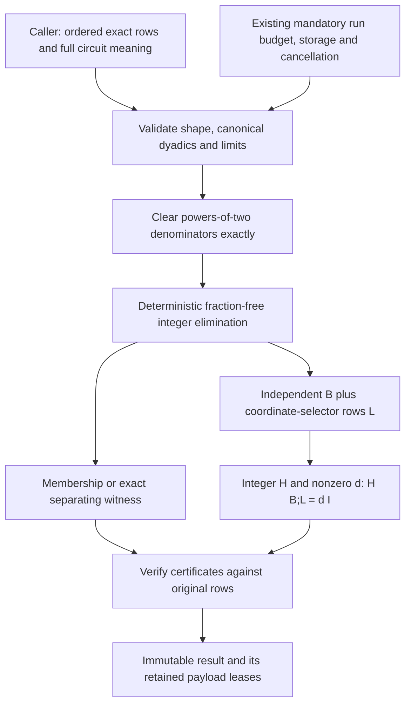

# Exact Row Algebra

## Purpose and Scope

Parent: [CoreSpiceAnalysis](../DESIGN.md). No children. This proposed component
owns bounded Pure Swift exact linear relations over finite dyadic input rows:
signed limb arithmetic, deterministic fraction-free row-space membership, and
completion of independent rows B to an invertible square matrix [B; L]. It is one
Analysis responsibility, not a general-purpose arbitrary-precision package.

Status: the Native package-internal lower kernel is qualified by the central
`exact-row/green-r1` run: all 16 owner tests pass, including both unchanged
initialization-work red regressions. The one comprehensive review finding on
Array initialization admission and its finding-limited recheck are closed.
This finite arithmetic/certificate/resource evidence does not qualify other
targets or SDK/full-circuit composition. Physical charge/algebraic charts,
guard-constrained roots, continuation and entire-history obligations remain open.

## Responsibilities and Boundaries

The component owns arithmetic and certificates about the supplied ordered rows.
It does not import OSDI, evaluate a model, select circuit rows, identify physical
units, decide that an identity holds in a source domain, or solve circuit equations.
The caller owns source/condition binding, full circuit incidence, complete device
contributions, guards, original raw/body/flow rows and their ordered coordinate
axes. A successful algebraic completion proves neither a physical charge chart's
existence nor roots, continuation, seam compatibility or entire-history behavior.

Inputs are exact values, not sampled Jacobians or thresholded matrices. No
floating-point rank, compensated-pair fallback, linked C integer library or external
solver may decide a zero, dependency, membership or invertibility result.

## Related Designs

| Design | Relationship | Contract Used | Cautions |
|---|---|---|---|
| [Analysis](../DESIGN.md) | parent | Run ownership and typed numerical failures | Exact algebra adds no solve/Newton attempt |
| [SparseExecution](../SparseExecution/DESIGN.md) | depends on | Existing cumulative budget, cancellation and storage bridge | This path requires both budget and storage; existing optional/unaccounted callers are not a bounded exact-algebra entry |
| [SparseFactorization](../../CoreSpiceCompile/SparseFactorization/DESIGN.md) | depends on | `LinearSolverExecutionControlling` checkpoints and retained payload leases | Reuse control only; no floating LU or solver dispatch |
| [NumericalState](../../CoreSpiceDevices/NumericalState/DESIGN.md) | coordinates with | Distinction between represented states and exact identities | Two binary64 components do not implement arbitrary-size integer arithmetic |
| [OSDI Topology](../../CoreSpiceOSDI/Topology/DESIGN.md) | future upper consumer | Actual raw-to-active-to-global incidence | Adapter/composition must preserve full row inventories and source scopes |

### Confirmed Existing Facilities and Dependency Gate

CoreSpice currently has no BigInt, exact rational or dyadic arithmetic dependency.
`CompensatedValue` normalizes a finite binary64 pair and bounds or discards tails;
it cannot represent arbitrary exact coefficients or decide these identities.
`TransientExecutionLimits`, `TransientExecutionBudget`, `AnalysisExecutionResources`
and `AnalysisLinearSolverControl` are the existing numerical resource contracts.
There is no current declaration named `NumericalExecutionPolicy`.

The conditional source-identity binding is now published in swift-osdi `1.1.0`
at `2c9ee1f620406e7a479ac10a4fddfaa17bc23d6d`; the earlier `0921a44` observation
was a development prerequisite, not qualification of CoreSpice's public graph.
CoreSpice now declares and publicly resolves `1.1.0`; the previous qualified
graph used `1.0.1`. Dependency resolution does not establish consumer behavioral
qualification, which remains separately owned adoption work.
The bounded arithmetic qualification uses exact standalone fixtures and does not
consume the SDK. Actual SDK/circuit composition requires the adopted public
revision plus the exact source-and-coordinate-condition binding described by
[RangeExecution](../../CoreSpiceOSDI/RangeExecution/DESIGN.md). Neither publication
nor local SDK evidence establishes that a circuit imposes that condition or that
these algebraic certificates define a physical chart.

## Architecture

The diagram's inverse equation denotes `H * [B; L] = d * I`. No public API is
introduced here. The initial implementation boundary is package-internal and
accepts the existing execution-control protocol; the parent composes it with the
actual Analysis owners. Primitive integers and mutable workspace remain private.

## Contracts and Invariants

### Exact Input and Primitive Arithmetic

A scalar is a signed numerator magnitude in least-significant-first UInt64 limbs
divided by `2^p`, with a nonnegative denominator power. Zero has no magnitude limbs,
positive sign and p = 0. Nonzero magnitudes have a nonzero final limb; when p > 0
the numerator is odd. Invalid encodings refuse rather than normalize silently.
Every input numerator and denominator bit length must fit the caller's explicit
integer-bit ceiling. No decimal or Double conversion participates in this path.

The required private integer operations are sign/zero, magnitude comparison,
negation, addition/subtraction, schoolbook multiplication, and checked nonnegative
binary shifts. Trailing zero removal is exact. General division, GCD, transcendental
functions and an extensible numeric tower are outside this unit. UInt64 full-width
products and explicitly checked carry/borrow implement the limb operations.

All dimensions, offsets, capacities, bit-length additions, shift counts, limb counts
and work products use checked machine arithmetic before indexing or allocation.
`ceil(bits/64)` uses quotient/remainder, avoiding a potentially overflowing `bits+63`.
Every produced intermediate, including elimination scales and certificates, is
bounded by the same explicit maximum integer bit length. An intermediate that
exceeds it fails even if a later cancellation would have produced a small result.
This is a capacity refusal, never a proof of dependency or nonmembership.

Input matrices are rectangular with explicit row/column counts and row-major cell
order. The column count is positive; an empty identity inventory is valid and has
zero row-space dimension. Shape, ragged/overlapping cell descriptors, noncanonical
scalars and out-of-range requested row indices refuse before arithmetic. Input
storage is an immutable borrow with an owner that outlives the operation.

### Integer Reduction and Exact Membership

For row i, let `p_i` be the largest denominator power in that row. Multiplying by
`D_i = 2^p_i` yields the integer row `A_i = D_i * B_i`. Clearing denominators is an
exact nonzero row scaling, with preadmitted shifts and destination capacity.

Elimination scans columns from first to last and selects the earliest remaining
row with an exact nonzero entry. Row order is stable except for the recorded pivot
swaps. For pivot p and entry a, row replacement is `row <- p*row - a*pivotRow`.
There is no division or magnitude threshold. Track the same operations on integer
row-combination coefficients, so every reduced row remains bound to the original
ordered input. Zero rows are exact dependencies, not discarded physical equations.

Membership for query q returns exactly one of these outcomes, after verification:

| Outcome | Exact certificate over the original input B |
|---|---|
| Member | Nonzero integer d and integer row c with `d*q = c*B` |
| Nonmember | Nonzero integer column z with `B*z = 0` and `q*z != 0` |
| Refusal | Invalid input, checked overflow, bit/work/storage limit, cancellation or inconsistent certificate |

Query denominator clearing and its scales are included in the certificate. They
are not rounded away. Dependent input rows remain in the certificate's original
row axis. The result does not select a different source/condition or reuse a
certificate from a prior matrix.

A nonmember witness is constructed from a nonzero residual free column. Starting
with that coordinate vector, reverse pivot substitution scales the whole vector
by each nonzero pivot and subtracts the exact pivot-row dot product in the pivot
coordinate. This gives an integer null vector without rational division. The
verifier directly checks the two products above against the original rows/query;
it does not accept a search success flag or merely a nonzero reduced residual.

### Invertible Completion

Completion receives r explicitly requested independent rows B of width n, with
`0 <= r <= n`. A dependent requested B is a typed refusal; the component cannot
silently replace it with a smaller basis. Exact row-space reduction is also usable
on a redundant identity inventory, but choosing which proved rows constitute B
is a separate explicit caller operation.

The complement L consists of coordinate-selector rows `e_j` for the nonpivot
columns, in increasing original column order. The selected pivot minor of B is
nonsingular by exact elimination, so `[B; L]` has n independent rows. With r = 0,
L is the full identity. With r = n, L has zero rows. No coordinate is removed from
the full width, including any caller-designated body, ground-incidence or flow
coordinate.

B and L here are generic algebra notation, not physical charge/differential or
algebraic row roles. In future circuit composition, already checked null-charge
rows remain the given rows. Coordinate selectors may supply only the complementary
differential rows, with an explicit row permutation to the physical ordering.
Completion never promotes a newly selected coordinate row into a proof of `LQ=0`.

Return L's selected original indices and a scaled inverse
certificate `(H, d)` with integer H and positive nonzero integer d satisfying
`H * [B; L] = d * I`. Fraction-free elimination on the augmented square matrix,
followed by fraction-free reverse elimination, produces a nonzero diagonal and
an integer row transform. Products of the other diagonal entries produce H and d
without division; denominator-clearing row scales are included in H. Normalize
the common sign only; no primitive/GCD normalization is promised.
The caller retains B and its source binding; certificate verification always takes
the original B explicitly. Result storage does not duplicate the caller's input.

The certificate is verified by a fresh exact product against the original B and
selector L before publication. It proves a two-sided inverse over the rationals
for this square matrix. It does not assert a dyadic inverse: for example a pivot
3 may require a denominator 3. Keeping H and d as integers avoids inventing a
general rational-arithmetic API or silently rounding `1/3`. A forged selected row,
selector, sign, denominator or inverse entry must fail this product check.

### Full-Circuit Pullback Assumption

The upper caller supplies the actual complete incidence and all device terms.
If raw device rows f contribute as `g = P*f`, then a global left row lambda can
use a local checked identity only after the exact pullback `lambda*P` is proved
to belong to that device's checked identity row space. This must hold for every
independent contributing device block, or another explicit exact relation must
justify their coupling. The kernel proves the supplied algebra only; it does not
infer cross-device cancellation, omit an unproved row or turn a local source
identity into a whole-circuit fact.

## Runtime Flows

1. Check cancellation and validate explicit limits, shape and encoded lengths.
2. Compute checked capacities for input copies, integer work cells, transformation
   coefficients, query witnesses, completion/inverse and verification scratch.
3. Reserve payload leases before allocation or copying. Initialize fixed-capacity
   workspace, then import/clear denominators under cumulative checkpoints.
4. Execute exact elimination and requested membership/completion operations.
5. Independently evaluate the certificate's original-row product identities.
6. Check cancellation, then publish the immutable result with its output leases.
   Release temporary buffers and their leases on every exit.

Refused attempts retain consumed work and release newly acquired capacity. A retry
uses the caller's same remaining run allowance; it cannot reset counters. A fresh
independent invocation requires a caller-created owner. No solver attempt or
Newton iteration is counted because no circuit solve occurs here.

## State, Ownership, and Lifecycle

| State | Owner and lifetime | Mutation / sharing |
|---|---|---|
| Borrowed input rows/query | Caller, through the synchronous operation | Immutable; no pointer escape or await |
| Integer cells, row transforms and scratch | One exclusive operation and its admitted leases | Private flat limb pools and checked ranges |
| Immutable row-space/result data | Result owner, including every retained limb/index buffer and lease | Sendable immutable sharing; no hidden mutable cache |
| Work / invocation usage | Existing caller budget and resources | Existing unconditional Mutex boundary |
| Capacity | Existing caller storage accountant | Lease retained through the final dependent buffer |
| Cancellation | Existing token and task | Checked through the existing control |

Hot loops borrow fixed contiguous limb pools with cell ranges and explicit logical
lengths. They do not allocate an Array or copy all integer operands per limb/row
operation. Different input/output scratch cells avoid mutation aliasing. Initial
implementation uses scoped safe buffers; unsafe memory/binding is not authorized
by this design. Any measured need for it requires a separate scoped lifetime and
alignment decision under the repository's unsafe-boundary rules.

An escaping result cannot refer into worker/session spans. The composition caller
must admit any retained SDK-to-kernel copy while the SDK view is live. Aliasing
immutable result values retains one owner; mutation must allocate an admitted
replacement while old storage and leases coexist. Temporary scratch never becomes
a view that outlives its lease. No shared mutable process-global state is added.
Immutable limb and selector buffers carry their output lease themselves, so
extracting a certificate component does not leave its backing unaccounted when
the enclosing result is released. Scalar/value comparison ignores lease identity.

## Failure, Concurrency, and Constraints

The bounded entry requires explicit row/column, integer-bit, workspace-byte and
result-byte ceilings, and a nonoptional execution controller. The Analysis
composition requires a nonoptional existing `TransientExecutionBudget`, storage
accountant and cancellation token; it constructs the existing bridge directly.
The optional `make` path and `UnaccountedStorage` fallback are not used. No hidden
default policy, new independent work owner or guessed machine-sized ceiling exists.

`checkpoint(workUnits:)` admits work before each bounded batch and observes token
and task cancellation before/after admission. Work counts limb inspection, carry/
borrow, shifts, multiply-accumulate, initialization, copies, row scans, swaps,
transform updates and final certificate products. The implementation must state
the conservative count for each operation before executing it. All explicit loops
poll at most every 256 limb/index steps, including zero scans and carry chains;
one large precharge does not replace those polls. There is a final zero-work
checkpoint before publication.
The implementation uses operation-local 256-unit credits before limb/index work;
at most 255 unused credits remain charged at exit. They are never refunded or
carried into another operation. Every actual fixed Array initialization is
separately admitted as a library primitive before allocation: all word/length/sign
arrays, workspace order/pivot/power arrays, selector arrays, exported Scalar arrays,
and every exported limb/index destination. Counts use checked additions/products;
remaining limb-loop credits cannot pay for these new initializations. Zero-valued
operations also spend credit
so sparse/empty scans cannot bypass cancellation or work admission.

Workspace/result limits count managed payload capacity, including unused limb
slots and array metadata slots, not only nonzero limb lengths. Admission includes
original retained rows, echelon/transform cells, simultaneous product/subtraction
scratch, old/replacement capacity and output while final verification scratch is
live. Checked high-water sizing precedes allocation. The same payload has one
lease; upstream aggregation must not reserve it again as an independent buffer.
Integer limbs are not reported as saved Double scalars. Allocator headers, Swift
object overhead and RSS remain distinct from this logical payload contract.

New component failures distinguish invalid encoding/shape, dependent requested B,
integer-bit/workspace/result limits and failed certificate verification. Checked
machine overflow uses the existing `TransientExecutionError.arithmeticOverflow`.
Existing work/storage/cancellation errors preserve their causal typed values.
Nonmembership is a successful proved negative result, not an exception. Limits,
cancel or internal verification failure are not nonmembership and publish no
partial certificate, stale basis or fallback success.

No external owner callback, I/O or allocation admission runs under a work-counter
lock. Simultaneous operations may share the existing synchronized work/storage
owners but own separate workspace. Native/WASM/Embedded have the same state and
isolation declarations; this design grants no new target qualification.

## Verification and Change Impact

Focused tests are in [ExactRowAlgebraTests](../../../Tests/CoreSpiceAnalysisTests/ExactRowAlgebraTests.swift).
They exercise the actual private arithmetic,
membership, completion and verification paths, with deliberately forged witnesses.

| Falsifier | Required observation |
|---|---|
| Signed carry/borrow, zero, limb boundaries and maximal limbs | Exact canonical results; checked sizing and no negative zero |
| Huge dyadic cancellation | `(2^4096 + 2^-4096) - 2^4096` retains `2^-4096`; no Double conversion |
| Almost equal exact rows | Rows `(2^4096, 1)` and `(2^4096, 1+2^-4096)` are independent if admitted; low bit budget refuses rather than lowering rank |
| True/false relations and dependent inventory | Member and separating witnesses verify against every original row; forged coefficient/null vector refuses |
| Local pushforward counterexample | For `f=(u,-u)`, local `(1,1)` is an identity. `P=(1,0)` and global lambda=1 pull back to `(1,0)`, which is a nonmember. `P=(1,1)` pulls back to a true member |
| Additional body/flow contribution | Identity span `(1,1,0)` cannot justify query `(0,0,1)` or omission of that coordinate |
| Completion boundaries | Empty B gives identity L; square independent B gives empty L; dependent B refuses without truncation |
| Nondyadic inverse | `B=(3,1)`, `L=(0,1)` yields integer H/d with exact product `dI`; no claim that the inverse is dyadic |
| Tampered completion certificate | Wrong selector, H entry, d, row order or missing original row fails exact product verification |
| Overflow and quota boundaries | Dimensions/shifts/products refuse before allocation; bit/work/capacity limits do not produce false membership |
| Mid-product cancellation / upstream refusal | No result callback/publication; all live payload leases refund, including cancellation after admission |
| Reuse, sharing and retry | Copied results retain capacity until final release; second operation consumes the same work owner; failed attempts do not reset usage |

Small exhaustive integer fixtures can compare certificate products with machine
integers only where every reference operation is checked to fit. Large fixtures
use symbolic expected powers/signs and exact product identities. C/GMP/Python may
serve as an independent offline test oracle, never the production algorithm.

Existing resource semantics are demonstrated by
[AnalysisLinearSolverControlTests](../../../Tests/CoreSpiceAnalysisTests/AnalysisLinearSolverControlTests.swift)
and [AnalysisExecutionResourcesTests](../../../Tests/CoreSpiceAnalysisTests/AnalysisExecutionResourcesTests.swift).
New owner tests must exercise the same cumulative refusal, post-admission cancel,
retained-copy lifetime and release behavior rather than repeat those tests as mocks
of the existing bridge.

Changing exact representation or elimination affects all certificates and verifier
fixtures. Changing resource/lifetime assumptions requires SparseExecution and the
Native composition owner's review. Future full-circuit chart/guard/root composition
requires its own upper contract and behavioral evidence after this lower component
is independently qualified; these tests do not establish that upper result.
