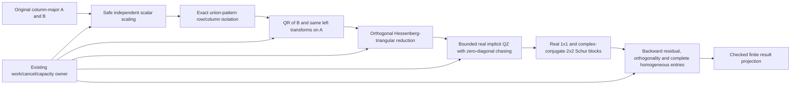

# Generalized Schur

## Purpose and Scope

Own the Pure Swift real generalized Schur algorithm used by finite-pencil pole-zero
analysis. Parent: [Analysis](../DESIGN.md). No children. This component replaces
foreign dense eigenvalue computation, not device equations or the public finite
pole/zero result schema. DC gain remains a composition of the existing sparse LU.

## Responsibilities and Boundaries

Own exact structural pair isolation, scaled real QR reduction, generalized Hessenberg reduction, implicit QZ sweeps,
Schur blocks, all homogeneous eigenvalue triples and numerical validation. Do not
invert B, fit determinant roots, sample frequency responses, regularize the pencil,
or delegate runtime work to an external numerical backend. No certificate of exact
rank, forward eigenvalue accuracy or model applicability is produced.

## Related Designs

| Design | Relationship | Contract Used | Summary | Cautions |
|---|---|---|---|---|
| [Analysis](../DESIGN.md) | parent | Affine pencil extraction and finite result | PZ caller owns physical applicability | All homogeneous entries are checked before finite projection |
| [Sparse execution](../SparseExecution/DESIGN.md) | coordinates with | Work, cancellation, capacity controller | Same invocation and case resources | No independent budget or hidden fallback |
| [Sparse factorization](../../CoreSpiceCompile/SparseFactorization/DESIGN.md) | depends on via PZ caller | Controlled partial-pivot Swift LU | Original G DC response | Gain does not use a dense foreign solve |

## Architecture

## Contracts and Invariants

Input arrays have checked n*n dimensions and finite entries. Matrices use one
column-major owner per plane; rotations and reflectors mutate borrowed storage,
without per-row or per-sweep arrays. Preparation retains the original borrowed
matrices for residuals. Working A/B and left/right orthogonal factors require O(n^2)
managed storage; all sizes and coexistence are checked and admitted before allocation.
The QZ payload bound includes five n*n planes, three length-(n+1) homogeneous
vectors, n homogeneous output triples, the coexisting n complex projections and
stored Array value slots. MemoryLayout<Array<T>> counts the Swift value itself,
not the runtime heap allocation header. Allocator overhead/RSS is not claimed by
this managed-payload contract. Caller row-descriptor slots use the same distinction.

The numerical algorithm follows Reference-LAPACK v3.12.1 DGGEV/DGGHRD/DHGEQZ and
DLAG2/DLASV2/DLARFG/DLARTG. The fixed sources are algorithm references and, where
translated, retain their BSD notice in THIRD_PARTY_NOTICES.txt. No Fortran, C,
Accelerate or LAPACK symbol is called by this component.

DGGBAL JOB=P exact-zero structural isolation precedes QR. Independent row and
column permutations accumulate into Q and Z; QR/Hessenberg/QZ operate only on the
remaining active square. Isolated 1x1 blocks are never contaminated by QR rounding.
No numerical threshold is used to declare an input rank or discard a finite root.

Independent A/B scaling is recorded and undone in homogeneous coordinates. Scaling
must not turn a representable nonzero homogeneous component into zero solely to
normalize its partner. Norms and elementary transformations use safe scaled
arithmetic. H-subdiagonal deflation uses machine precision and safe-minimum
relative criteria. T-diagonal zero chasing requires an exactly zero stored entry;
a nonzero entry is never overwritten with zero because of a norm threshold.
Shift estimation likewise preserves every nonzero B diagonal rather than replacing
it with DLAG2's conventional small-diagonal perturbation. Unrepresentable shift
arithmetic is a typed failure, not an infinite eigenvalue. Working Schur form has real 1x1
and 2x2 blocks with conjugate pairs; all n entries, including infinity, are retained.
A computed beta of exactly zero with nonzero alpha is infinite. Alpha=beta=0 is
indeterminate and fails the finite PZ request. A nonzero beta is never reclassified
as infinity because its ratio is large. Finite projection overflow is a typed failure.

The result is a backward-stable floating-point Schur computation, not an exact-rank
oracle: a near-singular original pencil can be ill-conditioned. Admission and qualification check
both original scaled-pair Schur residuals and orthogonality. The numerical quality
ceiling is 128*n*ulp for max-entry normalized reconstruction residual and orthogonality;
this ceiling is versioned with the algorithm and is not a source/physical tolerance. Repeated/defective pencils are judged by backward error
and algebraic multiplicity, not an unjustified forward relative-error promise.

Classification is explicitly numerical, not an exact-rank decision procedure.
Before QR, the exact row/column permutations may expose a triangular B with every
diagonal nonzero. That source-structural fact proves its spectrum is finite even
when a diagonal is tiny. Otherwise, a nonzero final T diagonal within the QZ
roundoff floor max(safeMinimum, ulp*normF(B_scaled)) leaves finite/infinite
classification unresolved and the complete request fails with a typed numerical
error. This floor refuses ambiguity; it never sets beta to zero or filters a root.
A computed zero beta that contradicts the triangular-B finite proof also fails.

In particular, dense exact singular Hadamard fixtures can leave a nonzero T
diagonal after QR rounding. This implementation refuses that unresolved spectrum;
it does not claim exact general-pencil rank/singularity support or classify those
values as successful finite or infinite roots. Exact isolated and triangular
nilpotent infinity cases remain supported. The coupled finite counterexample
A=[[1,1],[1,2]], B=diag(1,2^-1000) must successfully retain both finite roots.
These limitations cannot be generalized into complete general-pencil support or
release readiness. No global exact-rank oracle is introduced.

The reference QZ maximum of 30*n sweeps is checked for integer overflow. A shift or
iteration failure returns no partial successful spectrum. Physical source tolerances,
DC convergence and affine-device admission are unchanged. Existing PoleZeroResult
continues to publish only finite poles/zeros after every homogeneous entry is checked.

## Runtime Flows

PZ reserves checked caller payload before allocating port vectors, CSR stamp values,
G/C row planes, column-major copies and Rosenbrock planes. QZ and LU own separate
workspace leases; the Native wrapper must not reserve the old generic dense envelope
again. G/C projection reads the stamped CSR directly. Initializations, device/CSR
scans, layout conversion and augmented-pencil construction all charge/checkpoint the
same controller before bounded work batches.

PZ extracts one original G,C pair, solves the original CSR G*x=b using the supplied
controlled Swift LU and verifies that original linear residual, then computes the
pole and augmented Rosenbrock pencils in sequence. DC OP, gain and both spectra share
the same invocation budget, cancellation token and capacity owner. PZ negates alpha
for s=-lambda only at its existing finite output projection.

## State, Ownership, and Lifecycle

All mutable numerical buffers are invocation-local value storage. The immutable
controller forwards to the existing Mutex-protected budget and capacity leases;
no new shared mutable state or target-specific synchronization exists. A workspace
lease remains alive until its final buffer use, including throw and cancellation.
A refused invocation cannot expose partial factors or reuse stale state.

## Failure, Concurrency, and Constraints

Work is charged before bounded batches of explicit arithmetic, scans, resets and
validation, including all QZ sweeps. Cancellation polls remain bounded independently
of loop size and happen before allocation. A one-time cubic envelope is not treated
as payment for arbitrarily many iterations. Dimension, work and capacity overflow,
quota exhaustion, cancellation, non-finite arithmetic, nonconvergence, indeterminate
pencils, unresolved homogeneous classification, invalid Schur quality and finite
projection overflow remain typed failures.

## Verification and Change Impact

Owner tests: Tests/CoreSpiceAnalysisTests/GeneralizedSchurTests.swift and
QZNumericalPrimitivesTests.swift and PoleZeroSwiftGainTests.swift plus existing PoleZeroTests,
PoleZeroIntegrationTests and ReleaseNumericalRegressionTests.

Qualification uses independently constructed known spectra (finite zero, tiny
nonzero beta, repeated infinity with singular nilpotent B, real/complex mixtures,
zero/zero indeterminacy), exact dyadic left/right orthogonal transforms and two-sided
power-of-two scales. Independent original-pair residuals and orthogonality checks
cover every admitted Schur result. Tests exercise malformed/nonfinite input,
finite-ratio overflow, coupled tiny-beta success, unresolved dense-singular refusal,
cancellation during work, quota/capacity refusal and lease
release. Circuit fixtures verify RC/RLC poles, transmission zeros and original-G
resistive gain through the actual PZ caller. Central integration checks finite
API/CLI saved outputs and absence of foreign numerical calls from this path.

Primary references:
- https://raw.githubusercontent.com/Reference-LAPACK/lapack/v3.12.1/SRC/dhgeqz.f
- https://raw.githubusercontent.com/Reference-LAPACK/lapack/v3.12.1/SRC/dlag2.f
- https://raw.githubusercontent.com/Reference-LAPACK/lapack/v3.12.1/SRC/dlasv2.f
- https://raw.githubusercontent.com/Reference-LAPACK/lapack/v3.12.1/TESTING/EIG/dget51.f
- https://www.netlib.org/lapack/lug/node56.html
