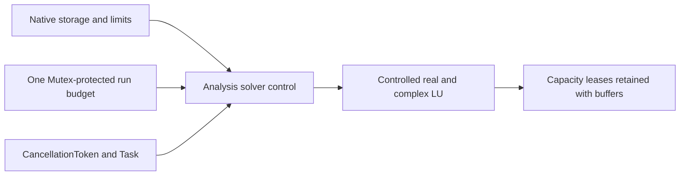

# Sparse Execution

## Purpose and Scope

Own the Analysis bridge from solver work/storage/cancellation to existing run
owners. Parent: [CoreSpiceAnalysis](../DESIGN.md). No children.

## Responsibilities and Boundaries

Compose one cumulative TransientExecutionBudget, CancellationToken and optional
AnalysisResultStorageAccounting with Compile's solver control requirements.
Do not duplicate factorization, choose allocation policy or change convergence,
physical residuals, accepted/rejected histories or output meaning.

## Related Designs

| Design | Relationship | Contract Used | Summary | Cautions |
|---|---|---|---|---|
| [Analysis](../DESIGN.md) | parent | Numerical lifecycle and quotas | Run composition | Share owner across DC/recovery/transient/frequency |
| [Factorization](../../CoreSpiceCompile/SparseFactorization/DESIGN.md) | depends on | LinearSolverExecutionControlling | Actual sparse work/capacity | Preserve typed refusal |
| [Native](../../CoreSpice/NativeExecution/DESIGN.md) | used by | Existing capacity lease | Complete preparation/execution peak | Do not double count retained topology |

## Architecture

## Contracts and Invariants

Remove dense n-squared/cubic assumptions from sparse factorization admission.
Iteration admission retains stamping/vector/device work; numeric factorization,
reach, ordering and substitutions separately charge actual bounded work batches.
Factor reuse charges substitutions, not another factorization. The
[GeneralizedSchur](../GeneralizedSchur/DESIGN.md) child owns the dense PZ QZ
workspace and actual bounded sweep work; this is not sparse eigensolving.

Configure the actual solver through a declared protocol requirement before bounded
execution. Custom bounded solvers must forward control or explicitly refuse it.
All preparation and Analysis paths pass the same cumulative budget and capacity
owner to embedded DC, recovery, transient, AC and noise. Temporary solver leases
are included in the existing Native peak together with preparation/output. Nested
runs cannot reset budgets. Controller checks cancellation before and after resource
admission; long factorization observes it at bounded graph/numeric checkpoints.

Singularity alone maps to AnalysisError.singularMatrix. Capacity, work, cancellation
and numerical failures preserve their typed cause and do not enter convergence
recovery or publish partial success. Existing FMA original-CSR residual, iterative
refinement, compensated coordinates and physical equation certificates retain
unchanged tolerances and acceptance semantics.

## State, Ownership, and Lifecycle

The bridge holds immutable Sendable references. Budget counters use the same
Mutex<State>; no I/O, external callback or resource admission runs under the counter
lock. Native's existing temporary reservation lease releases its own capacity once
after the final reference, including failures and cancellation. Solver copies keep
old leases until their owned buffers are gone.

## Failure, Concurrency, and Constraints

Checked integer arithmetic covers work/capacity and augmented dimensions. A storage
failure cannot be coerced into singularity. Cancellation remains cancellation in
terminal events and Native/CLI structured results. No new global mutable state.
Native CPU is the qualified path; no new GPU/other-platform numerical claim.

## Verification and Change Impact

Consumer tests cover low-work and low-capacity refusal, mid-factor cancellation,
retry/new-run independence, final-owner release, repeated factor solves and exact
resource ownership. Preserve strict Newton and compensated DC regression tests.
Execute DC/AC/transient/noise for original device models and large PEX through
source/API/CLI, then verify saved/reloaded values and solver identity. Solver
identity becomes CoreSpice.SparseLU.SwiftCSC.v2; old persisted results retain their
old identity and cannot be silently upgraded to new execution evidence.

The controller is installed at each Newton solve boundary (including embedded DC,
source/gmin recovery and transient steps) and once before each complex sweep or
transfer-function factorization. It is present only when a cumulative budget or
capacity owner is supplied. Raw unbounded custom solver calls retain their existing
protocol behavior. Noise source RHS reuse and linear refinement admit only vector
work at Analysis level; kernel checkpoints account substitutions. Pole-zero gain uses the existing controlled sparse LU on the original extracted G.
Dense pencil formation and QZ retain explicit matrix storage admission; the QZ
child charges bounded actual arithmetic and validation batches through the same
invocation controller and temporary leases, including cancellation and failure.
A single cubic precharge does not cover an unbounded iterative calculation.

| Logical state | Native storage / isolation / entry points | WASM / Embedded contract | Release |
|---|---|---|---|
| Run counters | `Mutex<State>`; `chargeWork` / admission methods / `statistics` | Same unconditional declaration and access methods | Run owner lifetime |
| Solver bridge | Immutable budget, token and storage references; checkpoints invoke each owner outside locks | Same Sendable value and methods; no target branch | Solver/controller lifetime |
| Cancellation | `CancellationToken` atomic and `Task.isCancelled` | Existing token/task contract; no state replacement | Token/task owner lifetime |
| Capacity | `AnalysisResultStorageAccounting.reserveTemporaryBytes` lease | No portable backend qualification added | Final returned lease owner |

Focused behavioral evidence is owned by
[AnalysisLinearSolverControlTests](../../../Tests/CoreSpiceAnalysisTests/AnalysisLinearSolverControlTests.swift)
and the existing
[NewtonLinearRefinementTests](../../../Tests/CoreSpiceAnalysisTests/NewtonLinearRefinementTests.swift).
They cover cumulative refusal, custom solver refusal, typed kernel failures, token
and task cancellation, lease release and the unchanged original-CSR refinement gate.

MOSL3ConsistencyTests.nonFiniteChannelFailsAnalysis verifies the initial extreme
finite-bias device stamp contains a nonfinite CSR coefficient and that the actual
production DC path preserves SparseSolverError.nonFiniteMatrixValue with that
coefficient's index. It must not wrap this failure into singularity or convergence
recovery; an early solver diagnostic is a valid explicit numerical failure.
