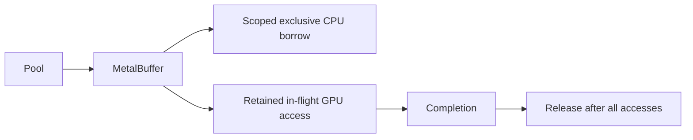

# MetalExecution

## Purpose and Scope
Child of [CoreSpiceBackend](../DESIGN.md), owning Metal buffer and submission lifetime.

## Responsibilities and Boundaries
Private raw MTLBuffer storage is retained by a MetalBuffer lease. Pool reuse begins
only after release and the last CPU/GPU access finishes. Invalidated old handles
cannot access reused storage. No user closure, callback or Metal call runs under Mutex.

## Related Designs
| Design | Relationship | Contract Used | Summary | Cautions |
|---|---|---|---|---|
| [CoreSpiceBackend](../DESIGN.md) | parent | Checked dispatch | Native implementation | Native-only Metal target |
| [Photonic GPU](../../PluginsPhotonic/GPU/DESIGN.md) | used by | Buffer allocation | Checked sizing | Shared ABI remains unchanged |

## Architecture

## Contracts and Invariants
Kernel identity and pipeline ownership are immutable MetalKernel values; bounds
validation never depends on a caller-mutable Metal label.
The typed API accepts Swift values with native BitwiseCopyable conformances.
Imported C coefficient and descriptor structs remain CPU ABI values; GPU storage
is explicitly prepared as Float or UInt32 fields, preserving exact field order.
Element type/count are recorded at allocation, checked before every typed access,
and initialized using GPUBufferElement.gpuBufferZero. TypedBuffer count is checked
against logical count, not rounded allocation length. Reentrant CPU access fails
immediately; GPU admission fails during CPU access. GPU accesses retain the owner.

## State, Ownership, and Lifecycle
| State | Storage | Isolation | Read / mutation | Release |
|---|---|---|---|---|
| Lease CPU/GPU/released flags | MetalBuffer.State | Mutex | begin/end access | Recycle once idle and released |
| Cached allocations and limit | BufferPool.State | Mutex | acquire/recycle | drain drops idle cache |
| Submissions and failures | MetalSubmissionTracker.State | Mutex | register/complete/snapshot | synchronize consumes failures |
No WASM/Embedded branch exists; these are native Metal implementations.

## Failure, Concurrency, and Constraints
`BackendConfiguration.maxBufferSize` / pool maxBytes is the maximum rounded size
of one allocation, not an aggregate memory reservation. Multiple live allocations
and cached size classes can exceed it in aggregate. Shrinking that per-allocation
limit below any live allocation is rejected; no aggregate-budget policy is added.
CPU/GPU overlap and use-after-release produce typed errors. Submission failure is
reported to its caller and retained for synchronize. Synchronize snapshots submissions
registered before its call and awaits completion even if the waiting task is cancelled.
Known-MZI generic dispatch exclusively borrows a UInt32 descriptor, rejecting
prior GPU writers, then captures its three fields and supplies that immutable
snapshot through setBytes. Descriptor storage is never read by the submitted
kernel; later CPU or GPU edits cannot invalidate admission. State and coefficient
storage must both have exact Float logical element type. Arbitrary custom kernels
retain caller responsibility for their declared ABI.
MZI kernels accept even count 1...256 or odd count 1...255; offset+2*count must stay within 512 ports and match pattern parity.
Coefficient storage holds count matrices. State storage must hold batchSize*512 complex Float values.

## Verification and Change Impact
Tests cover real even/odd/full/partial, multibatch, invalid dimensions/capacities,
CPU reentry, release while in flight, callback synchronization and failed submissions.
Changing handle ownership requires backend and photonic integration tests.
