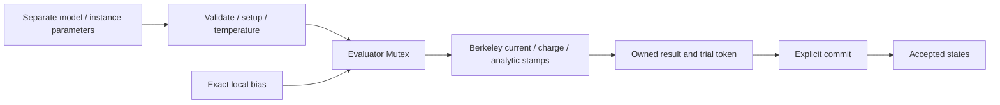

# BSIM3 Evaluator

## Purpose and Scope

This component owns Berkeley BSIM3 3.3.0 model evaluation. Its parent is
[CoreSpiceCompactModels](../DESIGN.md), and its physics dependency is the
[CoreSpiceBSIM3 kernel](../../CoreSpiceBSIM3/DESIGN.md).

## Responsibilities and Boundaries

The evaluator accepts separate model and instance parameters, explicit polarity,
exact version, operating temperature in kelvin, and local node values.
Nominal model temperature defaults to 300.15 K; original `tnom` model
parameters are in degrees Celsius and independently override that default.
It returns nonlinear
DC/transient residuals, equivalent-source RHS, analytic real/imaginary matrices,
physical terminal charges, all 17 internal states, and operating-point data.
Circuit topology, Newton limiting, convergence, timestep selection, and circuit
acceptance remain outside this component. Noise analysis is not exposed.

## Related Designs

| Design | Relationship | Contract Used | Summary | Cautions |
|---|---|---|---|---|
| [CompactModels](../DESIGN.md) | parent | Safe independent model API | Public evaluator | No frontend gate is opened by kernel evidence |
| [C kernel](../../CoreSpiceBSIM3/DESIGN.md) | depends on | Fixed local ABI | Official equations and bounded storage | Published calls and destruction use the same Mutex |

## Architecture

## Contracts and Invariants

Local index 0 is ground; 1/2/3/4 are drain/gate/source/bulk. Drain prime,
source prime, and NQS charge indices are reported by topology; their voltage
or scaled charge-deficit values must be supplied explicitly. Series nodes are
never silently collapsed. NQS states and frequency-dependent AC stamps use the
original equations. DC/transient residual is `G * bias - RHS`; AC returns the
exact original complex matrix rather than assuming `G + jωC` for AC NQS.
Physical charges map to gate, drain prime, source prime, and bulk; NQS charge
is separately represented in the state vector. The source charge is the
negative sum of the other terminal charges. Model polarity converts charge
states to physical charge. Current and charge derivatives must agree with
finite differences within numerical tolerance in each operating region.

Input parameters must exist in the original writable table, be finite, and
have the declared scalar/vector kind. Selector and version domains are checked
before setup. Original parameter-check warnings and adjustments are returned
as structured diagnostics; fatal checks, non-finite outputs, diagnostic
capacity exhaustion, bad topology values, and bad history transitions throw.

## State, Ownership, and Lifecycle

One `Mutex<State>` owns exactly one C allocation, including model, instance,
size-dependent preprocessing, sparse buffer, trial and accepted states. Construction exclusively owns the
unshared handle until publication. All
published read/mutation/destruction calls use that same lock on every target, without
conditional synchronization. No I/O, await, external closure, or user callback
runs inside it. C functions retain no caller pointers. The only file-scope
objects in the kernel are immutable tables and version strings. Destruction
frees the handle once; a result cannot borrow its memory.

## Runtime Flows

Initialization performs setup and temperature preprocessing once. History is
initialized explicitly at an accepted initial bias, with zero charge-current
history. Evaluation updates trial state only. Backward Euler uses `(Q-Qprev)/dt`;
trapezoidal uses `2*(Q-Qprev)/dt-Iprev`. Commit accepts only the latest successful
transient token. DC/AC evaluation, failed evaluation, and history initialization
invalidate a trial token. A rejected trial cannot change accepted history.

## Failure, Concurrency, and Constraints

Each evaluator is bounded to eight local slots, 64 complex entries, 17 states
per history level, one geometry block, and 32 KiB diagnostics. Model and instance
configuration contain at most 512/32 parameters respectively, with names bounded to 64 UTF-8 bytes.
No scratch file,
process, simulator-global state, or heap allocation occurs during evaluation.
The caller owns analysis time and cancellation; synchronous fixed-size kernel
operations have no suspended work or background task.

## Verification and Change Impact

[BSIM3KernelTests](../../../Tests/CoreSpiceCompactModelsTests/BSIM3KernelTests.swift)
owns cold initialization, strict parameter failures, DC/current and charge
finite differences, NMOS/PMOS and reverse bias, full series/NQS topology and
AC, accepted BE/trapezoidal history, concurrency, and numerical rejection.
Independent ngspice 3.3.0 fixture values qualify only these model cards and
biases, never a foundry process. Changes to ABI, state order, or topology require
revalidation here and in any production bound-device consumer.

The C boundary borrows fixed SIMD storage only for synchronous calls. Imported
fixed C arrays preserve exact buffer counts; the safe public API exposes SIMD
values instead of raw buffers or retained Span views. Memory owner, alignment,
initialized extents and no-escape lifetime are checked in scoped Swift borrows;
the pointer exists only because the original physics ABI is C. No raw pointer
is exposed to an evaluator client.
