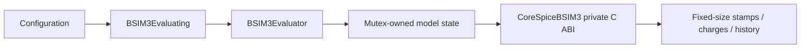

# CoreSpiceCompactModels

## Purpose and Scope

This SwiftPM module is an independently usable native compact-model evaluator.
Its parent is [CoreSpice](../../DESIGN.md); its children are [BSIM3](BSIM3/DESIGN.md), [BSIM4](BSIM4/DESIGN.md), and [PreparationStorage](PreparationStorage/DESIGN.md).

## Responsibilities and Boundaries

The module owns safe model configuration, evaluator lifetime, local topology,
physical currents, analytic matrices, charge states, and accepted history. It
provides no circuit solver, frontend model selection, or foundry qualification.

## Related Designs

| Design | Relationship | Contract Used | Summary | Cautions |
|---|---|---|---|---|
| [CoreSpice](../../DESIGN.md) | parent | Native simulation domain | Independent evaluator product | Selector qualification is owned by Devices BSIM3 |
| [BSIM3](BSIM3/DESIGN.md) | child | Safe model evaluation | Berkeley 3.3.0 physics | Preserve full NQS and series-node semantics |
| [BSIM4](BSIM4/DESIGN.md) | child | Safe original evaluator | Independent host kernel | Production requires separate Devices proof |
| [PreparationStorage](PreparationStorage/DESIGN.md) | child | Explicit local preparation budgets | Shared payload accounting | Actual capacities are checked before use; allocator metadata is excluded |

## Architecture

## Contracts and Invariants

Construction exclusively owns an unshared model. Every published mutable
model field is serialized by one evaluator's Mutex. Results are
owned values; no pointer or callback escapes that boundary. Failure is typed,
never a zero stamp, substituted model, or falsely accepted timestep.

## Verification and Change Impact

[Kernel tests](../../Tests/CoreSpiceCompactModelsTests/BSIM3KernelTests.swift)
prove the evaluator contract. Solver composition has a separate owner and must
verify actual DC/AC/transient before model selection can advertise support.

## BSIM4 Kernel Composition

[BSIM4 evaluator](BSIM4/DESIGN.md) owns exact Berkeley 4.8.3 host CPU evaluation. This lower
contract does not open the native Level 54 frontend/binding gate; production
integration and correlated noise composition remain incomplete.
