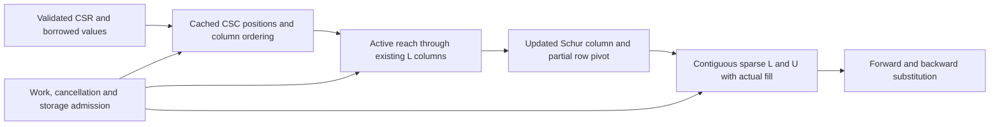

# Sparse Factorization

## Purpose and Scope

Own numerical real/complex sparse LU and its control/statistics contract. Parent:
[CoreSpiceCompile](../DESIGN.md). No children. Public SparseLUSolver and
ComplexSparseLUSolver are module composition entries over this component.

## Responsibilities and Boundaries

Own CSC preparation, active graph reach, numerical row pivoting, complete fill,
reusable numeric buffers and normal solves. Do not own nonlinear convergence,
waveform/history, model equations, application resource policy or I/O. No dense
factor buffer, size crossover, implicit drop tolerance or dense fallback exists.

## Related Designs

| Design | Relationship | Contract Used | Summary | Cautions |
|---|---|---|---|---|
| [Compile](../DESIGN.md) | parent | Validated CSR, solver protocols | Numerical implementation boundary | Preserve original CSR for residuals |
| [Ordering](../SparseOrdering/DESIGN.md) | depends on | Controlled deterministic permutation | Reduce fill before numeric LU | Ordering is not a pivot/fill proof |
| [Sparse execution](../../CoreSpiceAnalysis/SparseExecution/DESIGN.md) | used by | Run control and temporary-storage leases | Compose caller limits | Exceptions retain their typed cause |

## Architecture

## Contracts and Invariants

The independent Swift implementation uses column-oriented left-looking Gaussian
elimination and iterative graph reach. The mathematical algorithm is also
explained by Davis' sparse LU work; the upstream CXSparse implementation is an
external reference, not a linked backend or copied source dependency:
https://github.com/DrTimothyAldenDavis/SuiteSparse/tree/dev/CXSparse/Source .

Input structure and ordering mode key structural caching. Numeric pivot and fill
are recomputed for every factorization. Pivot candidates are updated Schur-column
values, with deterministic maximum-magnitude row selection and diagonal tie
preference. Singularity means no nonzero finite candidate, not a fixed absolute
1e-15 threshold. Complex comparison/division avoids unnecessary square overflow.
Only exact numeric zero may be omitted. Every retained intermediate/result must
be finite, otherwise a typed numerical failure is returned. Begin factorization
by invalidating the previous factors; failure cannot leave a usable stale solve.

Storage is O(n + nnz(A) + nnz(L) + nnz(U)) including capacity slack and active
workspace. Fill may itself become dense; no O(nnz(A)) general guarantee is made.
No pivot step scans the entire dimension unless all those rows are reached.
Normal solves preserve original row/column order and support multiple RHS values
without refactorization. The inout solve uses caller-owned output as its working
vector and cached permutation cycles, without a new dimension-sized temporary.
The allocating solve remains explicitly allocating; callers own returned storage.

`LinearSolverExecutionControlling` owns two fallible requirements:
`checkpoint(workUnits: Int)` and `reserveStorage(byteCount: Int) -> any Sendable`.
The returned immutable lease must retain its release owner. Solvers retain leases
while admitted buffers remain live. `configureExecution(_:)` is a solver protocol
requirement; a bounded custom solver must implement it or refuse explicitly.
The default cannot silently ignore a nonnil controller. Existing unbounded calls
remain available and do not claim caller resource guarantees.

Before allocating/growing buffers, request checked managed payload capacity.
Fixed-count Array storage and geometrically enlarged factor buffers keep capacity
explicit; retain old and replacement leases through their coexistence. Before a
mutating refactor, admit a complete replacement payload while old leases remain
alive, covering copy-on-write when a solver value was copied. No ownership or
threading contract is weakened. Managed payload includes scalar/index buffers and
array slots; it is distinguished from allocator overhead and measured process RSS.
Work is charged before bounded batches of numeric/graph operations. Polls remain
bounded independently of precharged library allocation work. Fixed-count Array
initialization is admitted as a library primitive; explicit validation, reset,
copy, reach, renumber and substitution loops poll at most every 256 operations,
and success has a final cancellation checkpoint. Structural cache authority is
invalidated before a fallible rebuild, so partial workspace replacement cannot
reuse an old shape after refusal. Replaced workspace buffers, their permutation
and retained base-capacity estimate agree before the next fallible operation;
an interrupted rebuild therefore retains accurate admission through a refused
retry, including dimension shrink and copy-on-write ownership. The structural
cache key is published only after preparation completes. Checkpoints also check
cancellation. Resource refusal must not become singularity/recovery.
Statistics expose actual input/factor counts, buffer capacity, admitted managed
bytes, work and cache/pivot activity; they do not claim measured heap allocations.

The run-local work meter retains its strong controller for its entire lifetime.
Check credit and polling eligibility before binding the controller existential:
ordinary credited operations must not copy/destroy that owner. This changes no
checkpoint sequence: positive precharge still precedes work, every 256th explicit
operation (including a zero-work spend) still polls, and failures retain their
original propagation and state-update order. Numerical arithmetic, work charges,
storage leases and final checkpoints remain unchanged. Inspect optimized code and
measure the complete original PEX API/CLI path to establish the performance effect;
unchanged output bytes alone do not prove an acceleration.

## State, Ownership, and Lifecycle

Solver structs exclusively mutate their run-local Array buffers. Copies retain
Swift value semantics and existing leases; mutation receives replacement admission
before possible COW. Factors are read-only during solve. Closure borrows do not
escape. The controller is Sendable; shared counters stay behind the existing
Mutex and no external callback or I/O runs under that lock. Dropping the final
solver/buffer owner releases leases. No unsafe Sendable or target-specific raw
state is introduced.

## Failure, Concurrency, and Constraints

Preserve CompileError shape/structure/singularity failures. Sparse numerical,
capacity-overflow and unsupported-control failures remain typed. Check finite
matrix/RHS and finite arithmetic, checked count/byte growth and result dimensions.
Separate instances may run concurrently; sharing a mutable solver still requires
exclusive ownership. This task qualifies Native CPU only, not Metal/WASM/Embedded.

## Verification and Change Impact

Tests own Schur-pivot counterexamples across old 499/500/501 crossover, nonsymmetric
fill and multiple swaps, scale extremes, singular/nonfinite failures, stale-factor
refusal, repeated-value/structure/ordering changes, controlled work/storage/cancel
refusal, COW copies and lease release. SparseWorkspaceAdmissionTests covers
post-allocation preparation cancellation, refused retry without premature lease
release, real/complex workspace growth, natural/AMD shrink, recovery to either
shape and final-owner release. Compare original-system residuals and small
systems against an independently implemented dense partial-pivot reference.
Large diagonal/chain/mesh and actual extracted PEX measurements report cold/warm
work, factor counts, managed bytes, RSS and time separately. Analysis retains its
FMA-compensated original CSR residual and physical equation gate unchanged.
SparseBatchPollingTests fixes positive/zero checkpoint boundaries, admission and
poll failures, unbounded/overflow behavior and final-controller-owner release.
