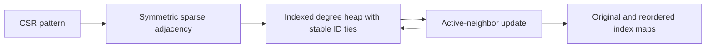

# Sparse Ordering

## Purpose and Scope

Own deterministic sparse structural ordering and public symbolic inspection.
Parent: [CoreSpiceCompile](../DESIGN.md). No children.

## Responsibilities and Boundaries

Own permutation values, active minimum-degree selection and structural inspection.
Do not select numeric pivots, certify numeric fill capacity or allocate factors.
The existing AMDOrdering name remains for API continuity; the implemented method
is exact active minimum degree with explicit sparse neighbor cliques, not a
quotient-graph AMD implementation.

## Related Designs

| Design | Relationship | Contract Used | Summary | Cautions |
|---|---|---|---|---|
| [Compile](../DESIGN.md) | parent | Validated CSR | Structural owner | Valid input indices |
| [Factorization](../SparseFactorization/DESIGN.md) | used by | Permutation and execution control | Reduce fill | Numeric fill is measured separately |

## Architecture

## Contracts and Invariants

Use an indexed heap so each node has at most one queue slot. No full dimension
scan per elimination and no unbounded stale-entry heap. Neighbor ordering and
node-ID tie breaking are deterministic. Sort the admitted neighbor buffer before
clique insertion and heap updates so fresh Set hash seeds cannot change charged
heap work. Sorting charges a fixed height envelope for each sift, including idle
iterations after the heap condition is satisfied; both ordering and charged work
are reproducible for identical structural inputs. Active clique fill is explicitly stored,
charged and controlled; dense graph fill can be refused and cannot switch backend.
Controlled ordering is fallible; standalone APIs propagate typed errors rather
than selecting a silent fallback. SymbolicAnalysis is an advisory no-numeric-pivot
structural view. Its unsymmetric closure must be complete for that assumption;
it is never a storage-admission authority or a promise under row pivoting.

## State, Ownership, and Lifecycle

Local value storage only. Shared caller control is invoked outside any owner lock.
Temporary graph/heap storage retains capacity leases through allocation and growth.
Graph rows use explicit geometric Set reservations (minimum four elements), charged
at a conservative 128 bytes per admitted element because Swift Set does not expose
its exact hash allocation. Replacement admission coexists with the prior lease
until reserveCapacity finishes. Fixed arrays admit their element strides, including
lease slots and capacity metadata. Permutation and symbolic outputs retain their
own payload leases; graph/heap leases expire at return. This managed envelope is
not an allocator-byte or process-RSS measurement.

Unsymmetric symbolic closure maintains both row and column incidences. For each
pivot, every existing lower incidence is paired with every upper incidence and
new incidences enter both views before the next pivot. No symmetric edge is
invented. The advisory dependency parent is the first later row using a pivot;
this forest does not prove parallel numeric independence. Output row sorting uses
iterative heapsort with cancellation checkpoints inside bounded operations.
No change to global state, platform synchronization or concurrency conformance.

## Failure, Concurrency, and Constraints

Arithmetic, storage/work admission and cancellation propagate before affected work.
SparseOrderingError reports capacity overflow or an inconsistent supplied permutation;
controller errors retain their original type.
Allocation and graph-fill counts are bounded by the caller's control. Uncontrolled
legacy use has no application resource ceiling claim. Permutation values remain
validated by their constructing algorithm and preserve inverse mapping.

## Verification and Change Impact

Verify exact permutation/inverse, stable equal-degree order, diagonal/chain/star
scaling, disconnected graphs, ordering changes in solver cache keys, bounded
failure, fresh-allocation charged-work reproducibility and nonsymmetric symbolic closure. Recheck numeric factorization consumers
when ordering changes, using original-system residuals rather than exact LU bytes.
