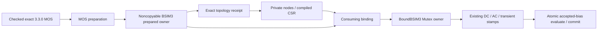

# BSIM3 Production Device

## Purpose and Scope

This component owns lossless native Level 49 admission and binding. Parent:
[CoreSpiceDevices](../DESIGN.md). It has no children. It composes the independently
verified BSIM3 3.3.0 evaluator through its safe protocol, without importing its C ABI.

## Responsibilities and Boundaries

The approved S3 preparation/binding boundary is owned by
[MOSPreparation](../MOSPreparation/DESIGN.md). The historical descriptor path
prepares during Lowering and repeats preparation during binding; it is the
pre-migration implementation, not the target owner contract.

BSIM3Preparation converts separate resolved model/instance values to an admitted
kernel configuration. The descriptor binds physical and private auxiliary nodes.
BoundBSIM3 owns matrix stamps, accepted-history session admission and atomic
re-evaluate/commit. The kernel owns official current/charge/NQS equations; the
analysis owns solve, timestep acceptance and session lifetime.

## Related Designs

| Design | Relationship | Contract Used | Summary | Cautions |
|---|---|---|---|---|
| [Devices](../DESIGN.md) | parent | Registry and throwing BoundDevice | Model selection | No fallback to L3 |
| [Compact BSIM3](../../CoreSpiceCompactModels/BSIM3/DESIGN.md) | depends on | BSIM3Evaluating | Official bounded native physics | Exact version, topology and accepted token are authoritative |
| [IR](../../CoreSpiceIR/DESIGN.md) | depends on | Resolved model and owned nodes | Lossless provenance | No C fields enter IR |
| [Analysis](../../CoreSpiceAnalysis/DESIGN.md) | used by | Solver-owned transient lifetime | Acceptance and rejection | Begin/end brackets every run exit |
| [MOSPreparation](../MOSPreparation/DESIGN.md) | used by | Exact prepared owner and consuming bind | Single cold setup per run | Lowering/rebind preparation is removed during migration |

## Architecture

## Contracts and Invariants

- Exact version 3.3.0 is admitted, with the original default when omitted. Other
  versions fail explicitly; no version rounding, renaming, or simplified model.
- Model and instance parameters remain separate, including acnqsmod role. Original
  IC is represented as three DS/GS/BS values. Instance multiplier m is a positive
  finite parallel-instance scale applied to all electrical matrix/RHS outputs;
  each representative evaluator retains its original charge/history semantics.
- Each original local node slot 1...4 maps to D/G/S/B. Slots 5...7, when present,
  map in kernel order to fresh instance-owned nodes. Every active pair is compiled
  and bound; absent, aliased, duplicated or changed auxiliary ownership fails.
- DC uses original residual linearization, AC uses the full original complex
  matrix, and BE/trapezoidal use original charge and NQS integration. The original
  local RHS and matrix are stamped directly, including series conductances.
- Numerical/admission failure remains typed through all solver calls. No partial
  matrix is stamped before successful evaluation and no failure becomes zero.
- Noise uses the original four current PSDs, mapped from actual prime/physical
  nodes. Parallel multiplier m scales each independent current PSD once; the
  circuit transfer function uses the already multiplied electrical matrix.
  Zero series PSDs remain named sources for stable tracking. Evaluation may
  throw and never returns replacement zero sources on failure. This component
  does not provide BSIM4 or foundry qualification; BSIM4 has a separate owner.

## Runtime Flows

The approved S3 flow prepares the already resolved exact 3.3.0 release once at
explicit execution conditions, retains the admitted evaluator and projects its
exact auxiliary topology. Consuming binding maps that same owner without cold
setup. The historical Lowering/descriptor repetition remains until migration
implementation is verified. A transient session initializes charge history
from the run initial solution (UIC applies explicit terminal IC through the
analysis initial-condition hook). Trial stamps only read accepted history.
Acceptance re-evaluates the final bias using the accepted integration method and
commits that token atomically. End releases the session without publishing a
partial result.

## State, Ownership, and Lifecycle

| State | Storage owner | Isolation | Read / mutation | Release |
|---|---|---|---|---|
| Immutable mapping/model metadata | BoundBSIM3 | Sendable values | Binding / stamping | Bound owner lifetime |
| Transient active flag and kernel operation sequence | BoundBSIM3 State | Mutex on every target | begin/end/stamp/commit/noiseContributions | End on all run exits |
| Original C context and accepted/trial states | BSIM3Evaluator | Its existing Mutex on every target | Safe evaluator protocol only | Exactly-once evaluator destruction |

| Target source | Storage / isolation | Read / mutation / release entry points | Runtime evidence |
|---|---|---|---|
| Native | BoundBSIM3 Mutex<State> and evaluator Mutex<State> | Same declared begin/end/stamp/commit/noiseContributions and evaluator noiseSpectrum/destruction | Host CPU tested |
| WASM | Identical common declarations, no platform branch | Identical declared entry points | Compile/link/runtime unverified |
| Embedded | Identical common declarations, no platform branch | Identical declared entry points | Compile/link/runtime unverified |

The outer Mutex makes composite initialize/evaluate/commit operations atomic.
Its lock order is outer owner then evaluator. No reverse access, external callback,
I/O or await occurs while either lock is held. Constructor has exclusive ownership
before publication. Concurrent DC/AC evaluations do not mutate accepted history;
concurrent transient session acquisition is a typed rejection before mutation.

## Failure, Concurrency, and Constraints

Safe evaluator capacities and failures are preserved. Local matrices use fixed
8-node/64-entry values; mapping is allocated once at bind time. Runtime bias uses
fixed SIMD storage, and no C pointer escapes. No conditional synchronization or
unchecked Sendable is introduced. Host CPU runtime is verified; WASM/Embedded
compile/link/runtime and Metal remain outside this evidence.

## Verification and Change Impact

[CoreSpiceBSIM3IntegrationTests](../../../Tests/CoreSpiceBSIM3IntegrationTests)
owns the production proof: exact frontend version/provenance, cold admission,
private sparse nodes, original independent fixtures, current/charge finite
differences, actual DC/AC/BE/trapezoidal analysis, NQS/series execution, accepted vs
rejected history, repeat reset, concurrent session failure and exit cleanup,
and typed invalid-version/admission/numerical/noise failure. Revalidate direct
Lowering, IR, Compile, Analysis and IO consumers when this contract changes.

### Independent analysis oracle authority

The production equations are Berkeley BSIM3 3.3.0. The independent ngspice 46
reference is pinned to source tag `ebdaf58ec76a06ffaac7e0f138360dd1cf5ee4b6`.
Its instance-temperature extension recomputes `tconst` using a reused `T0`
(`sqrt(1 + nlx/leff)`) rather than the original `leffCV * leffCV`. For these
fixed fixtures only, the reference input uses
`elm_reference = elm_original * sqrt(1 + nlx/leff) / (leffCV * leffCV)`.
Effective lengths are 1 micrometer: drawn L is 1 micrometer and original
`lint`, `dlc`, `ll`, `lw`, `lwl` corrections are zero. Effective mobility is
the same on both sides (u0=500, nominal/actual 300.15 K, reference mulu0=1).
The original elm=5 and nonzero drift/diffusion physics remain in the native
input. This transformation is derived from the fixed equations, not fitted
to observed outputs, and is not a general geometry adapter.

The reference-only CTM body derivative is also corrected by the product/chain
rule already documented in the [physics design](../../CoreSpiceBSIM3/Kernel/DESIGN.md),
so the reference matrix compares the same derivative without weakening the
AC tolerance. The source archive, original file hashes, patch, executable hash,
original uncorrected discrepancy and transformation are recorded in the fixture
generator and JSON. No reference executable is used at simulation runtime.
These fixtures qualify the original model under their stated inputs; they do
not qualify arbitrary ngspice extensions or a foundry process.

[CoreSpiceBSIM3NoiseTests](../../../Tests/CoreSpiceBSIM3NoiseTests) owns original
mode, frequency, temperature, polarity, series/multiplicity and NQS noise proof
against an independent source-pinned oracle. Noise uses the existing outer then
evaluator Mutex order, preserves accepted history and invalidates trial tokens.

The noise oracle compares the original junction gmin=1e-12 model under explicit
fixture solver gmin=0. CoreSpice's default diagonal regularization differs from
ngspice's junction-only conductance; it measurably changes the nearly cancelling
rd transfer by approximately 1 ppm. The production default remains unchanged
and has separate successful/failed behavior tests. No tolerance was relaxed to
hide this distinction. SI2019 reference primitive alignment, original header
hash and unaligned spectra are retained beside the noise fixtures.

## Approved Single-Owner Preparation

Status: designed for S3; runtime completion is recorded in workspace PROGRESS.md.
[MOSPreparation](../MOSPreparation/DESIGN.md) owns the public preparation protocol,
portable identity matching, local capacities, cancellation boundaries and binding
failure contract. This component owns its release-specific physical mapping.

The prepared value is noncopyable. Its evaluator is private and concrete, created
fresh by the factory, with no outward evaluator getter or initializer accepting
another evaluator. Consuming binding transfers that sole native reference into
the existing BoundBSIM Mutex state. Standalone CompactModels evaluator APIs are
independent and unchanged. The outer history/session lock and evaluator lock are
both retained, with the existing outer-to-inner lock order.

Model TNOM, when supplied, remains authoritative. When absent, only the derived
kernel configuration receives caller nominalTemperatureKelvin minus 273.15 as
Celsius TNOM; the original resolved model and suppliedness evidence are unchanged.
Ambient temperature and both caller condition values remain fixed by preparation
identity. Existing kernel Celsius conversion is used once.

Before publishing the prepared owner, the local budget includes the safe
evaluator's exact C allocation query and Swift retained/temporary capacity.
Failure destroys the evaluator once; consuming bind checks every required CSR
pair, topology alias and terminal IC constraint before the final nonthrowing
BindingContext claim commit. No missing active matrix entry is silently omitted.
Direct preparation tests cover failure/drop/transfer lifetime, condition/identity
drift, capacities and cancellation; existing integration/noise tests own
unchanged physical stamps and accepted-history behavior. Root composition owns
actual single-run transfer and no cold setup between DC points.
