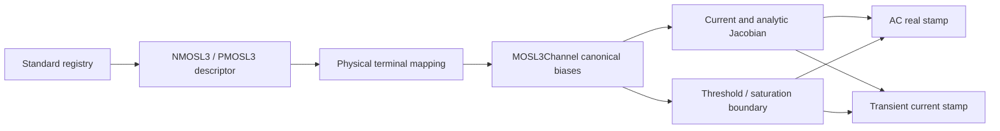

# Native Electrical Devices

## Purpose and Scope

This component owns descriptor and bound-device implementations. Its parent is
[CoreSpiceDevices](../DESIGN.md). This sprint changes only the Level 3 MOS channel
model and its direct descriptor/stamping/capacitance paths.

## Responsibilities and Boundaries

`MOSL3Channel` owns the common polarity-normalized channel law. NMOS/PMOS bound
devices own physical-terminal orientation, matrix/RHS stamps, Meyer capacitances,
and transient history. Descriptors own parameter-domain admission. BSIM3/4 and
foundry temperature/noise fidelity are not provided by this Level 3 model.

## Related Designs

| Design | Relationship | Contract Used | Summary | Cautions |
|---|---|---|---|---|
| [CoreSpiceDevices](../DESIGN.md) | parent | BoundDevice and registry | Analysis boundary | Current and derivative consistency is required for all analyses |

## Architecture



## Contracts and Invariants

- Normalized drain/gate/body voltages use polarity +1 for NMOS and -1 for PMOS,
  relative to the effective source; reverse conduction swaps source and drain.
- Threshold is `polarity * vto + gamma * (sqrt(max(phi - vbs, 0.01)) - sqrt(phi))
  - eta * vds`. The derivative of the body clamp is zero below its floor.
- The smoothed overdrive uses an overflow-resistant hypotenuse and avoids
  cancellation in deep cutoff. Mobility and velocity denominators require
  nonnegative theta/kappa and finite derived beta, Cox, and velocity coefficient.
- The existing 1 pS channel stabilization is retained as a parallel conductance
  in both current and derivative, rather than a derivative-only floor.
- DC reconstruction, finite differences, and AC real stamps describe one current.
  At a piecewise region boundary, each branch uses its own one-sided derivative.
- Meyer capacitance region selection uses the same canonical body and threshold,
  including reverse PMOS operation. This does not claim charge-conserving BSIM
  capacitances or foundry fidelity.

## Runtime Flows

Binding validates the model domain. Each stamp resolves terminal biases, evaluates
the channel, maps current/derivatives back to physical terminals, and adds
capacitance companions where applicable. Analysis failure remains typed when
finite admitted parameters and extreme finite biases overflow arithmetic.

## State, Ownership, and Lifecycle

The evaluator contains values only. L3 history is the module's existing
`TransientCapacitanceStore`; trial stamps read history, and accepted-step commits
mutate it through the same Mutex entry points on all targets.

## Failure, Concurrency, and Constraints

Invalid denominator domains and non-finite derived coefficients fail binding with
`DeviceBindingError.invalidParameterValue`. Runtime non-finite currents must reach
the existing analysis numerical-failure path without defaulting to a successful
zero current. The model is native pure CPU logic, without a GPU backend change.

## Verification and Change Impact

The [MOSL3ConsistencyTests](../../../Tests/CoreSpiceDevicesTests/MOSL3ConsistencyTests.swift)
suite uses the production registry and both coordinate/CSR stamps. It checks
finite-difference derivatives in cutoff/linear/saturation/reverse/body-clamp
conditions, current KCL and polarity symmetry, AC capacitances, accepted transient
history, actual DC/AC/transient analyses, and binding/numerical failure.
Revalidate both bound polarities, parent device contracts, and analysis consumers
when the channel law changes. Unsupported BSIM model selection stays blocked.

Verified on Swift 6.4 RELEASE, arm64 macOS 27, using the native CPU SparseLU
analysis path: all 9 L3 methods and 12 directly related parameter/capacitance/history
methods completed successfully (21 selected methods, 21 matching `testEnded`
events from a 157-method compiled product registry). The original four contract
tests reproduced 56 violations before the implementation change.

```sh
../scripts/swift-test-timeout.sh 120 --scratch-path .build-l3 --jobs 6 \
  --test-product CoreSpiceDevicesTests \
  --filter 'MOSL3ConsistencyTests|MOSFETCapacitanceDefaultTests|TransientAndNoiseCapabilityTests|ModelParameterValidationTests' \
  --event-stream-output-path /tmp/corespice-l3-integration.events.jsonl --event-stream-version 0
```

This evidence covers the native L3 implementation and analysis consumers on that
host. It does not qualify BSIM3/4, Metal execution, WASM, or Embedded targets.
