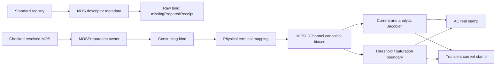
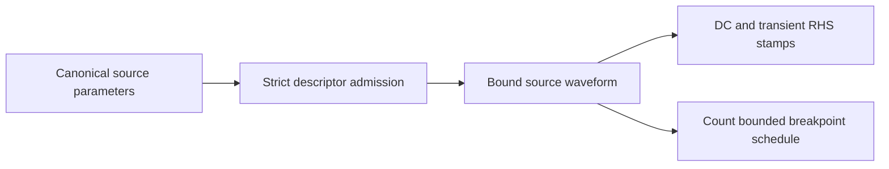
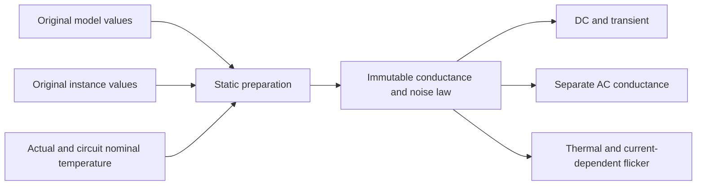
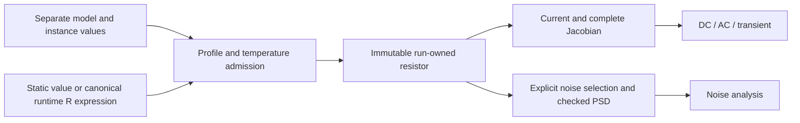

# Native Electrical Devices

## Purpose and Scope

This component owns descriptor and bound-device implementations. Its parent is
[CoreSpiceDevices](../DESIGN.md). The verified Level 3 MOS contract and independent
source admission remain unchanged. The resistor section separately defines the
B8.6.5.4 static/runtime resistor contracts. Runtime implementation and focused
behavioral fixtures are present; execution evidence is recorded independently by
the task executor and does not imply whole-process qualification.

## Responsibilities and Boundaries

`MOSL3Channel` owns the common polarity-normalized channel law. NMOS/PMOS bound
devices own physical-terminal orientation, matrix/RHS stamps, Meyer capacitances,
and transient history. Non-MOS descriptors own parameter-domain admission. MOS
descriptors retain registry metadata and refuse raw binding with
MOSBindingFailure.missingPreparedReceipt. [MOSPreparation](../MOSPreparation/DESIGN.md)
owns checked resolved-input admission and consuming binding for every MOS release.
Native BSIM devices are removed; compact models use the separate OSDI adapter.
Foundry temperature/noise fidelity is not provided by this Level 3 model.

## Related Designs

| Design | Relationship | Contract Used | Summary | Cautions |
|---|---|---|---|---|
| [CoreSpiceDevices](../DESIGN.md) | parent | BoundDevice and registry | Analysis boundary | Current and derivative consistency is required for all analyses |
| [IR](../../CoreSpiceIR/DESIGN.md) | depends on | ResolvedDeviceModel, Instance and BehavioralExpression | Separate model provenance and simulation dependencies | Reuse existing value boundaries; do not invent merged provenance |
| [Lowering](../../CoreSpiceLowering/DESIGN.md) | used by | Model resolution and runtime expression lowering | Prepared numerical input and dependencies | The parser does not implement resistor physics |
| [Analysis](../../CoreSpiceAnalysis/DESIGN.md) | used by | Checked stamping and noise execution | DC, AC, transient and noise consumers | Device binding does not declare an analysis successful |
| [ContinuousEquationStructure](../ContinuousEquationStructure/DESIGN.md) | depends on | Complete bound-coordinate support and native R/C/V coefficient bits | Actual prepared-law witnesses | Unknown/custom devices remain unproved; source facts are not jets |
| [NumericalState](../NumericalState/DESIGN.md) | depends on | Compensated scalar/enclosure arithmetic | Prescribed coordinate voltage and derivative bounds | Arithmetic bounds do not validate the input family |
| [PrescribedVoltageReduction](../../CoreSpiceAnalysis/PrescribedVoltageReduction/DESIGN.md) | used by | Explicit source values and prescribed charge-rate composition | Conditional downstream consumer | Actual source/axis/history joins remain caller obligations |
| [TransientLifecycle](../TransientLifecycle/DESIGN.md) | depends on | Explicit original static/reactive decomposition | Native whole-circuit balance consumes scoped contributions | Preserve independent companion validation and typed capability admission |

## Architecture



## Contracts and Invariants

### Original transient equation decomposition

The [TransientLifecycle contract](../TransientLifecycle/DESIGN.md#contracts-and-invariants)
owns the original F / unadjusted alphaDeltaQ capability. R, independent V/I,
static C, L, BJT, and behavioral charge capacitors reuse their existing physical
kernels. R/V/I have identically zero Q; static C has identically zero F;
inductor static KCL carries branch current and its branch equation has F=V and
Q=-L*I. BJT static F includes intrinsic and series currents; its signed terminal
Q is formed from the same BE/BC charge kernel. Behavioral charge Q includes the
retained expression, scale, explicit time, and accepted-coordinate history.
These trial queries never modify or promote accepted derivative history.

Behavioral differential C retains its original Ccandidate*D(V) operator. Its
same synchronized accepted history additionally retains the exact accepted C
evaluated during session initialization/commit. Decomposition emits separate
Ccandidate*alpha*DeltaV and TR (Caccepted-Ccandidate)*Daccepted terms. Native adds
the retained previous global F for TR and separately checks the original device
companion. This correction preserves a changing coefficient without inventing
Q=C*V or claiming conservative charge. The accepted coordinate, derivative,
coefficient, time and generation are promoted atomically; rejected queries do not
write any of them.

| Target | Accepted differential state | Isolation | Read | Publication / release |
|---|---|---|---|---|
| Native, WASM, Embedded | `BehavioralCapacitorHistory.State` V/D/optional C/time/generation | One common `Mutex<State>` | Immutable snapshot, evaluation and callbacks outside lock | Validated generation-checked commit; session end closes admission |

The extension adds one optional scalar coefficient per behavioral capacitor,
without dimension-sized buffers, per-trial arrays, extra locks, or retained
callback borrows. Native composition accounts for its own dimension-based
ordinary/paired row buffers before allocation. The device owner uses identical
stored state and synchronization in all target configurations.

R/V/I/C/L separately provide the paired enclosure capability through their
existing compensated kernels. BJT and behavioral expressions do not advertise
paired evaluation. No query allocates dimension-sized storage or invokes an
external callback while holding a history Mutex. Native composition owns the
bounded row buffers and acceptance. The ordinary companion remains unchanged.

- Normalized drain/gate/body voltages use polarity +1 for NMOS and -1 for PMOS,
  relative to the effective source; reverse conduction swaps source and drain.
- Threshold is `polarity * vto + gamma * (sqrt(max(phi - vbs, 0.01)) - sqrt(phi))
  - eta * vds`. The derivative of the body clamp is zero below its floor.
- The smoothed overdrive uses an overflow-resistant hypotenuse and avoids
  cancellation in deep cutoff. Mobility and velocity denominators require
  nonnegative theta/kappa and finite derived beta, Cox, and velocity coefficient.
- The existing 1 pS channel stabilization is retained as a parallel conductance
  in both current and derivative, rather than a derivative-only floor.
- DC reconstruction, finite differences, and AC real stamps describe one current.
  At a piecewise region boundary, each branch uses its own one-sided derivative.
- Meyer capacitance region selection uses the same canonical body and threshold,
  including reverse PMOS operation. This does not claim charge-conserving BSIM
  capacitances or foundry fidelity.

## Runtime Flows

Checked MOS preparation validates the model domain; consuming binding validates
identity, topology and conditions. Raw descriptor binding always fails before
parameter extraction or executable-owner allocation. Each stamp resolves terminal biases, evaluates
the channel, maps current/derivatives back to physical terminals, and adds
capacitance companions where applicable. Analysis failure remains typed when
finite admitted parameters and extreme finite biases overflow arithmetic.

## State, Ownership, and Lifecycle

The evaluator contains values only. L3 history is the module's existing
`TransientCapacitanceStore`; trial stamps read history, and accepted-step commits
mutate it through the same Mutex entry points on all targets.

## Failure, Concurrency, and Constraints

Invalid denominator domains and non-finite derived coefficients fail binding with
`DeviceBindingError.invalidParameterValue`. Runtime non-finite currents must reach
the existing analysis numerical-failure path without defaulting to a successful
zero current. The model is native pure CPU logic, without a GPU backend change.

## Verification and Change Impact

The [MOSL3ConsistencyTests](../../../Tests/CoreSpiceDevicesTests/MOSL3ConsistencyTests.swift)
suite uses checked MOS preparation and both coordinate/CSR stamps. It checks
finite-difference derivatives in cutoff/linear/saturation/reverse/body-clamp
conditions, current KCL and polarity symmetry, AC capacitances, accepted transient
history, actual DC/AC/transient analyses, and binding/numerical failure.
Revalidate both bound polarities, parent device contracts, and analysis consumers
when the channel law changes. Unsupported BSIM model selection stays blocked.

The following historical channel-law evidence preceded the checked preparation
caller migration; S4 revalidates the migrated fixtures and descriptor refusal.
Verified on Swift 6.4 RELEASE, arm64 macOS 27, using the native CPU SparseLU
analysis path: all 9 L3 methods and 12 directly related parameter/capacitance/history
methods completed successfully (21 selected methods, 21 matching `testEnded`
events from a 157-method compiled product registry). The original four contract
tests reproduced 56 violations before the implementation change.

```sh
../scripts/swift-test-timeout.sh 120 --scratch-path .build-l3 --jobs 6 \
  --test-product CoreSpiceDevicesTests \
  --filter 'MOSL3ConsistencyTests|MOSFETCapacitanceDefaultTests|TransientAndNoiseCapabilityTests|ModelParameterValidationTests' \
  --event-stream-output-path /tmp/corespice-l3-integration.events.jsonl --event-stream-version 0
```

This evidence covers the native L3 implementation and analysis consumers on that
host. It does not qualify BSIM3/4, Metal execution, WASM, or Embedded targets.

## BJT Voltage Limiting

`BoundBJT` owns polarity-normalized BE/BC limiting through `PNJunctionLimiter`.
Ground is an allowed terminal and has no mutable solution coordinate. With a
grounded base, emitter and collector corrections are referenced to that fixed
base. With a grounded collector and a mutable emitter, base and emitter
corrections use that fixed collector. If both collector and emitter are grounded,
the mutable base receives a nonzero BE correction when present, otherwise the BC
correction. Different emission coefficients can make only one junction require
limiting; neither correction may silently disappear into a ground coordinate.
The simultaneous admission probe retries until both device rules leave the
candidate unchanged. Other topologies retain the existing emitter-referenced
base/collector correction.

The device owns junction rules and terminal mapping; Analysis only probes the
device through `VoltageLimitingDevice`. This changes no BJT current, Jacobian,
capacitance, history, or exponential evaluation rule. The NPN/PNP grounded-terminal
regressions in
[NewtonVoltageLimitingTests](../../../Tests/CoreSpiceAnalysisTests/NewtonVoltageLimitingTests.swift)
verify first-iteration candidate admission and actual DC equation residuals.

## Independent Source Admission

Voltage/current descriptors own DC, pulse, sine and PWL selection. `pwl` is a
canonical real vector with at least two finite time/value pairs, nonnegative and
strictly increasing times, and finite interpolation slopes. Waveform families are
exclusive; partial, unknown and mistyped parameters fail binding rather than
selecting DC or parameter defaults. DC plus transient parameters is ambiguous.
PWL holds its first/last values outside its declared domain. Source breakpoint
enumeration consumes an explicit count admission before appending each item.



Built-in devices preserve the same bounded breakpoint contract through the
BoundDevice protocol. Custom implementations own admission before allocating
their breakpoint output. Host CPU integration tests trace compiler, registry,
bound waveform, numerical transient and exact accepted time axis.

## Bound Prescribed Voltage Coordinate Law

Status: finite Native lower contract qualified on fixed Swift 6.4, arm64 macOS 27.
The seven new Devices tests and single actual-source C-parallel-V Analysis test
pass. The full Devices owner passes 277 tests in 37 suites; prescribed-voltage
reduction plus the new composition passes 16 tests in two suites, all with zero
skips. The same implementation/test snapshot has one closed comprehensive source
review with no findings. The [verification receipt](../../../.verification/bound-prescribed-voltage-law-20261019/final-verification-r1.json)
binds source hashes, compile/runtime logs and the documentation-only final delta.
This finite conditional qualification grants no Timing family, history or root
authority. This section owns only the
actual ideal-V equation's external-coordinate input law. It is not a new
waveform, ordinary solver, generic interval provider, or global history checker.

### Construction and Authority

A package-only immutable `BoundPrescribedVoltageLaw` is created by a factory on
an actual `BoundVoltageSource`. Its initializer is private to its implementation;
construction retains that concrete bound source and its actual source fact, and
checks positive/negative/branch identities and rows against the supplied complete
compiled axis. No public initializer, decoder, caller-defined encloser protocol,
model-name lookup, or coefficient record can instantiate this producer. The full
compiled-axis bijection and same-prepared-owner join remain the native caller's
responsibility; local factory validation does not manufacture that authority.

The law's explicit external coordinate U is not a new MNA unknown. The immutable
law retains the signed physical voltage at U=0 and U=1 and a positive finite
source-time scale T. Endpoints follow the actual positive-minus-negative branch
orientation; a reversed source may therefore have a negative endpoint difference.
There is no implicit ground rail, assumed 1.8 V supply, or default time scale.
Its local fixed-size values retain already admitted source/Instance/Waveform COW
storage; additional retained output storage is admitted by the caller.

```text
actual BoundVoltageSource + checked axis + explicit signed physical endpoints/T
    -> bound external-coordinate law
       -> explicit point U -> physical excitation -> shared actual F kernel
       -> U interval + left/right derivative intervals -> outward V / Vdot
       -> source Values/derivatives for existing prescribed-voltage reduction
host checked Timing primary context + physical rails/time/candidate identity
    -> separate explicit parametric analysis binding, required before composition
```

### Finite Point and Interval Contract

Let v0 and v1 denote the exact represented finite endpoint values, delta=v1-v0
as a real difference of those values, and tau=(t-t0)/T. The owned constitutive law is

    phi(U) = v0 + delta*U,
    Fpotential = e*iV,  Fbranch = e^T*x - phi(U),  Q = 0,
    dV/dt(left/right) = delta*(dU/dtau)(left/right)/T.

The source's complete coordinate terms retain their existing signed unit
incidences, including duplicate terms for equal endpoints and omission only of
actual ground. Its external partial is -delta on the branch row and zero on
potential rows; its own charge and external charge partial are exactly zero.
Other devices' prescribed-input charge rates arise through the whole-circuit
coordinate lift and are not attributed to this ideal source.

Point evaluation requires an explicit finite U in [0,1]. An absent optional point
coordinate has a typed missing-coordinate refusal; no midpoint, arbitrary phase,
history selection, or original-waveform fallback is available. The ordinary
binary64 point result is a rounded evaluation of the same real phi and F, with
its certified rounding enclosure kept separate from that point result. The
interval operation accepts explicit finite ordered normalized bounds within
[0,1] and separate finite ordered left/right normalized derivative bounds.
Those input bounds are assumptions supplied by the checked host join, not proof
of a Timing source family. Both one-sided derivatives are preserved at seams;
there is no inferred smoothness or unique derivative.

The factory takes explicit zeroVoltage/oneVoltage, timeOrigin/timeScale, the
compiled variable map and mandatory checkpoint. `point(normalized:at:checkpoint:)`
returns a rounded voltage, its separate exact-law enclosure and rounding-error
bound, and the enclosed normalized source time. `enclose` returns source time,
voltage and separate physical left/right slopes. `externalPartial` encloses the
branch F_U=-delta and `charge` is exactly zero. The law's residual methods use
the actual source's checked paired or ordinary state. The paired residual method
encloses the external U interval at that represented state; whole-box X variation
uses the separately qualified linear coordinate terms, not an invented state-box
claim from a SolutionState. No point coordinate or derivative is inserted into
SolutionState or IntegrationState.

Endpoint subtraction, affine evaluation, derivative multiplication and positive
T division reuse NumericalState CompensatedValue/CompensatedEnclosure arithmetic.
Delta is not first rounded to an untracked Double coefficient. Scalar-to-interval
admission and outward result projection must preserve endpoints, signed zero,
gradual underflow and finite arithmetic/refusal semantics. A represented point
or a closed interval result never asserts root existence or exact residual zero.
No finite time slab is extrapolated to an infinite past.

### Actual Equation Path and Compatibility

BoundVoltageSource's existing private excitation-argument enclosure kernel is
shared with the explicit-input path. Its ordinary point residual is factored only
as needed to receive an explicit excitation while retaining the existing checked
reads, exact subtraction ordering, finite checks and incidence publication.
Existing DC and source-scaled DC supply their original private dcVoltage;
ordinary transient methods supply the original private Waveform.value(at:).
Their DC, pulse, sine and finite PWL semantics, stamps, breakpoints, numerical
ordering and accepted state remain unchanged. No descriptor or registry defaults
select the new law. The explicit coordinate path supplies phi(U) to that same
source equation and is selected instead of, never in addition to, the ordinary
source contribution for a distinct parametric analysis.

The existing PrescribedVoltageReduction sourceValues/prescribedChargeRate inputs
are the immediate downstream mathematical consumer. Their current explicit-input
contract remains conditional; this law does not turn them into an actual-device
admission or a whole-circuit certificate. The later native composition must bind
the actual source edge and all other producers' F/Q facts before using them.

### Host Assumptions and Identity

The host must retain a checked Timing initial source context or its exact prepared
replay, admit only qualified primaryPort origins, and join its candidate endpoint,
scenario/corner, thresholds, history generation, physical rails, source orientation
and time to this actual bound source. The resulting parametric analysis identity
must be distinct from the original native DC/waveform configuration identity and
bind both inputs plus every selected source mapping. The lower Devices component
has no Timing dependency and does not accept an arbitrary identity string as proof.
Both existing time contracts use SI seconds; choosing T=1 and an origin still
requires that explicit join, and geometryScale is never a time conversion.

The affine external-coordinate law quantifies over every supplied admissible U;
it does not select or truncate its history. Known-clock all-integer-cycle phases
and unrestricted admitted absolutely continuous histories remain retained host
assumptions. No finite PWL or pre-delay pulse is substituted for those families.
Initial prescribedCellOutput entries remain unproved internal histories. No
finite-crossing, non-Zeno, unique-history, physical-root, flow or tube authority
is returned by this component.

### Resources, Failure, and Verification

Every factory, point, interval and source-row visit requires a throwing checkpoint
from the same existing prepared/run work and cancellation owner. Each finite
operation is charged before arithmetic/visitation, including omitted ground
candidates; there is no default callback, quota, reset or retained foreign code.
Methods use fixed-size immutable values and borrow source/state input; no hot
string map, dimension-sized allocation, pointer escape or mutable shared owner is
introduced. Native/WASM/Embedded retain the same state and callback contracts.
The native caller admits output retention before copying and keeps its prepared
source/resources alive. A foreign input/state map cannot substitute for the bound
coordinate identities. Typed failures preserve invalid binding/domain, missing
point coordinate, nonfinite/overflow/time-scale and caller-control causes. Failed
queries do not consume, close or mutate the actual source. Any throwing visitor
prefix is incomplete and must be discarded; no successful partial law is returned.

Devices owner tests will bind real sources and check grounded, reversed, floating
and coincident incidences, exact coordinate identities, wrong-state maps, omitted
U, invalid endpoints/domain/T, and overflow. Small exact dyadic rational fixtures
provide independent V/F/left/right-derivative interval oracles, including extreme
endpoint cancellation, signed zero and subnormal cases. Original DC/PULSE/sine/PWL
point/enclosure/stamp regressions must establish the unchanged numerical ordering
and original past/end behavior. Caller work/cancel failure must interrupt before
success without resetting counters or invalidating the source. A focused Analysis
composition fixture must use this actual law with C parallel to V and reconstruct
iV=-C*dV/dt and all original rows using the existing prescribed-voltage reduction.
This finite fixture does not establish the later full history/physical join.

## Resistor Execution Contract

### Static Preparation Ownership

`ResistorPreparation` owns the static parameter-domain and derived-value admission
behind `ResistorDescriptor`. The immutable prepared value supplies DC and AC
conductances, thermal temperature, multiplicity and flicker coefficients to the
memoryless `BoundResistor`. Preparation reads original model and instance maps
separately; aliases are admitted only within their source role and conflicting
aliases are explicit failures. Model geometry defaults are 10 micrometers and
remain SI; only supplied instance dimensions consume document scale in lowering.
Model geometry wins over model R only when sheet resistance and source dimensions
admit the original geometry path. Effective dimensions must be positive whenever
geometry resistance or explicit-dimension flicker area consumes them.

The pinned `resnoise.c` plus `NevalSrcInstanceTemp` define a distinct thermal
temperature: without absolute instance `temp`, use operating temperature plus
`dtemp`; with `temp`, use its Kelvin value plus model nominal Celsius temperature.
This unusual original rule is preserved explicitly rather than substituting the
resistance-evaluation temperature. It requires finite positive noise temperature.
Flicker consumes total actual DC current `I=G*V`, then the per-unit current `I/m`.
Its area is one unless either source instance dimension is supplied; otherwise
the admitted effective dimensions and model `lf/wf` define the area. Invalid
frequency or non-finite/negative spectra fail the existing throwing noise API.



Runtime-dependent resistance is retained as canonical behavioral IR and referenced
nodes in lowering. `ResistorDescriptor` selects immutable `BoundRuntimeResistor`,
which owns the current/Jacobian/noise law and reuses the checked scalar AD evaluator.
`RuntimeResistorPolicy` admits bounded AST/dependency/work before publication.

### Current Facts and Fixed Scope

`ResistorDescriptor` delegates static admission to `ResistorPreparation` and
binds immutable conductance/noise values. DC/transient share the prepared
conductance; AC may use a separate admitted resistance. Binding resolves CSR
indices once. Original ideal-R meaning and terminal orientation are retained.
Temperature, geometry, multiplicity, resistance scale and thermal/flicker noise
have explicit numerical paths, including the separate runtime profile below.
Focused native CPU execution evidence is recorded by the task
executor, independently of this implementation description.

B8.6.5.4 fixes two target responsibilities: complete native static resistor
semantics (explicit/model/geometry resistance, temperature, multiplicity,
resistance scale and noise), and runtime-dependent resistor semantics (current,
complete Jacobian, temperature, multiplicity and noise). Implementation sprints
are divided by the package task; an interim subset is not the completed contract.
Until a supplied parameter's meaning is implemented, it is a typed refusal when
used, even if syntactically valid or zero-valued. This interim admission prevents
false success; it does not remove the missing feature from the target.
Unused declarations remain source values; they are neither numerically prepared
nor qualified by parsing alone. Completion does not imply all Sky130 device or
process coverage, or arbitrary runtime function support.

The untouched xhigh-po card establishes these concrete needs: `rend1/2` reference
`reshead`, supply scalar `r` and instance `tc1/tc2`; `reshead` supplies `tnom=25`.
`rbody` supplies a resistance expression containing terminal/substrate voltages
and its own `tc1/tc2`, but does not reference `resbody`. That unused model's
`tnom=25` must not be inferred as the body's temperature authority. The observed
model declaration refusal precedes these execution paths; advancing that refusal
alone is not evidence of their numerical correctness.

### Input Roles and Admission

- Keep resolved model name/type/parameters in existing `ResolvedDeviceModel`,
  separate from supplied `Instance.parameters`. Instance coefficients override
  corresponding model defaults only at the device's preparation boundary.
  Model identity/type mismatch, unknown references and unsupported supplied
  parameters fail explicitly. No model coefficients are lost through flattening.
- A static resistance expression resolves using the existing scoped parameter
  semantics. A voltage-dependent resistance retains the existing canonical
  `BehavioralExpression` and all referenced nodes. It must not be statically
  evaluated, replaced by a constant, or changed into manufactured SPICE text.
- Require finite, positive effective resistance, valid temperature and finite
  derived current/conductance/derivatives within the admitted passive profile.
  Zero/negative/non-finite resistance, invalid temperature factors and arithmetic
  overflow yield typed binding/runtime failure. Do not adopt the reference's
  warning-plus-small-resistance substitution as successful native admission.
- Explicit source R has precedence over any admitted model-default resistance.
  Without explicit R, the static owner selects valid original geometry and sheet
  resistance, then model-default R. Missing/invalid input fails instead of the
  reference warning-plus-1mOhm fallback. Geometry is a required target, not a
  reason to infer an ideal resistance while its implementation is absent.

### Temperature and Scale Authorities

For ordinary model-backed R, model `tnom` is Celsius at source intake and Kelvin
after preparation. Without model `tnom`, use the circuit nominal temperature
(reference default 300.15 K), independently of actual operating temperature.
`OperatingConditions` owns distinct actual and nominal temperatures in Kelvin.
Its nominal temperature defaults to 300.15 K and both temperatures must be finite
and positive. `SPICEAnalysisOptions` resolves circuit `.options tnom` in Celsius
and supplies the converted nominal value through `operatingConditions()`.
Model `tnom` overrides this circuit nominal value only during device preparation.
Nominal temperature is not inserted into physical instance parameter maps.
Instance `tc1/tc2`
override their model defaults independently. With
`dT = T_effective - T_nominal`, `F = 1 + tc1*dT + tc2*dT*dT` and
`R_effective = R_nominal*F`. Multiplicity and resistance scale are required static
semantics: `G = m/(R_nominal*F*scale)`. An explicit
instance absolute `temp` takes precedence over `dtemp`; otherwise `dtemp` adds
to the operating temperature. Instance `tce` overrides model `tce`; if either is
supplied, its exponential factor `pow(1.01,tce*dT)` takes precedence over the
quadratic law. Optional AC resistance uses its distinct source value with the
same admitted temperature/multiplicity/scale law. Every applied value retains
its source role; unimplemented supplied values are not ignored.

For the reference-compatible voltage-dependent R profile, use the pinned
behavioral nominal temperature **300.15 K**, independently of an unused resistor
model's `tnom`. Preserve its supplied instance `tc1/tc2` and admitted multiplicity
in the reference law `I = m*V_terminal/(R_expression*F)`. Runtime multiplicity
is a required target regardless of whether the observed card supplies it.
The fixed rewrite copies main-current multiplicity only to the main behavioral
source. Its noise-transfer source has gain `1/sqrt(R_expression)` and its 1-ohm
noise resistor receives `tc1/tc2`, but retains circuit nominal temperature and
unit multiplicity. These are distinct, verified authorities. The complete
admitted runtime profile is defined below; unsupported source combinations fail
explicitly instead of inheriting coefficients from a discarded model.

The pinned reference applies document `.options scale` to source instance `l/w`,
while R-instance `scale` multiplies resistance. They must never alias. The required
static geometry contract preserves SI lengths and the original
`Rsh*(L-2*short)/(W-2*narrow)` law, source default provenance and valid effective
dimensions. Defaults and effective dimensions retain their model/instance origin.
This requires its own analytical proof before successful admission. The observed
xhigh-po card does not need geometry-only resistance or `tce`; that observation
does not remove either from the complete static target.

These rules use the fixed ngspice46 commit
`ebdaf58ec76a06ffaac7e0f138360dd1cf5ee4b6`:
[ordinary temperature/geometry](https://raw.githubusercontent.com/imr/ngspice/ebdaf58ec76a06ffaac7e0f138360dd1cf5ee4b6/src/spicelib/devices/res/restemp.c),
[source temperature and scale conversion](https://raw.githubusercontent.com/imr/ngspice/ebdaf58ec76a06ffaac7e0f138360dd1cf5ee4b6/src/spicelib/devices/res/resparam.c),
and [behavioral temperature and current stamping](https://raw.githubusercontent.com/imr/ngspice/ebdaf58ec76a06ffaac7e0f138360dd1cf5ee4b6/src/spicelib/devices/asrc/asrcload.c).
The reference's behavioral nominal-temperature FIXME is a verified reference
behavior, not permission to silently replace it with the unused model's `tnom`.

### Runtime and Noise

DC and transient evaluate the same current law. Every voltage dependency enters
the compiled matrix structure, even when it is not one of the two resistor ports.
Jacobian and AC small-signal stamps differentiate that complete current law at
the same operating point, including the voltage dependence of R. Subcircuit
remapping applies to both terminals and read-only referenced nodes. Reuse the
existing behavioral expression machinery; evaluating `1/R` alone is not the
nonlinear device Jacobian. The device is memoryless and adds no transient history.

Ordinary R retains its existing thermal-noise default. Explicit admitted
`noisy/noise=0` is a source choice, not an unsupported-noise fallback. The
reference-compatible runtime R default is noiseless; thermal noise is enabled
only by an explicit `noisy/noise` choice or caller policy equivalent to
the reference `enable_noisy_r`. This choice must survive lowering and binding.
Ordinary thermal current PSD uses the selected temperature and conductance law,
`4*kB*T_noise*G`. Its temperature authority and overrides must follow the original
noise path, not an assumed equality with another nominal temperature. For the
reference runtime rewrite, terminal-current PSD is
`4*kB*T_operating/(R_expression*F_aux)`, where
`F_aux = 1 + tc1*(T_operating-T_nominal_circuit) + tc2*(T_operating-T_nominal_circuit)^2`.
The main-current factor uses the separate fixed 300.15 K nominal. PSD does not
include multiplicity; output noise does depend on the main Jacobian's transfer.
It is not `4*kB*T*dI/dV`. CoreSpice retains its existing modern SI Boltzmann
constant 1.380649e-23 J/K; a source-law comparison against ngspice46 accounts for
its older 1.38064852e-23 value explicitly rather than changing physical constants.

Noise-disabled and noise-unsupported states are different: a requested capability
outside the profile fails through the existing noise admission boundary before
successful analysis. It cannot disappear because a device lacks `NoisyDevice`.

Static flicker noise is a required target. It retains model `kf/af/ef/lf/wf`,
actual operating-point current and admitted effective noise area. The original
current PSD is `m*kf*abs(I/m)^af/(A_effective*f^ef)`; when source dimensions are
supplied, `A_effective=(L-2*short)^lf*(W-2*narrow)^wf`, otherwise its source
default is retained. Finite/domain admission and frequency/temperature handling
remain explicit. Static preparation and `BoundResistor` implement these semantics; invalid
supplied coefficients and non-finite runtime spectra remain typed failures. Existing ideal-R thermal tests cannot qualify flicker.
The fixed reference's
[runtime rewrite and noise selection](https://raw.githubusercontent.com/imr/ngspice/ebdaf58ec76a06ffaac7e0f138360dd1cf5ee4b6/src/frontend/inpcom.c),
[ordinary defaults](https://raw.githubusercontent.com/imr/ngspice/ebdaf58ec76a06ffaac7e0f138360dd1cf5ee4b6/src/spicelib/devices/res/ressetup.c),
and [noise law](https://raw.githubusercontent.com/imr/ngspice/ebdaf58ec76a06ffaac7e0f138360dd1cf5ee4b6/src/spicelib/devices/res/resnoise.c)
are separate authorities; the behavioral current-source implementation alone
does not provide resistor-noise support.



### Complete Admitted Runtime Resistor Profile

Status: contract fixed by [pinned-source and concrete-path analysis](../../../../.verification/runs/b865-runtime-resistor-20261009/contract-analysis.json);
implementation is present with [RuntimeResistorTests](../../../Tests/CoreSpiceDevicesTests/RuntimeResistorTests.swift);
behavioral execution proof remains B8.6.5.13-owned. This profile closes
the previously unresolved auxiliary-noise/multiplicity algorithm. It does not
claim arbitrary runtime function support or physical process qualification.

| Boundary | Contract and owner |
|---|---|
| Source intake | Parser consumes the complete named unquoted R expression, respecting the next assignment, continuation, original location and owned decode work |
| Runtime temperature | IR retains an explicit ambient Celsius variable; Lowering recognizes `temper` as runtime; binding supplies `OperatingConditions.temperatureCelsius`, never a lowering-time constant |
| Runtime source profile | Required R/resistance canonical expression; optional finite tc/tc1, tc2, positive m, and boolean noisy/noise. Conflicting aliases, model references, or supplied static-only ac/temp/dtemp/tce/scale/geometry/model-noise values are typed profile refusals; the fixed reference discards their meaning, so native cannot silently accept them |
| Current | `I=m*V/(R*F_main)` with fixed 300.15 K main nominal; require finite positive R and F_main, finite current/equivalent current and every derivative |
| Full Jacobian | Union both resistor terminal indices with all AST node/branch dependencies; differentiate V and R, including third-node and branch dependence |
| AC / transient | AC linearizes the same full law at the actual OP and time zero; transient uses IntegrationState.currentTime. The resistor has no history or shared mutable state |
| Convergence | Candidate physical-residual checking belongs to NewtonRaphsonSolver at actual analysis time. The device introduces no time-zero convergence evaluation or mutable last-time cache |
| Noise | Runtime default is explicitly noiseless; source boolean overrides the descriptor policy's default. Enabled thermal PSD uses the separate circuit-nominal F_aux, with no intrinsic m or flicker term; invalid enabled-noise factors and nonfinite PSD throw |
| Bounds | RuntimeResistorPolicy owns finite binding/evaluation ceilings and default noise selection; each policy validates positive/overflow-safe AST nodes, depth, dependencies and per-stamp work before allocation/evaluation. Default depth is the validated bounded recursion preset; changing any default requires boundary and representative runtime tests, without changing the physical law |
| Failure | Binding rejects malformed AST arity, missing topology and unsupported parameters before device publication. Checked evaluation rejects invalid state indices, nonfinite time/value/derivatives, nonpositive R and overflow using typed errors. Throwing stamps/noise propagate through existing analysis APIs; no success, partial result or canonical case is emitted on failure |

RuntimeResistorPolicy is an immutable caller-selected operational ceiling, distinct
from physical parameters. Its default preset admits 4096 AST nodes, depth 64,
256 solution dependencies and 1,052,672 AST visits per stamp (4096 * 257).
All ceilings must be positive; depth may not exceed the owner-supported recursion
ceiling of 64. Binding counts before recursive evaluation and checks the
node-count * (dependency-count + 1) product without overflow. Callers may reduce
work ceilings or raise node/dependency/work ceilings within checked arithmetic;
the recursion ceiling changes only with owner validation. The preset is an
operational selection, not an accuracy limit; boundary tests and the real runtime
card establish the admitted path, without generalizing to other platforms.

`ResistorDescriptor(runtimePolicy:)` remains the existing DeviceDescriptor
boundary. It selects independently prepared static or runtime values without
reinterpreting static coefficient precedence. Immutable `BoundRuntimeResistor`
implements BoundDevice and NoisyDevice; checked scalar AD remains inside this
Devices owner. Policy construction throws `RuntimeResistorPolicyError` for
invalid ceilings or capacity overflow. `SolutionState.checkedBoundValue` rejects
missing, out-of-range or remapped node/branch identities before checked stamps;
`SolutionStateAccessError.variableIndexMismatch` prevents a value/Jacobian map mismatch. There is no new analysis
engine, global evaluator cache, shared mutable history, C backend or platform
synchronization branch. Prebound sparse indices and owned AST are reused; each
stamp reads the solution owner without materializing solution arrays or derivative
arrays. Admitted work is O(AST nodes * (dependency count + 1)) and retained
storage is bounded at binding. Noise computation evaluates the same owned R at
its OP and returns the existing explicit NoiseSource boundary.

The fixed reference's division regularization and source-stepping internals are
not transplanted into native device equations. Native positive-domain admission
and its existing solver remain authoritative. Numerical/source-law comparisons
state their tolerances and constant normalization separately from any physical
acceptance criterion.

### Runtime Closure Evidence

| Requirement | Behavioral owner and falsifiable check |
|---|---|
| Original runtime grammar | ResistorParserTests: unmodified named continuation expression, following parameter boundary, malformed/location refusal |
| Bound ambient authority | ResistorLoweringTests + runtime device tests: same retained AST rebound at two actual temperatures; nested scope/node/branch identities survive |
| Current and all derivatives | RuntimeResistorTests: independent analytic derivative checks for both terminals, third node and referenced branch; actual Newton/DC and AC OP path |
| Actual transient time | Public IO transient memoryless expression with time dependency and actual residual checking |
| Distinct main/aux nominal | Native noise/DC at 77 C, tc1/tc2, m=4, and circuit nominal 27/17 C: current unchanged by nominal while thermal spectrum changes |
| PSD versus differential conductance | Nonlinear R=1000*(1+Vout), DC/AC/noise comparison using independently derived terminal PSD and actual transfer; no m factor in terminal PSD |
| Explicit source choices | noiseless default, enabled/disabled source flag and policy default override; discarded-reference inputs are native typed refusals |
| Resource/domain safety | AST depth/node/work/dependency ceilings, malformed direct IR arity, missing/out-of-range state, R<=0, temperature-factor/derivative/current/PSD overflow; failure publishes no result |
| Preserved static contract | Existing static resistor and affected behavioral-source tests, once after the frozen implementation/review |
| Real adopted input | Current untouched Sky130 CLI path advances through grammar/runtime admission; later scale/bin/version gaps stay explicit rather than gaining qualification |

### Ownership, Failures and Completion Evidence

Prepared values/dependencies are immutable and owned by the bound device for one
analysis run. Expression resolution is invocation-local and uses the existing
LoweringContext isolation. No shared mutable resistor state, platform-conditional
storage, C evaluator or new global projector is introduced. Resource/cancellation
and numerical-failure propagation remain with the existing compilation/analysis
owners. No typed error can become a successful zero current, ideal R or omitted
noise contribution.

| Invariant | Minimum behavioral evidence and owner |
|---|---|
| Declaration vs execution | Parser/ParsedIR unused-model round trip plus public IO model-reference survival |
| Separate roles and precedence | Public IO model/instance coefficient conflict, scoped references and actual binding |
| Static resistance and geometry | Public IO explicit/model/geometry precedence, SI/document scale, effective dimensions and model defaults against an independent resistance oracle |
| Ordinary temperature and scale | Device/public IO current/AC conductance for model and instance coefficients, tnom, temp/dtemp, tce, m and resistance scale |
| Runtime current and topology | Public IO voltage-dependent DC/transient, independent derivative oracle and AC linearization, including substrate and nested node references |
| Distinct nominal authorities | Same coefficient values tested against ordinary model tnom and runtime 300.15 K separately |
| Static noise | Actual NoiseAnalysis thermal/flicker PSD and contribution checks across current/frequency/area/multiplicity and explicit disable |
| Runtime noise | Actual original auxiliary algorithm comparison including temperature/multiplicity, enabled/disabled selection and nonlinear operating-point dependence |
| Refusal | Unsupported supplied parameter, model mismatch, non-finite/invalid R or temperature factor and runtime-domain failure |
| Production input locality | Untouched Sky130 card/deck replay retains expressions; grammar progress is reported separately from device numerical completion |

Existing [resistor binding/stamp tests](../../../Tests/CoreSpiceDevicesTests/CoreSpiceDevicesTests.swift),
[ideal thermal-noise tests](../../../Tests/CoreSpiceAnalysisTests/NoiseIntegrationTests.swift)
and [behavioral public IO tests](../../../Tests/CoreSpiceIOTests/SPICEIOEndToEndTests.swift)
remain regression premises. They do not already prove this target resistor
profile. New profile completion requires the additional actual public behavior
above; no foundry/process-wide qualification follows from that completion.


### Static Verification Owners

[StaticResistorTests](../../../Tests/CoreSpiceDevicesTests/StaticResistorTests.swift)
checks analytical temperature/multiplicity/scale and AC conductances, model/default
geometry precedence, original thermal-temperature rule, current-dependent flicker
area and frequency laws, aliases, noise disable, CSR/transient reuse and failures.
[ResistorLoweringTests](../../../Tests/CoreSpiceLoweringTests/ResistorLoweringTests.swift)
checks lexical models, separate maps, runtime dependency retention, document scale
and incomplete MOS refusal. [SPICEIOEndToEndTests](../../../Tests/CoreSpiceIOTests/SPICEIOEndToEndTests.swift)
executes actual DC/AC/noise and nominal-temperature/geometry compositions.
[RuntimeResistorTests](../../../Tests/CoreSpiceDevicesTests/RuntimeResistorTests.swift)
checks independent analytical full Jacobians, coordinate/CSR/AC/transient laws,
bound ambient temperature, distinct main/auxiliary nominals, explicit noise
selection without intrinsic multiplicity, typed domain/state/arity failures and
policy depth/node/dependency/work boundaries. Checked evaluation validates every
active AST intermediate; a singular derivative such as `sqrt(0)` is refused
when its scalar AD is nonfinite. These source fixtures are not execution evidence.
Evidence remains local to the native CPU paths executed by the task executor;
WASM/Embedded and foundry-wide accuracy are unqualified.

### Independent Current Excitation Consistency

The runtime resistor OP/AC oracle uses an independent current excitation. Its
existing SPICE orientation is identical in DC, AC and transient: current is
drawn from the positive terminal and injected into the negative terminal.
BoundCurrentSource stamps this direction explicitly through bound indices;
the generic complex current-injection helper uses the opposite injection
convention and must not be substituted for the source terminal law. Public
nonlinear resistor AC correlation rejects a reversed stimulus sign.

## Capacitor Binding Admission

[Static and Behavioral Capacitor Execution](#static-and-behavioral-capacitor-execution)
is the numerical authority for ideal/model capacitance and charge/differential C
expressions. Descriptor admission preserves explicit model/instance roles and
refuses mismatched model types, mixed Q/C, behavioral-plus-model and unknown or
mistyped parameters. `ModelConsumption.selected` remains provenance: URC-generated
ideal capacitors retain URC source evidence without a physical capacitor model.

## Designed Diode Ownership Transfer

Current diode descriptor/model/bound files still reside here and use flattened
inputs. Their replacement authority is the proposed sibling
[Diode component](../Diode/DESIGN.md). Move those files with implementation; this
component will no longer own diode admission or numerical feature policy. The new
path refuses unsupported features rather than inheriting today's silent acceptance.

## S3 Original DC Residual Contributions

Status: implemented. `DCPhysicalResidualContributing` is the small device-owned
contract for original physical equations. Existing bound static resistor,
independent voltage source and independent current source implementations expose
`accumulatePhysicalResidual(state:add:)` using their actual admitted private
coefficients and DC values. The resistor computes the voltage difference before
multiplication, preserving large common-mode cancellation semantics. Source
waveforms do not replace their DC value. Each contributor checks its bound state
indices, finite physical quantities and callback row. Runtime expression resistors
and other devices require their own direct equation implementation before joining
this profile.

The [OSDI adapter](../../CoreSpiceOSDI/DESIGN.md) refines this protocol for raw
projected model residuals. The [native owner](../../CoreSpice/NativeExecution/DESIGN.md)
combines contributions without knowing source parameters, model internals or device
coefficients. A large-common-mode resistor counterexample distinguishes original
physical current from independently rounded `G*vp - G*vn` arithmetic.

[DirectDCPhysicalResidualTests](../../../Tests/CoreSpiceOSDINativeTests/DirectDCPhysicalResidualTests.swift)
verify original resistor arithmetic at large common-mode voltage, source DC/branch
semantics, shape failures and nonfinite state refusal. Full source-native four-family
OSDI tests compose those same device-owned contributions with raw model residuals.

## S4 Direct RLCVI Transient Equations

The admitted bound RLCVI devices contribute original DC and transient equations through the
generic physical-residual protocols. Sources evaluate their admitted waveform at candidate
time. Capacitors use immutable accepted voltage/current history during trials; only accepted
commit updates current. Inductors use admitted branch/terminal values and integration history.
All residual reads validate bound indices, finite values and required previous-state width.
No host reconstructs physical coefficients from source dictionaries. The initial waveform DC
value remains its actual value at zero; explicit DC plus waveform syntax keeps its existing
refusal. Component tests cover direct arithmetic, history and nonfinite failure.

Independent AC sources admit finite magnitude and phase in degrees and stamp the corresponding
complex excitation. This preserves nonzero imaginary source semantics through source preparation
and existing AC analysis; direct physical transient/DC evaluation continues using its admitted
waveform.

### S4D Enclosed RLCVI Equations

The five admitted ideal/static bound devices implement
`TransientPhysicalResidualEnclosureContributing`. Every state-dependent term is
read as a checked normalized pair with its exact bound node/branch identity.
The original equations use `CompensatedEnclosure` operations, retaining their DD
center and outward arithmetic radius until row accumulation. They never certify
the rounded ordinary companion equation or project absolute coordinates into
binary64 intervals before subtraction. The resistor's prepared binary64 G is the
admitted static coefficient; no source resistance is reconstructed. Sources use
their existing admitted waveform at the exact selected binary64 endpoint.

```text
paired current/accepted state + admitted G/C/L/source + paired exact interval
  -> checked physical equation and DD center / outward radius
  -> fresh row-enclosure gate
accepted commit -> reactive derivative center / radius -> next trial
rejected trial ---------------------------------------> unchanged history
```

| Device | Enclosed original equation | Accepted derivative history |
|---|---|---|
| R | `G * (Vp - Vn)` | None |
| C | `Iq = k*C*(V - Vprev)/h - (TR ? Iqprev : 0)` | Computed Iq, seeded zero |
| L | KCL branch I; branch equation `V - Iq`, with `Iq = k*L*(I - Iprev)/h - (TR ? Iqprev : 0)` | Computed Iq, seeded zero; never substitute prior terminal V |
| V | KCL branch I; `Vp - Vn - waveform(time)` | None |
| I | Positive/negative terminal waveform current | None |

Here `k` is 1 for BE and 2 for TR. `h` is the represented exact
`IntegrationState.compensatedTimeStep`, not `integration.coefficient` or the
rounded high interval. BE ignores and replaces the old derivative; TR subtracts
the last accepted derivative center and its radius. In particular, an allowed
nonzero prior L equation residual cannot enter the recurrence as terminal V.

`ReactiveResidualHistory` owns one `Mutex<State>` per bound C/L. State contains
the ordinary capacitor current, precise derivative center/radius and session
admission bit. Existing ordinary capacitor stamps/current and ordinary inductor
stamps/terminal-voltage-history equations retain their arithmetic. Accepted
commit computes both applicable histories before atomic publication; arithmetic
failure preserves the prior state. Standalone manual commit remains supported.
Begin rejects a concurrent session before mutation, validates its bound initial
state, and seeds both histories to zero for OP and UIC. End clears and releases
the session. The actual Analysis session lifecycle invokes these methods on all
exit paths; trials do not publish history. Callbacks run after releasing Mutex.

| Logical state | Native / WASM / Embedded storage | Isolation | Read / mutation | Release |
|---|---|---|---|---|
| C ordinary and precise current | Same `ReactiveResidualHistory.State` | Same `Mutex<State>` | Snapshot / accepted commit, begin, end | End clears state; final owner release |
| L precise derivative voltage | Same `ReactiveResidualHistory.State` | Same `Mutex<State>` | Snapshot / accepted commit, begin, end | End clears state; final owner release |
| R/V/I law and coefficients | Immutable bound values | Sendable value ownership | Checked paired reads / none | Bound value release |

`CompensatedRLCVIResidualTests` owns binary-exact sub-ULP C/L and R/V/I
counterexamples, exact interval-low retention, BE/TR recurrence/reset and rejected
trial isolation, the nonzero prior inductor residual counterexample, finite/map
refusals, session reset/concurrent admission and callback reentry. Root execution
records the actual tested platform; common source declarations alone do not
qualify WASM/Embedded synchronization runtime semantics. Numerical-state
arithmetic changes require rechecking these equations and the Analysis/native
enclosure gate; device history changes require rechecking their actual session
initialization and accepted commit callers.

### Enclosed Original DC RVI Equations

`DCPhysicalResidualEnclosureContributing` exposes device-owned original DC equations
at checked paired coordinates. Static R and independent V/I implement this contract;
it does not infer a physical law from an assembled matrix. `sourceScale` must be finite
and within `[0, 1]`, including recovery stages and the final unscaled equation. Invalid
scales fail with `DeviceBindingError` before emitting any contribution. R ignores a
valid scale and consumes its admitted prepared conductance. V/I multiply their admitted
DC value by the scale with enclosed arithmetic, retaining the product's low component
and outward radius. The source value is never replaced with a transient waveform.

```text
paired state + prepared G / admitted DC source + checked source scale
  -> device-owned original DC law -> signed DD center / outward radius
transient candidate time -> waveform value -> same source equation helper
```

V contributes checked branch current to KCL and `Vp - Vn - scaledDC` to its branch
row. I preserves positive-to-negative SPICE current orientation. R shares its DC
enclosure with transient; V/I share equation helpers while transient evaluates the
waveform at the selected endpoint. All values are immutable and retain the existing
common-target Sendable ownership without new shared state or conditional isolation.

[CompensatedDCRVIResidualTests](../../../Tests/CoreSpiceDevicesTests/CompensatedDCRVIResidualTests.swift)
owns low-component nearshort R current, paired V branch/terminal equations, exact
scaled-product retention, valid/invalid scales, malformed state and transient waveform
separation. NumericalState arithmetic changes require rechecking these fixtures and
the consuming Analysis DC enclosure gate. This device contract does not declare an
analysis converged or qualify unexecuted platforms.

Static resistor flicker noise consumes the same prepared current law at the complete
operating-point pair. When low components are present, terminal subtraction and
conductance multiplication precede the final binary64 current projection used by
the existing PSD formula. Ordinary states retain their existing arithmetic. Checked
paired reads and arithmetic failures propagate; projection cannot silently discard
a sub-ULP terminal difference before the nearshort conductance is applied.
`StaticResistorTests.pairedNearshortCurrentReachesFlickerNoise` compares the actual
noise contribution with the analytic nonzero current and an ordinary-state equivalent;
`pairedFlickerNoiseRejectsInvalidStateAndOverflow` owns invalid-pair and overflow refusal.

## Ideal Capacitor Multiplicity

The default ideal capacitor path admits finite `c`, `ic`, and `m` values;
`c` and `m` are positive. Its expanded static/profile admission is owned by
[Static and Behavioral Capacitor Execution](#static-and-behavioral-capacitor-execution). Multiplicity denotes parallel identical devices, so
`Ctotal = c*m` must remain finite and positive, and every AC, charge/residual,
transient companion and accepted history consumes that same prepared total.
Initial voltage is a voltage and is not multiplied. Invalid types, unknown
parameters and underflow/overflow fail before a bound device is published.
The capacitor has one existing synchronized history owner on every target; this
change adds no mutable state or target-specific synchronization.
Focused multiplicity tests independently reconstruct AC admittance and BE/trap
currents; public source tests verify `m` survives lowering into actual execution.

## BJT Physical Parameter Ownership

RL1 replaces the legacy approximate BJT transport/Early and variable-capacitance
companion with the pinned SPICE3 low-injection Gummel–Poon subset. The authority is
ngspice46 `ebdaf58ec76a06ffaac7e0f138360dd1cf5ee4b6`, `bjtload.c` and `bjtnoise.c`.
This is an intentional numerical behavior correction, not an assertion that the
previous tests qualified the original physical law. No high-injection, leakage,
substrate, excess-phase or additional model parameter is admitted by this change.

| Owner | Contract |
|---|---|
| Descriptor | Strict finite admitted parameters; model values then explicit instance overrides; model type must match polarity |
| Frontend | Private nodes for nonzero `rc`, `rb`, `re`, in collector/base/emitter order; storage/count budget before append |
| Binding | Exact private-node count, complete nonmutating claim validation, complete bound construction, final nonthrowing claim commit |
| Bound model | Intrinsic normalized junction voltages; physical terminal current, charge, full analytic derivatives; polarity maps current/charge signs |
| Series elements | Constant positive resistance from external to intrinsic terminal; identical DC/AC/transient conductance and `4*k*T/R` thermal-current PSD |
| History | One Mutex owner for two accepted junction currents and session admission; trials never publish accepted history |

```text
external C/B/E -> optional rc/rb/re -> intrinsic C/B/E
    -> normalized Vbe,Vbc -> I,Q,dI/dV,dQ/dV
    -> DC / G+jωC / BE or trapezoidal ΔQ companion
    -> accepted-step-only current commit
```

For normalized voltages `u=Vbe`, `v=Vbc`, define junction currents `F` and `R`
from the SPICE exponential and its continuous deep-reverse continuation below
`-3*n*Vt`. Define `a=1-v/VAF-u/VAR`, which must be finite and positive.
Transport is `(F-R)*a`; `Ic=(F-R)*a-R/BR`,
`Ib=F/BF+R/BR` and `Ie=-Ic-Ib`. All matrix entries differentiate
these exact currents. Numerical gmin is owned by analysis continuation and is
zero in the final original physical equation and oracle fixture.
`Qbe=Qdepl(u)+TF*F*a` for `u>0`; the original reference uses `TF*F` for
`u<=0`. `Qbc=Qdepl(v)+TR*R`. Depletion charge is integrated analytically;
at `FC=.5`, its quadratic continuation has capacitance slope
`2*M*C_half/Vj`. The BE diffusion cross derivative enters the full charge matrix.
The zero-voltage TF branch uses the reference branch's own derivative.

Transient current is `coefficient*(Qnew-Qaccepted)-Iaccepted` for trapezoidal,
and omits `Iaccepted` for BE. Previous solution width/finite state, positive
finite timestep, finite currents/charges/derivatives and valid base-width domain
are checked with typed failure. Accepted currents change atomically only after
complete evaluation. A fresh session resets currents; concurrent session begin
fails before mutation and shutdown releases that admission. Ground and voltage
limiting use intrinsic nodes; series resistances never alter junction law.

Native, WASM and Embedded share identical immutable parameters and the same
`Mutex` history owner/read/update/session boundaries. There is no target-specific
raw mutable storage, conditional conformance, unchecked Sendable or unsafe pointer.
Native runtime evidence does not qualify an unexecuted target.

### BJT Temperature Preparation

`BJTTemperaturePreparation` implements the pinned `bjttemp.c` default `TLEV=0`,
`TLEVC=0` law with fixed unexposed defaults `EG=1.11 eV`, `XTI=3`, `XTB=0`,
reference temperature 300.15 K, unit area and zero temperature coefficients.
Model nominal temperature is explicit instance `tnom/tnom_k`, then model nominal,
then circuit nominal. Same-source aliases must agree. Saturation current uses
`Is(T)=Is(Tnom)*exp((T/Tnom-1)*EG/Vt + XTI*log(T/Tnom))`; forward/reverse share it.
The original silicon bandgap/potential correction and grading-dependent depletion
capacitance correction are applied separately to BE and BC. Beta, series R,
transit times, emission coefficients and Early voltages remain unchanged under
those fixed reference defaults. Thermal noise uses actual temperature. Derived
nonpositive potentials/capacitance factors, underflow/overflow, nonfinite thermal
voltage or derived conductance fail preparation instead of substituting defaults.
This does not admit user-supplied EG/XTI/XTB or alternative temperature levels.

Pinned BJT shot PSDs use the absolute intrinsic DC collector/base terminal
currents, with the reference's numerical gmin set to zero, at collector/emitter
and base/emitter intrinsic connections. Thermal PSDs attach to each physical
series resistor; no series source is silently discarded.

## Static and Behavioral Capacitor Execution

RL1 completes two distinct capacitor responsibilities using pinned ngspice46
`ebdaf58ec76a06ffaac7e0f138360dd1cf5ee4b6` capacitor setup/temperature/parameter
sources and `inpcom.c`'s behavioral C/Q rewrite. Parse success is separate from
numerical admission. Selected model maps remain separate from instance maps.

| Mode | Original equation | Linearization and accepted history |
|---|---|---|
| Static model or ideal | `Q=Ctotal*V` | Existing linear capacitor owner, total C in every path |
| Charge expression | `I=d(scale*Qexpression)/dt` | Full node/branch gradient; BE/TR charge difference and accepted physical current |
| Differential C expression | `I=scale*Cexpression*D(V)` | `C*gradient(D)+D*gradient(C)`; accepted unit-voltage derivative, not accepted physical current |

C(state,time) is not silently reinterpreted as `Q=C*V`. General control-node
C expressions need not have a path-independent scalar charge. At static bias
`D(V)=0`, so AC C mode is the terminal differential admittance `jω*scale*C(OP)`;
Q mode is `jω*scale*gradient(Q)`. Explicit-time expressions are transient-only;
AC and finite pole-zero analyses report typed unsupported capability.

Static preparation admits instance `c/ic/m/l/w/scale/temp/dtemp/tc1/tc2`; model
`cap/cj/cox/cjsw/capsw/defw/w/narrow/short/del/di/thick/tnom` and `tc1/tc2`.
Aliases within a role must agree. Explicit instance c wins over model cap; model
cap wins over geometry. Geometry uses `(W-narrow)*(L-short)*cj` plus perimeter
`2*((W-narrow)+(L-short))*cjsw`. Width defaults to model defw/w or 10um; length
is source instance l or zero, matching original setup. Explicit del supplies
2*del only for absent individual narrow/short. Without supplied cj/cox, positive
thickness gives dielectric*eps0/thick, with original SiO2 permittivity when di
is absent. Model defl/l is not consumed by the pinned runtime and is explicitly
outside this implemented profile; no meaningless successful admission is added.
Geometry is validated only when it determines C. Supplied unknown fields fail.

Static C is multiplied by positive finite instance scale, m and temperature
factor `1+tc1*ΔT+tc2*ΔT²`. Model nominal temperature defaults to circuit nominal;
instance coefficients independently override model coefficients. Explicit absolute
instance Celsius temp wins over dtemp; otherwise actual ambient plus dtemp is
used. Source document scale applies to supplied instance l/w in lowering, not
model defaults or instance capacitance scale. All effective/derived values must
remain finite and in the positive passive domain. IC is a voltage, never scaled.

Behavioral modes admit expression c or q exclusively, ic, m, tc/tc1 and tc2.
The source grammar keeps its existing Q-only form; direct typed IR supports the
same numerical law with explicit scalar settings. The pinned behavioral rewrite
uses `scale=m/(1+tc1*(T-300.15)+tc2*(T-300.15)^2)` independently of static model
nominal. Behavioral expressions with a model fail explicitly instead of discarding
it. Canonical ASTs, complete dependency remapping and bounded node/depth/dependency/
per-stamp work are admitted before evaluator/CSR preparation. Runtime C must be
positive; Q may be signed. Evaluation/domain/nonfinite/history failure is typed.

One Mutex owner retains active-session admission, initial/accepted scalar charge
or terminal voltage, accepted derivative, and accepted time. Session begin checks
all inputs before acquiring admission; concurrent begin fails before mutation.
Candidate stamping reads an immutable snapshot. Commit reevaluates the complete
accepted candidate and publishes exactly once after successful finite validation;
a failed/rejected trial cannot alter history. End releases admission. External
callbacks, AST evaluation, I/O and await run outside that lock. Native/WASM/Embedded
use this same owner and access contract, without conditional raw state/conformance.
Initial voltage is exposed through VoltageInitialConditionDevice; explicit zero
is preserved as an initial condition. Time/shape/step mismatch fails before commit.

Focused tests must reject `d(CV)/dt` by using nonlinear differential C, compare Q
with an independent nonlinear antiderivative and finite differences, cover extra
control nodes, m/temp, BE/TR rejected trials, zero IC, concurrency/session reset,
static model geometry/temperature/precedence and source solver execution.

### Pinned BJT Compatibility Constants

All BJT physical/temperature/noise references are from the same ngspice46 commit
`ebdaf58ec76a06ffaac7e0f138360dd1cf5ee4b6`: `bjtload.c`, `bjttemp.c`,
`bjtsetup.c`, `bjtnoise.c` and `src/include/ngspice/const.h`. This is the
low-injection GP subset at that revision, not bitwise SPICE3f5 qualification.
BJT-only thermal/temperature/noise calculations use its declared
`k=1.38064852e-23 J/K` and `q=1.6021766208e-19 C`; global constants and other
device families are unchanged. This intentionally replaces the previous BJT SI
constant convention to permit strict independently frozen reference comparison.

CapacitorDescriptor publishes immutable static-instance, static-model and common
behavioral-instance parameter-name sets as the single admission-profile authority.
Both numerical preparers and IO coverage consume those same sets; coverage does
not reproduce physical formulas, precedence or numerical validation.

The selected source BJT profile is absent/level-1 GP only. Other parsed BJT
levels fail in frontend admission before level metadata could be lost; capacitor
models admit no level selector. Neither level selection nor numerical physics is
inferred from declaration parsing alone.
