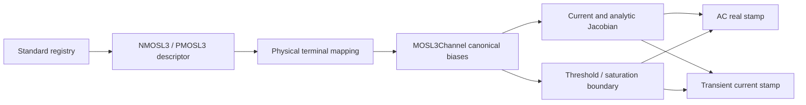
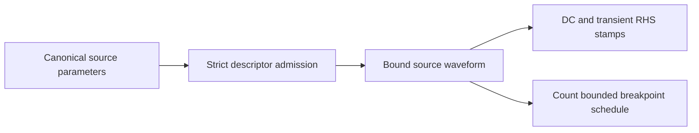
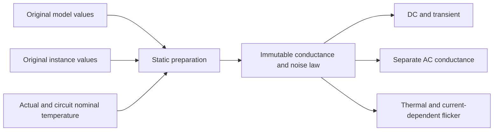
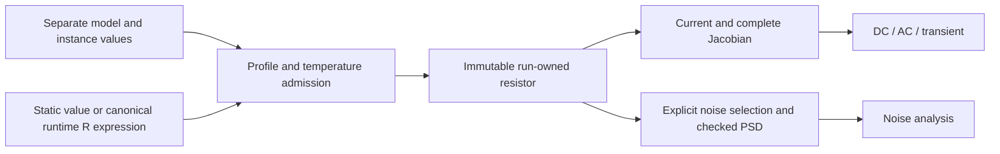

# Native Electrical Devices

## Purpose and Scope

This component owns descriptor and bound-device implementations. Its parent is
[CoreSpiceDevices](../DESIGN.md). The verified Level 3 MOS contract and independent
source admission remain unchanged. The resistor section separately defines the
B8.6.5.4 static/runtime resistor contracts. Runtime implementation and focused
behavioral fixtures are present; execution evidence is recorded independently by
the task executor and does not imply whole-process qualification.

## Responsibilities and Boundaries

`MOSL3Channel` owns the common polarity-normalized channel law. NMOS/PMOS bound
devices own physical-terminal orientation, matrix/RHS stamps, Meyer capacitances,
and transient history. Descriptors own parameter-domain admission. BSIM3/4 and
foundry temperature/noise fidelity are not provided by this Level 3 model.

## Related Designs

| Design | Relationship | Contract Used | Summary | Cautions |
|---|---|---|---|---|
| [CoreSpiceDevices](../DESIGN.md) | parent | BoundDevice and registry | Analysis boundary | Current and derivative consistency is required for all analyses |
| [IR](../../CoreSpiceIR/DESIGN.md) | depends on | ResolvedDeviceModel, Instance and BehavioralExpression | Separate model provenance and simulation dependencies | Reuse existing value boundaries; do not invent merged provenance |
| [Lowering](../../CoreSpiceLowering/DESIGN.md) | used by | Model resolution and runtime expression lowering | Prepared numerical input and dependencies | The parser does not implement resistor physics |
| [Analysis](../../CoreSpiceAnalysis/DESIGN.md) | used by | Checked stamping and noise execution | DC, AC, transient and noise consumers | Device binding does not declare an analysis successful |

## Architecture



## Contracts and Invariants

- Normalized drain/gate/body voltages use polarity +1 for NMOS and -1 for PMOS,
  relative to the effective source; reverse conduction swaps source and drain.
- Threshold is `polarity * vto + gamma * (sqrt(max(phi - vbs, 0.01)) - sqrt(phi))
  - eta * vds`. The derivative of the body clamp is zero below its floor.
- The smoothed overdrive uses an overflow-resistant hypotenuse and avoids
  cancellation in deep cutoff. Mobility and velocity denominators require
  nonnegative theta/kappa and finite derived beta, Cox, and velocity coefficient.
- The existing 1 pS channel stabilization is retained as a parallel conductance
  in both current and derivative, rather than a derivative-only floor.
- DC reconstruction, finite differences, and AC real stamps describe one current.
  At a piecewise region boundary, each branch uses its own one-sided derivative.
- Meyer capacitance region selection uses the same canonical body and threshold,
  including reverse PMOS operation. This does not claim charge-conserving BSIM
  capacitances or foundry fidelity.

## Runtime Flows

Binding validates the model domain. Each stamp resolves terminal biases, evaluates
the channel, maps current/derivatives back to physical terminals, and adds
capacitance companions where applicable. Analysis failure remains typed when
finite admitted parameters and extreme finite biases overflow arithmetic.

## State, Ownership, and Lifecycle

The evaluator contains values only. L3 history is the module's existing
`TransientCapacitanceStore`; trial stamps read history, and accepted-step commits
mutate it through the same Mutex entry points on all targets.

## Failure, Concurrency, and Constraints

Invalid denominator domains and non-finite derived coefficients fail binding with
`DeviceBindingError.invalidParameterValue`. Runtime non-finite currents must reach
the existing analysis numerical-failure path without defaulting to a successful
zero current. The model is native pure CPU logic, without a GPU backend change.

## Verification and Change Impact

The [MOSL3ConsistencyTests](../../../Tests/CoreSpiceDevicesTests/MOSL3ConsistencyTests.swift)
suite uses the production registry and both coordinate/CSR stamps. It checks
finite-difference derivatives in cutoff/linear/saturation/reverse/body-clamp
conditions, current KCL and polarity symmetry, AC capacitances, accepted transient
history, actual DC/AC/transient analyses, and binding/numerical failure.
Revalidate both bound polarities, parent device contracts, and analysis consumers
when the channel law changes. Unsupported BSIM model selection stays blocked.

Verified on Swift 6.4 RELEASE, arm64 macOS 27, using the native CPU SparseLU
analysis path: all 9 L3 methods and 12 directly related parameter/capacitance/history
methods completed successfully (21 selected methods, 21 matching `testEnded`
events from a 157-method compiled product registry). The original four contract
tests reproduced 56 violations before the implementation change.

```sh
../scripts/swift-test-timeout.sh 120 --scratch-path .build-l3 --jobs 6 \
  --test-product CoreSpiceDevicesTests \
  --filter 'MOSL3ConsistencyTests|MOSFETCapacitanceDefaultTests|TransientAndNoiseCapabilityTests|ModelParameterValidationTests' \
  --event-stream-output-path /tmp/corespice-l3-integration.events.jsonl --event-stream-version 0
```

This evidence covers the native L3 implementation and analysis consumers on that
host. It does not qualify BSIM3/4, Metal execution, WASM, or Embedded targets.

## Independent Source Admission

Voltage/current descriptors own DC, pulse, sine and PWL selection. `pwl` is a
canonical real vector with at least two finite time/value pairs, nonnegative and
strictly increasing times, and finite interpolation slopes. Waveform families are
exclusive; partial, unknown and mistyped parameters fail binding rather than
selecting DC or parameter defaults. DC plus transient parameters is ambiguous.
PWL holds its first/last values outside its declared domain. Source breakpoint
enumeration consumes an explicit count admission before appending each item.



Built-in devices preserve the same bounded breakpoint contract through the
BoundDevice protocol. Custom implementations own admission before allocating
their breakpoint output. Host CPU integration tests trace compiler, registry,
bound waveform, numerical transient and exact accepted time axis.

## Resistor Execution Contract

### Static Preparation Ownership

`ResistorPreparation` owns the static parameter-domain and derived-value admission
behind `ResistorDescriptor`. The immutable prepared value supplies DC and AC
conductances, thermal temperature, multiplicity and flicker coefficients to the
memoryless `BoundResistor`. Preparation reads original model and instance maps
separately; aliases are admitted only within their source role and conflicting
aliases are explicit failures. Model geometry defaults are 10 micrometers and
remain SI; only supplied instance dimensions consume document scale in lowering.
Model geometry wins over model R only when sheet resistance and source dimensions
admit the original geometry path. Effective dimensions must be positive whenever
geometry resistance or explicit-dimension flicker area consumes them.

The pinned `resnoise.c` plus `NevalSrcInstanceTemp` define a distinct thermal
temperature: without absolute instance `temp`, use operating temperature plus
`dtemp`; with `temp`, use its Kelvin value plus model nominal Celsius temperature.
This unusual original rule is preserved explicitly rather than substituting the
resistance-evaluation temperature. It requires finite positive noise temperature.
Flicker consumes total actual DC current `I=G*V`, then the per-unit current `I/m`.
Its area is one unless either source instance dimension is supplied; otherwise
the admitted effective dimensions and model `lf/wf` define the area. Invalid
frequency or non-finite/negative spectra fail the existing throwing noise API.



Runtime-dependent resistance is retained as canonical behavioral IR and referenced
nodes in lowering. `ResistorDescriptor` selects immutable `BoundRuntimeResistor`,
which owns the current/Jacobian/noise law and reuses the checked scalar AD evaluator.
`RuntimeResistorPolicy` admits bounded AST/dependency/work before publication.

### Current Facts and Fixed Scope

`ResistorDescriptor` delegates static admission to `ResistorPreparation` and
binds immutable conductance/noise values. DC/transient share the prepared
conductance; AC may use a separate admitted resistance. Binding resolves CSR
indices once. Original ideal-R meaning and terminal orientation are retained.
Temperature, geometry, multiplicity, resistance scale and thermal/flicker noise
have explicit numerical paths, including the separate runtime profile below.
Focused native CPU execution evidence is recorded by the task
executor, independently of this implementation description.

B8.6.5.4 fixes two target responsibilities: complete native static resistor
semantics (explicit/model/geometry resistance, temperature, multiplicity,
resistance scale and noise), and runtime-dependent resistor semantics (current,
complete Jacobian, temperature, multiplicity and noise). Implementation sprints
are divided by the package task; an interim subset is not the completed contract.
Until a supplied parameter's meaning is implemented, it is a typed refusal when
used, even if syntactically valid or zero-valued. This interim admission prevents
false success; it does not remove the missing feature from the target.
Unused declarations remain source values; they are neither numerically prepared
nor qualified by parsing alone. Completion does not imply all Sky130 device or
process coverage, or arbitrary runtime function support.

The untouched xhigh-po card establishes these concrete needs: `rend1/2` reference
`reshead`, supply scalar `r` and instance `tc1/tc2`; `reshead` supplies `tnom=25`.
`rbody` supplies a resistance expression containing terminal/substrate voltages
and its own `tc1/tc2`, but does not reference `resbody`. That unused model's
`tnom=25` must not be inferred as the body's temperature authority. The observed
model declaration refusal precedes these execution paths; advancing that refusal
alone is not evidence of their numerical correctness.

### Input Roles and Admission

- Keep resolved model name/type/parameters in existing `ResolvedDeviceModel`,
  separate from supplied `Instance.parameters`. Instance coefficients override
  corresponding model defaults only at the device's preparation boundary.
  Model identity/type mismatch, unknown references and unsupported supplied
  parameters fail explicitly. No model coefficients are lost through flattening.
- A static resistance expression resolves using the existing scoped parameter
  semantics. A voltage-dependent resistance retains the existing canonical
  `BehavioralExpression` and all referenced nodes. It must not be statically
  evaluated, replaced by a constant, or changed into manufactured SPICE text.
- Require finite, positive effective resistance, valid temperature and finite
  derived current/conductance/derivatives within the admitted passive profile.
  Zero/negative/non-finite resistance, invalid temperature factors and arithmetic
  overflow yield typed binding/runtime failure. Do not adopt the reference's
  warning-plus-small-resistance substitution as successful native admission.
- Explicit source R has precedence over any admitted model-default resistance.
  Without explicit R, the static owner selects valid original geometry and sheet
  resistance, then model-default R. Missing/invalid input fails instead of the
  reference warning-plus-1mOhm fallback. Geometry is a required target, not a
  reason to infer an ideal resistance while its implementation is absent.

### Temperature and Scale Authorities

For ordinary model-backed R, model `tnom` is Celsius at source intake and Kelvin
after preparation. Without model `tnom`, use the circuit nominal temperature
(reference default 300.15 K), independently of actual operating temperature.
`OperatingConditions` owns distinct actual and nominal temperatures in Kelvin.
Its nominal temperature defaults to 300.15 K and both temperatures must be finite
and positive. `SPICEAnalysisOptions` resolves circuit `.options tnom` in Celsius
and supplies the converted nominal value through `operatingConditions()`.
Model `tnom` overrides this circuit nominal value only during device preparation.
Nominal temperature is not inserted into physical instance parameter maps.
Instance `tc1/tc2`
override their model defaults independently. With
`dT = T_effective - T_nominal`, `F = 1 + tc1*dT + tc2*dT*dT` and
`R_effective = R_nominal*F`. Multiplicity and resistance scale are required static
semantics: `G = m/(R_nominal*F*scale)`. An explicit
instance absolute `temp` takes precedence over `dtemp`; otherwise `dtemp` adds
to the operating temperature. Instance `tce` overrides model `tce`; if either is
supplied, its exponential factor `pow(1.01,tce*dT)` takes precedence over the
quadratic law. Optional AC resistance uses its distinct source value with the
same admitted temperature/multiplicity/scale law. Every applied value retains
its source role; unimplemented supplied values are not ignored.

For the reference-compatible voltage-dependent R profile, use the pinned
behavioral nominal temperature **300.15 K**, independently of an unused resistor
model's `tnom`. Preserve its supplied instance `tc1/tc2` and admitted multiplicity
in the reference law `I = m*V_terminal/(R_expression*F)`. Runtime multiplicity
is a required target regardless of whether the observed card supplies it.
The fixed rewrite copies main-current multiplicity only to the main behavioral
source. Its noise-transfer source has gain `1/sqrt(R_expression)` and its 1-ohm
noise resistor receives `tc1/tc2`, but retains circuit nominal temperature and
unit multiplicity. These are distinct, verified authorities. The complete
admitted runtime profile is defined below; unsupported source combinations fail
explicitly instead of inheriting coefficients from a discarded model.

The pinned reference applies document `.options scale` to source instance `l/w`,
while R-instance `scale` multiplies resistance. They must never alias. The required
static geometry contract preserves SI lengths and the original
`Rsh*(L-2*short)/(W-2*narrow)` law, source default provenance and valid effective
dimensions. Defaults and effective dimensions retain their model/instance origin.
This requires its own analytical proof before successful admission. The observed
xhigh-po card does not need geometry-only resistance or `tce`; that observation
does not remove either from the complete static target.

These rules use the fixed ngspice46 commit
`ebdaf58ec76a06ffaac7e0f138360dd1cf5ee4b6`:
[ordinary temperature/geometry](https://raw.githubusercontent.com/imr/ngspice/ebdaf58ec76a06ffaac7e0f138360dd1cf5ee4b6/src/spicelib/devices/res/restemp.c),
[source temperature and scale conversion](https://raw.githubusercontent.com/imr/ngspice/ebdaf58ec76a06ffaac7e0f138360dd1cf5ee4b6/src/spicelib/devices/res/resparam.c),
and [behavioral temperature and current stamping](https://raw.githubusercontent.com/imr/ngspice/ebdaf58ec76a06ffaac7e0f138360dd1cf5ee4b6/src/spicelib/devices/asrc/asrcload.c).
The reference's behavioral nominal-temperature FIXME is a verified reference
behavior, not permission to silently replace it with the unused model's `tnom`.

### Runtime and Noise

DC and transient evaluate the same current law. Every voltage dependency enters
the compiled matrix structure, even when it is not one of the two resistor ports.
Jacobian and AC small-signal stamps differentiate that complete current law at
the same operating point, including the voltage dependence of R. Subcircuit
remapping applies to both terminals and read-only referenced nodes. Reuse the
existing behavioral expression machinery; evaluating `1/R` alone is not the
nonlinear device Jacobian. The device is memoryless and adds no transient history.

Ordinary R retains its existing thermal-noise default. Explicit admitted
`noisy/noise=0` is a source choice, not an unsupported-noise fallback. The
reference-compatible runtime R default is noiseless; thermal noise is enabled
only by an explicit `noisy/noise` choice or caller policy equivalent to
the reference `enable_noisy_r`. This choice must survive lowering and binding.
Ordinary thermal current PSD uses the selected temperature and conductance law,
`4*kB*T_noise*G`. Its temperature authority and overrides must follow the original
noise path, not an assumed equality with another nominal temperature. For the
reference runtime rewrite, terminal-current PSD is
`4*kB*T_operating/(R_expression*F_aux)`, where
`F_aux = 1 + tc1*(T_operating-T_nominal_circuit) + tc2*(T_operating-T_nominal_circuit)^2`.
The main-current factor uses the separate fixed 300.15 K nominal. PSD does not
include multiplicity; output noise does depend on the main Jacobian's transfer.
It is not `4*kB*T*dI/dV`. CoreSpice retains its existing modern SI Boltzmann
constant 1.380649e-23 J/K; a source-law comparison against ngspice46 accounts for
its older 1.38064852e-23 value explicitly rather than changing physical constants.

Noise-disabled and noise-unsupported states are different: a requested capability
outside the profile fails through the existing noise admission boundary before
successful analysis. It cannot disappear because a device lacks `NoisyDevice`.

Static flicker noise is a required target. It retains model `kf/af/ef/lf/wf`,
actual operating-point current and admitted effective noise area. The original
current PSD is `m*kf*abs(I/m)^af/(A_effective*f^ef)`; when source dimensions are
supplied, `A_effective=(L-2*short)^lf*(W-2*narrow)^wf`, otherwise its source
default is retained. Finite/domain admission and frequency/temperature handling
remain explicit. Static preparation and `BoundResistor` implement these semantics; invalid
supplied coefficients and non-finite runtime spectra remain typed failures. Existing ideal-R thermal tests cannot qualify flicker.
The fixed reference's
[runtime rewrite and noise selection](https://raw.githubusercontent.com/imr/ngspice/ebdaf58ec76a06ffaac7e0f138360dd1cf5ee4b6/src/frontend/inpcom.c),
[ordinary defaults](https://raw.githubusercontent.com/imr/ngspice/ebdaf58ec76a06ffaac7e0f138360dd1cf5ee4b6/src/spicelib/devices/res/ressetup.c),
and [noise law](https://raw.githubusercontent.com/imr/ngspice/ebdaf58ec76a06ffaac7e0f138360dd1cf5ee4b6/src/spicelib/devices/res/resnoise.c)
are separate authorities; the behavioral current-source implementation alone
does not provide resistor-noise support.



### Complete Admitted Runtime Resistor Profile

Status: contract fixed by [pinned-source and concrete-path analysis](../../../../.verification/runs/b865-runtime-resistor-20261009/contract-analysis.json);
implementation is present with [RuntimeResistorTests](../../../Tests/CoreSpiceDevicesTests/RuntimeResistorTests.swift);
behavioral execution proof remains B8.6.5.13-owned. This profile closes
the previously unresolved auxiliary-noise/multiplicity algorithm. It does not
claim arbitrary runtime function support or physical process qualification.

| Boundary | Contract and owner |
|---|---|
| Source intake | Parser consumes the complete named unquoted R expression, respecting the next assignment, continuation, original location and owned decode work |
| Runtime temperature | IR retains an explicit ambient Celsius variable; Lowering recognizes `temper` as runtime; binding supplies `OperatingConditions.temperatureCelsius`, never a lowering-time constant |
| Runtime source profile | Required R/resistance canonical expression; optional finite tc/tc1, tc2, positive m, and boolean noisy/noise. Conflicting aliases, model references, or supplied static-only ac/temp/dtemp/tce/scale/geometry/model-noise values are typed profile refusals; the fixed reference discards their meaning, so native cannot silently accept them |
| Current | `I=m*V/(R*F_main)` with fixed 300.15 K main nominal; require finite positive R and F_main, finite current/equivalent current and every derivative |
| Full Jacobian | Union both resistor terminal indices with all AST node/branch dependencies; differentiate V and R, including third-node and branch dependence |
| AC / transient | AC linearizes the same full law at the actual OP and time zero; transient uses IntegrationState.currentTime. The resistor has no history or shared mutable state |
| Convergence | Candidate physical-residual checking belongs to NewtonRaphsonSolver at actual analysis time. The device introduces no time-zero convergence evaluation or mutable last-time cache |
| Noise | Runtime default is explicitly noiseless; source boolean overrides the descriptor policy's default. Enabled thermal PSD uses the separate circuit-nominal F_aux, with no intrinsic m or flicker term; invalid enabled-noise factors and nonfinite PSD throw |
| Bounds | RuntimeResistorPolicy owns finite binding/evaluation ceilings and default noise selection; each policy validates positive/overflow-safe AST nodes, depth, dependencies and per-stamp work before allocation/evaluation. Default depth is the validated bounded recursion preset; changing any default requires boundary and representative runtime tests, without changing the physical law |
| Failure | Binding rejects malformed AST arity, missing topology and unsupported parameters before device publication. Checked evaluation rejects invalid state indices, nonfinite time/value/derivatives, nonpositive R and overflow using typed errors. Throwing stamps/noise propagate through existing analysis APIs; no success, partial result or canonical case is emitted on failure |

RuntimeResistorPolicy is an immutable caller-selected operational ceiling, distinct
from physical parameters. Its default preset admits 4096 AST nodes, depth 64,
256 solution dependencies and 1,052,672 AST visits per stamp (4096 * 257).
All ceilings must be positive; depth may not exceed the owner-supported recursion
ceiling of 64. Binding counts before recursive evaluation and checks the
node-count * (dependency-count + 1) product without overflow. Callers may reduce
work ceilings or raise node/dependency/work ceilings within checked arithmetic;
the recursion ceiling changes only with owner validation. The preset is an
operational selection, not an accuracy limit; boundary tests and the real runtime
card establish the admitted path, without generalizing to other platforms.

`ResistorDescriptor(runtimePolicy:)` remains the existing DeviceDescriptor
boundary. It selects independently prepared static or runtime values without
reinterpreting static coefficient precedence. Immutable `BoundRuntimeResistor`
implements BoundDevice and NoisyDevice; checked scalar AD remains inside this
Devices owner. Policy construction throws `RuntimeResistorPolicyError` for
invalid ceilings or capacity overflow. `SolutionState.checkedBoundValue` rejects
missing, out-of-range or remapped node/branch identities before checked stamps;
`SolutionStateAccessError.variableIndexMismatch` prevents a value/Jacobian map mismatch. There is no new analysis
engine, global evaluator cache, shared mutable history, C backend or platform
synchronization branch. Prebound sparse indices and owned AST are reused; each
stamp reads the solution owner without materializing solution arrays or derivative
arrays. Admitted work is O(AST nodes * (dependency count + 1)) and retained
storage is bounded at binding. Noise computation evaluates the same owned R at
its OP and returns the existing explicit NoiseSource boundary.

The fixed reference's division regularization and source-stepping internals are
not transplanted into native device equations. Native positive-domain admission
and its existing solver remain authoritative. Numerical/source-law comparisons
state their tolerances and constant normalization separately from any physical
acceptance criterion.

### Runtime Closure Evidence

| Requirement | Behavioral owner and falsifiable check |
|---|---|
| Original runtime grammar | ResistorParserTests: unmodified named continuation expression, following parameter boundary, malformed/location refusal |
| Bound ambient authority | ResistorLoweringTests + runtime device tests: same retained AST rebound at two actual temperatures; nested scope/node/branch identities survive |
| Current and all derivatives | RuntimeResistorTests: independent analytic derivative checks for both terminals, third node and referenced branch; actual Newton/DC and AC OP path |
| Actual transient time | Public IO transient memoryless expression with time dependency and actual residual checking |
| Distinct main/aux nominal | Native noise/DC at 77 C, tc1/tc2, m=4, and circuit nominal 27/17 C: current unchanged by nominal while thermal spectrum changes |
| PSD versus differential conductance | Nonlinear R=1000*(1+Vout), DC/AC/noise comparison using independently derived terminal PSD and actual transfer; no m factor in terminal PSD |
| Explicit source choices | noiseless default, enabled/disabled source flag and policy default override; discarded-reference inputs are native typed refusals |
| Resource/domain safety | AST depth/node/work/dependency ceilings, malformed direct IR arity, missing/out-of-range state, R<=0, temperature-factor/derivative/current/PSD overflow; failure publishes no result |
| Preserved static contract | Existing static resistor and affected behavioral-source tests, once after the frozen implementation/review |
| Real adopted input | Current untouched Sky130 CLI path advances through grammar/runtime admission; later scale/bin/version gaps stay explicit rather than gaining qualification |

### Ownership, Failures and Completion Evidence

Prepared values/dependencies are immutable and owned by the bound device for one
analysis run. Expression resolution is invocation-local and uses the existing
LoweringContext isolation. No shared mutable resistor state, platform-conditional
storage, C evaluator or new global projector is introduced. Resource/cancellation
and numerical-failure propagation remain with the existing compilation/analysis
owners. No typed error can become a successful zero current, ideal R or omitted
noise contribution.

| Invariant | Minimum behavioral evidence and owner |
|---|---|
| Declaration vs execution | Parser/ParsedIR unused-model round trip plus public IO model-reference survival |
| Separate roles and precedence | Public IO model/instance coefficient conflict, scoped references and actual binding |
| Static resistance and geometry | Public IO explicit/model/geometry precedence, SI/document scale, effective dimensions and model defaults against an independent resistance oracle |
| Ordinary temperature and scale | Device/public IO current/AC conductance for model and instance coefficients, tnom, temp/dtemp, tce, m and resistance scale |
| Runtime current and topology | Public IO voltage-dependent DC/transient, independent derivative oracle and AC linearization, including substrate and nested node references |
| Distinct nominal authorities | Same coefficient values tested against ordinary model tnom and runtime 300.15 K separately |
| Static noise | Actual NoiseAnalysis thermal/flicker PSD and contribution checks across current/frequency/area/multiplicity and explicit disable |
| Runtime noise | Actual original auxiliary algorithm comparison including temperature/multiplicity, enabled/disabled selection and nonlinear operating-point dependence |
| Refusal | Unsupported supplied parameter, model mismatch, non-finite/invalid R or temperature factor and runtime-domain failure |
| Production input locality | Untouched Sky130 card/deck replay retains expressions; grammar progress is reported separately from device numerical completion |

Existing [resistor binding/stamp tests](../../../Tests/CoreSpiceDevicesTests/CoreSpiceDevicesTests.swift),
[ideal thermal-noise tests](../../../Tests/CoreSpiceAnalysisTests/NoiseIntegrationTests.swift)
and [behavioral public IO tests](../../../Tests/CoreSpiceIOTests/SPICEIOEndToEndTests.swift)
remain regression premises. They do not already prove this target resistor
profile. New profile completion requires the additional actual public behavior
above; no foundry/process-wide qualification follows from that completion.


### Static Verification Owners

[StaticResistorTests](../../../Tests/CoreSpiceDevicesTests/StaticResistorTests.swift)
checks analytical temperature/multiplicity/scale and AC conductances, model/default
geometry precedence, original thermal-temperature rule, current-dependent flicker
area and frequency laws, aliases, noise disable, CSR/transient reuse and failures.
[ResistorLoweringTests](../../../Tests/CoreSpiceLoweringTests/ResistorLoweringTests.swift)
checks lexical models, separate maps, runtime dependency retention, document scale
and incomplete MOS refusal. [SPICEIOEndToEndTests](../../../Tests/CoreSpiceIOTests/SPICEIOEndToEndTests.swift)
executes actual DC/AC/noise and nominal-temperature/geometry compositions.
[RuntimeResistorTests](../../../Tests/CoreSpiceDevicesTests/RuntimeResistorTests.swift)
checks independent analytical full Jacobians, coordinate/CSR/AC/transient laws,
bound ambient temperature, distinct main/auxiliary nominals, explicit noise
selection without intrinsic multiplicity, typed domain/state/arity failures and
policy depth/node/dependency/work boundaries. Checked evaluation validates every
active AST intermediate; a singular derivative such as `sqrt(0)` is refused
when its scalar AD is nonfinite. These source fixtures are not execution evidence.
Evidence remains local to the native CPU paths executed by the task executor;
WASM/Embedded and foundry-wide accuracy are unqualified.

### Independent Current Excitation Consistency

The runtime resistor OP/AC oracle uses an independent current excitation. Its
existing SPICE orientation is identical in DC, AC and transient: current is
drawn from the positive terminal and injected into the negative terminal.
BoundCurrentSource stamps this direction explicitly through bound indices;
the generic complex current-injection helper uses the opposite injection
convention and must not be substituted for the source terminal law. Public
nonlinear resistor AC correlation rejects a reversed stimulus sign.

## Capacitor Model Binding Admission

`CapacitorDescriptor.bind` owns the direct IR numerical-admission boundary. An
`Instance.model` with a mismatched type fails with typed DeviceBindingError; a
matching capacitor model also fails explicitly until model-backed C numerical
preparation is implemented. Positive explicit `c` cannot bypass this gate or
discard model coefficients. The refusal branch carries INCOMPLETE_IMPLEMENTATION.

`Instance.model == nil` retains the existing ideal capacitor companion/stamp path.
`ModelConsumption.selected` is provenance, not a physical model binding map:
URC-generated ideal capacitors legitimately retain selected URC evidence while
model is nil and must continue to bind/stamp. Tests reject same/wrong-type models
with explicit values and exercise ideal transient stamps with selected URC
provenance. No model-C physics qualification follows from declaration intake.
