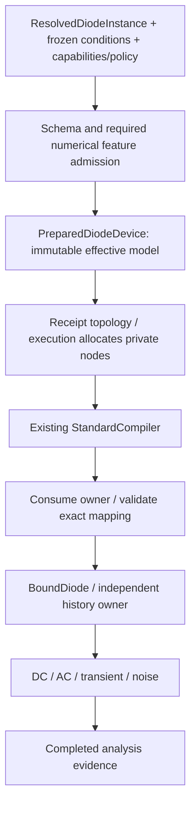

# Native Diode Preparation and Execution

## Purpose and Scope

Status: proposed component. Parent: [Devices module](../DESIGN.md). No children.
It will own the diode implementation currently in Devices/DiodeDescriptor.swift,
Devices/DiodeModelParameters.swift and Devices/BoundDiode.swift; move those production
files here when implementing this boundary. This document defines the new checked
path, not a claim that today's descriptor implements it. No solver replacement or
Sky130 Level-3 physics is included.

## Responsibilities and Boundaries

Prepare exact admitted diode inputs, validate physical feature/analysis support,
compute effective numerical values once, establish topology and consume the owner
into binding. Bound devices own bias evaluation and mutable execution history.
Analysis owns solving, accepted timestep decisions and result success.

## Related Designs

| Design | Relationship | Contract Used | Summary | Cautions |
|---|---|---|---|---|
| [Devices module](../DESIGN.md) | parent | BoundDevice/registry/history | Native composition | Preserve fallible stamping |
| [Input](../../CoreSpiceDiodeContracts/Input/DESIGN.md) | depends on | Schema and preparation stages | Exact role/unit authority | Never merge source maps |
| [Environment](../../CoreSpiceEvaluationContracts/Environment/DESIGN.md) | depends on | Frozen environment | Checked temperature adaptation | No implicit reprepare |
| [Diode resolution](../../CoreSpiceLowering/DiodeResolution/DESIGN.md) | used by | Checked resolved value | No source evaluation here | No reverse implementation dependency |
| [Native execution](../../CoreSpice/NativeExecution/DESIGN.md) | used by | Preparation owner / topology / bind | Sole circuit composition | Own atomic reservations |
| [Analysis](../../CoreSpiceAnalysis/DESIGN.md) | used by | Stamps/session/noise protocols | Existing numerical algorithms | No result on device failure |

## Architecture



## Contracts and Invariants

```swift
// Proposed APIs, not existing declarations.
public protocol DiodeDevicePreparing: Sendable {
    associatedtype Prepared: PreparedDiodeDevice & ~Copyable
    func prepare(_ input: borrowing DiodePreparationInput,
                 limits: DiodePreparationLimits,
                 control: any DiodePreparationControlling)
        throws(DiodePreparationFailure) -> Prepared
}
public protocol PreparedDiodeDevice: ~Copyable, Sendable {
    associatedtype Bound: BoundDevice
    var receipt: DiodePreparationReceipt { get }
    consuming func bind(_ mapping: borrowing DiodeBindingMapping)
        throws(DiodeBindingFailure) -> Bound
}
```

No raw Instance.parameters path is accepted for diode binding after migration.
DiodeDescriptor remains registry metadata and reports missing checked preparation
for raw binds; direct programmatic users use the same checked input factories and
preparer. A receipt without its executable owner is insufficient to bind.
Validate schema/law/resolution/environment/implementation/capability/policy identity
before temperature work, topology allocation or binding. Mapping must preserve
instance identity, ordered physical terminals, exact private-node ownership and
compiled sparse indices. Bind cannot reevaluate expressions, search model names,
change temperatures or invoke cold setup. DC sweep bias points reuse the owner.

### Effective values and numerical admission

Prepare model Tnom from its admitted override or frozen global nominal. Local
instance temp overrides ambient; dtemp adds to ambient; the schema forbids both.
Evaluate temperature adjustment at that effective temperature, not at Tnom or
ambient by accident. Preserve original model coefficients and unscaled instance
values next to separately typed effective values.

For the initial area-factor law, A is AreaFactor and M is parallel multiplicity:
Is_effective = Is_at_T * A * M, Cjo_effective = Cjo * A * M, and, when series
resistance is implemented, Rs_effective = Rs / (A * M). The grading coefficient,
ideality, potentials, temperatures and transit time are not multiplied. A future
sidewall/density law must specify its separate area/perimeter equations in its own
exact schema; do not apply this formula to Level3 js/cj/scalm cards. Validate every
product/quotient for overflow, underflow and physical domain before publication.

Parallel replication scales terminal I, Q, G, C and independent noise PSD by M,
not M squared; series conductance and its thermal noise scale correspondingly.
KCL, equal/opposite terminal charge and consistent derivatives must survive scaling.
Numerical stabilization is separately identified and excluded from physical noise
and replication proofs; a numerical gmin is not a model leakage coefficient.

Current baseline has unused rs, questionable reverse/breakdown derivative branches,
and a variable-C companion without an explicit charge law. Existing shape/stamp
checks cannot qualify these features. The first admitted native feature set is
explicitly restricted to area-scaled Shockley/temperature, zero rs, breakdown
disabled, zero tt and zero cjo, with zero pj. It still exercises direct A/M roles
through DC, AC, memoryless transient and shot noise. Its I and G must come from the
same finite analytic evaluation (no exp clamp with an unclamped derivative, and no
constant reverse current with an unrelated slope). Nonfinite I/G fails explicitly.
No legacy branch may execute behind this new preparation path.

Nonzero rs, explicit breakdown, depletion/diffusion charge and sidewall remain
recognized feature refusals until their respective diode-law units have independent
proof. In particular cjo>0 cannot silently run the existing variable-C transient
companion; requesting an unsupported analysis fails before execution. Feature
support is a static, implementation-identity-bound capability table, not a runtime
"tests passed" flag or a caller-controlled whitelist. Adding support requires the
owning physics design and tests before changing that table.

## State, Ownership, and Lifecycle

```text
checked input -> prepared ~Copyable owner -> consuming bind -> per-execution bound
  -> begin session -> trial reads/stamps -> accepted-step commit -> end/release
```

Prepared owner holds immutable effective values and exact topology. Binding creates
one mutable state owner per diode per execution, never shared with another run.
Use UniqueArray<NativePreparedDiodeDevice?> for mixed-circuit staging, independently
of MOS owners. No C owner is needed for this Swift junction law. Borrow spans only
synchronously; no pointer/view escapes its backing owner or an await.

When charge is implemented, use a diode-owned typed charge/current history with
Mutex<State> and the existing TransientSessionDevice/TransientStateCommittingDevice
protocols. Trial stamping does not commit history; acceptance commits exactly once,
rejection/cancel preserves the last accepted state, and end clears the session.
Derive charge from the admitted law and C=dQ/dV, rather than C(V_trial)*V_previous.
Do not rewrite the shared TransientCapacitanceStore for unrelated device families.
DC/AC/noise are history-observational. Keep the same storage/Mutex/access contract
across Native/WASM/Embedded source; only Native CPU numerical execution is qualified
in this implementation sequence.

## Failure, Concurrency, and Constraints

NativeCircuitPreparer owns prepare -> allocate -> compile -> consume-bind for both
MOS and diode; Lowering remains independent of Devices. Exact prepared topology
owns additional matrix dimension and auxiliary-node charges, including future Rs
nodes. Extend current MOS-only preparation accounting instead of assuming diodes
have zero resource cost. Distinguish caller admission ceilings, conservative preflight
reservations, allocated capacities and measured peaks. Count each live owner/buffer
once; moving prepared values into binding transfers reservations without recharging.
Diagnostic source references retain their shared backing owner. Release temporary
storage after preparation and all retained owners on any later failure/cancel.
Resource ceiling overflow never publishes a partial circuit, bound list or receipt
as a successful public result. Do not raise CLI ceilings to hide double counting.

The run owns one preparation batch; the BoundDevice array retains physical owners
until execution ends. Public copies of a preparation receipt do not create runnable
state. Atomic private-node claim validation/commit reuses BindingContext's existing
contract. No callback, I/O or await executes under the history Mutex.

## Verification and Change Impact

Proposed DiodePreparationTests in CoreSpiceDevicesTests owns identity, feature
refusals, exact effective temperature/A/M values, topology and consuming binding,
budget boundary, cancellation at each stage and cleanup after partial batches.
DiodeExecutionConsistencyTests checks independent analytic I/G, finite differences,
KCL, AC Y=G+jwC, M parallel-array equivalence and PSD scaling for the admitted set.
Future charge proofs require Q conservation, C=dQ/dV, BE/trapezoidal accepted/rejected
steps and lifecycle/concurrent release tests before nonzero cjo/tt admission.
Future Rs proofs require actual current reduction, internal-node mapping and thermal
noise; future breakdown proofs require current/derivative continuity and reference
comparison. The rs=0 vs1000 equal-current CLI counterexample must turn into an exact
unsupported-feature result first, or a proven physical difference once implemented.
Public raw-source/typed API tests must cover both outcomes and prevent registry bypass.

## D3 Change Impact

The [D3 resolution owner](../../CoreSpiceLowering/DiodeResolution/DESIGN.md) defines occurrence admission, frozen
evaluation, immutable result transport and explicit numerical refusal. This layer
consumes that contract; D4 numerical preparation and D5 downstream adoption remain
separate. Its affected production path and behavioral tests are verified in D3.
