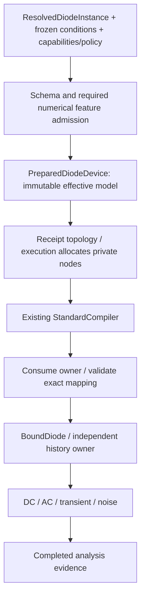

# Native Diode Preparation and Execution

## Purpose and Scope

Status: D4 preparation and 07N generic numerical law implemented and verified on native CPU. Parent: [Devices module](../DESIGN.md). No children.
It owns DiodeDescriptor.swift, DiodeModelParameters.swift, BoundDiode.swift and the
checked preparation owner in this directory. No solver replacement or Sky130
Level-3 physics is included. Generic numerical graduation requires the independent success/failure and
accepted-history evidence defined by 07N below.

## Responsibilities and Boundaries

Prepare exact admitted diode inputs, validate physical feature/analysis support,
compute effective numerical values once, establish topology and consume the owner
into binding. Bound devices own bias evaluation and mutable execution history.
Analysis owns solving, accepted timestep decisions and result success.

## Related Designs

| Design | Relationship | Contract Used | Summary | Cautions |
|---|---|---|---|---|
| [Devices module](../DESIGN.md) | parent | BoundDevice/registry/history | Native composition | Preserve fallible stamping |
| [Input](../../CoreSpiceDiodeContracts/Input/DESIGN.md) | depends on | Schema and preparation stages | Exact role/unit authority | Never merge source maps |
| [Environment](../../CoreSpiceEvaluationContracts/Environment/DESIGN.md) | depends on | Frozen environment | Checked temperature adaptation | No implicit reprepare |
| [Diode resolution](../../CoreSpiceLowering/DiodeResolution/DESIGN.md) | used by | Checked resolved value | No source evaluation here | No reverse implementation dependency |
| [Native execution](../../CoreSpice/NativeExecution/DESIGN.md) | used by | Preparation owner / topology / bind | Sole circuit composition | Own atomic reservations |
| [Analysis](../../CoreSpiceAnalysis/DESIGN.md) | used by | Stamps/session/noise protocols | Existing numerical algorithms | No result on device failure |

## Architecture



## Contracts and Invariants

```swift
// Implemented preparation and executable ownership boundary.
public protocol DiodeDevicePreparing: Sendable {
    associatedtype Prepared: PreparedDiodeDevice & ~Copyable
    func prepare(_ input: borrowing DiodePreparationInput,
                 limits: DiodePreparationLimits,
                 control: any DiodePreparationControlling)
        throws(DiodePreparationFailure) -> Prepared
}
public protocol PreparedDiodeDevice: ~Copyable, Sendable {
    var receipt: DiodePreparationReceipt { get }
    consuming func bind(instance: Instance, context: inout BindingContext)
        throws(DiodePreparationFailure) -> any BoundDevice
}
```

No raw Instance.parameters path is accepted for diode binding after migration.
DiodeDescriptor remains registry metadata and reports missing checked preparation
for raw binds; direct programmatic users use the same checked input factories and
preparer. A receipt without its executable owner is insufficient to bind.
Validate schema/law/resolution/environment/implementation/capability/policy identity
before temperature work, topology allocation or binding. Mapping must preserve
instance identity, ordered physical terminals, exact private-node ownership and
compiled sparse indices. Bind cannot reevaluate expressions, search model names,
change temperatures or invoke cold setup. DC sweep bias points reuse the owner.

### Effective values and numerical admission

Prepare model Tnom from its admitted override or frozen global nominal. Local
instance temp overrides ambient; dtemp adds to ambient; the schema forbids both.
Evaluate temperature adjustment at that effective temperature, not at Tnom or
ambient by accident. Preserve original model coefficients and unscaled instance
values next to separately typed effective values.

For the initial area-factor law, A is AreaFactor and M is parallel multiplicity:
Is_effective = Is_at_T * A * M, Cjo_effective = Cjo * A * M, and, when series
resistance is implemented, Rs_effective = Rs / (A * M). The grading coefficient,
ideality, potentials, temperatures and transit time are not multiplied. A future
sidewall/density law must specify its separate area/perimeter equations in its own
exact schema; do not apply this formula to Level3 js/cj/scalm cards. Validate every
product/quotient for overflow, underflow and physical domain before publication.

Parallel replication scales terminal I, Q, G, C and independent noise PSD by M,
not M squared; series conductance and its thermal noise scale correspondingly.
KCL, equal/opposite terminal charge and consistent derivatives must survive scaling.
Numerical stabilization is separately identified and excluded from physical noise
and replication proofs; a numerical gmin is not a model leakage coefficient.

The restricted coreJunctionV1 law supports zero Rs, disabled breakdown, zero Cjo/Tt
and zero perimeter. The distinct genericJunctionV1 law supports depletion/diffusion
charge and calibrated breakdown as specified below. Rs and sidewall remain explicit
feature refusals. Support is implementation-owned, not a caller whitelist.

## State, Ownership, and Lifecycle

```text
checked input -> prepared ~Copyable owner -> consuming bind -> per-execution bound
  -> begin session -> trial reads/stamps -> accepted-step commit -> end/release
```

Prepared owner holds immutable effective values and exact topology. Binding creates
one mutable state owner per diode per execution, never shared with another run.
Use UniqueArray<NativePreparedDiodeDevice?> for mixed-circuit staging, independently
of MOS owners. No C owner is needed for this Swift junction law. Borrow spans only
synchronously; no pointer/view escapes its backing owner or an await.

Charge uses a diode-owned typed charge/current history with
Mutex<State> and the existing TransientSessionDevice/TransientStateCommittingDevice
protocols. Trial stamping does not commit history; acceptance commits exactly once,
rejection/cancel preserves the last accepted state, and end clears the session.
Derive charge from the admitted law and C=dQ/dV, rather than C(V_trial)*V_previous.
Do not rewrite the shared TransientCapacitanceStore for unrelated device families.
DC/AC/noise are history-observational. Keep the same storage/Mutex/access contract
across Native/WASM/Embedded source; only Native CPU numerical execution is qualified
in this implementation sequence.

## Failure, Concurrency, and Constraints

NativeCircuitPreparer owns prepare -> allocate -> compile -> consume-bind for both
MOS and diode; Lowering remains independent of Devices. Exact prepared topology
owns additional matrix dimension and auxiliary-node charges, including future Rs
nodes. Extend current MOS-only preparation accounting instead of assuming diodes
have zero resource cost. Distinguish caller admission ceilings, conservative preflight
reservations, allocated capacities and measured peaks. Count each live owner/buffer
once; moving prepared values into binding transfers reservations without recharging.
Diagnostic source references retain their shared backing owner. Release temporary
storage after preparation and all retained owners on any later failure/cancel.
Resource ceiling overflow never publishes a partial circuit, bound list or receipt
as a successful public result. Do not raise CLI ceilings to hide double counting.

The run owns one preparation batch; the BoundDevice array retains physical owners
until execution ends. Public copies of a preparation receipt do not create runnable
state. Atomic private-node claim validation/commit reuses BindingContext's existing
contract. No callback, I/O or await executes under the history Mutex.

## Verification and Change Impact

DiodePreparationTests in CoreSpiceDevicesTests owns identity, feature
refusals, exact effective temperature/A/M values, topology and consuming binding,
budget boundary, cancellation at each stage and cleanup after partial batches.
DiodeExecutionConsistencyTests checks independent analytic I/G, finite differences,
KCL, AC Y=G+jwC, M parallel-array equivalence and PSD scaling for the admitted set.
Charge proofs require Q conservation, C=dQ/dV, BE/trapezoidal accepted/rejected
steps and lifecycle/concurrent release tests before nonzero cjo/tt admission.
Future Rs proofs require actual current reduction, internal-node mapping and thermal
noise; breakdown proofs require current/derivative continuity and reference
comparison. The rs=0 vs1000 equal-current CLI counterexample must turn into an exact
unsupported-feature result first, or a proven physical difference once implemented.
Public raw-source/typed API tests must cover both outcomes and prevent registry bypass.

## D3 Change Impact

The [D3 resolution owner](../../CoreSpiceLowering/DiodeResolution/DESIGN.md) defines occurrence admission, frozen
evaluation, immutable result transport and explicit numerical refusal. This layer
consumes that contract; D4 numerical preparation and D5 downstream adoption remain
separate. Its affected production path and behavioral tests are verified in D3.

## D4 Preparation Boundary

D4 owns coreDiodeV1/coreJunctionV1 and genericDiodeV1/genericJunctionV1 checked
preparation and consuming binding. Generic Cjo/Tt/breakdown inputs remain admitted;
their numerical law and qualification are owned by 07N below. This restricted exact
law does not remove those existing public cells.

| Boundary | Owner | Falsifying evidence |
|---|---|---|
| Checked input and frozen environment | DiodePreparationInput | Mixed model/instance/environment refusal |
| Effective thermal current and AREA/M | NativeDiodeDevicePreparer | Independent formula, overflow/underflow, unsupported feature refusal |
| Receipt and executable authority | NativePreparedDiodeDevice | Forged/mismatched receipt or raw descriptor cannot bind |
| Exact terminals and sparse mapping | Consuming bind | Missing/reordered terminal, mismatched conditions and matrix mapping refusal |
| Native circuit composition | NativeCircuitPreparer | Mixed MOS/diode preparation, cancellation and batch storage release |

Preparation capabilities name DC, AC, transient and noise explicitly. Admission
is implementation-owned and cannot be enlarged by the caller. Input/receipt
construction validates the environment before numerical work. The prepared owner
retains one immutable resolved input and effective values; no source map merging,
coefficient copies or model-name lookup occurs in bind/evaluation. Each owner
performs one setup and moves into one bound device. The restricted core profile
evaluates finite Shockley I/G with no physical gmin or inconsistent exponent clamp. Its physical law has no
charge or private nodes; its memoryless transient is the same law at the
trial voltage. Its shot-noise output is validated before publication.

Caller limits bound preparation retained bytes, temporary bytes and work. The
native batch reserves storage before preparing and transfers that reservation
through binding. Failure/cancellation publishes no partial owner array. All shared
state remains under the existing common resource owner; no target-specific raw
state or Sendable branch is introduced. Portable values are verified separately
from the Native-only numerical backend.

### D4 Ownership and Verification Scope

| State | Native | Ordinary WASM | Embedded WASM | Owner/lifetime |
|---|---|---|---|---|
| Checked input, identity and receipt | Immutable Sendable | Same declarations | Same declarations | Shared immutable source/typed backing |
| Prepared diode owner | Noncopyable immutable value | Native evaluator not claimed | Native evaluator not claimed | Consumed once into binding |
| Generic charge history | Diode-owned common Mutex store | Numerical backend not claimed | Numerical backend not claimed | Bound device; session lifecycle proved by 07N |
| Native batch resources | Existing common synchronized accounting | Numerical backend not claimed | Numerical backend not claimed | Reservation transferred to run/results |

Preparation work and retained/temporary byte facts describe admitted owner value
capacity, not measured allocator utilization. Native circuit capacity separately
owns bound arrays, compiled topology and result storage. Generic history is not
qualified by the immutable portable value probe. Generic numerical success requires the 07N evidence below; unsupported Rs/sidewall
remain explicit feature refusals.

## 07N Generic Numerical Law

This component owns CoreSpice's genericJunctionV1 law, identified by
`CoreSpice.NativeDiode.Preparation.v2`. It is not ngspice equation parity. The
restricted coreJunctionV1 remains memoryless Shockley with zero Rs/charge/breakdown.
The generic schema retains its existing positive BV/IBV inputs; numerical admission
checks the relationship required by this nonnegative avalanche coefficient law.

Let u=N*k*T/q, S=Is(T)*AREA*M, J=IBV*AREA*M, b=BV/u, r=-expm1(-b),
B=J/r-S. Explicit BV requires finite b>0, r>0, finite J>0, representable S*r>0 and finite B>=0.
B=0 is valid. J<S*r fails with typed invalidEffectiveValue(breakdownCurrent):
that combination is incompatible with this law, not universally physically invalid.
No coefficient adjustment or silent underflow fallback occurs. Omitted BV disables
avalanche. Preparation computes and freezes B once alongside the other effective
values. Stable exponential differences avoid cancellation near V=0.

I_f=S*expm1(V/u), G_f=S/u*exp(V/u).
I_av=-B*(exp(-(V+BV)/u)-exp(-BV/u)), G_av=B/u*exp(-(V+BV)/u).
I=I_f+I_av and G=G_f+G_av give I(0)=0, I(-BV)=-J and G=dI/dV>=0,
with continuous I/G. Physical stamps contain no gmin or exponential clamp. Solver
voltage limiting remains separate and also limits the reverse exponential argument.
Nonfinite I/G, equivalent RHS, capacitance, charge or frequency products fail before
emitting stamps. Shot noise is 2*q*abs(I); no solver gmin enters it. This is the
declared shot-noise law, not an avalanche excess-noise/multiplication model.

For depletion, a=1-m, Vf=Vj/2, Cf=Cjo*2^m, L=2*m*Cf/Vj:
Q_dep=-Cjo*Vj/a*expm1(a*log1p(-V/Vj)) below Vf. Above Vf use
Q_dep(Vf)+Cf*(V-Vf)+L*(V-Vf)^2/2. C_dep=dQ_dep/dV is the existing
continuous depletion/forward-linear capacitance. Q_diff=Tt*I_f and
C_diff=Tt*G_f use only the forward junction, excluding avalanche and numerical
stabilization. Q=Q_dep+Q_diff is stamped equal/opposite at physical terminals.

```text
begin(Q_initial, I_dynamic=0, time=0) -> trial read -> accept(Q, I_dynamic, time)
                                   -> rejected trial leaves history unchanged
end clears history; a concurrent begin fails before replacing the active owner
```

BoundDiode implements TransientSessionDevice. One common Mutex<State> holds the
optional accepted Q/current/time. BE dynamic current is (Qtrial-Qaccepted)/dt;
TR is 2*(Qtrial-Qaccepted)/dt-Iaccepted. The Newton Jacobian is coefficient*Ctrial
and equivalent current is Idynamic-Jacobian*Vtrial. Trials and DC/AC/noise never
mutate accepted history. Commit validates positive finite dt, increasing finite
accepted time and finite next values before atomic publication. Missing/concurrent
sessions and duplicate acceptance fail explicitly. end releases history on success,
throw and cancellation through Analysis's existing acquired-session defer. External
stamper callbacks execute after releasing the lock. Memoryless devices need no
history for a direct transient stamp. Fixed-size history capacity is accounted in
preparation; no per-step array, dictionary or borrowed pointer is retained.

| Invariant | Owner/test |
|---|---|
| I/G continuity and BV/IBV calibration | DiodeExecutionConsistencyTests independent expressions and finite differences |
| Q conservation, C=dQ/dV, AC Y | Same suite, independent integral and terminal stamp checks |
| BE/TR acceptance/rejection/restart and concurrency | Same suite, actual TransientSessionDevice lifecycle |
| AREA/M scaling and physical shot noise | Same suite, parallel replication and PSD ratios |
| Actual DC/AC/transient/noise and failures | DiodeNumericalAnalysisTests, existing affected Analysis tests |
| Portable synchronization declarations | Common immutable owner and Mutex history; native CPU numerical execution only |

The original generic incomplete markers may be removed only after these success,
failure and lifecycle counterexamples pass. The shared TransientCapacitanceStore
and unrelated device laws are outside this responsibility. Full CLI profile/receipt
emission remains 07C; portable preparation evidence is not numerical qualification.

### 07N Completion Evidence

DiodeExecutionConsistencyTests supplies eleven behavioral cells; the charge finite-difference
cell uses h=1e-5 because recovering Q from terminal stamps subtracts
conductive currents. Its original relative tolerance is unchanged. At V=0.5,m=0,
an independent IEEE arithmetic reproduction yields the prior h=1e-6 error exactly;
the corrected stencil lowers roundoff while preserving the analytic reference.
DiodeNumericalAnalysisTests supplies four actual CPU solver/cancellation/refusal
cells. Existing diode/temperature28, diode convergence/sensitivity/MonteCarlo7 and
source-to-native5 cells pass. No incomplete generic numerical branch remains.
The immutable portable preparation evidence is unaffected; this evidence does not
qualify a WASM/Embedded or Metal numerical backend, Rs/sidewall or CLI07C receipts.

## 07C Checked Numeric Perturbations

DiodeNumericPerturbation owns a typed role, canonical value, immutable original
basis and checked replacement resolved input. Construction revalidates the same
schema/profile and environment, reconstructs only originally supplied assignments
plus the explicit replacement, preserving raw geometry/scale and model/instance
roles. Canonical Kelvin overrides convert through source Celsius at this checked
input boundary. No parser lookup, expression reevaluation, dictionary merging or
raw descriptor binding occurs. Perturbed source-assignment evidence is false;
original declaration/occurrence/environment/seed remain the basis. Sensitivity
names use model.<sourceName> / instance.<sourceName> to prevent M role collision.
Fresh checked preparation owns feature/physical admission, limits and executable
lifetime. DiodeCLIAdmissionTests and native sensitivity tests falsify model/instance
role collision, stale-owner reuse and unmodified-parameter masquerading as a fresh
perturbation. Immutable perturbation values have no history or resource release.
