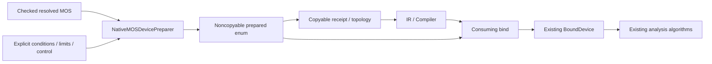

# Native MOS Preparation

## Purpose and Scope

This component owns checked native preparation and consuming binding for L1/L2/L3,
BSIM3 3.3.0 and BSIM4 4.8.3. Parent: [Devices](../DESIGN.md). No children.
This is the approved S3 implementation target, not completed runtime evidence.
Workspace PROGRESS.md owns migration status.

## Responsibilities and Boundaries

`NativeMOSDevicePreparer` implements `MOSDevicePreparing`. It accepts an already
checked `ResolvedMOSInstance`, constructs one fresh evaluator or classic parameter
value, and returns `NativePreparedMOSDevice`. It does not evaluate source programs,
select declarations, normalize geometry again, compile, solve or qualify a process.

`PreparedMOSDevice` is a noncopyable Sendable protocol. Its receipt describes
admitted inputs and topology; consuming `bind(instance:context:)` transfers the
executable owner once into an existing BoundDevice. The concrete noncopyable enum
has classic, BSIM3 and BSIM4 cases. Protocols returning BoundDevice belong here,
rather than in the portable contracts target.

The intended public signatures are:

```swift
public protocol MOSDevicePreparing: Sendable {
    func prepare(
        _ input: borrowing MOSPreparationInput,
        limits: MOSPreparationLimits,
        control: any MOSPreparationControlling
    ) throws(MOSPreparationFailure) -> NativePreparedMOSDevice
}

public protocol PreparedMOSDevice: ~Copyable, Sendable {
    var receipt: MOSPreparationReceipt { get }
    consuming func bind(instance: Instance, context: inout BindingContext)
        throws(MOSBindingFailure) -> any BoundDevice
}
```

## Related Designs

| Design | Relationship | Contract Used | Summary | Cautions |
|---|---|---|---|---|
| [Devices](../DESIGN.md) | parent | BindingContext and BoundDevice | Native composition | Fallible checks precede ownership claims |
| [Portable preparation](../../CoreSpiceMOSContracts/Preparation/DESIGN.md) | depends on | Identity, conditions, topology, limits and failures | Semantic vocabulary | No kernel or Foundation reverse dependency |
| [IR](../../CoreSpiceIR/DESIGN.md) | depends on | Typed resolved/prepared stage and private nodes | Retained receipt | Counts alone do not prove matching preparation |
| [Classic devices](../Devices/DESIGN.md) | depends on | Parameter validation and existing stamps | L1/L2/L3 physics | Unsupported supplied semantics are refused |
| [BSIM3](../BSIM3/DESIGN.md) | depends on | Exclusive 3.3.0 owner | Original topology/history | Evaluator cannot escape preparation |
| [BSIM4](../BSIM4/DESIGN.md) | depends on | Exclusive 4.8.3 owner | Explicit stress/noise intent | Inspectable 4.5 fails before allocation |
| [Native execution](../../CoreSpice/NativeExecution/DESIGN.md) | used by | Concrete noncopyable owner | Aggregate resources and run ordering | No cold setup per DC point |

## Architecture



## Contracts and Invariants

The [portable preparation design](../../CoreSpiceMOSContracts/Preparation/DESIGN.md)
owns complete identity, implementation identity, requested analysis capabilities,
conditions, topology and limit definitions. This component preserves their meaning
and compares the complete identity, rather than model name, declaration ID,
process-random Hashable output or node count alone. Model and instance scopes,
suppliedness, exact release and normalized geometry remain separate.

| Release | Native admission |
|---|---|
| L1/L2/L3 | Existing defaults/validators; M absent or exactly 1; OFF absent or 0; any supplied terminal IC is unsupported, including zero; NF rejected by schema |
| BSIM3 3.3.0 | Positive finite outer M, existing DS/GS/BS IC, original selectors and private topology; NF rejected by schema |
| BSIM4 4.8.3 | Positive finite outer M, existing IC, original fractional NF in [1, Int32.max], explicit positive stress ceiling and analysis capabilities |
| BSIM4 4.5 | Inspectable resolution retained; exact unsupported release before evaluator allocation |

Classic preparation builds and validates MOSFETModelParameters once. It does not
alter W to approximate multiplicity, invent IC behavior or silently drop OFF.
Existing classic equations use ambient temperature for noise and implement no
nominal-temperature model law. Both conditions enter identity. No physics or
solver algorithm is added by S3.

Binding requires the exact prepared IR receipt, matching ambient and nominal
conditions, four physical ports, exact local role aliases and private-node order.
Every active non-ground index and required CSR pair must exist. Binding cannot
reprepare, reinterpret supplied values or substitute a release.
The unqualified `nmos` and `pmos` type aliases are admitted only when the receipt's
resolved release is exactly L1, matching Compiler admission. Qualified type names
retain their explicit release and polarity checks.

## Runtime Flows

Preparation validates release/capabilities/limits, admits work/storage, projects
kernel input, creates one fresh evaluator, obtains topology, completes cold
numerical admission, checks cancellation and publishes owner/receipt.

Binding validates identity/conditions, preflights nodes and CSR mappings, constructs
terminal IC and the complete bound owner, then commits claims through the
[BindingContext contract](../DESIGN.md#atomic-private-node-binding). It does not
copy BindingContext. Failure destroys unpublished executable state and leaves the
caller's context unchanged.

## State, Ownership, and Lifecycle

Prepared BSIM values privately retain fresh concrete evaluators. They expose no
evaluator getter or initializer accepting an existing evaluator. Only consuming
binding transfers the reference to the bound owner's private Mutex state. Copyable
receipts carry no evaluator. Standalone CompactModels evaluator APIs remain usable.

| State | Owner / lifetime | Isolation / access |
|---|---|---|
| Resolution, receipt, topology | Immutable retained values | Common Sendable contract |
| Prepared evaluator | Noncopyable enum case until consume/drop | Exclusive cold setup; existing evaluator Mutex after publication |
| Bound history/session sequence | Existing BoundBSIM after consume | Existing outer Mutex then evaluator Mutex |
| Aggregate reservation / UniqueArray slots | Native execution composition | Root-owned invocation accounting; no Devices runtime wrapper |

Drop, preparation failure and failed binding release the fresh evaluator exactly
once. Successful transfer leaves it with one native executable owner. Existing
transient begin/end and accepted-bias evaluate/commit semantics remain unchanged.
No callback, I/O or await occurs under either history lock. Source synchronization
and Sendable remain common across targets; native evidence does not qualify
WASM/Embedded execution.

## Failure, Concurrency, and Constraints

MOSPreparationFailure and MOSBindingFailure distinguish preparation admission
from binding identity/conditions/topology failures. Failure publishes neither an
empty successful device nor a partial receipt. Aggregate root admission and
Devices per-owner limits are separate proof obligations.

Local accounting includes exact safe-evaluator C allocation size, Swift owner
storage, retained diagnostics and projected parameter capacities. Temporary
accounting includes normalization sets, dictionary growth, sorting tuples and
diagnostic conversion. Arithmetic is checked before allocation; actual capacity
is checked before publication. Embedded C diagnostics/history/matrix/geometry
are included in C sizeof and are not counted twice. Allocator metadata exclusions
are explicit. Limit units belong to the portable preparation contract.

Cancellation/work checks bracket allocation, each bounded projection loop, setup,
cold preflight and publication. Existing synchronous C setup has no external
cancellation callback; cancellation is observed when the bounded call returns.
BSIM4 stress admission charges the explicit ceiling before original work. No
background task or detached cleanup outlives preparation or binding.

## Verification and Change Impact

Direct [CoreSpiceMOSPreparationTests](../../../Tests/CoreSpiceMOSPreparationTests) must reject receipt/implementation/condition/capability
drift, missing node/CSR mappings, unsupported classic supplied values, insufficient
capacity, overflow and cancellation without publication or partial claims. Lifetime
fixtures prove drop, failed preparation/binding and successful transfer release
exactly once. Counterexamples cover every supported release/polarity, auxiliary
role and terminal IC ground/alias conflict. Compile-negative probes reject copying
and second consuming bind. Root owns UniqueArray and actual run ordering proof.

Existing BSIM integration/noise tests own unchanged physical behavior and history
locks. S4 owns public parser/lowering/CLI/host adoption; task integration owns actual
MOS DC/AC/transient composition. Changes to identity, topology, conditions or limits
require rechecking this component, IR/Compiler and native composition, without
repeating unchanged parser/resolver proof.
