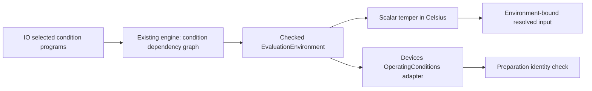

# Evaluation Environment

## Purpose and Scope

Status: proposed. Parent: [EvaluationContracts](../DESIGN.md). No children.
Own immutable ambient/nominal temperature meaning and evaluation identity.

## Responsibilities and Boundaries

Provide checked values, not source precedence, expression evaluation or physics.
A model nominal temperature and an instance effective temperature are distinct
from the circuit environment. Neither changes global scalar bindings.

## Related Designs

| Design | Relationship | Contract Used | Summary | Cautions |
|---|---|---|---|---|
| [EvaluationContracts](../DESIGN.md) | parent | Portable values | Dependency floor | No Foundation |
| [Frontend](../../CoreSpiceLowering/Frontend/DESIGN.md) | used by | Frozen conditions | Condition graph evaluation | Freeze before ordinary roots |
| [Evaluation](../../CoreSpiceMOSResolution/Evaluation/DESIGN.md) | used by | Builtin ambient temperature | Existing exclusive engine | No second memo/RNG |
| [Diode input](../../CoreSpiceDiodeContracts/Input/DESIGN.md) | used by | Condition identity | Bind resolution to its evaluation environment | Local temperature is separate |
| [IO preparation](../../CoreSpiceIO/SimulationPreparation/DESIGN.md) | used by | Effective condition value | Source/caller precedence | No default from process environment |

## Architecture

## Contracts and Invariants

Proposed public values: TemperatureKelvin, TemperatureCelsius, TemperatureDelta,
EvaluationEnvironment and EvaluationEnvironmentIdentity. Factories reject nonfinite
inputs, conversion overflow and absolute temperature at/below zero Kelvin. Celsius
conversion occurs once; deltas do not receive the 273.15 offset. Store canonical
Kelvin and expose Celsius as a checked conversion; canonicalize negative zero.
Environment identity is a stable semantic value over canonical ambient/nominal
values and contract version, not a process-local hash, pointer, path or random UUID.
Evaluation provenance separately records source/override origin and evaluator/PRNG
versions. Equal temperatures can share semantic identity without losing provenance.

`temper` means circuit ambient Celsius, including inside model/instance scalar
expressions. It does not mean model Tnom or local device temperature. Source
parameter bindings named temper are rejected as reserved, case-insensitively.
Function formal parameters remain the innermost explicit lexical binding and may
shadow that spelling only within the function. Time, frequency and node values
are not scalar preparation conditions; their scalar use is explicitly refused.
Runtime resistor ambient-temperature variables retain their current meaning and
receive the same checked environment through binding, not a duplicated scalar cache.

## Runtime Flows

1. IO chooses effective ambient and global nominal programs before evaluation:
   explicit typed caller override, then the last applicable ordered global source
   setting, then explicit caller policy defaults. `.temp` and `.options temp` share
   the same ordered ambient-setting stream; tnom has its own stream. Multiple-value
   temperature sweeps and subcircuit-local condition directives are refused in this
   initial profile. Dead settings retain source provenance; their syntax is checked
   but their expressions are not evaluated.
2. Frontend builds condition roots in the existing final invocation/binding graph.
   Evaluate ambient first, then global nominal, then freeze. A dependency reaching
   ambient/temper while ambient is active is a typed condition cycle, including
   indirect parameter/function paths. This is not a fixed-point temperature solve.
3. Move the same exclusive evaluator, memoized condition dependencies and PRNG
   into the ordinary lowering session. Visit remaining roots in the documented
   evaluator-V2 order; previously visited bindings are not replayed. Record this
   order/version rather than claiming old random sequences are preserved.
4. Stamp source-evaluated CircuitIR with the frozen environment identity. Preserve
   it in clone/compile transports and reject a different native preparation environment
   at the circuit entry, including scalar resistor values that used temper. Direct
   source-free typed runtime expressions remain bindable under their own runtime
   contract; they do not claim source-scalar evaluation provenance.
5. Resolve model/instance inputs, prepare and bind against that frozen environment.
   A temperature sweep/re-run starts a new evaluation session and preparation.
   Reusing a temperature-dependent resolved result at another environment fails;
   reusing the declaration/program snapshot is allowed.

## State, Ownership, and Lifecycle

The proposed bootstrap session is noncopyable and cannot publish a CircuitIR.
Consuming freeze returns the ordinary exclusive session; a frozen environment is
an immutable Sendable value. No mutable global temperature or cache invalidation API
exists. Failure/cancel poisons the session and releases its owned reservations.
Condition and ordinary evaluation share one bounded work/retained/diagnostic ledger.
Do not charge a shared snapshot once per consumer; reservation owner keeps it alive.

## Failure, Concurrency, and Constraints

Typed failures distinguish invalid temperature, reserved name, unsupported condition
syntax, condition cycle, environment mismatch, work/storage exhaustion and cancel.
The bounded diagnostic retains source/scope/invocation and the dependency path.
No partial environment, circuit or preparation receipt is returned on failure.

## Verification and Change Impact

Proposed EnvironmentTests owns unit conversion, finite/boundary and identity tests.
Frontend ConditionEvaluationTests owns `.temp 30` with a scalar temper-dependent
parameter, forward dependencies, caller/source precedence, indirect cycles, formal
shadowing, one random draw per binding across freeze, poisoning and limits.
IO tests exercise the public preparer; Devices tests check resolution/prepare/bind
mismatch and model-Tnom/local-T separation. Revalidate MOS evaluator provenance and
runtime resistor consumers when builtin lookup or visitation changes.
