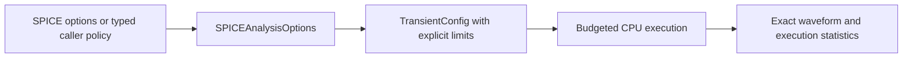

# CoreSpiceIO

## Purpose and Scope

This SwiftPM module composes SPICE parsing/lowering, analysis intent and waveform
I/O. Parent: [CoreSpice](../../DESIGN.md). This change owns explicit transient policy
selection; it introduces no child components.

## Responsibilities and Boundaries

`SPICEAnalysisOptions` translates parsed deck options into analysis configuration.
The caller owns resource ceilings. IO never selects an implicit unbounded or
machine-capacity execution policy. Numerical admission belongs to Analysis.

## Related Designs

| Design | Relationship | Contract Used | Summary | Cautions |
|---|---|---|---|---|
| [CoreSpice](../../DESIGN.md) | parent | Public package composition | Developer/CLI input | Missing policy is a typed failure |
| [Analysis](../CoreSpiceAnalysis/DESIGN.md) | depends on | TransientExecutionLimits and config | Whole-run admission | DC and recovery share the same budget |
| [ParserSPICE](../CoreSpiceParserSPICE/DESIGN.md) | depends on | Parsed controls and PWL | Source intent preservation | Malformed sources cannot execute as DC |
| [Lowering](../CoreSpiceLowering/DESIGN.md) | depends on | Canonical source vectors | Device admission boundary | Preserve numeric pair order |

## Architecture

## Contracts and Invariants

Document geometry scale is resolved by `SPICEAnalysisOptions` and passed as the
explicit `NetlistLowering.Configuration.geometryScale` value. Direct public
parse-and-lower delegates source option intake to lowering when that explicit
value is absent. Both paths use a finite positive dimensionless value. Current
static resistor consumers scale only supplied instance `l/w`; model geometry
defaults retain SI units and instance resistance `scale` remains independent.
The incomplete compact-device consumer refuses nonidentity document scale.

Typed callers supply `executionLimits` directly. CLI/deck callers supply all seven
positive integer options: `tranmaxaccepted`, `tranmaxattempts`, `tranmaxiterations`,
`tranmaxscalars`, `tranmaxdimension`, `tranmaxwork`, `tranmaxbreakpoints`. Each option
has the corresponding Analysis limit meaning. Partial policy remains absent and
transient configuration fails with `missingExecutionLimits`. Option coverage can
inspect one option independently without fabricating a complete execution policy.
`executionLimitOptionsPresent` records whether the source declares any budget option;
callers distinguish absent policy from partial policy before selecting their own limits.
Scalar options and measurements reject numeric vectors.

## Failure, Concurrency, and Constraints

### Circuit nominal temperature composition

`SPICEAnalysisOptions` resolves `.options tnom` independently of `.temp` and
passes actual and nominal temperature through the immutable
`OperatingConditions` value. Source nominal temperature is Celsius; device
conditions are Kelvin, finite and above absolute zero. The absent nominal option
uses 300.15 K. Device preparation owns any model-level nominal override. IO does
not add synthetic nominal-temperature keys to instance or model parameters.
Public IO tests distinguish actual, circuit nominal and model nominal authority.

### Required PDK geometry composition

IO resolves document `scale` and supplies it once to
[Lowering](../CoreSpiceLowering/DESIGN.md); static resistor instance geometry
uses that scale. Compact MOS geometry and scoped bin selection remain incomplete,
and nonidentity scale is explicitly refused on that path. Model names,
`BINUNIT` and display units are not alternative scaling authorities. Unsupported
required options cannot produce qualified execution with altered geometry.

Included declarations and executed models are separate coverage facts. The
selected Sky130 library includes R/C definitions; the examined unchanged MOS
deck executes a model-free load resistor and an `nfet_01v8` wrapper. Declaration
intake alone does not establish the unused models' numerical execution.

Public IO verification retains the original deck and include graph, resolved
scale/temperature, selected model and execution profile. Static TT/SS/FF
inventories are not executed corner evidence. Parsing, numerical execution and
physical qualification remain separate completion conditions.

The options object is a Sendable value; it owns no shared mutable state. Missing,
invalid or exhausted policy remains typed and produces CLI JSON failure. CPU
waveform success does not imply Metal, WASM or Embedded qualification.

## Verification and Change Impact

[SPICEIOEndToEndTests](../../Tests/CoreSpiceIOTests/SPICEIOEndToEndTests.swift)
verifies voltage/current PWL roundtrip and actual execution, invalid source rejection,
complete policy resolution and missing policy. CLI fixtures explicitly own their
finite validation policy; changed defaults require direct API/CLI caller migration.

## BSIM4 preparation policy composition

SPICEAnalysisOptions resolves explicit `.options bsim4stressiterations=<positive UInt32>`
once into [BSIM4PreparationPolicy](../CoreSpiceDevices/BSIM4/DESIGN.md). Missing
policy remains nil and Level54 preparation fails typed. Malformed/zero/overflow
values fail; no fallback selects a budget. The same options value supplies both
loweringConfiguration and deviceRegistry, including every CLI rebind. Runtime
policy and kernel qualification diagnostics belong to execution provenance,
not physical model IR. Other model families do not require this policy.

## BSIM4 Noise Preparation Intent

SPICEAnalysisOptions resolves parsed .noise intent into one explicit
bsim4NoisePreparationRequested choice. The same options owner supplies lowering
Configuration and deviceRegistry, including CLI source overrides/Monte Carlo/
sensitivity rebinds. The choice is execution provenance, not model IR. Direct
API callers may request noise capability before lowering/binding; late requests
on electrical-only topology fail explicitly.
