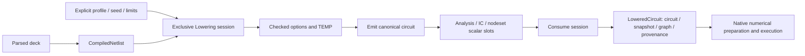

# CoreSpiceIO

## Purpose and Scope

This SwiftPM module composes SPICE parsing/lowering, analysis intent and waveform
I/O. Parent: [CoreSpice](../../DESIGN.md). This change owns explicit transient policy
selection and shared node-voltage assignment intake. Child: [InitialConditions](InitialConditions/DESIGN.md).
Child: [SimulationPreparation](SimulationPreparation/DESIGN.md), the implemented owned
execution-intake boundary for the explicitly supported Native CPU device domain.

## Responsibilities and Boundaries

`SPICEAnalysisOptions` translates checked compiled scalar slots into analysis
configuration. Every evaluation entry requires an explicit MOSInputProfile, UInt64
seed and MOSResolutionLimits. The caller owns resource ceilings. IO never selects
an implicit profile, RNG seed or unbounded execution policy. Numerical admission
belongs to Analysis; numerical MOS preparation belongs to native composition.

## Related Designs

| Design | Relationship | Contract Used | Summary | Cautions |
|---|---|---|---|---|
| [CoreSpice](../../DESIGN.md) | parent | Public package composition | Developer/CLI input | Missing policy is a typed failure |
| [InitialConditions](InitialConditions/DESIGN.md) | child | Protocol-first same-session node-voltage resolution | Shared CLI/host assignment intake | Static expressions use the sole frontend session |
| [SimulationPreparation](SimulationPreparation/DESIGN.md) | child | Actual source graph, effective intent and IC/nodeset preparation | Shared native CLI/host intake | Legacy exact loading is not whole-invocation capacity proof |
| [ExternalModelPreparation](ExternalModelPreparation/DESIGN.md) | child | Resource-retaining external-M preparation | Explicit descriptor-bound source normalization | Source association does not prove model numerics |
| [Touchstone](Touchstone/DESIGN.md) | child | Bounded network exchange | Imported and exported network data | Imported data has no DC/source provenance |
| [Analysis](../CoreSpiceAnalysis/DESIGN.md) | depends on | TransientExecutionLimits and config | Whole-run admission | DC and recovery share the same budget |
| [ParserSPICE](../CoreSpiceParserSPICE/DESIGN.md) | depends on | Parsed controls and PWL | Source intent preservation | Malformed sources cannot execute as DC |
| [Lowering](../CoreSpiceLowering/DESIGN.md) | depends on | CompiledNetlist, exclusive session and LoweredCircuit | Sole scalar/MOS resolution authority | Preserve exact snapshot/graph and numeric pair order |

The [Touchstone codec](Touchstone/DESIGN.md) owns bounded network-parameter exchange. Imported network records do not manufacture a DC operating point or source identity.

## Architecture



## Contracts and Invariants

### Consumed-source capture: required migration

The loader owns immutable full-file UTF-8 bytes from the actual read used by the
parser. The host resolver returns text, captured content identity and the chosen
resolved path together; a second path lookup cannot supply the source identity.
Repeated canonical paths reuse the owned capture for one load, including when
the original path changes afterward. In-memory source retains its supplied bytes
even when its diagnostic filename names a different existing file. Paths remain
availability and diagnostic metadata, separate from content identity.

Library selection projects the retained full-file source while preserving the
original physical newline positions. Nonselected lines are blanked, not removed;
selected continuation statements retain their actual physical locations. The
parser retains declaration identity derived from captured content and actual
statement position. Lowering carries the exact selected lexical declaration's
identity, and IR does not import ParsedIR or contain source metadata in physical
parameter dictionaries. Missing origin remains explicitly unavailable for model
receipt emission rather than being inferred from a model name.

Capture limits belong to an explicit host policy with caller override. Effective
whole-graph byte, unique-source-count and read-page limits are finite, positive,
retained with the load and checked before read, append or materialization.
Operational defaults have an identified owner and selection rule and must admit
the observed adopted input graph within the stated budget; they are not physical
accuracy thresholds. Failed reads, invalid UTF-8, limit violations and checked
close failures register no successful capture. Capture lifetime is the loaded
deck lifetime; retained buffers are reused across parser and execution consumers.

Loader tests own mutation-after-read, repeated source reuse, memory-source
identity, library physical locations, graph limits and read/close failure proof.
Lowering and Analysis own selected-origin preservation and wrong-origin bound
substitution refusal. CLI creates input references from these captured bytes,
never by rereading original paths after parsing. Actual per-phase observations
and qualification emission remain a separate composition step.
Coverage lookup accepts repeated declarations from reused sources and selects
the last declaration in the same lexical scope, matching native lowering.
Repeated includes cannot trap while constructing the coverage lookup.

`SPICEAnalysisOptions.resolve(from:session:)` borrows a CompiledNetlist and the
same noncopyable NetlistLoweringSession. Entry verifies compiled storage identity,
including text-only decks. Numeric option and TEMP controls consume their exact
source-ordinal scalar slots in order. Unknown/text controls remain raw payload;
method interpretation does not spuriously draw random values. Semantic validation
failure poisons the session before returning the original typed option error.
The legacy retry parameter resolver and second ExpressionEvaluator are removed
from this execution path.

Document geometry scale is evaluated once and passed to session.lower. Model
bounds, coefficients and BINUNIT retain the MOSResolution scaling contract. IO
cannot infer scale from units or normalized dimensions. Non-MOS geometry roles
retain their existing device-owned meaning.

`SPICEIO.lower` and `parseAndLower` require profile, seed and limits and return
LoweredCircuit. They compile, begin one run, resolve options, emit the circuit and
consume finish. Callers needing static analysis/IC/nodeset values use the public
compiled/session primitives and finish after those consumers. No compatibility
wrapper discards the required evaluation policy. Parsed source backing remains
retained alongside the exact snapshot, invocation graph and final provenance.

`SPICEAnalysisCommands.resolve(_:at:from:session:)` resolves exactly one selected
ParsedAnalysisCommand from its compiled source index. It verifies source command
and compiled storage identity before scalar access. Numeric fields become .numeric
while output names, source IDs, integer point counts, flags and command shape stay
intact. Nested Monte Carlo analyses use their existing analysis. slot prefixes;
AC sensitivity uses acSpec. fields. Unselected commands are not evaluated. The
same session memo applies to repeated requests, and failure poisons the run. Analysis
selection, range validation and numerical dispatch remain caller-owned. Recursive
command traversal is bounded by the explicit session expression-depth limit.

Option source coverage classifies retained syntax without evaluation or RNG.
Recognized syntax is inventory evidence; actual applied values come only from the
single invocation's SPICEAnalysisOptions. Loaders cannot fabricate effective option
success by probing a separate evaluator.

Typed callers supply `executionLimits` directly. CLI/deck callers supply all seven
positive integer options: `tranmaxaccepted`, `tranmaxattempts`, `tranmaxiterations`,
`tranmaxscalars`, `tranmaxdimension`, `tranmaxwork`, `tranmaxbreakpoints`. Each option
has the corresponding Analysis limit meaning. Partial policy remains absent and
transient configuration fails with `missingExecutionLimits`. Option coverage can
inspect one option independently without fabricating a complete execution policy.
`executionLimitOptionsPresent` records whether the source declares any budget option;
callers distinguish absent policy from partial policy before selecting their own limits.
Scalar options and measurements reject numeric vectors.

## Failure, Concurrency, and Constraints

### Circuit nominal temperature composition

`SPICEAnalysisOptions` resolves `.options tnom` independently of `.temp` and
passes actual and nominal temperature through the immutable
`OperatingConditions` value. Source nominal temperature is Celsius; device
conditions are Kelvin, finite and above absolute zero. The absent nominal option
uses 300.15 K. Device preparation owns any model-level nominal override. IO does
not add synthetic nominal-temperature keys to instance or model parameters.
Public IO tests distinguish actual, circuit nominal and model nominal authority.

### Required PDK geometry composition

IO resolves document `scale` and supplies it once to
[Lowering](../CoreSpiceLowering/Frontend/DESIGN.md); static resistor instance geometry
and resolved MOS geometry consume their respective scaling contracts. Scoped MOS
selection and normalization belong to MOSResolution. Model names, BINUNIT and
display units cannot replace the supplied scale. Numerical preparation may refuse
an inspectable resolved release without replacing its selected source or values.

Included declarations and executed models are separate coverage facts. The
selected Sky130 library includes R/C definitions; the examined unchanged MOS
deck executes a model-free load resistor and an `nfet_01v8` wrapper. Declaration
intake alone does not establish the unused models' numerical execution.

Public IO verification retains the original deck and include graph, resolved
scale/temperature, selected model and execution profile. Static TT/SS/FF
inventories are not executed corner evidence. Parsing, numerical execution and
physical qualification remain separate completion conditions.

The options object is a Sendable value; it owns no shared mutable state. Missing,
invalid or exhausted policy remains typed and produces CLI JSON failure. CPU
waveform success does not imply Metal, WASM or Embedded qualification.

## Verification and Change Impact

[SPICEIOEndToEndTests](../../Tests/CoreSpiceIOTests/SPICEIOEndToEndTests.swift)
verifies voltage/current PWL roundtrip and actual execution, invalid source rejection,
complete policy resolution and missing policy. CLI fixtures explicitly own their
finite validation policy; changed defaults require direct API/CLI caller migration.

[SPICEFrontendSessionTests](../../Tests/CoreSpiceIOTests/SPICEFrontendSessionTests.swift)
verifies one scalar/RNG authority across options, TEMP, device parameters, selected
static analysis and node assignments; exact compiled identity and poisoned failures;
zero-evaluation syntax inventory; and inspectable resolved MOS retention. Selected
command shape preservation includes all parsed analysis cases and nested Monte
Carlo, while an unused failing command must remain unevaluated. Component-owned
resource and node-binding evidence is indexed in the corresponding child designs.


## Host capture policy

SPICESourceCapturePolicy.hostDefault selects operational ceilings of 64 MiB of
unique retained raw UTF-8 bytes, 4096 unique sources and 64 KiB read pages. The
caller may override all fields; positive finite integer values and page <= total
are required. LoadedSPICEDeck retains the effective policy. These ceilings are
host resource policy, not physical tolerances or PDK qualification. A policy
change requires representative adopted-graph admission and byte/count/page boundary
verification. Captured source storage owns its bytes for the loaded deck lifetime.
Read and close failures propagate through typed capture errors. The injected
SPICESourceReading contract provides bounded reads with checked close; the local
adapter checks remaining graph capacity before reading pages.

The adopted immutable graph's static inventory is TT 171 sources/7,134,157 bytes,
SS 171/7,145,502 and FF 171/7,153,041, all below hostDefault. This is inventory
admission evidence, not a completed parser or numerical execution. The focused
loader tests prove actual loading for their complete synthetic graphs. The current
Runtime resistor grammar, canonical ambient temperature and immutable binding
are now implemented under the [Devices runtime contract](../CoreSpiceDevices/Devices/DESIGN.md#complete-admitted-runtime-resistor-profile).
Their public numerical proof is owned by [RuntimeResistorIntegrationTests](../../Tests/CoreSpiceIOTests/RuntimeResistorIntegrationTests.swift).
Full adopted-graph parsing and compact-model execution must still be established
from actual CLI evidence, independently of this inventory; this runtime change
does not establish complete PDK physical qualification. Batch source inventory persistence and per-phase case issuance are composed by
the [CLI owner](../CoreSpiceCLI/DESIGN.md). This IO boundary supplies captured
references and does not issue tool qualification.

### Caller-owned exact source intake

Status: implemented by `SPICEExactDeckLoader`. Ordinary
loadFile/load APIs own filesystem discovery and capture; they do not enforce a
PDK producer's expected dependency graph. The protocol-first exact intake
entry point, `SPICEDeckSourceLoading`, uses the existing parser pipeline.
Its request supplies a root source binding, explicit section/preprocessing
configuration, expected source bindings and finite source/parser policy. Inject
`SPICEExactSourceProviding` and `SPICESourceWorkAccounting` requirements rather
than letting the loader reopen original paths. All operations invoked through
existentials are protocol requirements.

The source provider returns immutable full-file bytes, their full expected
ArtifactReference and the selected source key/document together. A public checked
source-admission factory verifies the same bytes, count and content identity;
arbitrary receipts cannot construct a checked input. The loader retains these
bindings and source owners, the actual grammar-owned dependency events, section
selection, conditional context and effective policy in LoadedSPICEDeck. Resolver
failures cannot be hidden by a partial parser result. This path uses the same
SPICEParser, library projection and coverage gate as ordinary loading.

The CoreSpice-owned work interface is independent of PDK; the optional
[PDK adapter](../../../PDKKit/Sources/PDKSpiceProfileInspection/DESIGN.md)
forwards costs/checks to the invocation accountant. Text/projection byte counts and
retained element counts use that work policy. They are not live/temp capacity
reservations; the bounded-profile design below owns that missing guarantee. Parsed input references
propagate into the actual execution provenance; returning only the root netlist
reference is insufficient when included sources contribute. Changed/missing/extra
source, section or preprocessing context blocks before numerical dispatch.
Domain execution still checks model/options/capability and records actual model
selection; this intake cannot qualify unsupported BSIM or other numerical paths.

Source capture/discovery from the future public
[Foundation API](../../../CircuiteFoundation/Sources/CircuiteFoundationFileSystem/SourceDiscovery/DESIGN.md)
is generic acquisition, not a PDK selection authority. Ordinary source discovery
may adopt it independently; exact profile intake uses supplied expected sources.
No CoreSpice target depends on PDKKit. CoreSpiceIOTests owns real source-factory,
loader/event, source drift, configuration, work/cancellation and capture-lifetime
proof before PDK adapter tests. Native simulation composition must retain the
loaded graph and actual model/operating-condition evidence.

#### Exact intake authority and limits

`SPICEExactLoadRequest` fixes root key, optional library section, initial conditional
parameters, expected full source bindings, parser configuration, capture limits
and work limits. Expected active edges retain parent/child keys, directive path,
section and physical position; comparison is ordered after the actual grammar
returns. `SPICECheckedSource.admit` hashes/counts supplied immutable full-file bytes
before constructing an input owner. Source keys are caller-owned lookup tokens;
they do not grant filesystem authority. The injected provider resolves only supplied
keys. Its returned complete binding must equal the expected binding.

The load-local actor retains one checked owner per key and rejects missing,
undeclared, changed, duplicate or unused expected bindings. The parser produces
active dependency events in lexical depth-first order. Local section delimiters
are grammar syntax and never external resolution requests. Conditional evidence
retains inactive and unresolved branches; unresolved evaluation is a parse failure.
All parser/source work uses one synchronous `SPICESourceWorkAccounting` requirement
with a finite load-owned budget plus injected invocation accounting. Count charges precede
source/projection copies, token growth, statement retention, expansion and
conditional evaluation; current counts do not prove byte-capacity ownership. Cancellation is checked during lexing and at statement,
source and expansion boundaries. A failed exact load exposes no loaded deck.

```text
Expected full refs + immutable provider bytes
  -> checked source owner -> actual SPICEParser grammar
  -> ordered events + captured owners -> exact graph comparison -> coverage gate
```

Native `SPICEExactSourceIntakeTests` owns factory drift, source reuse, actual
include/lib grammar, section/conditional context, graph mismatch, bounded work
and cancellation. This source intake establishes no numerical qualification.

The work accountant's only mutable state is `Mutex<[SPICESourceWorkKind: UInt64]>`.
Charge and consumption reads use that same storage/isolation on the host IO target;
upstream callbacks and cancellation checks run outside its critical section.
The registry actor owns captures and checked owners for one load, and the returned
deck retains their value storage. No Embedded/WASM conditional storage or Sendable
branch is introduced; host IO evidence does not qualify those execution platforms.
Native concurrent admission verifies that 32 contenders admit exactly 16 units
against a ceiling of 16.


### Bounded profile source intake

The Span checked-source factory and occurrence document conversion are implemented;
the owned grammar and [simulation preparation](SimulationPreparation/DESIGN.md) composition are implemented for the explicit supported capability. IO owns full-reference byte validation and
checked text/source ownership for the profile parse path. It composes
[Parser](../CoreSpiceParser/DESIGN.md#bounded-contextual-source-contract) and
[ParserSPICE](../CoreSpiceParserSPICE/DESIGN.md#bounded-profile-grammar), without
using the existing whole-expected-graph/numerical coverage loader as a substitute.
The contextual parser/provider contract is grammar-neutral: exact approval and
candidate discovery both supply captures through that same grammar. Lower IO does
not choose undeclared paths or infer a producer's expected graph.

`SPICECheckedSource.admit` Span overload accepts the full source binding,
scoped `Span<UInt8>`, SPICESourceResourceAccounting and explicit positive
`maximumPageByteCount`, returning SPICECheckedSource with retained reservations. It checks count/digest against those exact borrowed bytes,
validates strict UTF-8, and creates an owned byte/text representation only after
its concrete logical extent is reserved. Copying raw bytes at this ownership
boundary is permitted and charged; no public Data export or second file read is
needed. SourceDocument conversion accepts a fresh occurrence and actual section,
retaining checked source/text owners. The existing Data-valued bytes property is an explicit raw caller-owned export
boundary; the bounded factory charges its internal owned copy before allocation.
Legacy Data factories remain their current count-only scope, and bounded parsing
rejects a source/document lacking accounted storage instead of upgrading it silently. Source/content identity
and parse occurrence remain separate.

Hash chunk Array copy is reserved before materialization and released after update.
Charge actual hashed bytes before each update and check cancellation/deadline through
the injected accounting requirement. `.sourceBytes` is legacy logical intake work,
not real filesystem reads: a PDK capture already accounts readBytes/pages/open
resources. Do not charge those again at text admission. Hash failure preserves its
actual resource cause across typed digester callbacks, not a lossy error string.
Strict UTF-8 may not repair invalid input. Size/map/byte-count arithmetic is checked.

Byte/text storage and parsed results share immutable reservation handles with
copies. Temporary hash/UTF-8/projection storage ends at its true scope; retained
source/result storage ends at final owner release, including after accounting closes.
Failures containing derived payload retain its necessary backing, not a whole
registry or cycle. The adapter exports checked fact copies before releasing lower
owners. No source drift/invalid UTF-8/capacity/cancellation failure publishes a
checked successful source/result.

#### Minimal responsibility sprints and proof

| Ordered lower sprint | Closed invariant and files | Behavioral proof |
|---|---|---|
| Owned boundary | New portable reservation/error/occurrence values in ParsedIR; checked source text/environment/contextual protocol in Parser; Span source factory/retention in IO | Count/digest/UTF-8 refusal, hash accounting, empty/changed/insertion-order snapshot identities, capacity-before-copy, final-copy release and COW/refund helpers |
| Existing grammar integration | SPICEParser, SPICELexer, SPICEExpressionParser, SPICEConditionalPreprocessor and their invoked helpers; account the concrete allocation table in ParserSPICE | Actual pre-await request/refusal, original positions/section, inherited map semantics, repeated origin, every named transform/copy quota boundary, cancellation and supported ordinary/bounded fact equivalence |

The first sprint closes checked helper contracts independently; do not expose a
callable pretend bounded parse before the second sprint finishes. Any deliberately
unfinished public branch requires the repository's explicit incomplete-implementation
marker and typed refusal. No whole-frontend rewrite, AST grammar, numericalEngine,
CLI or standard-view migration is included. Public protocol operations invoked
through existentials are requirements; no generic existential bridge is assumed.

Proof owners: focused files in ParsedIRTests, ParserSPICETests and IOTests. Register
a dedicated native lower source test product selecting those affected test targets
when package-wide test graph would bring GPU/CLI tests into the run. Existing IO
production dependencies may compile, but numerical tests/execution are not needed
for this contract. Build/run separately with timeout180/60 seconds under fixed
Swift6.4.0; source snapshot and dependency override/build-path must match. Expected
incremental proof is seconds to tens of seconds; a cold IO dependency build may
approach build timeout and must be reported/replanned rather than repeated blindly.
Actual method census/runtime is recorded after implementation, not asserted here.
One whole review plus one targeted finding recheck precedes frozen affected-product
proof; upper PDK adapter proof follows verified lower contracts.

Boundary verification is owned by
[CheckedSpanSourceTests](../../Tests/CoreSpiceSourceBoundaryTests/CheckedSpanSourceTests.swift).
Its native evidence does not qualify WASM/Embedded or bounded grammar parsing.

## Capacitor Source Coverage

Source coverage distinguishes preserved C declaration syntax from numerical
capability. Static C model and instance field capability follows the public
`CapacitorDescriptor` admission profile; numerical domains remain Devices-owned. Ambiguous bare C candidates require scoped source
resolution; coverage must not infer model-free success from a nil modelName.
Visible parameter declarations retain their precedence over model names. Reporting
uses lexical global/default/body parameter scope, without executing parameters or
claiming the later binding result. Numerical admission remains owned by
[Lowering](../CoreSpiceLowering/DESIGN.md#capacitor-source-resolution-and-admission).

## Source Intake and Selected Execution Admission

Ordinary and exact loaders admit the captured, parsed source graph and root
execution intent. They retain the whole-source coverage report, including blocked
model and component definitions that are not selected. `hasBlockedItems` continues
to report unsupported source capability; it is not selected execution admission.
Load success does not assert numerical executability.

The shared report projection used by both loaders rejects blocked analysis,
directive, option, measurement and preprocessing items. Model/component items are
diagnostics. Selected numerical admission is owned by the actual configured
[Lowering](../CoreSpiceLowering/DESIGN.md) and descriptor binding; no second closure
walk, speculative pre-lowering or duplicate evaluation occurs in IO. Root controls
are projected from both root and recursively retained subcircuit controls. A body
location cannot hide unsupported execution directives such as alter from global
intake admission. This syntax-only projection does not apply scoped options or
evaluate unused body expressions.
Invalid global expressions retain existing lowering failures; unused body-local
expressions are not evaluated.

```text
Captured graph -> parse -> root intent admission -> LoadedSPICEDeck
                       -> whole-source coverage diagnostics retained
Actual options/overrides/seed -> one selected lowering -> compile/bind -> execution
```

Q and runtime C source expression capability follows the distinct charge and
differential-capacitance contracts. Coverage rejects conflicting roles, unsupported
fields/models and malformed expressions. The public source loader can retain unused
unsupported definitions; selecting those still fails in the lower/device owner. Exact graph comparison, capture lifetime, source accounting and failure
propagation are unchanged.

[SelectedExecutionAdmissionTests](../../Tests/CoreSpiceIOTests/SelectedExecutionAdmissionTests.swift)
owns ordinary/exact unused-definition admission, retained blocked diagnostics,
root control refusal and actual selected failure. CLI tests own real successful
ideal execution/case output with unused unsupported definitions, selected Q/model
refusal and continued root intent refusal. A selected unsupported BSIM version now
reports the actual numerical preparation failure, rather than a source-coverage
parse error. This diagnostic change is intentional; backward compatibility is not
required. Revalidate the CLI and exact-loader consumers whenever this split changes.

### MOS width selection control

`.options wnflag` is input interpretation owned by the
[lowering frontend](../CoreSpiceLowering/Frontend/DESIGN.md#mos-source-admission-repairs),
not a numerical analysis option. SPICEAnalysisOptions invokes the session's checked
option entrance; it neither emits an unapplied warning nor supplies a second copy
of the width policy. Lowering consumes the same cached scalar and retains the final
choice in resolved MOS rules/geometry. Invalid values and unsupported profiles fail
through every IO, CLI, Host and Studio caller of this shared path.

## Output Storage Lifetime

SPICEOutputProjector preserves the [waveform storage lease](../CoreSpiceWaveform/DESIGN.md)
when it materializes selected real or complex samples. Identity projection returns
the original value. Output copies retain the existing native admission owner
without reserving prepared topology twice. Native lifetime tests and full IO/CLI
tests verify this output boundary.

### Preferred transient integration method

The SPICE `METHOD` option selects `SPICETransientOptions.preferredMethod`, which
composes `TransientConfig.preferredMethod`. An absent option selects trapezoidal
after the [Analysis checked startup contract](../CoreSpiceAnalysis/DESIGN.md#checked-variable-step-lte-and-startup).
The renamed public field does not promise an unchecked first-step method; source
option syntax remains unchanged. Effective-intent encoding binds the selected
preferred method.

## S3 Portable OSDI Source Entry

`SPICEIO.parseAndLower` and `SPICEIO.lower` accept the same default-empty
`osdiInstances` map as the [Frontend](../CoreSpiceLowering/Frontend/DESIGN.md#s3-explicit-typed-osdi-injection).
The existing session remains the only scalar/environment owner. The
[prepared source component](SimulationPreparation/DESIGN.md#s3-explicit-osdi-input-transport)
owns retained source/configuration identity; native setup owns loading and execution.


## Legacy Native BSIM Migration
IO exposes no BSIM preparation policy or stress-iteration configuration.
A supplied legacy bsim4stressiterations option is an explicit unsupported-option
failure with OSDI migration guidance. Deck coverage marks legacy MOS 49/54 as
blocked rather than counting them as supported classical devices. Explicit OSDI
bindings retain their independent typed parameter and source contracts.
