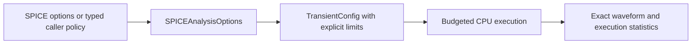

# CoreSpiceIO

## Purpose and Scope

This SwiftPM module composes SPICE parsing/lowering, analysis intent and waveform
I/O. Parent: [CoreSpice](../../DESIGN.md). This change owns explicit transient policy
selection; it introduces no child components.

## Responsibilities and Boundaries

`SPICEAnalysisOptions` translates parsed deck options into analysis configuration.
The caller owns resource ceilings. IO never selects an implicit unbounded or
machine-capacity execution policy. Numerical admission belongs to Analysis.

## Related Designs

| Design | Relationship | Contract Used | Summary | Cautions |
|---|---|---|---|---|
| [CoreSpice](../../DESIGN.md) | parent | Public package composition | Developer/CLI input | Missing policy is a typed failure |
| [Analysis](../CoreSpiceAnalysis/DESIGN.md) | depends on | TransientExecutionLimits and config | Whole-run admission | DC and recovery share the same budget |
| [ParserSPICE](../CoreSpiceParserSPICE/DESIGN.md) | depends on | Parsed controls and PWL | Source intent preservation | Malformed sources cannot execute as DC |
| [Lowering](../CoreSpiceLowering/DESIGN.md) | depends on | Canonical source vectors | Device admission boundary | Preserve numeric pair order |

## Architecture

## Contracts and Invariants

### Consumed-source capture: required migration

The loader owns immutable full-file UTF-8 bytes from the actual read used by the
parser. The host resolver returns text, captured content identity and the chosen
resolved path together; a second path lookup cannot supply the source identity.
Repeated canonical paths reuse the owned capture for one load, including when
the original path changes afterward. In-memory source retains its supplied bytes
even when its diagnostic filename names a different existing file. Paths remain
availability and diagnostic metadata, separate from content identity.

Library selection projects the retained full-file source while preserving the
original physical newline positions. Nonselected lines are blanked, not removed;
selected continuation statements retain their actual physical locations. The
parser retains declaration identity derived from captured content and actual
statement position. Lowering carries the exact selected lexical declaration's
identity, and IR does not import ParsedIR or contain source metadata in physical
parameter dictionaries. Missing origin remains explicitly unavailable for model
receipt emission rather than being inferred from a model name.

Capture limits belong to an explicit host policy with caller override. Effective
whole-graph byte, unique-source-count and read-page limits are finite, positive,
retained with the load and checked before read, append or materialization.
Operational defaults have an identified owner and selection rule and must admit
the observed adopted input graph within the stated budget; they are not physical
accuracy thresholds. Failed reads, invalid UTF-8, limit violations and checked
close failures register no successful capture. Capture lifetime is the loaded
deck lifetime; retained buffers are reused across parser and execution consumers.

Loader tests own mutation-after-read, repeated source reuse, memory-source
identity, library physical locations, graph limits and read/close failure proof.
Lowering and Analysis own selected-origin preservation and wrong-origin bound
substitution refusal. CLI creates input references from these captured bytes,
never by rereading original paths after parsing. Actual per-phase observations
and qualification emission remain a separate composition step.
Coverage lookup accepts repeated declarations from reused sources and selects
the last declaration in the same lexical scope, matching native lowering.
Repeated includes cannot trap while constructing the coverage lookup.

Document geometry scale is resolved by `SPICEAnalysisOptions` and passed as the
explicit `NetlistLowering.Configuration.geometryScale` value. Direct public
parse-and-lower delegates source option intake to lowering when that explicit
value is absent. Both paths use a finite positive dimensionless value. Current
static resistor consumers scale only supplied instance `l/w`; model geometry
defaults retain SI units and instance resistance `scale` remains independent.
The incomplete compact-device consumer refuses nonidentity document scale.

Typed callers supply `executionLimits` directly. CLI/deck callers supply all seven
positive integer options: `tranmaxaccepted`, `tranmaxattempts`, `tranmaxiterations`,
`tranmaxscalars`, `tranmaxdimension`, `tranmaxwork`, `tranmaxbreakpoints`. Each option
has the corresponding Analysis limit meaning. Partial policy remains absent and
transient configuration fails with `missingExecutionLimits`. Option coverage can
inspect one option independently without fabricating a complete execution policy.
`executionLimitOptionsPresent` records whether the source declares any budget option;
callers distinguish absent policy from partial policy before selecting their own limits.
Scalar options and measurements reject numeric vectors.

## Failure, Concurrency, and Constraints

### Circuit nominal temperature composition

`SPICEAnalysisOptions` resolves `.options tnom` independently of `.temp` and
passes actual and nominal temperature through the immutable
`OperatingConditions` value. Source nominal temperature is Celsius; device
conditions are Kelvin, finite and above absolute zero. The absent nominal option
uses 300.15 K. Device preparation owns any model-level nominal override. IO does
not add synthetic nominal-temperature keys to instance or model parameters.
Public IO tests distinguish actual, circuit nominal and model nominal authority.

### Required PDK geometry composition

IO resolves document `scale` and supplies it once to
[Lowering](../CoreSpiceLowering/DESIGN.md); static resistor instance geometry
uses that scale. Compact MOS geometry and scoped bin selection remain incomplete,
and nonidentity scale is explicitly refused on that path. Model names,
`BINUNIT` and display units are not alternative scaling authorities. Unsupported
required options cannot produce qualified execution with altered geometry.

Included declarations and executed models are separate coverage facts. The
selected Sky130 library includes R/C definitions; the examined unchanged MOS
deck executes a model-free load resistor and an `nfet_01v8` wrapper. Declaration
intake alone does not establish the unused models' numerical execution.

Public IO verification retains the original deck and include graph, resolved
scale/temperature, selected model and execution profile. Static TT/SS/FF
inventories are not executed corner evidence. Parsing, numerical execution and
physical qualification remain separate completion conditions.

The options object is a Sendable value; it owns no shared mutable state. Missing,
invalid or exhausted policy remains typed and produces CLI JSON failure. CPU
waveform success does not imply Metal, WASM or Embedded qualification.

## Verification and Change Impact

[SPICEIOEndToEndTests](../../Tests/CoreSpiceIOTests/SPICEIOEndToEndTests.swift)
verifies voltage/current PWL roundtrip and actual execution, invalid source rejection,
complete policy resolution and missing policy. CLI fixtures explicitly own their
finite validation policy; changed defaults require direct API/CLI caller migration.

## BSIM4 preparation policy composition

SPICEAnalysisOptions resolves explicit `.options bsim4stressiterations=<positive UInt32>`
once into [BSIM4PreparationPolicy](../CoreSpiceDevices/BSIM4/DESIGN.md). Missing
policy remains nil and Level54 preparation fails typed. Malformed/zero/overflow
values fail; no fallback selects a budget. The same options value supplies both
loweringConfiguration and deviceRegistry, including every CLI rebind. Runtime
policy and kernel qualification diagnostics belong to execution provenance,
not physical model IR. Other model families do not require this policy.

## BSIM4 Noise Preparation Intent

SPICEAnalysisOptions resolves parsed .noise intent into one explicit
bsim4NoisePreparationRequested choice. The same options owner supplies lowering
Configuration and deviceRegistry, including CLI source overrides/Monte Carlo/
sensitivity rebinds. The choice is execution provenance, not model IR. Direct
API callers may request noise capability before lowering/binding; late requests
on electrical-only topology fail explicitly.

## Host capture policy

SPICESourceCapturePolicy.hostDefault selects operational ceilings of 64 MiB of
unique retained raw UTF-8 bytes, 4096 unique sources and 64 KiB read pages. The
caller may override all fields; positive finite integer values and page <= total
are required. LoadedSPICEDeck retains the effective policy. These ceilings are
host resource policy, not physical tolerances or PDK qualification. A policy
change requires representative adopted-graph admission and byte/count/page boundary
verification. Captured source storage owns its bytes for the loaded deck lifetime.
Read and close failures propagate through typed capture errors. The injected
SPICESourceReading contract provides bounded reads with checked close; the local
adapter checks remaining graph capacity before reading pages.

The adopted immutable graph's static inventory is TT 171 sources/7,134,157 bytes,
SS 171/7,145,502 and FF 171/7,153,041, all below hostDefault. This is inventory
admission evidence, not a completed parser or numerical execution. The focused
loader tests prove actual loading for their complete synthetic graphs. The current
Sky130 parser still refuses runtime-dependent resistor grammar; full graph parsing
must not be reported as successful from this inventory alone. Batch record source
inventory persistence and per-phase/TQ emission remain the next CLI composition
slice; this slice returns captured references without asserting those capabilities.
