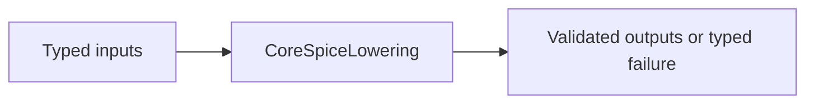
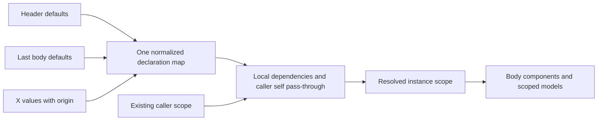

# CoreSpiceLowering

## Purpose and Scope

This SwiftPM module owns ParsedNetlist to canonical CircuitIR conversion. Parent: [CoreSpice](../../DESIGN.md). This module has no newly introduced child components.

## Responsibilities and Boundaries

Lowering owns instance-local named parameter resolution and scoped model composition. It consumes parsed values rather than SPICE text. BSIM3 model and instance expressions retain separate roles and exact version identity; native model admission and auxiliary requirements delegate to BSIM3Preparation.

## Related Designs

| Design | Relationship | Contract Used | Summary | Cautions |
|---|---|---|---|---|
| [CoreSpice](../../DESIGN.md) | parent | Package composition | Owned module boundary | Revalidate direct consumers when contracts change |
| [ParserSPICE](../CoreSpiceParserSPICE/DESIGN.md) | depends on | ParsedSubcircuit header defaults | Marked/unmarked named values have the same parsed representation | Revalidate public parse-to-lower default and override behavior |
| [Devices BSIM3](../CoreSpiceDevices/BSIM3/DESIGN.md) | depends on | BSIM3Preparation | Native cold admission | Kernel topology is the authority |
## Architecture

## Contracts and Invariants

Document geometry scale has one immutable semantic value for a lowering run.
`Configuration.geometryScale` explicitly overrides the deck; otherwise the last
resolved `.options scale` is consumed, with default one. A finite positive scale
multiplies supplied resistor instance `l/w` once, preserving model defaults in SI
and the distinct instance resistance `scale`. IO can resolve the deck option and
pass that value explicitly; lowering does not resolve the source option again in
that composition. Direct public lowering resolves it after global parameters.
Compact-device geometry consumption and model-family selection remain incomplete.
A nonidentity geometry scale reaching a MOS instance is a marked typed refusal
until the independent compact-device geometry owner completes that path.

Level 49 maps to native BSIM3 descriptors only after cold model admission succeeds. Model parameters cannot be overridden through instance flattening. Original parameter semantics remain independent; invalid role or version is a typed failure. Level 54 follows the [BSIM4 preparation contract](../CoreSpiceDevices/BSIM4/DESIGN.md).

### Instance-local named parameter resolution

The expander builds one case-insensitive declaration map, in increasing priority:
header defaults, body `.param` defaults in source order (last declaration wins),
and explicit X-instance values. The complete map is resolved once before body
components execute. There is no separate protected-name rejection or second body
parameter application. Ordered `parameterDefinitions` provide body declaration
order; the body dictionary supports callers that supply typed IR without that list.

All unresolved names owned by this map hide equally named parent/global values.
A dependent default observes the final local value even when its key sorts before
the dependency. Explicit X values retain their origin: a reference to that X
value's own name may read the caller's existing binding before local publication,
so nested `l={l}` is pass-through rather than a default self-cycle. References to
other names in the complete map wait for their local values. User-function formal
arguments remain inner lexical bindings and take priority over reserved names.
Missing caller/external references, unresolved dependency cycles and invalid
expressions remain typed failures, without successful default substitution.

Instance resolution selects an internal resolver policy carrying immutable
per-attempt reserved-name/self-reference information. The public global/model
resolver paths keep their existing expression environment: a model value such as
`vto={vto}` may consume the enclosing parameter. Instance declaration ownership
does not redefine model parameter names as instance-local declarations.
Expression evaluation retains the existing Mutex-owned context API;
no raw shared state, platform branch or new synchronization owner is introduced.
A temporary scope and then the expansion scope are released by existing `defer`
paths on success or failure. No resolved parameter or scoped model escapes to a
sibling instance or parent. Exact model versions and model/instance role separation
remain governed by the device contracts.

| Evidence | Required behavior |
|---|---|
| Parent z=17; local a=z and X z=2000 | a resolves to2000, never17 |
| Header1000, body2000, X1500 | body wins without X; X wins when supplied |
| Nested X l=l | caller l passes through before local publication |
| Function formal matches pending local name | formal argument remains lexical |
| Missing reference or local cycle | typed failure and unchanged parent scope |
| Repeated/sibling invocations | deterministic independent values and model scope |

This contract follows the pinned ngspice46
[declaration/default transformation](https://raw.githubusercontent.com/imr/ngspice/ebdaf58ec76a06ffaac7e0f138360dd1cf5ee4b6/src/frontend/inpcom.c)
and [actual-argument evaluation/publication](https://raw.githubusercontent.com/imr/ngspice/ebdaf58ec76a06ffaac7e0f138360dd1cf5ee4b6/src/frontend/numparam/xpressn.c).
It addresses unchanged Sky130 wrappers with body `l/w` defaults and nested
same-name actual arguments; it does not qualify device physics or model binning.

## State, Ownership, and Lifecycle

### Required geometry and scoped family selection

Current exact-name lookup does not select suffixed model bins from an unsuffixed
family reference. Document scale now reaches static resistor source dimensions. Compact-device
geometry conversion and family selection remain incomplete for the selected
Sky130 profile; nonidentity document scale at a MOS instance fails explicitly.

The target contract consumes the resolved geometry scale once at the instance
boundary. Length and area parameters use the specified release's linear and
quadratic rules. Model bounds and coefficients retain their original units;
dimensionless selectors and multiplicities remain dimensionless. `BINUNIT` is a
model coefficient convention, not the deck scale. The unchanged `w=.65 l=.15`
with `scale=1u` requires W=650 nm and L=150 nm.

Family selection uses effective geometry and the applicable lexical scope,
including declaration order and the pinned reference's preprocessing and
boundary rules. An inner family cannot select a parent or sibling model.
The reference execution of the unchanged TT deck reports bounds uniquely
identifying bin `.98` at this geometry; this one observation does not establish
all boundary cases or native selection. A universal half-open rule is not
inferred from model-file limits.

The selected exact model/version, source identity, effective geometry and
separate model/instance roles remain traceable through preparation and binding.
Missing or unsupported selection fails explicitly. Resistor physics belongs to
[Devices](../CoreSpiceDevices/Devices/DESIGN.md); lowering preserves its static
versus runtime dependencies and parameter roles without inventing device laws.

Completion requires the actual public parse-to-lower path to prove scaling once,
scoped selection and refusal, boundary selection against the complete pinned
reference path, and exact selected identity. Existing local-parameter tests do
not establish these capabilities or physical accuracy.

LoweringContext owns its existing Mutex. Prepared evaluator used for admission is local and released after topology projection; no C state enters IR.

## Failure, Concurrency, and Constraints

Model preparation uses the configured temperature and original defaults. Later binding prepares at actual operating conditions and rejects any auxiliary topology mismatch. No compact-model fallback is permitted.

## Verification and Change Impact

Integration tests resolve scoped model expressions and conflicting model/instance selectors, plus version/domain failures through actual lowering. Revalidate IR, Devices preparation, and IO coverage. [Lowering tests](../../Tests/CoreSpiceLoweringTests/) own resolver/scope failures; [public IO tests](../../Tests/CoreSpiceIOTests/) own parse-to-lower precedence, nesting and actual CPU circuit behavior.

## Canonical PWL Source Migration

Parsed numeric vectors preserve alternating PWL time/value values. SPICE PWL syntax
parses and serializes this vector, lowering retains `ParameterValue.realVector`,
and device admission owns strict time/value validation. Partial/unknown source
waveforms produce typed parse/binding failure, never successful DC substitution.
Scalar option/measurement/expression consumers reject vectors explicitly.

## BSIM4 Level54 admission

[BSIM4 preparation](../CoreSpiceDevices/BSIM4/DESIGN.md) receives the optional
caller policy from Configuration. Missing policy fails before cold evaluation.
Exact version and separate model/instance values remain in resolved provenance;
all original auxiliary requirements become fresh owned nodes. Policy does not
enter physical model/instance parameters. The same caller policy must reach binding.

## Noise-Dependent BSIM4 Topology

Configuration carries the caller noisePreparationRequested choice to the same
BSIM4 preparation contract used at binding. Original tnoimod1 noise-only D/S
nodes are allocated only when requested; full CSR ownership remains unchanged.
Noise capability and resource policy are separate from physical model parameters.

## Static Resistor Composition

Scoped/include model resolution consumes only `ParsedComponent.resistorModelCandidate`
for ambiguous bare tokens. An explicit numeric identifier keeps its original role
when an equally named model exists. Subcircuit remapping preserves the candidate
without adding it to physical parameter dictionaries. A braced, quoted or named
numeric expression is never reclassified from its expression shape.

The expander retains resolved resistor model name/type/parameters in
`ResolvedDeviceModel`, with supplied instance values in their own map, regardless
of `expandModels`. Scoped references and static expressions use the existing
resolver. Unknown or mismatched models fail explicitly. Runtime-dependent R
expressions consume `BehavioralExpressionLowerer` and preserve read-only node
and branch dependencies; subcircuit remapping uses the existing voltage-reference
mapper. Binding remains a marked typed refusal until runtime resistor physics is
implemented. Static geometry and temperature/noise physics belong to
[Devices](../CoreSpiceDevices/Devices/DESIGN.md#resistor-execution-contract).

The focused owners are [ResistorParserTests](../../Tests/CoreSpiceParserSPICETests/ResistorParserTests.swift),
[ResistorLoweringTests](../../Tests/CoreSpiceLoweringTests/ResistorLoweringTests.swift),
[StaticResistorTests](../../Tests/CoreSpiceDevicesTests/StaticResistorTests.swift), and
[public IO execution](../../Tests/CoreSpiceIOTests/SPICEIOEndToEndTests.swift).
Their planned paths are native CPU DC, independent AC and thermal/flicker noise;
compilation or parser intake is not physical qualification.
