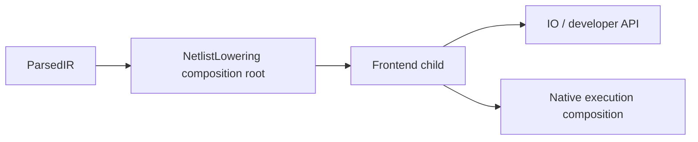

# CoreSpiceLowering

## Purpose and Scope

This SwiftPM module exposes typed parsed-netlist compilation and circuit lowering.
Parent: [CoreSpice](../../DESIGN.md). Its implemented child is
[Frontend](Frontend/DESIGN.md), which owns the approved S4 adapter contract.
Implementation/completion state belongs to workspace PROGRESS.md B8.6.5.18.4.

## Responsibilities and Boundaries

The module composition root exposes the Frontend API and directly composes its
compiler and exclusive evaluation session. Source/program authority, invocation
planning, scalar/runtime boundaries, IR emission, inspection ownership and failure
semantics are defined only by [Frontend](Frontend/DESIGN.md).

Numerical preparation and execution are composed outside this module. The public
integration boundary is [Frontend's compiled/session/result contract](Frontend/DESIGN.md#public-scalar-bridge-and-result).

## Related Designs

| Design | Relationship | Contract Used | Summary | Cautions |
|---|---|---|---|---|
| [CoreSpice](../../DESIGN.md#mos-boundary-migration) | parent | Package composition | Source frontend in the numerical platform | Public consumers migrate with the owned contract |
| [Frontend](Frontend/DESIGN.md) | child | compile, beginEvaluation, scalar/session API and LoweredCircuit | Sole Lowering implementation responsibility | Exact implementation and verification live beside this design |
| [IO](../CoreSpiceIO/DESIGN.md) | used by | Frontend public API | Option/analysis/source-policy composition | Follow the child contract for shared evaluation |
| [Native execution](../CoreSpice/NativeExecution/DESIGN.md) | used by | LoweredCircuit | Consumes frontend values for numerical composition | Follow the child contract for inspection retention |

## Architecture

## Contracts and Invariants

The module composes the child only through its public compiled/session/result
contract. All source, scalar, runtime and resolved-stage invariants have one
[Frontend authority](Frontend/DESIGN.md#contracts-and-invariants); this module
adds no alternate parameter resolver, model selector or numerical admission path.

## Verification and Change Impact

[Frontend verification](Frontend/DESIGN.md#verification-and-change-impact) owns
adapter behavior and focused Lowering tests. Module-level verification checks the
public exports, allowed package dependencies and direct IO/native composition.
Changes to the child public contract require corresponding IO, native execution,
CLI and host consumer migration; leaf evidence alone does not establish that
integration. Root owns Package.swift and cumulative integration/commit evidence.

## Designed Diode Resolution Composition

Status: implemented. [DiodeResolution](DiodeResolution/DESIGN.md) is the new
direct child owning diode source admission; Frontend remains the single compiled
storage/session owner. The new child consumes
[DiodeContracts](../CoreSpiceDiodeContracts/DESIGN.md); no Devices edge is introduced.

## D2 Environment Composition

| Design | Relationship | Contract Used | Summary | Cautions |
|---|---|---|---|---|
| [EvaluationContracts](../CoreSpiceEvaluationContracts/DESIGN.md) | depends on | Checked environment identity | D2 temperature meaning | Standard Library only; source policy stays outside this module |

## D3 Change Impact

The [D3 resolution owner](DiodeResolution/DESIGN.md) defines occurrence admission, frozen
evaluation and immutable result transport. This layer consumes that contract;
D4 numerical preparation and D5 API/CLI adoption are separate implemented owners
linked by the package design. Its own affected path and tests remain the D3 proof.
