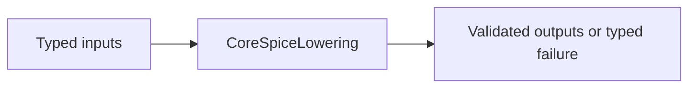

# CoreSpiceLowering

## Purpose and Scope

This SwiftPM module owns ParsedNetlist to canonical CircuitIR conversion. Parent: [CoreSpice](../../DESIGN.md). This module has no newly introduced child components.

## Responsibilities and Boundaries

Lowering resolves BSIM3 model and instance expressions in separate roles, retaining exact version identity. It delegates native model admission and auxiliary requirements to BSIM3Preparation.

## Related Designs

| Design | Relationship | Contract Used | Summary | Cautions |
|---|---|---|---|---|
| [CoreSpice](../../DESIGN.md) | parent | Package composition | Owned module boundary | Revalidate direct consumers when contracts change |
| [Devices BSIM3](../CoreSpiceDevices/BSIM3/DESIGN.md) | depends on | BSIM3Preparation | Native cold admission | Kernel topology is the authority |
## Architecture

## Contracts and Invariants

Level 49 maps to native BSIM3 descriptors only after cold model admission succeeds. Model parameters cannot be overridden through instance flattening. Original parameter semantics remain independent; invalid role or version is a typed failure. Level 54 remains blocked.

## State, Ownership, and Lifecycle

LoweringContext owns its existing Mutex. Prepared evaluator used for admission is local and released after topology projection; no C state enters IR.

## Failure, Concurrency, and Constraints

Model preparation uses the configured temperature and original defaults. Later binding prepares at actual operating conditions and rejects any auxiliary topology mismatch. No compact-model fallback is permitted.

## Verification and Change Impact

Integration tests resolve scoped model expressions and conflicting model/instance selectors, plus version/domain failures through actual lowering. Revalidate IR, Devices preparation, and IO coverage.
