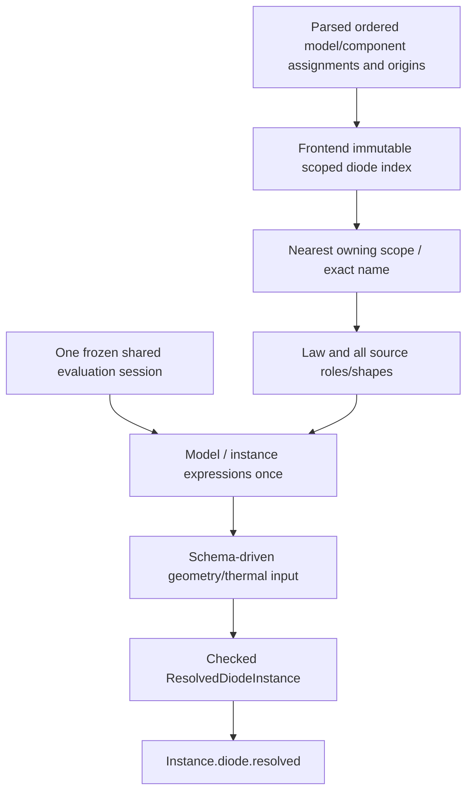

# Diode Resolution

## Purpose and Scope

Status: D3 implemented; native numerical preparation remains D4. Parent: [Lowering](../DESIGN.md). No children. Own source-to-checked
diode resolution using the existing frontend declaration and evaluation owners.

## Responsibilities and Boundaries

Select the declaration, admit every source assignment, evaluate once, normalize
once and emit Instance.diode.resolved. Do not import Devices, prepare numerical
parameters, allocate auxiliary topology or invent a second expression engine.

## Related Designs

| Design | Relationship | Contract Used | Summary | Cautions |
|---|---|---|---|---|
| [Lowering](../DESIGN.md) | parent | Public frontend | Component composition | No Devices dependency |
| [Frontend](../Frontend/DESIGN.md) | depends on | Compiled source/invocation jobs | Single compilation/session owner | Keep model occurrences |
| [Input](../../CoreSpiceDiodeContracts/Input/DESIGN.md) | depends on | Role/schema/staged values | Diode admission authority | No duplicate whitelist |
| [Environment](../../CoreSpiceEvaluationContracts/Environment/DESIGN.md) | depends on | Frozen condition identity | Scalar temperature meaning | No post-evaluation mutation |
| [Evaluation](../../CoreSpiceMOSResolution/Evaluation/DESIGN.md) | depends on | Existing memo/program/RNG operations | Single scalar execution owner | No reevaluation for reporting |
| [IR](../../CoreSpiceIR/DESIGN.md) | used by | Typed diode stage | Canonical transport | Preserve in every clone |
| [Diode device](../../CoreSpiceDevices/Diode/DESIGN.md) | used by | Resolved input | Numerical consumer | No model lookup after resolution |

## Architecture

## Contracts and Invariants

### Confirmed baseline and changes

Baseline f2bd586: ParserSPICE named assignments preserve occurrences; bare extra
D tokens/numbers can be consumed without a role, and the generic model compiler
skips non-scalar fields. Frontend.model searches reverse declaration order; non-MOS
lowering merges model fields with instance fields. DiodeDescriptor reads only a
flat subset. Replace that diode path rather than adding a second validation pass
after the merge. Current modelConsumption alone is provenance, not physical input.

coreDiodeV1 selects exact names case-insensitively, from the nearest lexical scope
containing that name. Same-name declarations in that owning scope are a duplicate
error, retaining both origins. Wrong-type inner declarations fail without parent
fallback. No family/bin/prefix search exists for diodes. Invalid unused declarations
may be retained for inspection; every selected declaration is fully admitted.

ParserSPICE/ParsedIR must preserve all named, positional and flag input occurrences
or reject unsupported syntax at parse time. Initial coreDiodeV1 forbids positional
area/off/ic syntax: unknown trailing tokens must produce a source diagnostic, not
silently disappear. Never reconstruct missing assignment provenance from a dictionary.
For direct ParsedIR construction, an explicit canonical input factory supplies
origins/order (or marks unavailable origin); missing occurrence evidence must not
pretend to prove source duplicates were absent. Public parse paths always preserve it.

Compile the diode index once, interning names at that boundary. Store occurrence
ranges into shared frontend storage. Resolve indexes by scope/ID rather than scanning
all models or normalizing strings per instance. Admission inspects original ordered
assignments, including level/version and non-scalar values, before dropping anything.
Case-folded/aliased duplicate IDs are errors, even for equal values.

All bindings/programs use the existing exclusive evaluator. A shared model buffer
is memoized by declaration + lexical invocation + frozen environment + schema,
never by model name. Two X invocations cannot share parameter-dependent values by
accident. Evaluate selected model fields in source order, instance fields in source
order; final binding-graph dependency/operand visits follow evaluator-V2. Provenance
and diagnostics borrow the already evaluated values. Reject node/time/frequency
expressions for diode model/geometry inputs rather than substituting ambient values.

Direct instance m and explicit m={callerParameter} are supported. coreDiodeV1 adds
no automatic X multiplication: an X formal named m is an ordinary scoped parameter.
If an existing pinned expansion plan supplies an implicit inherited multiplier,
initial diode resolution refuses it explicitly before publication. Do not multiply
an already effective expression by m again. Extending that separate expansion
contract requires a checked factor-chain receipt and nested explicit/implicit X
counterexamples; it is not needed to implement the direct diode boundary.

## Runtime Flows

The public frontend accepts an explicit diode profile together with the existing
MOS profile; neither is inferred from the other or from PDK/tool configuration.
IO freezes conditions first, then the Frontend calls the non-overridable checked
diode resolution function with the shared session and typed schema provider.
Selected law/schema failures retain the selected declaration for inspection but
return no ResolvedDiodeInstance. A resolved result may still fail native feature
admission. The IR resolved stage cannot be bound or executed directly.

## State, Ownership, and Lifecycle

CompiledNetlist owns declaration/program/source storage; the session owns mutable
memo/RNG/work state. Immutable resolution owns model backing references and its
instance values. No temporary invocation scope mutates a parent/sibling scope.
Failure/cancel poisons the session and returns a bounded diagnostic, not a partial
CircuitIR. Limit checks charge index capacity and model buffers once, instance
values per instance, and borrow shared buffers without COW mutation or arrays.

## Failure, Concurrency, and Constraints

Use typed diode admission failures with bounded source-backed context, preserving
the underlying expression or resource cause. Existing public preparation currently
loses some MOS failure context; adapting this diode path must carry its structured
diagnostic through IO/CLI instead of exposing only raw interned IDs. Numerical
capabilities and preparation resource limits are not input-resolution heuristics.

## Verification and Change Impact

DiodeResolutionTests in CoreSpiceDiodeResolutionTests runs without Devices, IO,
external SPICE or GPU. Cover exact scope/duplicates/wrong type, case and include
reappearance; unknown/non-scalar/positional/flag fields; both m roles; geometry units;
model memo sharing within vs across X invocations; sibling failure isolation; random
draw counts and reporting without reevaluation; temper/local temperature; implicit
X refusal; work/storage/diagnostic limits and poisoned session. ParserSPICE tests own
lost-token counterexamples; CoreSpiceIO tests own public raw-source preservation.
Changes to the shared evaluator additionally revalidate MOS and resistor consumers.

## D3 Resolution Integration Contract

D3 owns ordered scalar admission and an immutable resolved diode stage. Lowering
requires an explicit diode profile when a diode is encountered; absence refuses
before evaluation. IO may transport that explicit profile without inferring it
from the MOS profile. Numerical preparation remains D4 and downstream adoption D5.
The resolved stage must survive IR clones, and compiler/direct binding refuse it
until a consuming numerical preparation owner exists. Legacy source-free diode
IR is outside this source resolution migration.

The compiled frontend retains ordered assignment programs and a scope/symbol
index with contiguous declaration occurrence ranges. Canonical direct ParsedIR
constructors provide ordered assignments with unavailable source origin; a
nonempty dictionary without occurrence evidence refuses rather than fabricating
source history. Assignment/dictionary disagreement also refuses. Selected model
values are immutable, memoized by declaration index and lexical invocation inside
one frozen evaluation session; AREA/PJ/M/local thermal input remain per instance.
The existing evaluator owns expressions, memo, PRNG, cancellation and poison state.
Frontend storage owns index/model/instance capacity and bounded diagnostic context.
No new shared mutable state or target-specific synchronization is introduced.

D3 tests own raw-source and direct-ParsedIR success/refusal, both m roles, scope
and duplicate selection, source shapes and selectors, deterministic draw counts,
shared model identity, normalization boundaries, frozen temperature identity,
resource refusal and poison behavior. MOS/resistor consumers are regression
checked through the same frontend. No numerical diode capability is claimed.

[Behavioral verification and ownership review](../../../validation/diode-resolution/README.md)
links each D3 invariant to its production-path counterexample. The immutable model
owner supplies its aligned header/payload accounting extent before allocation.
The frontend separately reserves bounded diode diagnostic capacity.
