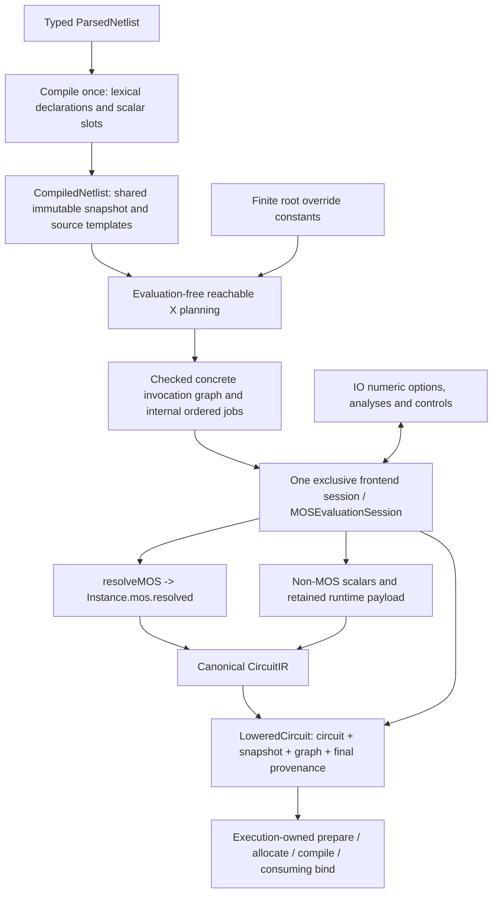

# Lowering Frontend

## Purpose and Scope

This component owns source-preserving ParsedNetlist compilation, concrete
invocation planning, shared scalar evaluation, and canonical CircuitIR emission.
Parent: [CoreSpiceLowering](../DESIGN.md). It has no child components.
The contracts below specify the approved S4 adapter migration; implementation and
verification completion are recorded only in workspace PROGRESS.md B8.6.5.18.4.

Private `ParsedNetlistCompiler` is noncopyable and its compile operation consumes
the construction owner. It composes the noncopyable declaration builder and
consuming snapshot publication described by
[Declarations](../../CoreSpiceMOSResolution/Declarations/DESIGN.md). Source compilation
publishes reusable immutable `CompiledNetlist`; mutable construction cannot survive
that publication or share the builder's private program table.

## Responsibilities and Boundaries

Lowering compiles typed parsed input once and retains its ordered source metadata.
It supplies lexical declarations and concrete caller environments to MOSResolution,
uses its exclusive evaluation session for every scalar consumer, and emits resolved
MOS stages. Ordered execution jobs are internal implementation values, not a second
public circuit representation. Instance.mos is the sole MOS value authority.

Lowering depends on ParsedIR, IR, MOSContracts and MOSResolution. It does not depend
on Devices, compact-model kernels or native execution; BSIM preparation policies,
operating conditions, cold preparation, auxiliary topology allocation and consuming
binding belong to execution composition. No model-name search or flattened model
map can override an emitted resolved MOS stage.

| Responsibility | Owner | Consumed contract |
|---|---|---|
| Source grammar and ordered occurrences | ParsedIR / ParserSPICE | Typed AST, assignment/function order, actual source origin |
| Declaration storage, final invocation bindings, RNG and model selection | MOSResolution | Shared snapshot/graph, exclusive session, exact resolved result |
| Typed circuit instance and resolved/prepared stage | IR | Instance.mos and canonical port identities |
| Option/analysis interpretation | IO caller | Compile-time scalar slots evaluated through this session |
| Numerical preparation and executable lifetime | Devices / native composition | Resolve, prepare, allocate, compile, consume-bind |

## Related Designs

| Design | Relationship | Contract Used | Summary | Cautions |
|---|---|---|---|---|
| [CoreSpiceLowering](../DESIGN.md) | parent | Frontend module composition | Native-independent frontend responsibility | Revalidate public consumers together |
| [ParsedIR](../../CoreSpiceParsedIR/DESIGN.md) | depends on | Ordered assignments/functions and source occurrences | Single source-to-program projection | Dictionaries do not replace available ordered metadata |
| [ParserSPICE](../../CoreSpiceParserSPICE/DESIGN.md) | depends on | Typed expression and runtime syntax | No source reparsing | Keep bare passive roles and runtime payload distinct |
| [Declarations](../../CoreSpiceMOSResolution/Declarations/DESIGN.md) | depends on | Immutable snapshot builder | Compile once, retain every occurrence | No declarations copied per X invocation |
| [Evaluation](../../CoreSpiceMOSResolution/Evaluation/DESIGN.md) | depends on | Graph, constants, exclusive shared session | Sole scalar and random authority | Numeric caller ancestry and lexical declaration ancestry differ |
| [Selection](../../CoreSpiceMOSResolution/Selection/DESIGN.md) | depends on | resolveMOS and independent inspection | Sole MOS selection/normalization | No model or coefficient reevaluation |
| [MOS instances](../../CoreSpiceIR/MOSInstances/DESIGN.md) | depends on | resolved and prepared stages | Sole immutable MOS truth | Resolved stage is not compile/bind admission |
| [IO](../../CoreSpiceIO/DESIGN.md) | used by | Compiled slots and exclusive frontend session | Public parse/lower/options/control migration | IO cannot create another parameter resolver or RNG |
| [Native execution](../../CoreSpice/NativeExecution/DESIGN.md) | used by | LoweredCircuit and resolved stage | Numerical composition | Allocate original auxiliary topology after actual preparation |
| [Devices](../../CoreSpiceDevices/DESIGN.md) | coordinates with | Non-MOS execution and runtime expression semantics | Physical laws remain device-owned | No implementation dependency from Lowering |

## Architecture



## Contracts and Invariants

### Source compilation and authority

CompiledNetlist is an immutable Sendable owner of one MOSDeclarationSnapshot,
lexical body/subcircuit templates, non-MOS model occurrences, and caller-addressable
scalar slot descriptors. It strongly retains all tables needed to interpret IDs;
identity tokens alone are insufficient. Compilation is independent of seed and
concrete invocation values. All reachable and unused lexical declarations remain
inspectable without numerically evaluating unused bodies or model cards.

ParsedExpression maps structurally and exhaustively to MOSExpression: literals,
references, unary/binary operators, ordered function arguments and conditionals.
There is no String serialization/reparse, expression-text hashing, AST-based random
slot deduplication, or re-interning after snapshot publication. A program may be
shared only when semantic slots remain distinct at evaluation/cache boundaries.

Ordered parameterDefinitions, parameterAssignments and functionDefinitions are
authoritative when present. Header defaults precede body defaults; source order
and duplicate occurrences survive compilation. Function metadata and matching
controls are one declaration, not two executable registrations. Only manually
constructed ParsedIR without the corresponding metadata uses a deterministic
case-normalized dictionary/control fallback. Such fallback never invents source
order, capture IDs, parse occurrence IDs or content digests. Exact release version
text is preserved as text; it is not evaluated as a floating-point number.

Source conversion occurs once. Actual selected model provenance comes from its
ParsedModel.origin, including capture, parse occurrence and supplied coordinates.
Unavailable coordinates remain absent. Synthetic caller/scalar slot identities
are internal evaluation identities and never masquerade as source occurrences.

### Invocation planning and parameter lookup

The planner traverses reachable X instances without evaluating a scalar. It
validates names, port counts, expansion depth and graph budgets, creates stable
per-run invocation IDs, and maps ports/internal nodes and runtime V/I references
once. Caller invocations precede children. Lexical declarations are shared rather
than cloned. Header/body final defaults and unique explicit actuals are delegated
to the checked graph; duplicate explicit actuals fail. Body defaults are last-wins.

Parameter overrides enter the root invocation as finite MOSInvocationValue.constant
actuals before any dependent global evaluation. Their symbols must already belong
to the compiled symbol inventory; callers declare additional override names at
compile time. Constants support new MC values without extending the snapshot.
A root program actual has no caller for self pass-through and therefore retains
normal cycle rejection. X program actual self-name lookup uses the exact caller;
other references see the final child environment. Function formals take priority.

Model/subcircuit/function declaration selection follows lexical scope ancestry,
not arbitrary caller declarations. Numeric parameter lookup follows the exact
concrete caller chain. A selected model coefficient is evaluated in the concrete
invocation owning that model declaration; a function body uses callsite numeric
invocation while nested function names use the function declaration's lexical
scope. No same-named parent/sibling model can repair a failed nearer owner.

### Model coefficients are evaluation slots

Non-MOS coefficient assignments, like MOS coefficients, are scalar evaluation
slots, not .param declarations. They never add peer coefficients to the numeric
environment. The selected declaration's owning invocation and lexical scope are
passed to the shared evaluator. A coefficient referring to its own spelling reads
the enclosing parameter if present; a reference existing only as another model
coefficient fails as missing binding. No synthetic coefficient scope is created.

This deliberately replaces the legacy temporary resolver's sorted publication,
peer-coefficient extension and retry behavior. Existing API shape and processing
order are not compatibility requirements of this migration. For global b=7 and
model a={b}, b=2 the values remain a=7 and b=2; removing global b makes a fail,
regardless of coefficient order. Non-MOS device laws and admitted parameter roles
remain unchanged. Ordered source occurrences and selected declaration identity
remain available independently of executable value maps.

### One scalar session and explicit caller policy

Profile, MOSResolutionLimits and UInt64 seed are explicit required inputs to every
frontend evaluation run. There is no hidden strict/pinned choice, unlimited limit,
time-based seed or default RNG. One noncopyable NetlistLoweringSession exclusively
owns the graph, internal ordered jobs, one MOSEvaluationSession, frontend scalar
slot memo and optional emitted circuit. It is synchronously borrowed inout and
cannot be copied, shared or captured by an escaping callback.

Global/default/actual parameter bindings, non-MOS instance/model scalar slots,
MOS requests, numeric options, .temp, analysis bounds, initial conditions, node
sets and other admitted static control expressions use that same session. A
single semantic slot evaluates at most once per invocation; retries after failure
and a second legacy global/model resolver are prohibited. Distinct scalar slots
with the same program retain distinct draws. Binding and MOS caches remain owned
by MOSResolution; frontend slot memo keys include compiled identity, slot and
concrete invocation. Failed adapter validation/evaluation poisons the run before partial
success or another draw can escape.

Root-call order is explicit and retained in provenance: final root bindings,
caller-requested static control/analysis slots, then depth-first component jobs
with final invocation bindings on entry. Calls after circuit emission remain in
the same ordered session. Within an expression, operand/argument ordering and
short-circuit behavior are Evaluation-owned. Internal topology publication may
defer coupled inductors within a body without silently changing scalar call order.
The final provenance records seed, PRNG version, profile, call order, cumulative
steps/draws and bounded retained/peak capacity counters.

### Public scalar bridge and result

The minimum public API has the following roles; these names are approved adapter
API targets, not a claim that callable implementations already exist:

| API / value | Contract |
|---|---|
| NetlistLowering.compile | Compile ParsedNetlist plus explicit limits/control and declared extra override symbols into CompiledNetlist once |
| CompiledNetlist.scalarSlots | Read-only typed source/field addresses for static scalar consumers; slot IDs are tied to the compiled identity |
| NetlistLowering.beginEvaluation | Accept compiled input, explicit profile/limits/seed, finite root constants and optional cancellation/work control; build reachable graph and exclusive session |
| NetlistLoweringSession.evaluateScalar | Evaluate a compiled scalar slot at its checked invocation through the sole MOS session, memoizing the semantic slot |
| NetlistLoweringSession.lower | Emit CircuitIR once with supplied effective geometry scale and existing non-MOS emission options; retain it inside the session |
| NetlistLoweringSession.circuit | Read-only post-emission circuit for node/analysis setup, without transferring an executable device owner |
| NetlistLoweringSession.poison | Mark external static-consumer semantic validation failure terminal without drawing/evaluating again |
| NetlistLoweringSession.finish | Consume the healthy emitted session and return LoweredCircuit with final provenance after all static consumers |
| LoweredCircuit | Immutable circuit, exact shared snapshot and graph, and final evaluation provenance; no duplicate resolved-MOS list |

The concrete public signatures for IO integration are:

```swift
public static func compile(
    _ netlist: ParsedNetlist,
    additionalOverrideNames: [String] = [],
    limits: MOSResolutionLimits,
    control: (any MOSResolutionControlling)? = nil
) throws -> CompiledNetlist

public static func beginEvaluation(
    _ compiled: CompiledNetlist,
    profile: MOSInputProfile,
    limits: MOSResolutionLimits,
    seed: UInt64,
    parameterOverrides: [String: Double] = [:],
    control: (any MOSResolutionControlling)? = nil
) throws -> NetlistLoweringSession

public enum NetlistScalarAddress: Sendable, Hashable {
    case control(index: Int, field: String)
    case analysis(index: Int, field: String)
    case initialCondition(node: String)
    case nodeSet(node: String)
}

// CompiledNetlist owns these read-only members.
public var source: ParsedNetlist { get }
public var snapshot: MOSDeclarationSnapshot { get }
public func sameStorage(as other: CompiledNetlist) -> Bool
public func scalarSlot(at address: NetlistScalarAddress) throws -> NetlistScalarSlot

// NetlistLoweringSession is ~Copyable and owns these operations.
public var compiled: CompiledNetlist { get }
public mutating func evaluateScalar(_ slot: NetlistScalarSlot) throws -> Double
public mutating func lower(geometryScale: Double? = nil, expandModels: Bool = true) throws
public var circuit: CircuitIR? { get }
public mutating func poison(_ cause: MOSResolutionFailure)
public consuming func finish() throws -> LoweredCircuit
```

The static factories belong to NetlistLowering. CompiledNetlist is a final
immutable Sendable class, with sameStorage checking exact owner identity;
LoweredCircuit is an immutable Sendable value. LoweredCircuit has public read-only circuit,
snapshot, graph and evaluationProvenance members. NetlistScalarSlot is an immutable
checked identity without a caller-constructible initializer; evaluateScalar checks
its exact CompiledNetlist identity before program lookup. Public static control
slots use the root invocation; component invocation-specific slots remain internal.
The optional circuit is nil before successful lower and read-only afterward;
finish requires a healthy emitted circuit and consumes the session once.

Field names are checked inventory addresses matching the ParsedIR property, never
expression text: ordinary option/temp control field is value; static analysis
fields use their property names, with analysis. prefixes for nested MC analyses.
The descriptor table is the authority for supported addresses. Missing/unsupported
addresses fail explicitly. Initial-condition/node-set control and dictionary
addresses referring to the same effective source assignment alias one scalar slot,
so querying both cannot consume two random draws. Source duplicate controls remain
separate ordered occurrences; only an actual alias shares evaluation identity.

Slots address a control ordinal/field, analysis ordinal/field, initial-condition
node or node-set node; their descriptors retain actual source coordinates when
available. Unknown/text-valued controls remain typed raw payload. IO chooses the
recognized numeric slots, so a method name or unknown option does not become an
undefined numeric variable. Strings/vectors are explicitly rejected by scalar
consumers. Compile all needed static expressions before beginning evaluation;
post-publication callers cannot submit text or extend the program inventory.

Host inspection reads the original resolved instance from LoweredCircuit.circuit
and calls inspectResolvedMOS with that result and LoweredCircuit.snapshot under
explicit inspection limits/control. The returned graph and provenance identify
its concrete invocation and evaluation run; no inspection operation re-evaluates
a program or draws randomness. Numerical composition constructs a separate
prepared CircuitIR and preserves the original LoweredCircuit for inspection.
Snapshot/identity mismatch is a typed refusal, including across MC samples with
different compiled inputs; equal textual names never substitute for identity.

IO resolves its numeric options through evaluateScalar, validates option semantics,
passes the resulting scale to lower, consumes analysis/IC/node-set scalar slots
through the same session, and finishes only after those calls. Lowering-only
callers consume the last source .options scale slot through this session unless
an explicit finite positive override suppresses that slot. IO's same evaluated
scale is never re-evaluated by lower. Temperature is an operating-condition input,
not an implicitly injected numeric parameter. The old SPICEAnalysisOptions
makeEvaluationContext retry/RNG path cannot remain on the migrated execution path.
Option interpretation, analysis dispatch and source coverage remain IO-owned.
The IO adapter is SPICEAnalysisOptions.resolve(from: CompiledNetlist, session:
inout NetlistLoweringSession). It checks session.compiled.sameStorage at entry;
wrong identity poisons the run before reading even a text-only control list.
External semantic validation failure, including invalid option ranges or nonzero
ground voltage, calls session.poison(.invalidRequest) before propagating the
original typed IO error. This public terminal operation adds no RNG/work attempt
and allows no later scalar evaluation, emission or finish to succeed.

### Runtime payload and MOS emission

B V/I/time/temper expressions and runtime-dependent R expressions are typed
runtime payload, not scalar evaluation jobs. PWL numeric vectors and control-source
references preserve their typed roles. Existing BehavioralExpressionLowerer emits
canonical runtime expressions, using session-resolved parameter values and
compiled lexical function lookup rather than a new ExpressionEvaluator/RNG.
Function formal substitution and nested lexical function ownership remain exact;
ports, read-only node/branch references and internal names are mapped once.
Runtime hertz remains explicitly unsupported, including when a parameter has that
name. Runtime temper remains ambient Celsius supplied at binding/rebinding.

The MOS branch bypasses legacy context.model, mapComponentType, model flattening,
legacy geometry refusal and cold BSIM admission. resolveMOS supplies the exact
selected source/release/schema and separate normalized values. Lowering emits
Instance.mos.resolved with physical nodes and zero owned auxiliary nodes. Generic
parameters, model and modelConsumption maps do not duplicate or override MOS
truth. IR/compiler refuse resolved or legacy MOS as numerical admission. Execution
composition alone prepares, allocates fresh auxiliary identities, replaces the
stage with its receipt, compiles, and consumes binding. BSIM4.5 resolved inspection
remains successful even though native preparation rejects that exact release.

## Runtime Flows

```text
compile once
  -> beginEvaluation(profile, limits, seed, root constants)
  -> same-session static option calls / validated effective scale
  -> lower: invocation entry bindings / ordered non-MOS slots / resolveMOS
  -> same-session analysis and node-voltage calls
  -> finish: LoweredCircuit with final counters and retained inspection storage
  -> execution-owned numerical preparation

Monte Carlo sample
  -> same CompiledNetlist + new root constants / graph / seed / session
  -> fresh resolved IR and later fresh executable owners
```

## State, Ownership, and Lifecycle

| State | Owner | Access / release |
|---|---|---|
| Lexical snapshot, source templates and program slots | CompiledNetlist | Immutable shared Sendable storage; retained through inspection |
| Concrete bindings and ancestry | MOSInvocationGraph | Checked immutable shared storage; root overrides belong to each run |
| RNG, scalar memo, work/capacity and terminal diagnostics | Exclusive frontend/MOS session | Synchronous inout calls; released or consumed at finish |
| Resolved MOS | Instance.mos | Immutable IR value; clones preserve the stage |
| Runtime expression | Canonical non-MOS Instance parameters | Finite captured parameters plus runtime variables; operating conditions supplied at binding |
| Kernel owner and auxiliary topology | Execution composition / Devices | Outside Lowering; consuming bind and deterministic release |

No new shared mutable Sendable state, unchecked concurrency, no-op lock or
Embedded-only raw storage is introduced. Existing LoweringContext may supply an
immutable-value emission view for non-MOS runtime conversion; it is not another
parameter/model evaluation authority. Its existing Mutex contract remains intact
where reachable during migration.

## Failure, Concurrency, and Constraints

Compilation, planning, scalar memo, source/template retention, AST traversal,
expansion jobs and publication use explicit byte/work/cardinality/depth budgets
and cancellation. The adapter does not hide unbounded arrays around bounded
MOSResolution calls. Duplicate actuals, missing references, cycles, wrong compiled
identity, invalid scalar type, nonfinite constants and unsupported selected input
fail explicitly. A poisoned session cannot publish LoweredCircuit. Numerical
preparation failure preserves resolved inspection and cannot select a substitute
release, family or backend.

## Verification and Change Impact

| Owner / test scope | Required counterexample or behavior |
|---|---|
| Lowering compiler | Ordered duplicate declarations, actual origin, lexical bodies/functions, 1:1 AST conversion and retained unused declarations |
| Lowering planner | Repeated/nested X identity, port remapping once, duplicate actuals, root constants, local last-wins and caller self pass-through |
| Shared scalar composition | Global/header/body/X/non-MOS/MOS/control rand share one deterministic stream; repeated same slot does not draw twice; sibling slots do |
| Model slot semantics | Enclosing coefficient names resolve as parameters; coefficient-only peer reference fails without publication/retry |
| Runtime boundary | B/R V/I/time/temper and PWL survive; lexical functions, node/branch mapping and temperature rebinding remain exact |
| MOS stage | Scale once, scoped exact/family selection, separate roles, actual selected origin, zero auxiliary nodes, successful independent BSIM4.5 inspection |
| Public IO | Numeric options and analyses use the same session; option scale/rand are not re-evaluated; text options do not spuriously evaluate |
| Public native composition | Resolved IR is refused by compiler; admitted preparation/receipt/owned topology/consuming bind execute through actual CPU path |
| Reuse / failure | Same snapshot with fresh graph/constants/seed/session; wrong identity, cancellation, budgets and poison produce typed failure |

The S4 adapter worker owns Sources/CoreSpiceLowering/** and
Tests/CoreSpiceLoweringTests/** only. New implementation lives beside this design
in Frontend/. NetlistLowering.swift remains the module composition root. Existing
helpers touched for this responsibility move into Frontend/ when migrated; unrelated
legacy files are not reorganized. IO owns source policy, option interpretation,
public parse/lower entry points and simulation preparation. Root owns Package.swift,
CLI and adoption pins. Compiler/snapshot, planner, exclusive session/scalar slots,
result/provenance and runtime emission are one Lowering ownership boundary; these
files are implemented serially against the reviewed S3 stage/preparation contract.
Source implementation follows reviewed S3 commit f816ee6.

Focused tests belong to CoreSpiceLoweringTests. Parser intake, scalar options and
public parse-to-native execution belong to the corresponding ParserSPICE/IO tests;
IR, Compile and Devices own their stage/preparation invariants. Shared evidence is
reused only while its owner inputs remain unchanged. Native CPU evidence does not
qualify device physics, a foundry deck, Metal, WASM or Embedded. Revalidate direct
and transitive public callers when this API replaces legacy lower-to-CircuitIR.

## Canonical PWL Source Migration

Parsed numeric vectors preserve alternating PWL time/value values. SPICE PWL syntax
parses and serializes this vector, lowering retains `ParameterValue.realVector`,
and device admission owns strict time/value validation. Partial/unknown source
waveforms produce typed parse/binding failure, never successful DC substitution.
Scalar option/measurement/expression consumers reject vectors explicitly.

## Static Resistor Composition

Scoped/include model resolution consumes only `ParsedComponent.passiveModelCandidate`
for ambiguous bare tokens. An explicit numeric identifier keeps its original role
when an equally named model exists. Subcircuit remapping preserves the candidate
without adding it to physical parameter dictionaries. A braced, quoted or named
numeric expression is never reclassified from its expression shape.

The expander retains resolved resistor model name/type/parameters in
`ResolvedDeviceModel`, with supplied instance values in their own map, regardless
of `expandModels`. Scoped references and static expressions use the shared
frontend session. Unknown or mismatched models fail explicitly. Runtime-dependent R
expressions consume `BehavioralExpressionLowerer` and preserve read-only node
and branch dependencies; subcircuit remapping uses the existing voltage-reference
mapper. The runtime contract now explicitly includes `temper` as a binding-time ambient
Celsius variable. It must survive lowering/rebinding rather than resolving from
LoweringContext.temperature. Runtime frequency (`hertz`) is classified as runtime
and explicitly refused, even when a same-named parameter exists. Nested expansion
propagates the already-mapped-node contract into child subcircuits so ports and
read-only dependencies retain canonical identities. Binding is owned by the
complete admitted Devices runtime profile. Static geometry and
temperature/noise physics belong to
[Devices](../../CoreSpiceDevices/Devices/DESIGN.md#resistor-execution-contract).

The focused owners are [ResistorParserTests](../../../Tests/CoreSpiceParserSPICETests/ResistorParserTests.swift),
[ResistorLoweringTests](../../../Tests/CoreSpiceLoweringTests/ResistorLoweringTests.swift),
[StaticResistorTests](../../../Tests/CoreSpiceDevicesTests/StaticResistorTests.swift), and
[public IO execution](../../../Tests/CoreSpiceIOTests/SPICEIOEndToEndTests.swift).
Their owned paths are native CPU DC, independent AC and thermal/flicker noise;
compilation or parser intake is not physical qualification. Supplied static R l/w
consume the finite positive document scale exactly once; model defaults stay in
SI and the separate instance resistance scale retains its meaning. Non-MOS
selected model identity/parameters remain separate from supplied instance values.
Generated JFET/MESFET series elements and URC ladder/shunt elements inherit the
actual selected source model metadata; cloning preserves it. Unavailable model
origin is not inferred as model-free.

## Capacitor Source Resolution and Admission

Bare C `passiveModelCandidate` resolution occurs after global and invocation-local
parameters have resolved in the final invocation graph. Numeric parameter
binding presence wins over lexical model presence, regardless of numeric sign
or zero. Unresolved/cyclic parameters fail before this choice; functions alone do not
count as bare parameter declarations. Reserved bare `c` does not resolve to a same-named model.

For an actual model reference, missing and mismatched types are typed failures.
Matching C models are also explicitly refused before model flattening, even with
an explicit positive instance capacitance: model-backed C numerical preparation
is not implemented. No model reference may silently become ideal C. Unused C
declarations remain independent of this instance gate. Subcircuit remapping keeps
source candidates. R source roles and URC-generated ideal capacitors retain their
existing execution and selected-source provenance.

Focused lowering/public IO tests own forward/include/scoped resolution, parameter
precedence, explicit-value-plus-model refusal and
unchanged ideal/URC execution. [Devices](../../CoreSpiceDevices/Devices/DESIGN.md#capacitor-model-binding-admission)
owns direct IR binding refusal.

## Charge Capacitor Numerical Admission

The actual selected-component validation rejects a capacitor containing `q` before
passive-role resolution, parameter evaluation, model preparation or topology
publication. This applies with or without an explicit C value, model or expression
evaluation, including manually constructed parsed input. Unselected subcircuit Q
bodies are retained without numerical evaluation. Q is not C or Q/V. No source
coverage result bypasses this owner. The independent direct IR gate is owned by
[Devices](../../CoreSpiceDevices/Devices/DESIGN.md#charge-capacitor-binding-admission).

A future numerical implementation must supply i=dQ/dt, the complete dQ/dV
Jacobian, AC linearization and accepted charge/current history with rejected-step
isolation, plus independent successful and failing numerical tests. Until then
public selected Q lowering is a marked typed refusal. Focused tests pair unused
Q definitions with selected Q failure and direct parsed C+Q refusal.

## Frontend Capacity Envelope and Inspection Link

The public `resourceEnvelope(limits:)` uses checked arithmetic with B equal to
`maximumRetainedBytes`. The adapter ledger bounds retained parsed source (including
ignored control/analysis payload and origins), templates, scalar slots, planner
buffers, scalar memoization, runtime-expression buffers and the circuit builder.
The immutable compiled snapshot is included in this adapter ledger after compile.
The snapshot builder and its finish output ledger can coexist with the adapter
ledger during compilation: the simultaneous upper bound is 3B. Graph construction
has one B ledger and ends before the B evaluation session starts; graph/session
retention coexists with the B adapter ledger. Public reservation is retained 2B,
temporary B, simultaneous 3B. Buffer element capacities and UTF-8 payload follow
MOSStorageBudget accounting; allocator metadata is outside that shared contract.

`CompiledNetlist.sameStorage(as:)` checks exact immutable source ownership.
`modelOrigin(for:)` validates resolved identity and selected declaration/source
before returning only the retained parser origin. Missing origins stay absent.
IC/nodeSet control occurrences and effective dictionary keys share one scalar slot,
with normalized node spelling, so repeated lookups reuse the same evaluated value.

`NetlistEvaluationProvenance` exposes profile, evaluation, evaluationSteps,
retainedBytes and peakOwnedBufferBytes. Its seed, randomDraws,
randomGeneratorVersion and rootVisits are read-only views of the one finished
MOSEvaluationSession. Runtime constant leaves use Resolution's package binaryMOSValue and
builtinMOSValue contracts, including the same shared session RNG. Runtime
quantities remain typed BehavioralExpression; no scalar operator or random
implementation is duplicated in Lowering.

Runtime lowering records the occurrence-owned component parameter program as one
shared-session root visit before traversing its AST, at the same granularity as
ordinary evaluateMOSProgram. Static conditional and logical branches remain lazy.
A random scalar capture beneath a dynamic conditional or dynamic short-circuit
branch is a typed refusal; both runtime branches are never eagerly sampled.
Pure unary, binary and function operations beneath a dynamic conditional remain
typed runtime operations, including constant operands. Lowering therefore does
not reject a potentially inactive arithmetic/domain error; the existing runtime
conditional evaluates and validates only the selected branch. This deferral does
not change the existing runtime logical-operator semantics. Outside dynamic
conditional branches, static capture uses the shared Resolution arithmetic law;
`pwrs` preserves a negative base's sign while `pwr` returns its unsigned magnitude.

## MOS Initial Condition Operand Projection

Ordered MOS `ic` assignments retain the supplied first operand and remaining
`additionalValues`. Frontend compiles each of the one to three supplied operands
once, in source operand order, to the existing canonical schema names ic_vds,
ic_vgs and ic_vbs. Parser dictionary projections do not supply another program
or another evaluation; omitted coordinates remain absent in resolved bindings.
Existing numerical preparation owns its initial-condition defaults.

A repeated vector or a vector combined with an explicit canonical IC assignment
is a selected-component typed refusal in both profiles. Non-scalar operands,
more than three operands and multi-value assignments outside IC are also refused.
Unselected body source remains retained. After model selection, the selected
release schema must admit the source `ic` vector kind as well as its canonical
scalar components. A source vector is never admitted merely because a different
release exposes similarly named scalar parameters. Instance.mos.resolved retains
the final evaluated canonical components; preparation consumes those held values.

### MOS source-admission repairs

MOS non-scalar coefficients are retained as a declaration intake failure marker
rather than omitted as unsupplied. A supplied version must be exact text; a different
ParsedIR value kind is marked invalid and cannot trigger version defaults. ParsedIR keeps the complete original assignment
list. The resolver owns active-candidate refusal and profile-specific duplicate
admission; compilation alone never evaluates or rejects a discarded model card.

The exclusive lowering session owns the global MOS width selection input.
`lower(geometryScale:globalWidthPerFinger:expandModels:)` accepts an optional typed
width flag; absent an explicit flag, ordered root `.options wnflag=0|1` settings
choose the final value, otherwise false. The pinned profile alone admits this
setting. Subcircuit placement is rejected during source compilation. Strict input rejects a supplied source flag or true typed flag. Source
flags are always validated even when a typed override is supplied. Non-scalar,
missing, non-finite and non-binary values fail before circuit publication.
`evaluateMOSWidthPerFingerOption(at:)` is the shared checked option entrance used
by IO and lowering; it uses the same scalar memo, so random operands draw once.
The final flag enters every MOSResolutionRequest and its semantic identity.
Resolved rules and selection geometry retain its applied effect; physical W and NF
remain separately normalized and unchanged. This is a CoreSpice source spelling
for the explicitly selected pinned ordinary-MOS contract, not a claim that every
ngspice control-language spelling is implemented.
