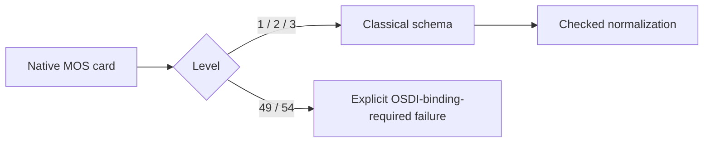

# Classical MOS Input Schema

## Purpose and Scope
Parent: [Contracts](../DESIGN.md). Own exact Level 1/2/3 input admission,
parameter roles, kinds and parameter-specific geometry scaling. No children.

## Responsibilities and Boundaries
Only native classical MOS levels 1, 2 and 3 are supported by these schemas.
Legacy BSIM levels 49 and 54 have no schema, selector catalog or executable
release identity here. They require an explicit OSDI model/catalog binding.
[OSDIContracts](../../CoreSpiceOSDIContracts/DESIGN.md) owns foreign model binding;
its actual loaded OSDI metadata owns official-family parameter types and aliases.
No legacy schema is repurposed as OSDI model authority.

## Related Designs
| Design | Relationship | Contract Used | Summary | Cautions |
|---|---|---|---|---|
| [Contracts](../DESIGN.md) | parent | Portable value boundary | Classical native inputs | No device physics |
| [Values](../Values/DESIGN.md) | used by | Release/schema identity | Checked result | No release substitution |
| [OSDIContracts](../../CoreSpiceOSDIContracts/DESIGN.md) | coordinates with | Explicit OSDI binding | Separate model authority | No parameter inference from legacy cards |

## Architecture

## Contracts and Invariants
Classical releases reject supplied version strings. Omitted level defaults to L1;
no BSIM release or missing-version default exists in either input profile.
Instance l/w/pd/ps use S, ad/as use S squared; multiplicity remains unscaled.
Only actually supported classical parameter names are admitted. BSIM bin bounds,
finger fields and compact-model selector aliases are not added to classical
schemas to preserve obsolete fixtures. Nonfinite, overflow and positive-to-zero
conversion fail explicitly.

`supportsScalarPerturbation` admits source-supplied real scalars and excludes
initial-condition fields. It does not invent a value for omitted or derived inputs.

## Verification and Change Impact
[Contract tests](../../../Tests/CoreSpiceMOSContractsTests) verify classical
parameter admission, exact release refusal and scaling. Resolver tests verify
source-positioned OSDI migration errors and no fallback. Actual OSDI runtime
parameter metadata and official model execution remain independently verified.
