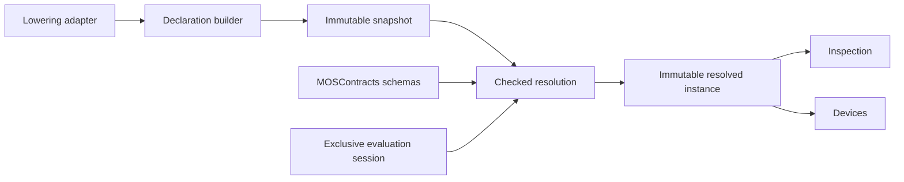

# CoreSpiceMOSResolution

## Purpose and Scope

This module owns independently inspectable MOS input interpretation. Parent:
[CoreSpice](../../DESIGN.md). The [Declarations](Declarations/DESIGN.md) child
owns immutable source declarations and indices. Evaluation and checked selection
are added in the next migration sprint; their implementation is not claimed by
this snapshot boundary.

## Responsibilities and Boundaries

The resolver consumes explicit profiles and release input schemas from
[MOSContracts](../CoreSpiceMOSContracts/DESIGN.md). It does not parse SPICE text,
allocate numerical devices, select a solver, or issue execution evidence.
The Lowering adapter owns conversion from ParsedIR into programs and declarations.
The checked resolution algorithm is a free function; providers may supply schemas
but cannot replace scope, normalization or selection invariants.

## Related Designs

| Design | Relationship | Contract Used | Summary | Cautions |
|---|---|---|---|---|
| [CoreSpice](../../DESIGN.md) | parent | Boundary composition | Source to executable ownership | Selection is not numerical support |
| [MOSContracts](../CoreSpiceMOSContracts/DESIGN.md) | depends on | Profiles, IDs, schema, values and failures | Portable semantic floor | Exact version and supplied/default roles remain distinct |
| [Declarations](Declarations/DESIGN.md) | child | Immutable snapshot and indexed ranges | Source occurrence authority | No declaration may disappear during index construction |
| [Lowering](../CoreSpiceLowering/DESIGN.md) | used by | Declaration/program adapter | Parsed input projection | No device preparation in adapter |
| [Devices](../CoreSpiceDevices/DESIGN.md) | used by | Resolved input | Exact numerical preparation | Unsupported release remains independently inspectable |

## Architecture

## Contracts and Invariants

The declaration child owns R06-R10 source/index invariants. The module's checked
resolution owns R11-R20 and R26-R32: nearest family ownership, exact priority,
final parameter binding, one evaluation, finite SI normalization and profile
selection. Evaluation and selection have no overridable correctness requirement.
Model coefficients and selection limits are independent of deck dimension scale.
Missing exact-model dimensions remain absent. An unsupported numerical release
is not replaced by a supported release.

## State, Ownership, and Lifecycle

Snapshots are immutable values. A session owns mutable memoization, PRNG state
and bounded counters and cannot be copied or shared. A failed session is poisoned;
a new attempt creates a new session. Resolved values can be reused across runs;
prepared device state cannot be stored here.

## Failure, Concurrency, and Constraints

All limits are explicit caller policy. Declaration/program construction rejects
capacity, bad references and malformed numeric values. Checked selection must
never return a truncated candidate search as complete. Diagnostic ranges retain
source ownership without intermediate candidate array materialization.

## Verification and Change Impact

[Contract tests](../../Tests/CoreSpiceMOSContractsTests) and
[snapshot tests](../../Tests/CoreSpiceMOSResolutionTests/MOSSnapshotTests.swift)
verify the local construction contract. Resolution tests will verify selected and
refused behavior, expression draw counts and boundary counterexamples before the
resolution sprint is marked complete. Native and matching Swift 6.4.0 normal and
Embedded WASM compile/link/runtime proofs are required for this module, using
the [MOSContracts runtime requirements](../CoreSpiceMOSContracts/DESIGN.md#verification-and-change-impact). Devices
is separately verified on Native CPU. Changes to IDs/schema/selection require
Lowering and Devices assumption checks and package composition verification.
