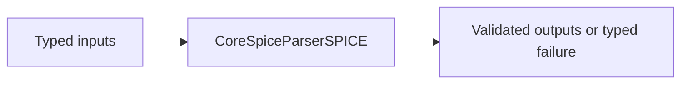
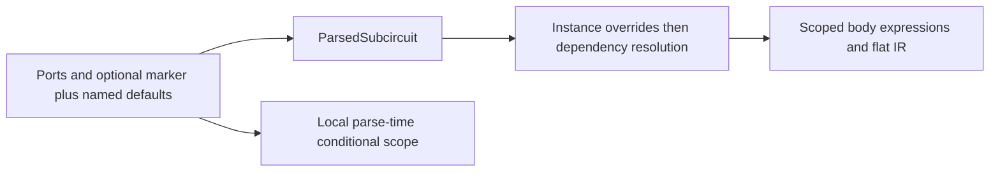
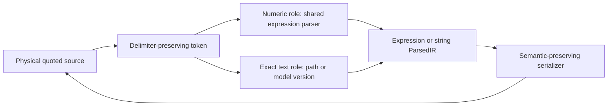
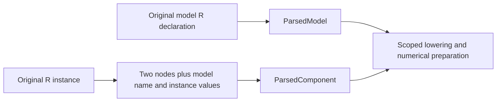

# CoreSpiceParserSPICE

## Purpose and Scope

This SwiftPM module owns the SPICE frontend. Parent: [CoreSpice](../../DESIGN.md). This module has no newly introduced child components.

## Responsibilities and Boundaries

The lexer preserves dotted version literals; parser retains an exact model version string and MOS IC vector coordinates. Numerical model admission remains downstream.

## Related Designs

| Design | Relationship | Contract Used | Summary | Cautions |
|---|---|---|---|---|
| [CoreSpice](../../DESIGN.md) | parent | Package composition | Owned module boundary | Revalidate direct consumers when contracts change |
| [ParsedIR](../CoreSpiceParsedIR/DESIGN.md) | depends on | Resistor declaration and source-role preservation | Syntax output retains model references and values | Declaration admission does not admit a numerical model |
| [Lowering](../CoreSpiceLowering/DESIGN.md) | used by | Scoped resolution and canonical runtime expressions | Parsed resistor intent reaches device preparation | Do not evaluate voltage references in the frontend |
| [Native Devices](../CoreSpiceDevices/Devices/DESIGN.md) | coordinates with | Resistor execution admission | Numerical guarantees belong to the device owner | Unused model parsing is not device qualification |

## Architecture



## Contracts and Invariants

### MOS declaration intake

The existing grammar appends ordered model/component/header assignments when it
consumes them, using its original located token stream and accounted buffers.
Component and `.param` origins use the existing capture/occurrence and physical
statement context. No source reparse, expression evaluation or model selection is
performed to recover this information. Subcircuit controls are body-owned and
all body builders are restored by defer when parsing exits or throws.

[ParsedIR](../CoreSpiceParsedIR/DESIGN.md#mos-declaration-intake) owns the preserved
fields. `MOSDeclarationIntakeTests` owns source order, source coordinates and
scope isolation proofs; later MOS resolution owns release/profile admission.

### Conditional delimiters and reference names

The shared lexer owns punctuation boundaries. In the unchanged Sky130
`res_high_po.model.spice:52`, the then branch ends in `weff/leff:300`; treating
`leff:300` as one identifier loses the required conditional delimiter. The existing
expression parser already owns low-precedence, right-associative conditional ASTs.
The [pinned ngspice grammar](https://github.com/imr/ngspice/blob/ebdaf58ec76a06ffaac7e0f138360dd1cf5ee4b6/src/spicelib/parser/inpptree-parser.y#L57-L68)
and actual reference probes confirm unspaced and nested conditionals.

The lexer tracks invocation-local conditional scopes by parenthesis/brace depth.
Once a scope contains a question token, colons in that same scope end identifiers
and remain punctuation, including an extra colon that the parser must reject.
Deeper reference-name scopes such as `q?v(x:y):i(vbranch:r)` retain their colon
names. Ordinary card names, ports and `params:` remain unchanged. Quoted interiors
use their independent existing expression lexer; comments and opaque strings do
not modify surrounding delimiter state. Reference naming is CoreSpice-owned and
does not adopt ngspice's different subcircuit qualification convention.

Physical newlines defer the logical-statement boundary. Comments, blank lines and
`+` continuations preserve the scope; the next substantive non-continuation card
resets it. Closing a delimiter releases its inner conditional frames; malformed
conditional syntax remains an explicit parser failure.

Ordinary and bounded tokenization call the same scanner. The existing accounted
preprocessor scratch stack becomes a shared internal parser stack without changing
its COW, reservation, failure or export semantics. Lexer frames use that stack,
reuse capacity within a statement, and release all scratch on tokenization success
or failure even while the lexer remains alive. Frame growth is admitted before
allocation; work/cancellation failures propagate through the existing checked
tokenization boundary. Scanning is linear in source/tokens and scratch is bounded
by conditional delimiter nesting; no suffix rescan or source rewrite is introduced.

```text
Source -> common lexer -> scope-aware colon tokens -> existing conditional AST
                  |
                  +-> ordinary names and deeper v/i reference names preserved
```

Verification compares exact ASTs, physical token locations, nested then/else,
comment-interrupted LF/CRLF continuation, extra/missing delimiters and unchanged
hierarchy references. Bounded tests additionally prove token/AST parity, reservation
refusal, cancellation and scratch release. Public CLI replay uses unchanged PDK
inputs and records the next execution boundary without claiming model physics.

### Resolved source documents

Root and included parsers consume [Parser source documents](../CoreSpiceParser/DESIGN.md).
The returned path, capture identity and library projection travel together; no
second path resolution supplies diagnostic provenance. Model origin records the
actual declaration start and parse-local ordinal. Library blank padding retains
physical lines, including continued statements. Bytes and limits remain [IO-owned](../CoreSpiceIO/DESIGN.md#consumed-source-capture-required-migration).


Continuation lines beginning with a plus after optional whitespace extend the last non-comment logical statement across full-line comments and blank lines. Tokenization folds intervening separators/comments only when a continuation is present; ordinary next statements remain separated and standalone comments remain available. Leading whitespace does not change full-line star-comment semantics. Retained tokens keep their physical source locations, including line and column. This grammar follows the original [ngspice 46 continuation stitcher](https://github.com/imr/ngspice/blob/ngspice-46/src/frontend/inpcom.c#L634-L710) and addresses the comment-interrupted continuations in unchanged Sky130 model cards; model evaluation/version support remains downstream. An unquoted dotted version is not rounded through Double. Numeric contexts reject version literals. MOS OFF is a flag, and IC accepts one to three DS/GS/BS values, defaulting omitted coordinates to zero.

## Subcircuit Header Defaults

The parser owns the SPICE header boundary: ports end at the first identifier followed
by `=`, or at an optional `PARAMS`/`PARAMS:` marker. Both marked and unmarked
headers produce the same `ParsedSubcircuit.parameters` values. The definition
retains numeric, signed, reference and brace-expression defaults; header names
never become ports or body components. All remaining header fields must be named
assignments with values. Missing values/assignment delimiters and malformed values
produce physical-location parser diagnostics instead of dropping fields.

The existing conditional preprocessor consumes the same admitted header defaults,
including logical continuation lines, in the definition's local parameter scope.
It retains its existing parse-time conditional semantics; this change does not
introduce per-instance conditional re-elaboration. Header values and body `.param`
state remain local and do not escape the matching `.ends` boundary. Lowering
remains the owner of instance-over-default precedence and numerical dependency
resolution under its [module contract](../CoreSpiceLowering/DESIGN.md).



The unmarked header in the immutable installed Sky130
`sky130_fd_pr__nfet_g5v0d16v0__subcircuit.pm3.spice:16` is a concrete admission
counterexample; the identical library/deck executed under ngspice. Grammar authority
is the [ngspice parameter manual](https://nmg.gitlab.io/ngspice-manual/circuitdescription/paramparametricnetlists/subcircuitparameters.html).
Its historical default-value warning does not override CoreSpice's verified
instance/default resolver or the current executable oracle; only the unmarked
header grammar is used here.

## Quoted Values and Source Diagnostics

### Confirmed Path and Owned Difference

The native replay of the untouched Sky130 TT library at CoreSpice `6a7e7a7`
fails at `corners/tt/nonfet.spice:4:13`: `cnwvc_tox='41.6503*1.024'`.
The existing lexer collapses both delimiters into a string token. The standalone
expression parser rejects that token, while generic parameter intake retains it
as opaque text. The serializer also emits opaque values with single quotes.
These three paths lose the distinction required by the
[ngspice numeric parameter specification](https://nmg.gitlab.io/ngspice-manual/circuitdescription/paramparametricnetlists/paramline.html).
The frontend owns this repair; ParsedIR already distinguishes expression and
string values, and Lowering consumes those contracts without another parser.

### Contract

- Tokens preserve single-quoted expression versus double-quoted opaque text.
- Numeric expression positions parse the complete single-quoted interior with
  the existing expression grammar, including references and function calls.
  Numeric `.param` positions reject opaque double-quoted text explicitly.
- Generic component, model, subcircuit-default and actual values map
  single-quoted numeric input to `ParsedParameterValue.expression`; they retain
  double-quoted text as `.string`. Conditional preprocessing uses the same
  expression parser through its existing dependency/function evaluator.
- Model `version` and include/library/HDL paths are explicit text roles. Either
  delimiter preserves their exact value; no arithmetic, suffix conversion or
  version normalization selects another model or path. Existing native model
  admission remains authoritative after parsing.
- The structural model `level` consumes a numeric value or a quoted literal,
  validated by exact integer conversion. A supplied nonliteral expression,
  opaque text, fractional or out-of-range value fails explicitly rather than
  silently retaining the default level. This structural role is distinct from
  model parameter expressions evaluated downstream.
- Unknown characters remain visible tokens so complete numeric expression
  parsing rejects quoted trailing invalid characters. The common lexical gate
  rejects unterminated quotes; raw control policy is not expanded by this repair.
- Opaque value serialization uses double quotes and reversible escaping for
  delimiters/backslashes. Expression serialization may retain the existing
  brace representation. Parse/serialize/parse preserves the IR meaning.
- Unterminated quotes, empty numeric interiors, malformed operators and
  unconsumed interior tokens yield `ParserDiagnostic` failures. Diagnostics
  inside quoted expressions retain the original physical file/line/column,
  including continued lines and CRLF. Unclosed text cannot become a success
  value through a partial lexer token or an empty path.
- Bare positional numeric values use the same quoted-expression intake as
  named values. A quoted token cannot be discarded when a positional slot is
  missing; opaque text in a numeric positional slot fails explicitly.
- The existing first-line title is free text, outside quoted-value syntax.
  Common unterminated-quote validation begins after that title is consumed;
  all remaining statements retain the lexical failure gate.
- Each parse owns its token/state lifetime. No new shared state, model backend,
  process policy, unit conversion or geometry bin selection is introduced.



| Requirement | Implementing owner | Behavioral proof |
|---|---|---|
| Numeric quotes and lexical distinction | Lexer, token and expression parser | Quoted AST, full-input rejection, physical errors |
| Canonical intake across actual consumers | SPICE parser and existing conditional evaluator | `.param`, `.model`, header/actual, `.if`, public parse/lower |
| Exact text and persistence | Text-role parser and serializer | Both path delimiters, exact unsupported version, opaque escaping round trip |
| Production admission | Native CLI with unchanged PDK/deck | Next actual failure or result; no model physics qualification inferred |

The package master indexes this child contract. Revalidate the parser target and
public IO consumer tests once after the implementation/test snapshot is frozen.
Lowering/model source remains unchanged; existing exact-version tests are direct
consumer checks rather than proof of new device support.

## Resistor Declaration and Instance Intake

Ambiguous bare identifiers carry `ParsedComponent.passiveModelCandidate`; numeric
braces, quotes and named `r=` values retain an explicit numeric role with no
candidate. Role resolution consumes only that source metadata, never expression
shape. Serializer output preserves an unresolved candidate as its original bare
token so include assembly or later lexical lowering can still resolve it.

`ModelType.resistor` and the resistor source-role intake are implemented.
Forward and scoped declarations resolve after their containing parse completes;
lowering repeats lexical resolution for declarations assembled by include loading.
An unresolved bare symbol remains a resistance expression. A model followed by
`r=` remains an explicit model reference even when the model is unknown.
Numerical execution is admitted separately by the device owner.

The frontend accepts `.model <name> R` as a resistor declaration and preserves
its original named values, expressions and source location. Unused declarations
may be parsed and serialized without executing their model. An unsupported
numerical parameter is retained for downstream admission, never silently dropped
or advertised as supported because the declaration parsed successfully.

For a two-node R instance, a model reference and positional or named resistance
are distinct source roles. A bare symbolic positional resistance remains an
expression when it does not designate a resistor model; scoped/forward model
references must retain `ParsedComponent.modelName`. An explicit named `r=` must
not overwrite or erase that model reference. The parser preserves instance
parameters separately from model declaration parameters; it does not merge
temperature coefficients, apply geometry scale, infer a model from a subcircuit
name, or translate a voltage-dependent R into a synthetic B card. Numeric values
use the existing numeric/quoted-expression grammar. Missing or malformed fields
produce physical-location `ParserDiagnostic` failures.



The model/instance syntax follows the pinned ngspice46
[resistor parser](https://raw.githubusercontent.com/imr/ngspice/ebdaf58ec76a06ffaac7e0f138360dd1cf5ee4b6/src/spicelib/parser/inp2r.c).
Runtime and noise semantics are owned only by the
[Native Devices resistor contract](../CoreSpiceDevices/Devices/DESIGN.md#resistor-execution-contract).
The parser test owner must distinguish unused declaration round trips, numeric
and symbolic positional R, model plus named R, scoped/forward references, and
malformed source diagnostics. Public IO must additionally prove that model
identity survives to binding; parser tests alone do not establish that guarantee.

## State, Ownership, and Lifecycle

Lexer and parser state is local to a parse. Parsed results are owned Sendable values.

## Failure, Concurrency, and Constraints

Malformed version/numeric contexts and invalid IC arity are parser diagnostics; unknown exact versions remain available for typed model admission failure.

## Verification and Change Impact

Public behavioral tests verify marked/unmarked headers, numeric ports, continuation defaults, local conditional scope, malformed-field diagnostics and actual lowering/default override results. Integration tests use the actual parser for quoted/unquoted version, IC and OFF, invalid version, and malformed numeric input. [Parser tests](../../Tests/CoreSpiceParserSPICETests/) verify comment-interrupted continuations through parsed model/parameter values, ordinary statement separation and physical diagnostic locations. Revalidate Lowering when token semantics change; replay unchanged real PDK library inputs through the native CLI to distinguish parser admission from later numerical model support.

## Canonical PWL Source Migration

Parsed numeric vectors preserve alternating PWL time/value values. SPICE PWL syntax
parses and serializes this vector, lowering retains `ParameterValue.realVector`,
and device admission owns strict time/value validation. Partial/unknown source
waveforms produce typed parse/binding failure, never successful DC substitution.
Scalar option/measurement/expression consumers reject vectors explicitly.

### Exact-profile dependency and work contract

Status: implemented post-await dependency/work evidence. The parser produces
the dependency events owned by
[ParsedIR](../CoreSpiceParsedIR/DESIGN.md#exact-source-dependency-values)
from actual include/library parse branches, preserving original physical positions
and lexical precedence. Local library sections and external library directives
remain distinct. Every active resolution records its returned source document;
missing sources/sections and unresolved required conditional grammar fail.
Repeated inclusion is not a cycle solely because content repeats. Source parsing
and numerical execution remain separate.

The parser accepts a CoreSpice-owned synchronous work/cancellation accounting
interface through its public source-intake path. Charge lexical bytes, tokens,
retained element counts, dependency expansions, conditional evaluation and section
materialization counts before corresponding work; these are not byte leases; check between bounded
chunks. Do not import PDK accounting or silently use an unbounded parser in a
required bounded scope. Existing parser configuration limits remain separate
caller-owned ceilings. The same grammar implements ordinary and exact intake.

Parser tests must reproduce local/external lib, active/inactive/unknown branches,
physical positions, repeated includes, depth/work exhaustion and cancellation.
A successful static source inventory or permissive partial parse does not meet
this contract. The optional PDK adapter translates events only after these checks.

`SPICEParser.parseChecked` propagates resolver and accountant errors rather than
recovering them into partial success. The ordinary protocol entry point still
returns source diagnostics. Both use the same lexer/token parser and conditional
evaluator. `SPICEPreprocessingEvent.selection` distinguishes active, inactive and
unresolved evaluation; unresolved required selection remains an error. Dependency
occurrences retain lexical depth-first ordinals and inherited/local parameter
expressions. Repeated source identity is not itself a cycle; include-depth and
expansion ceilings terminate recursion.

Checked top-level and quoted-interior token counts prepay an element-count
allowance before statement or expression construction. This limits counted work;
it neither measures AST byte capacity nor reserves temporary/retained storage. Subcircuit
default preprocessing, quoted expression lexing and recursive conditional
evaluation forward the same accountant. Native regressions reject token and
retention exhaustion inside those paths. Local library end matching stops at
the next local opener; an unrelated section cannot suppress an earlier bare
external library resolution.


### Bounded profile grammar

Status: implemented; dedicated bounded grammar verification is required before
publication. This module owns grammar integration for the
[Parser contextual contract](../CoreSpiceParser/DESIGN.md#bounded-contextual-source-contract)
and [ParsedIR storage values](../CoreSpiceParsedIR/DESIGN.md#bounded-source-storage-and-occurrence-values).
The protocol `SPICEProfileSourceParsing` requires
`parseProfile(document:configuration:environment:resolver:resources:) async throws
-> SPICEOwnedParseResult`. SPICEParser is its concrete implementation and reuses
ordinary lexer, expression parser, section and conditional grammar. Environment is
the checked Core value, resolver is SPICEContextualFileResolver, resources is
SPICESourceResourceAccounting. No whole expected graph is required: the injected
provider owns exact-approved or candidate-discovery selection. Parser authenticates
syntax/context, not approval, PDK admission or filesystem availability.

Physical source mapping uses the Parser-owned
[document projection contract](../CoreSpiceParser/DESIGN.md#bounded-contextual-source-contract)
and its unchanged package-visible coordinate helper.

`SPICEExpressionFormatting` exposes
`format(expression:resources:) throws -> SPICEOwnedExpressionText`.
`SPICEExpressionFormatter` delegates to the existing bounded, two-pass
`ParsedExpression.description` equivalent; it supplies no alternate grammar or
unaccounted fallback. The output exposes immutable `text` and privately retains
the actual formatter storage owner through copies. Its constructor is internal,
it is not Codable, and extracting a raw String transfers retention responsibility
to the caller. Input expressions are caller-owned values; this API does not mint
admitted source or AST authority. Unicode/capacity/cancellation errors retain their
existing typed causes; final cancellation is checked before publication.
The new public boundary is verified by
[PublicSourceProjectionTests](../../Tests/CoreSpiceProfileGrammarTests/PublicSourceProjectionTests.swift),
without replacing valid existing grammar evidence.

Existing parse/parseChecked remain their documented standalone/count-budget scope.
The new bounded API requires `configuration.resolveIncludes == true`; disabling
resolution is typed capability refusal before parsing, never a successful leaf
classification for an active include/lib. It refuses unowned document storage or
missing resource capability;
it does not downgrade to the legacy entry point. A successful owned result requires
no error/unresolved active conditional and a final resource/cancel check. Inspect
first error without ParseResult.errors/filter allocation. Resource/resolver failures
propagate their actual cause instead of interpolating it into diagnostic text.

Before each active include/external-lib await, build the source-local physical
statement identity, actual child-entry snapshot and request. Parent document
preprocessing already ran to completion. Snapshot inheritance is exactly current
initial conditionalParameterExpressions overlaid by currently parsed parameters,
with lowercase keys and existing ParsedExpression.description meaning. In subckt
body parsing, parser parameters are the saved/reset body-local map; header defaults
and parent functions are not added. Child Processor starts fresh function/frame
scopes. Merge child parameters back in the existing order; do not re-evaluate
parent conditionals or transfer child functions into parent preprocessing.

One checked snapshot supplies both request fingerprint and child construction.
Bounded events use that fingerprint and retained environment owner; their legacy
`preprocessingContext` dictionary is empty. Ordinary events retain their existing
dictionary contract. Consumers of the profile entry use the occurrence/context
fields rather than treating the legacy dictionary as bounded snapshot authority.
Parent branch evidence comes from actual preprocessor local scopes and conditional
events, not the child-entry map. Includes select full child/nil section; external
libs select their explicit child section. Allocate fresh occurrence IDs before
child parsing even when content key repeats. Model/subckt origins and physical
positions retain that occurrence. Post-merge lexical events remain depth-first,
including repeated nonrecursive edges. The original statement offset map survives
section/conditional blanking and continuation token relocation. Offsets/ordinals
are grammar-owned, never reconstructed by an adapter scanning SPICE text.

#### Concrete allocation and cooperative work boundaries

| Existing production path | Required bounded owner/check |
|---|---|
| SPICELexer token array, scanned names/numbers/quoted strings, escapes/comments | Reserve concrete UTF-8/slot capacity before grow/copy; chunk scan/check; continuation trimming refunds removed owned scratch |
| scanDotOperator remaining-tail lowercased probe | Compare only finite operator spelling with cooperative case handling; no full-tail normalization/allocation |
| SPICEExpressionParser and quoted-interior relocated tokens | Reserve relocated token capacity and each constructed concrete expression payload/argument capacity; same accountant for nested parsing |
| ParsedExpression.description for inherited parameters | Accounted cooperative formatter preserving exact existing output, including parentheses/operators; size before allocation instead of recursive map/join intermediates |
| Conditional Processor scopes, frame/output/event arrays, assignment/function parsing | Account scope/map entry and string payload capacities, header join, line copy and output join; loop checks in helper scans as well as main source scan |
| Merged parameter/function maps and evaluator resolving sets/argument maps | Admit transform/clone capacity before operation; current nested lookup/function semantics unchanged; recursive evaluation checks each node |
| Parser component/model/subckt/node/parameter/control/analysis values and vectors | Admit their actual element/entry payload capacities before append/insert/AST construction; scratch lifetime distinct from result storage |
| parseSubcircuit saved buffers, parseIncludedContent append/merge | Detect shared backing before mutation; reserve COW clone even without capacity growth; both snapshots charged through migration |
| resistorRoles/resistorSubcircuitRoles Set/map/union/final netlist | Charge concrete output and lookup entry capacities before transform; account each cooperative lookup/compare, preserve model precedence |
| Diagnostics and malformed/quoted expression payload | Charge derived text/entry capacity, or use static typed payload; retained failure owns required immutable backing only |

Use small ownership/capacity helpers in the existing owners, not another lexer,
container framework, slab/arena or allocator. Pre-size one-shot transforms from
actual counts using checked arithmetic; incremental buffers choose explicit
geometric logical capacity with overflow/refusal before growth. Copies sharing
immutable backing share leases; mutations admit separate capacity using a private
identity/uniqueness marker. Fixed-size scalar formatting uses a backend-established
bound, not a guessed multiplier; variable output uses accounted sizing/copy passes.
When a fixed backend cannot cooperatively bound a normalization/conversion, return
`SPICEBoundedSourceError.unsupportedBudgetCapability` with a static capability
name before the operation. In particular a Unicode operation must not silently
use ASCII equality or an unaccounted Foundation whole-string conversion.

Internal allocation hooks are owned by this module. `SPICEParseStorage` is an
invocation-local value requiring a real `SPICESourceResourceAccounting`. Its
accounted owner collection retains actual immutable payloads together with their
reservations. `reservePayload(of:)` reserves an associated expression/value stride
before construction; `retain(_:reservation:)` keeps the constructed payload, and
`hold(_:)` joins an existing immutable owner. `ownArray(_:)` makes a checked concrete
element-capacity copy while retaining its actual backing; input builders use the
existing `SPICEAccountedCollection` and release obsolete slots after migration.
`copyText(_:)` uses checked `SPICEAccountedText` and retains its actual String.
Retained payload wrappers are immutable class references fitting the existential
slot, with their concrete `(Value, optional original receipt, metadata receipt)`
stored-field tuple stride reserved before construction. `immutableOwner()` applies
that same boundary to result/failure scope export; no implicit large value boxing
is treated as free. Allocator/class headers remain excluded from this metric.

`SPICEAccountedMap<Value>` owns one String-keyed Dictionary, logical `(String,Value)`
entry capacity and immutable COW marker. It reserves geometric capacity before
growth or same-capacity shared writes, then cooperatively rebuilds the dictionary.
Key work is checked before hash/compare; this bounded hook rejects non-ASCII keys
instead of introducing Unicode normalization meaning. Dictionary bucket/allocator
slack, compiler headers and accountant-internal storage remain outside the managed
logical metric. Its raw export is a separately reserved owned copy.

Stable composed interfaces: `SPICELexer.tokenizeOwned(resources:)` returns
`SPICEOwnedTokens` (actual token array and `SPICEParseStorage`); expression parsing
accepts an optional inout storage value solely to preserve standalone calls, and
bounded callers always pass real storage. Conditional `processOwned(document:
environment:resources:)` returns its actual projected source/events/diagnostics
and immutable storage owner. Parser joins those owners into the checked result.
The profile entry requires each interface's real storage path; ordinary entries
retain their existing optional count-only work scope.

Hook verification is owned by
[StorageHookTests](../../Tests/CoreSpiceProfileGrammarTests/StorageHookTests.swift).
All hook mutable state is invocation-local; only immutable payload owners escape.

All helper scans/transforms charge examined work and check at bounded chunks;
a top-level token charge does not cover an arbitrary whole-tail/string/set pass.
Collection/hash/fingerprint arithmetic is checked. Work and logical storage are
separate counters. Explicit caller policy supplies limits/chunk sizes; no guessed
production defaults or machine-capacity selection. Parser state is invocation-local;
any escaped/shared owner uses immutable backing or Mutex/actor, uniformly Sendable.
No task, callback or I/O runs under a storage-accountant lock. Nested parser awaits
are structured; failure completes awaited resolver cleanup and publishes no result.

`SPICEProfileOccurrenceRegistry` admits source occurrence IDs on one traversal-wide
actor before each child parse. Its concrete stored-field extent and ID collection
use temporary reservations; they leave at traversal completion and are not retained
by a result. Source-local ordinals count actual grammar statements (including a
consumed subcircuit closing directive), excluding preprocessing-only branches and
the free-text title. Global dependency ordinals are depth-first merge positions.

| Mutable state | Native storage/isolation | WASM/Embedded source contract | Release |
|---|---|---|---|
| Parser/preprocessor builders | Invocation-local value state with reserved COW | Same declarations, no conditional state branch | Actual immutable payload owners remain in result |
| Occurrence uniqueness | Accounted collection on actor; resource callbacks occur in the actor, no Mutex held | Same actor and Sendable contract; runtime not established by Native proof | Traversal end releases temporary capacity |
| External resource counters | Injected synchronized protocol implementation | Same required protocol; implementation qualification is caller-owned | Shared reservations release at final copy |

The first profile result supports structural declarations, actual ordered subckt
ports and conditional/section/dependency evidence. Model types do not declare
terminals; no model-terminal or complete source-PVT facts are synthesized. Constant
TEMP/TNOM observations may be projected from their actual controls/parameters.
Expression-dependent temperature stays explicit unsupported until bounded
Core-owned option evaluation is supplied; do not call unaccounted analysis option
resolution or use its defaults in this path. Unsupported required meaning blocks,
while unused numerical physics is not qualified or executed here.

Verification owner: dedicated bounded-profile fixture files in
[CoreSpiceProfileGrammarTests](../../Tests/CoreSpiceProfileGrammarTests/). Real grammar must prove
pre-await coordinates/refusal, selected-parent/full-child section, exact inherited
snapshot, no parent-function/header-scope inheritance, no parent re-evaluation after
child merge, repeated origins, physical CRLF/continuation offsets, cumulative
capacity/work exhaustion, same-capacity COW, long-dot-token cancellation, unsupported
Unicode and final result/failure owner release. Compare supported ordinary/bounded
IR facts to protect unchanged semantics, and reject disabled include resolution
before an active dependency can disappear; no numerical/GPU/foundry proof is implied.

## Named Unquoted Runtime Resistance

A named resistor R value may begin with a scoped identifier and continue with
operators/function calls without quotes/braces, including physical continuation
lines. The existing expression token parser owns the full AST; numeric-role
intake must not return after the first identifier. The next named assignment
closes that value. Existing source locations, parsing work/storage accounting,
role preservation and explicit malformed-expression refusal remain authoritative.
[Devices runtime resistor contract](../CoreSpiceDevices/Devices/DESIGN.md#complete-admitted-runtime-resistor-profile)
owns the later runtime law. ResistorParserTests owns complete-expression,
following-parameter and failure-location proofs. Intake is implemented using the
original token stream and existing ordinary/bounded AST ownership. Named R and
resistance stop at the next assignment or statement boundary; an unexplained
trailing token fails at its original location. Focused verification is pending.

## Capacitor Source Intake

The frontend retains unused `.model C` declarations, including original Sky130
`cox/capsw/w/tnom/tc1/tc2` source values. A declaration is not executable-device
admission. The [pinned INP2C grammar](https://github.com/imr/ngspice/blob/ebdaf58ec76a06ffaac7e0f138360dd1cf5ee4b6/src/spicelib/parser/inp2c.c#L73-L143)
separates optional leading capacitance, model reference and optional post-model
capacitance. A post-model value replaces an earlier leading value. Named `c=`
accepts the complete expression and cannot silently discard its remaining tokens.
`model c=value` retains both roles; `c=value model` is rejected. Extra positional
values/tokens are rejected rather than ignored. Model-free ideal C is unchanged.

Bare C symbols retain `passiveModelCandidate` until fully scoped lowering because
a visible parameter wins over an equally named model. Parse-local model discovery
cannot decide against later included/global/body/default/actual parameter scope.
R keeps its existing model-selection contract. Explicit numeric syntax never
acquires a candidate. A bare reserved `c` cannot select a same-named C model.

Ordinary and bounded paths share this grammar and source metadata. Source-only
candidate references reuse admitted token strings and existing component storage;
no unaccounted parallel model/parameter table is introduced. Parser, bounded parity
and serializer tests inspect exact model/candidate/value roles, complete named
expressions, malformed tails and declaration origins. Public IO verifies unused
declarations execute independently of model-backed C refusal.

## Charge Capacitor Intake

The parser accepts two nodes and a single Q expression in quoted, braced or full
named-expression form. It retains the complete AST and serializer round trip in
ordinary and bounded parsing, using the existing accounted token stream. A bare
numeric Q value requires quotes/braces. Q-only syntax does not create a `c` value
or a model candidate. Missing values, duplicate Q and extra tokens are errors.

Mixed Q/C, positional values, model candidates/references and additional instance
attributes are explicitly unsupported source combinations. The fixed ngspice
frontend chooses its first braced expression and discards/rewrites other fields;
current unordered parameter storage cannot preserve that order-dependent meaning.
The parser refuses such forms instead of inventing precedence or silently dropping
fields. This incomplete mixed-form capability must remain marked and cannot be
reported as complete native source support. The unchanged Sky130 varactor card is
an unambiguous Q-only expression.

Parser/profile tests own complete named expressions, nested functions, malformed
and mixed forms, serialization, ordinary/bounded parity, origins and owner release.
The [Lowering charge contract](../CoreSpiceLowering/DESIGN.md#charge-capacitor-numerical-admission)
owns execution admission. The pinned source/probe evidence is retained in the
workspace charge-source verification run; the installed ngspice binary's exact
commit is not independently established.


## Model Braced Numeric Quote Elision

The unchanged Sky130 `sky130_fd_pr__model__r+c.model.spice:130` contains
`dw={"-tol_nfom/2-nfom_dw/2"}`. The pinned ngspice `inp_casefix` replaces double
quote delimiters with spaces on ordinary model cards before numerical parsing.
This is lexical elision, not expression grouping: `{2*"a+b"}` means `2*a+b`,
`{a"+"b}` means `a+b`, and `{1"k"}` cannot become `1k`. The reference contract is
[inpcom.c](https://github.com/imr/ngspice/blob/ebdaf58ec76a06ffaac7e0f138360dd1cf5ee4b6/src/frontend/inpcom.c#L3442),
called by [inp.c](https://github.com/imr/ngspice/blob/ebdaf58ec76a06ffaac7e0f138360dd1cf5ee4b6/src/frontend/inp.c#L814).

This source repair is owned by the braced coefficient entrance in `parseModel`.
`version` and structural `level` keep their existing contracts. Bare quoted
parameters, `.param`, subcircuit headers/actuals, paths and opaque metadata keep
[their existing roles](#quoted-values-and-source-diagnostics). This exception
neither adds a string primary to the expression grammar nor implements general
ngspice string substitution or card-wide rewriting.

```text
Model coefficient {...} -> original undecoded numeric source range
                        -> quote delimiters treated as equal-width spaces
                        -> one lexical scope and flat tokens
                        -> existing precedence parser -> complete expression AST
Other source roles       -> existing quoted-value entrance
```

The complete undecoded, conditionally projected interior must be scanned as one scope, including conditional
operators spanning a quote boundary. Splicing separately grouped ASTs or reusing
escape-decoded string tokens is invalid. Original physical positions, continuation
folding and token boundaries must survive. Do not repeatedly search from the start
of the source for each coefficient. Raw spans belong to the invocation's existing
source owner; any added range/index, temporary source and token storage must be
admitted before allocation and release on failure/cancellation. Ordinary and
bounded parsing use the same caller configuration, scanner and AST construction.
The new elision scope rejects single-quoted substrings instead of adding numeric
grouping that the reference refuses. Removed conditional lines remain removed.
No public API, shared
mutable state, canonical source identity or numerical model contract changes.

Parser tests own full original AST, lexical precedence/token boundaries, malformed
expressions, numeric/text-role isolation and serializer roundtrip. Bounded tests
own parity, cross-quote conditionals, LF/CRLF physical diagnostics, accounting
refusal/cancellation and last-owner release. IO tests own scoped model-coefficient
evaluation before and after serialization. The actual CLI replays unchanged PDK
bytes and records the next boundary; intake success does not qualify its models.
