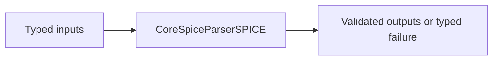
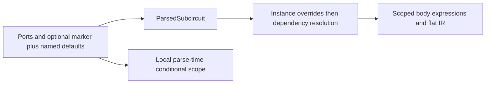
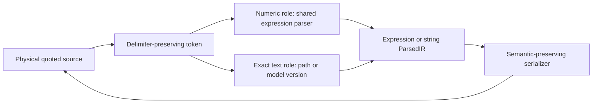
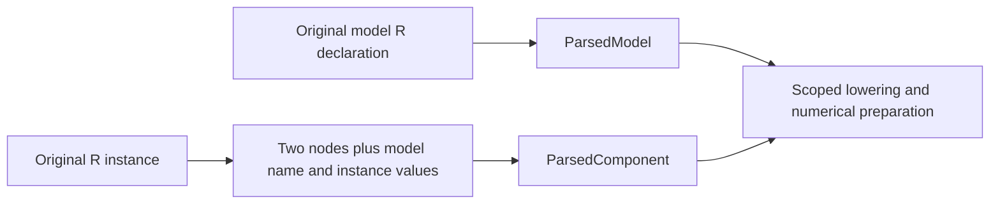

# CoreSpiceParserSPICE

## Purpose and Scope

This SwiftPM module owns the SPICE frontend. Parent: [CoreSpice](../../DESIGN.md). This module has no newly introduced child components.

## Responsibilities and Boundaries

The lexer preserves dotted version literals; parser retains an exact model version string and MOS IC vector coordinates. Numerical model admission remains downstream.

## Related Designs

| Design | Relationship | Contract Used | Summary | Cautions |
|---|---|---|---|---|
| [CoreSpice](../../DESIGN.md) | parent | Package composition | Owned module boundary | Revalidate direct consumers when contracts change |
| [ParsedIR](../CoreSpiceParsedIR/DESIGN.md) | depends on | Resistor declaration and source-role preservation | Syntax output retains model references and values | Declaration admission does not admit a numerical model |
| [Lowering](../CoreSpiceLowering/DESIGN.md) | used by | Scoped resolution and canonical runtime expressions | Parsed resistor intent reaches device preparation | Do not evaluate voltage references in the frontend |
| [Native Devices](../CoreSpiceDevices/Devices/DESIGN.md) | coordinates with | Resistor execution admission | Numerical guarantees belong to the device owner | Unused model parsing is not device qualification |

## Architecture

## Contracts and Invariants

### Resolved source documents

Root and included parsers consume [Parser source documents](../CoreSpiceParser/DESIGN.md).
The returned path, capture identity and library projection travel together; no
second path resolution supplies diagnostic provenance. Model origin records the
actual declaration start and parse-local ordinal. Library blank padding retains
physical lines, including continued statements. Bytes and limits remain [IO-owned](../CoreSpiceIO/DESIGN.md#consumed-source-capture-required-migration).

Continuation lines beginning with a plus after optional whitespace extend the last non-comment logical statement across full-line comments and blank lines. Tokenization folds intervening separators/comments only when a continuation is present; ordinary next statements remain separated and standalone comments remain available. Leading whitespace does not change full-line star-comment semantics. Retained tokens keep their physical source locations, including line and column. This grammar follows the original [ngspice 46 continuation stitcher](https://github.com/imr/ngspice/blob/ngspice-46/src/frontend/inpcom.c#L634-L710) and addresses the comment-interrupted continuations in unchanged Sky130 model cards; model evaluation/version support remains downstream. An unquoted dotted version is not rounded through Double. Numeric contexts reject version literals. MOS OFF is a flag, and IC accepts one to three DS/GS/BS values, defaulting omitted coordinates to zero.

## Subcircuit Header Defaults

The parser owns the SPICE header boundary: ports end at the first identifier followed
by `=`, or at an optional `PARAMS`/`PARAMS:` marker. Both marked and unmarked
headers produce the same `ParsedSubcircuit.parameters` values. The definition
retains numeric, signed, reference and brace-expression defaults; header names
never become ports or body components. All remaining header fields must be named
assignments with values. Missing values/assignment delimiters and malformed values
produce physical-location parser diagnostics instead of dropping fields.

The existing conditional preprocessor consumes the same admitted header defaults,
including logical continuation lines, in the definition's local parameter scope.
It retains its existing parse-time conditional semantics; this change does not
introduce per-instance conditional re-elaboration. Header values and body `.param`
state remain local and do not escape the matching `.ends` boundary. Lowering
remains the owner of instance-over-default precedence and numerical dependency
resolution under its [module contract](../CoreSpiceLowering/DESIGN.md).

The unmarked header in the immutable installed Sky130
`sky130_fd_pr__nfet_g5v0d16v0__subcircuit.pm3.spice:16` is a concrete admission
counterexample; the identical library/deck executed under ngspice. Grammar authority
is the [ngspice parameter manual](https://nmg.gitlab.io/ngspice-manual/circuitdescription/paramparametricnetlists/subcircuitparameters.html).
Its historical default-value warning does not override CoreSpice's verified
instance/default resolver or the current executable oracle; only the unmarked
header grammar is used here.

## Quoted Values and Source Diagnostics

### Confirmed Path and Owned Difference

The native replay of the untouched Sky130 TT library at CoreSpice `6a7e7a7`
fails at `corners/tt/nonfet.spice:4:13`: `cnwvc_tox='41.6503*1.024'`.
The existing lexer collapses both delimiters into a string token. The standalone
expression parser rejects that token, while generic parameter intake retains it
as opaque text. The serializer also emits opaque values with single quotes.
These three paths lose the distinction required by the
[ngspice numeric parameter specification](https://nmg.gitlab.io/ngspice-manual/circuitdescription/paramparametricnetlists/paramline.html).
The frontend owns this repair; ParsedIR already distinguishes expression and
string values, and Lowering consumes those contracts without another parser.

### Contract

- Tokens preserve single-quoted expression versus double-quoted opaque text.
- Numeric expression positions parse the complete single-quoted interior with
  the existing expression grammar, including references and function calls.
  Numeric `.param` positions reject opaque double-quoted text explicitly.
- Generic component, model, subcircuit-default and actual values map
  single-quoted numeric input to `ParsedParameterValue.expression`; they retain
  double-quoted text as `.string`. Conditional preprocessing uses the same
  expression parser through its existing dependency/function evaluator.
- Model `version` and include/library/HDL paths are explicit text roles. Either
  delimiter preserves their exact value; no arithmetic, suffix conversion or
  version normalization selects another model or path. Existing native model
  admission remains authoritative after parsing.
- The structural model `level` consumes a numeric value or a quoted literal,
  validated by exact integer conversion. A supplied nonliteral expression,
  opaque text, fractional or out-of-range value fails explicitly rather than
  silently retaining the default level. This structural role is distinct from
  model parameter expressions evaluated downstream.
- Unknown characters remain visible tokens so complete numeric expression
  parsing rejects quoted trailing invalid characters. The common lexical gate
  rejects unterminated quotes; raw control policy is not expanded by this repair.
- Opaque value serialization uses double quotes and reversible escaping for
  delimiters/backslashes. Expression serialization may retain the existing
  brace representation. Parse/serialize/parse preserves the IR meaning.
- Unterminated quotes, empty numeric interiors, malformed operators and
  unconsumed interior tokens yield `ParserDiagnostic` failures. Diagnostics
  inside quoted expressions retain the original physical file/line/column,
  including continued lines and CRLF. Unclosed text cannot become a success
  value through a partial lexer token or an empty path.
- Bare positional numeric values use the same quoted-expression intake as
  named values. A quoted token cannot be discarded when a positional slot is
  missing; opaque text in a numeric positional slot fails explicitly.
- The existing first-line title is free text, outside quoted-value syntax.
  Common unterminated-quote validation begins after that title is consumed;
  all remaining statements retain the lexical failure gate.
- Each parse owns its token/state lifetime. No new shared state, model backend,
  process policy, unit conversion or geometry bin selection is introduced.

| Requirement | Implementing owner | Behavioral proof |
|---|---|---|
| Numeric quotes and lexical distinction | Lexer, token and expression parser | Quoted AST, full-input rejection, physical errors |
| Canonical intake across actual consumers | SPICE parser and existing conditional evaluator | `.param`, `.model`, header/actual, `.if`, public parse/lower |
| Exact text and persistence | Text-role parser and serializer | Both path delimiters, exact unsupported version, opaque escaping round trip |
| Production admission | Native CLI with unchanged PDK/deck | Next actual failure or result; no model physics qualification inferred |

The package master indexes this child contract. Revalidate the parser target and
public IO consumer tests once after the implementation/test snapshot is frozen.
Lowering/model source remains unchanged; existing exact-version tests are direct
consumer checks rather than proof of new device support.

## Resistor Declaration and Instance Intake

Ambiguous bare identifiers carry `ParsedComponent.resistorModelCandidate`; numeric
braces, quotes and named `r=` values retain an explicit numeric role with no
candidate. Role resolution consumes only that source metadata, never expression
shape. Serializer output preserves an unresolved candidate as its original bare
token so include assembly or later lexical lowering can still resolve it.

`ModelType.resistor` and the resistor source-role intake are implemented.
Forward and scoped declarations resolve after their containing parse completes;
lowering repeats lexical resolution for declarations assembled by include loading.
An unresolved bare symbol remains a resistance expression. A model followed by
`r=` remains an explicit model reference even when the model is unknown.
Numerical execution is admitted separately by the device owner.

The frontend accepts `.model <name> R` as a resistor declaration and preserves
its original named values, expressions and source location. Unused declarations
may be parsed and serialized without executing their model. An unsupported
numerical parameter is retained for downstream admission, never silently dropped
or advertised as supported because the declaration parsed successfully.

For a two-node R instance, a model reference and positional or named resistance
are distinct source roles. A bare symbolic positional resistance remains an
expression when it does not designate a resistor model; scoped/forward model
references must retain `ParsedComponent.modelName`. An explicit named `r=` must
not overwrite or erase that model reference. The parser preserves instance
parameters separately from model declaration parameters; it does not merge
temperature coefficients, apply geometry scale, infer a model from a subcircuit
name, or translate a voltage-dependent R into a synthetic B card. Numeric values
use the existing numeric/quoted-expression grammar. Missing or malformed fields
produce physical-location `ParserDiagnostic` failures.

The model/instance syntax follows the pinned ngspice46
[resistor parser](https://raw.githubusercontent.com/imr/ngspice/ebdaf58ec76a06ffaac7e0f138360dd1cf5ee4b6/src/spicelib/parser/inp2r.c).
Runtime and noise semantics are owned only by the
[Native Devices resistor contract](../CoreSpiceDevices/Devices/DESIGN.md#resistor-execution-contract).
The parser test owner must distinguish unused declaration round trips, numeric
and symbolic positional R, model plus named R, scoped/forward references, and
malformed source diagnostics. Public IO must additionally prove that model
identity survives to binding; parser tests alone do not establish that guarantee.

## State, Ownership, and Lifecycle

Lexer and parser state is local to a parse. Parsed results are owned Sendable values.

## Failure, Concurrency, and Constraints

Malformed version/numeric contexts and invalid IC arity are parser diagnostics; unknown exact versions remain available for typed model admission failure.

## Verification and Change Impact

Public behavioral tests verify marked/unmarked headers, numeric ports, continuation defaults, local conditional scope, malformed-field diagnostics and actual lowering/default override results. Integration tests use the actual parser for quoted/unquoted version, IC and OFF, invalid version, and malformed numeric input. [Parser tests](../../Tests/CoreSpiceParserSPICETests/) verify comment-interrupted continuations through parsed model/parameter values, ordinary statement separation and physical diagnostic locations. Revalidate Lowering when token semantics change; replay unchanged real PDK library inputs through the native CLI to distinguish parser admission from later numerical model support.

## Canonical PWL Source Migration

Parsed numeric vectors preserve alternating PWL time/value values. SPICE PWL syntax
parses and serializes this vector, lowering retains `ParameterValue.realVector`,
and device admission owns strict time/value validation. Partial/unknown source
waveforms produce typed parse/binding failure, never successful DC substitution.
Scalar option/measurement/expression consumers reject vectors explicitly.

### Proposed exact-profile dependency and work contract

Status: proposed migration. Produce the dependency events owned by
[ParsedIR](../CoreSpiceParsedIR/DESIGN.md#proposed-source-dependency-values)
from actual include/library parse branches, preserving original physical positions
and lexical precedence. Local library sections and external library directives
remain distinct. Every active resolution records its returned source document;
missing sources/sections and unresolved required conditional grammar fail.
Repeated inclusion is not a cycle solely because content repeats. Source parsing
and numerical execution remain separate.

The parser accepts a CoreSpice-owned synchronous work/cancellation accounting
interface through its public source-intake path. Charge lexical bytes, tokens,
retained elements, dependency expansions, conditional evaluation and section
materialization before the corresponding work/allocation; check between bounded
chunks. Do not import PDK accounting or silently use an unbounded parser in a
required bounded scope. Existing parser configuration limits remain separate
caller-owned ceilings. The same grammar implements ordinary and exact intake.

Parser tests must reproduce local/external lib, active/inactive/unknown branches,
physical positions, repeated includes, depth/work exhaustion and cancellation.
A successful static source inventory or permissive partial parse does not meet
this contract. The optional PDK adapter translates events only after these checks.
