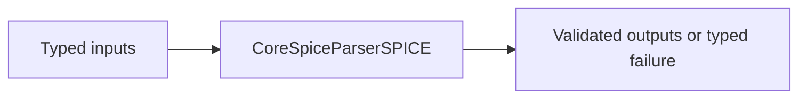

# CoreSpiceParserSPICE

## Purpose and Scope

This SwiftPM module owns the SPICE frontend. Parent: [CoreSpice](../../DESIGN.md). This module has no newly introduced child components.

## Responsibilities and Boundaries

The lexer preserves dotted version literals; parser retains an exact model version string and MOS IC vector coordinates. Numerical model admission remains downstream.

## Related Designs

| Design | Relationship | Contract Used | Summary | Cautions |
|---|---|---|---|---|
| [CoreSpice](../../DESIGN.md) | parent | Package composition | Owned module boundary | Revalidate direct consumers when contracts change |

## Architecture

## Contracts and Invariants

Continuation lines beginning with a plus after optional whitespace form one logical statement; their preceding newline and continuation token are folded during tokenization. An unquoted dotted version is not rounded through Double. Numeric contexts reject version literals. MOS OFF is a flag, and IC accepts one to three DS/GS/BS values, defaulting omitted coordinates to zero.

## State, Ownership, and Lifecycle

Lexer and parser state is local to a parse. Parsed results are owned Sendable values.

## Failure, Concurrency, and Constraints

Malformed version/numeric contexts and invalid IC arity are parser diagnostics; unknown exact versions remain available for typed model admission failure.

## Verification and Change Impact

Integration tests use the actual parser for quoted/unquoted version, IC and OFF, invalid version, and malformed numeric input. Revalidate Lowering when token semantics change.

## Canonical PWL Source Migration

Parsed numeric vectors preserve alternating PWL time/value values. SPICE PWL syntax
parses and serializes this vector, lowering retains `ParameterValue.realVector`,
and device admission owns strict time/value validation. Partial/unknown source
waveforms produce typed parse/binding failure, never successful DC substitution.
Scalar option/measurement/expression consumers reject vectors explicitly.
