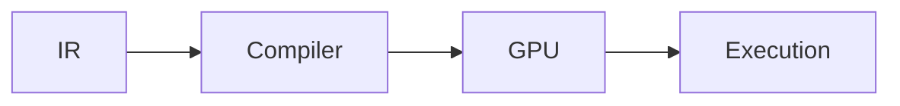

# Photonic Execution

## Purpose and Scope
Child of [PluginsPhotonic](../DESIGN.md); owns the execution responsibility.

## Responsibilities and Boundaries
Own sweep execution, cancellation, finite readback and structured terminal events.

## Related Designs
| Design | Relationship | Contract Used | Summary | Cautions |
|---|---|---|---|---|
| [PluginsPhotonic](../DESIGN.md) | parent | Mesh execution | Module composition | Native Metal only |
| [CoreSpiceBackend](../../CoreSpiceBackend/DESIGN.md) | depends on | Checked CPU/GPU buffer access | Native execution | No CPU fallback |

## Architecture

## Contracts and Invariants
Prepare each coefficient matrix once as eight Float fields directly in retained
GPU storage, with no intermediate packing array. This CPU/GPU boundary conversion
is outside the GPU hot loop and shared by every repetition. Wait for each actual
GPU layer before readback/release. Accumulate in Double and reject non-finite readback or means before completed events. Cancellation after final dispatch is checked before reporting completion.

## Verification and Change Impact
[Photonic tests](../../../Tests/PluginsPhotonicTests) own closed-form coefficients,
actual Metal sweeps, finite aggregation, sizing failures and cancellation behavior.
Changed numerical/ownership assumptions require direct executor integration checks.
