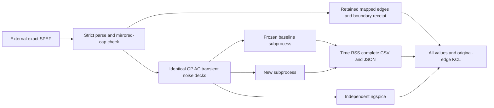

# Sparse PEX Qualification

## Purpose and Scope

Qualify Native CPU sparse execution against retained extracted interconnect and
independent numerical references. Parent: [CoreSpice](../../DESIGN.md#true-sparse-pex-qualification).
No children. The external GPL OpenSTA corpus is not vendored here.

## Responsibilities and Boundaries

Own strict source conversion, explicit electrical test boundaries, retained
edge/source/deck identities, cold subprocess measurements, and complete numerical
comparison. Do not claim original logic-cell behavior, foundry qualification,
Metal, WASM, Embedded, or sparse generalized eigensolving.

## Related Designs

| Design | Relationship | Contract Used | Summary | Cautions |
|---|---|---|---|---|
| [Package](../../DESIGN.md) | parent | True Sparse PEX Qualification | Corpus and acceptance boundary | Replicas are scaling fixtures |
| [Factorization](../../Sources/CoreSpiceCompile/SparseFactorization/DESIGN.md) | depends on | Sparse counts and bounded execution | Actual numerical implementation | Managed bytes are not RSS |
| [Sparse execution](../../Sources/CoreSpiceAnalysis/SparseExecution/DESIGN.md) | depends on | Cumulative run budgets | Native execution | Failures remain failures |

## Architecture

## Contracts and Invariants

`prepare.py` accepts only SHA-256
`775b511037d1b3bd3ed7fc7b85561e7496bef80ff5ee0f65c46842ce7fa9135b`.
The source is OpenSTA commit `dc5ccd2d6941289a6a7d3c918b10b493f44a7f56`,
`examples/gcd_sky130hd.spef`, GPL licensed. Validate PF/OHM units, 288 nets,
1,478 mapped nodes, 1,190 resistors, 1,478 ground caps, 3,208 coupling records
forming exactly 1,604 equal-valued pairs in the two endpoint-owning nets, and 646 sink connections.
CAP coupling endpoint order does not identify the owning net; CONN, ground caps
and resistor connectivity determine ownership. Preserve exact decimal edge sums and verify each declared net capacitance within
the source's decimal rounding. The exact cell-output/port-input CONN node drives
each net. Every other connection gets an explicit 1 megohm sink termination.
Nonuniform DC sources, one AC aggressor with all other drivers AC zero, and finite
PWL transitions excite interconnect and coupling. PWL sources omit redundant
DC tokens: their first PWL value defines the identical DC bias, matching the
exclusive-waveform binding contract while retaining AC amplitude. `prepare.py --work` selects the
retained deck's numerical-work ceiling and records it in `edges.json`; it changes
admission only, not electrical values, tolerances or sampling. Baseline/new timing
comparisons use the identical exported deck, including that explicit ceiling. Zero-valued source caps remain
in edge evidence but are omitted from SPICE device declarations.

Each replica is electrically disconnected from other replicas and retains the
same topology and source pattern. A replicated network measures scaling, not a
larger independent extracted design. Analytic path/grid fixtures use graph
Laplacian eigenmodes and have a separate closed-form reference.

## Runtime Flows

`cold_run.py` launches each executable in a fresh process group through
`/usr/bin/time -l`, saves exact command/executable/deck identities, stdout, stderr,
return status, wall time and peak RSS. After leader completion, remaining owned
process-group members receive SIGKILL even if the leader exited during SIGTERM.
The leader is reaped with a bounded wait; regression verifies an ignoring descendant
cannot survive that path.
The same retained deck, CSV output and JSON/audit settings are supplied to both
executables. Optional CLI-only `--execution-profile` forwards an explicit absolute
profile path and retains its exact byte count/SHA-256 in the runner receipt. Profile
content drift during execution invalidates completion. Default CLI, probe and
ngspice invocation behavior remains unchanged. A refused/timed-out run is never
assigned fabricated timing/results.
`verify.py` reads every CSV row and complex pair, compares every node against
ngspice against the exact complete expected node-voltage and source-current set.
CSV variable identity is the normalized base name; scalar and complex columns
claiming the same variable are rejected in either order before comparison.
OP requires one point, AC requires the complete retained sweep grid, and transient
requires the retained start/end and maximum output gap. Comparisons use matching
coordinates. Transient evidence requires every candidate time to be present in
the oracle; interpolation across PWL derivative corners is not qualification.
`transient_oracle.py` preserves original electrical statement bytes, independently
checks all retained resistor/capacitor/source values against the edge receipt,
and adds an audited isolated 2x2 ideal-source clock block to request those times.
Raw parsing scans and validates every declared point while retaining only the exact
requested candidate times; hashing and CSV row decoding stream their input.
Its two extra variables are excluded only with an audit bound to the candidate,
original/candidate/oracle decks and successful oracle run receipt. The complete
oracle deck must equal the candidate deck plus exactly the declared clock and
strict oracle option lines; unrelated directives cannot alter the reference. Oracle reltol, vntol and abstol are explicit finite positive caller inputs,
recorded in the audit and matched exactly to the appended option line. Existing
defaults remain available for regression fixtures; an oracle precision profile
must be checked for convergence before attributing a numerical discrepancy to
Native. Precision selection never changes physical comparison bounds. `verify.py` evaluates independent original-edge DC/AC KCL at every non-driver node.
Oracle comparison takes separate explicit absolute bounds in volts and amperes,
plus a dimensionless relative bound, and reports separate V/A error maxima.
Probe CSV-reload failures identify metadata, point/CSV line, variable/lane and exact
binary64 values/bits. The default CSV's lossy 15-significant-digit formatting is
checked with `5e-15 * abs(actual) + max(actual.ulp, saved.ulp)` for nonzero values:
the decimal rounding bound plus one binary64 parsing ulp. Actual zero requires
saved zero exactly. This serialization-only bound does not alter simulation or
physical-oracle tolerances. A source-driven Native/prepared/batch regression retains
the observed current boundary `-1.000287244593695e-6` and its exact default CSV
rounding `-1.0002872445937e-6`.
Transient comparison tolerance is explicit and interpolation is refused;
transient KCL is not inferred from derivatives of sampled results. Local discrete
KCL acceptance is distinct from global continuous-time accuracy against the oracle.
Caller calibration preserves electrical bytes and declares convergence/LTE options;
trapezoidal order 2 follows backward-Euler order 1 bootstrap as selected by Analysis.
No per-step runtime order trace is inferred from a configured method alone.

The probe's `--matrix edges.json output.json frequency iterations` mode stamps
retained R/ground-C/coupling-C and ideal-driver MNA directly into CSR, using source
DC values at zero frequency and complex AC values above zero. It factorizes/solves
once cold, then refactorizes the same numeric matrix and solves into the same
caller-owned result for the requested warm iterations. Each measured factor/solve
is followed outside its timing interval by an independent compensated original-CSR
residual check. Original matrix/RHS/solution buffers remain owned by this mode;
solver work/storage admission uses one finite invocation owner. Reports retain
actual kernel fill/capacity/work/cache/pivot/allocation counters at every phase.
Matrix mode excludes Native frontend, device binding and waveform output and is
not end-to-end qualification. Kernel managed payload and external process RSS
remain distinct measurements.

## State, Ownership, and Lifecycle

All outputs go to a caller-selected new directory. Source paths are availability
metadata; content hashes establish identity. Child process groups belong to the
runner until reaped. The Swift probe captures exact source bytes through the
public preparation API, executes a bounded Native run and saves/reloads every
waveform value before publishing its receipt. No global mutable state is added.

## Failure, Concurrency, and Constraints

Malformed topology, ambiguous drivers, mismatched mirrors, missing values,
nonfinite results, invalid subprocess completion and tolerance violations fail
explicitly. The runner is sequential to avoid resource interference. Python
standard library only; the Swift probe uses existing package products. Resource
limits are caller inputs and are reported with measurements.

## Verification and Change Impact

`test_prepare.py` owns malformed-unit/mirror/mapping/driver rejection and original
corpus receipt checks, plus actual small-ngspice forced-time comparison and
rejection of changed electrical bytes/values, hashes, numerical profile, missing
requested times and unrelated oracle variables. Native tests own analytic coupled RC DC/AC/transient/noise,
bounded failure and result ownership. Their source-transform admission is 128 MiB:
the existing frontend preflight includes 4,096 bytes per admitted element and
64 times the source bytes; the 20,000-element fixtures requested 82–88 MiB.
The analytic fixture retains a 64 MiB resolution budget for the simultaneous
compiled source, scalar-slot/job tables and evaluator backing, independently of
Native allocation. The large chain/mesh test admits 128 MiB of Native allocation:
current preparation plus two coexisting topology buffers requires 81,004,544 bytes
for 501 nodes / 2,503 devices and 115,271,680 bytes for 529 nodes / 3,611 devices.
The bound follows the preparer's actual local triplet/extent formulas and is
separate from the solver's actual managed-capacity admission. The probe uses one eighth of caller-admitted bytes for each
frontend resolution ledger (256 MiB at a 2 GiB invocation) and reports that
selection; it has no fixed 64 MiB cap. Optional probe-only `--live-bytes`
selects a separate source/live-owned ceiling and records it independently; Native
allocation, temporary storage and resolution ceilings retain their existing
selection from the original admitted-byte argument. The five-argument default
continues to use the admitted-byte value for live-owned storage. These caller admissions do not change
numerical limits or tolerances. CLI tests own source-driven batch/prepared
CSV and JSON save/reload. Large external-input benchmarks run separately with
explicit process timeouts; their evidence applies only to measured cases.

Measured results and reproducible identities are recorded in the
[Native CPU qualification report](../../docs/sparse-pex-qualification.md). This is
an evidence record; the contracts above remain authoritative.
